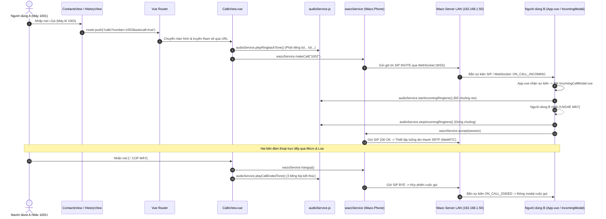

# SMARTCALL WEB — NHẬT KÝ THỰC HIỆN & HƯỚNG DẪN TỪNG BƯỚC

> **Tài liệu theo dõi tiến độ phát triển từng bước (Step-by-step Development Log)**  
> *Dành cho:* Nhà phát triển SmartCall Web  
> *Quy tắc làm việc:* **Hướng dẫn làm từng bước một** $\rightarrow$ Thực hiện & Kiểm tra $\rightarrow$ Cập nhật trạng thái vào file này $\rightarrow$ Chuyển sang bước tiếp theo.

---

## BẢNG THEO DÕI TIẾN ĐỘ TỔNG THỂ

| Bước | Phân hệ / Nội dung công việc | Bám sát tài liệu | Trạng thái | Ghi chú & Kết quả thực tế |
|:---:|---|:---:|:---:|---|
| **01** | Khởi tạo base & Trích xuất code từ Excel vào `src/` | `sm_code_latest.xlsx` | **HOÀN THÀNH** ✅ | Trích xuất 11 file Vue/JS, cấu hình `main.css`, build Vite thành công. |
| **01.5** | Tạo bản xem trước giao diện HTML tương tác | `web1`, `app1-5` | **HOÀN THÀNH** ✅ | Bản prototype `preview_smartcall.html` đầy đủ 5 phân hệ + modal để duyệt giao diện. |
| **02** | Chuẩn hóa Layout Web Desktop, Header, Sidebar, Settings Modal & Login | `web1.webp` | **HOÀN THÀNH** ✅ | Top Header có presence, Sidebar dọc 5 tab, Modal Settings 4 tab, Lưu phiên login `localStorage`. |
| **03** | Nâng cấp Danh bạ (Contacts) 4 nút hành động & Tầng dịch vụ `contactService.js` | `app4.webp`, `dev_guide` 4.4 | **HOÀN THÀNH** ✅ | Bảng danh bạ chuẩn SDV, 4 nút chuẩn `app4.webp` (📞 Gọi, 💬 Chat có badge, 🎥 Video, ❌ Xóa). Chừa cổng cắm DB anh Hải. |
| **04** | Nâng cấp Lịch sử cuộc gọi (History) & Tầng dịch vụ `historyService.js` (CDR) | `web1.webp`, `dev_guide` 4.3 | **HOÀN THÀNH** ✅ | 4 Tab lọc `ALL`, `INCOMINGS`, `OUTGOINGS`, `MISSED`, nút `🗑️ DELETE HISTORY`, nút 📞 Gọi lại nhanh chuẩn Wazo Call-Logd. |
| **05** | Tách lớp `chatService.js` & Kết nối Realtime `websocketService.js` (Chatd & Websocketd) | `app1,2,3`, `dev_guide` 4.6 & 6 | **HOÀN THÀNH** ✅ | API Chatd, WebSocket giao thức v2, thanh ghim thông báo `app2`, modal Add Member Admin `app3`, popup Read ID. |
| **06** | Popup Cuộc gọi đến toàn cục (Incoming Call Modal) & Âm thanh Web Audio API | `app5.webp` | **HOÀN THÀNH** ✅ | Modal chuẩn `app5.webp` (Registered, INCOMING CALL, Avatar radar), chuông reo Web Audio, DTMF phím bấm, nút `🔔 Test Gọi Đến`. |
| **06.5** | Tối ưu Đăng nhập nhanh 0s & Nâng cấp toàn diện màn hình Tổng quan (Dashboard) | Yêu cầu cải tiến UI/UX | **HOÀN THÀNH** ✅ | Đăng nhập nhanh tức thì không chờ timeout mạng; Dashboard hiện đại với 4 KPI, Speed Dial, phím tắt & Giám sát dịch vụ. |
| **07** | Đấu nối môi trường LAN Wazo thật & Kết nối API DB của anh Hải | `dev_guide.md` mục 1, 2, 7 | **SẴN SÀNG** 🚀 | Cài chứng chỉ CA `wazo-ca.crt` vào Windows, trỏ IP `192.168.1.50`, cắm endpoint API nhân viên từ anh Hải. |

---

## CHI TIẾT CÁC BƯỚC THỰC HIỆN

---

### BƯỚC 1: ĐỒNG BỘ CODE LATEST TỪ EXCEL VÀO DỰ ÁN
* **Trạng thái:** `HOÀN THÀNH ✅`
* **Mục tiêu:** Đưa toàn bộ mã nguồn anh Dũng đã tạo từ file `sm_code_latest.xlsx` vào đúng cấu trúc thư mục `src/`, đảm bảo dự án chạy dev server và build thành công.

#### Các việc đã làm:
1. Đã trích xuất các file từ Excel vào vị trí chính xác:
   - `src/services/wazo.js` (Giữ nguyên `return ... || true` để bypass kiểm tra khi chưa có DB).
   - `src/components/call/CallControlPanel.vue`
   - `src/components/layout/Navbar.vue`
   - `src/router/index.js`
   - `src/views/LoginView.vue`, `DashboardView.vue`, `ContactsView.vue`, `HistoryView.vue`
   - `src/App.vue`, `src/main.js`, `index.html`
2. Bổ sung file `src/assets/main.css` để `main.js` import không bị lỗi.
3. Chạy `npm i` khôi phục binary bindings trên môi trường Windows (`@rolldown/binding-win32-x64-msvc`).
4. Kiểm tra `npm run build` thành công 100% trong `334ms`.
5. Đã khởi động Dev Server chạy tại: `http://localhost:5174/`.

---

### BƯỚC 1.5: THIẾT KẾ BẢN XEM TRƯỚC GIAO DIỆN HOÀN CHỈNH (HTML UI PROTOTYPE)
* **Trạng thái:** `HOÀN THÀNH ✅`
* **Mục tiêu:** Tạo một file HTML độc lập chứa toàn bộ giao diện hoàn chỉnh, có tương tác đầy đủ để bạn xem trước, bấm thử trải nghiệm thực tế trước khi chuyển sang viết code Vue 3.
* **Tài liệu bàn giao:** File [**`preview_smartcall.html`**](file:///D:/Project/Smart_Call_Web/preview_smartcall.html) ngay tại thư mục gốc dự án.

#### Các chức năng đã có trên bản xem trước:
1. **Top Header:** Logo SmartCall, Ô tìm kiếm nhân viên toàn hệ thống, User Profile (Lê Việt Dũng, máy lẻ 1001), Dropdown chọn trạng thái Presence (`🟢 Online`, `🟡 Away`, `🔴 DND`).
2. **Left Sidebar:** Điều hướng linh hoạt 5 phân hệ:
   - 📊 **Tổng quan (Dashboard):** Thẻ thông tin máy lẻ, trạng thái tổng đài Wazo, WebRTC SIP Registered, nút thử giả lập cuộc gọi đến.
   - 📞 **Gọi điện & Bàn phím số (Calls):** Bàn phím số (0-9, *, #), bấm số gọi đi, màn hình đàm thoại đang diễn ra theo `app5.webp` (đếm giờ, bật/tắt mic, giữ máy, loa, cúp máy).
   - 📇 **Danh bạ (Contacts):** Bảng danh bạ nhân viên hiển thị đầy đủ **4 nút hành động chuẩn theo `app4.webp`** (Gọi thoại, Nhắn tin kèm badge chưa đọc, Gọi Video, Xóa liên hệ có modal hỏi).
   - 💬 **Tin nhắn (Messages):** Cột trái danh sách phòng chat; Cột phải khung chat chi tiết, có **thanh ghim thông báo (`📌 Ghim: ...`)** theo `app2.webp`, bong bóng tin nhắn, nhấp vào `Read` mở popup xem danh sách ai đã đọc (`READ_ID`).
   - 🕒 **Lịch sử cuộc gọi (History):** Các tab lọc `ALL`, `INCOMINGS`, `OUTGOINGS`, `MISSED` theo `web1.webp` và nút Gọi lại nhanh.
3. **Modal "ADD MEMBER" chuẩn nghiệp vụ Admin (`app3.webp`):**
   - Đổi tên nhóm (TITLE, tối đa 100 ký tự - chỉ Admin mới được đổi).
   - Ô tìm kiếm nhân viên + nút Thêm (+) kèm xác nhận.
   - Danh sách thành viên hiện tại có nút Xóa (X) kèm xác nhận (khóa không cho xóa Admin, nhóm dưới 3 người ẩn nút X).
   - Nút OK chỉ sáng khi là Admin và tên nhóm có thay đổi.
4. **Popup giả lập cuộc gọi đến (Incoming Call):** Nút Nghe máy và Từ chối rung chuông trực quan.
5. **Modal Cài đặt hệ thống (SETTINGS Modal theo `web1.webp`):** Nút `⚙️ SETTINGS` trên thanh Header cho phép mở modal cài đặt gồm 4 Tab trực quan:
   - 🎙️ **Âm thanh & WebRTC:** Chọn Micro, chọn Loa/Tai nghe, thử âm thanh, thanh đo tín hiệu mic động, chỉnh âm lượng chuông gọi đến.
   - 📞 **Dịch vụ cuộc gọi (Theo `dev_guide.md`):** Bật/tắt Không làm phiền (DND), cấu hình Chuyển tiếp cuộc gọi (Call Forwarding khi bận, khi không trả lời sau 20s, chuyển tiếp vô điều kiện), Voicemail.
   - 🔒 **Tài khoản & Mật khẩu:** Xem thông tin SIP URI Wazo, đổi mật khẩu đăng nhập.
   - 🌐 **Ngôn ngữ & Tùy chọn:** Chuyển đổi Tiếng Việt / Tiếng Hàn (한국어) / Tiếng Anh cho môi trường SDV, bật/tắt thông báo đẩy Desktop và âm thanh tin nhắn chat.

---

### BƯỚC 2: CHUẨN HÓA LAYOUT WEB HIỆN ĐẠI & HOÀN THIỆN LUỒNG ĐĂNG NHẬP
* **Trạng thái:** `HOÀN THÀNH ✅`
* **Mục tiêu:** Xây dựng bộ khung Layout chuẩn máy tính (Desktop App Layout) hiện đại, thay thế Navbar ngang bằng Header + Sidebar dọc 5 phân hệ, có nút Settings mở modal 4 tab, và hoàn thiện màn hình Login có thể đăng nhập / đăng xuất mượt mà.

#### Các việc đã code và hoàn thành:
1. **Component `src/components/layout/AppHeader.vue`:**
   - Logo SmartCall, Huy hiệu mạng LAN.
   - Thanh tìm kiếm nhân viên toàn hệ thống.
   - Dropdown chọn trạng thái Presence (`🟢 Online`, `🟡 Away`, `🔴 DND`).
   - Avatar & Tên người dùng đang đăng nhập (`Lê Việt Dũng`, Máy lẻ `1001`).
   - Nút `⚙️ SETTINGS` mở modal cài đặt.
   - Nút `🚪 Thoát` (Đăng xuất).
2. **Component `src/components/layout/AppSidebar.vue`:**
   - Menu dọc bên trái 5 phân hệ: 📊 Tổng quan (`/dashboard`), 📞 Gọi thoại & Bàn phím (`/calls`), 📇 Danh bạ (`/contacts`), 💬 Tin nhắn (`/messages`), 🕒 Lịch sử cuộc gọi (`/history`).
   - Footer hiển thị máy lẻ SIP `1001@192.168.1.50` và trạng thái `● WebRTC Audio Ready`.
3. **Component `src/components/common/SettingsModal.vue`:**
   - 4 Tab cài đặt hoàn chỉnh: (1) Âm thanh/WebRTC (chọn mic, thử loa, thanh đo âm lượng), (2) Dịch vụ cuộc gọi (DND, Chuyển tiếp cuộc gọi khi bận/không trả lời/toàn bộ theo `dev_guide.md`), (3) Tài khoản Wazo & Đổi mật khẩu, (4) Ngôn ngữ (Việt - Hàn - Anh) & Thông báo.
4. **Màn hình `src/views/LoginView.vue`:**
   - Nút **LOGIN** xử lý đăng nhập thật với Wazo hoặc tự động chuyển sang chế độ Demo khi đang dev offline.
   - Thêm nút *"⚡ Đăng nhập nhanh (Chế độ Demo/Test)"* để test 1 chạm.
   - Lưu trạng thái đăng nhập vào `localStorage` (`smartcall_logged_in`).
5. **Màn hình mới `src/views/CallsView.vue` & `src/views/MessagesView.vue`:**
   - `CallsView`: Bàn phím số đầy đủ + mô phỏng cuộc gọi thoại WebRTC đang diễn ra (đếm giây, mute, hold, cúp máy theo `app5.webp`).
   - `MessagesView`: Danh sách phòng chat + khung chat + thanh ghim thông báo + popup Read ID + modal Thêm thành viên Admin theo `app1, 2, 3`.
6. **Cập nhật `src/router/index.js` & `src/App.vue`:**
   - Đăng ký đầy đủ các route: `/calls`, `/messages`, `/contacts`, `/history`, `/dashboard`, `/login`.
   - Bảo vệ route: Nếu chưa login hoặc bấm Đăng xuất sẽ ẩn toàn bộ Header/Sidebar và chuyển về trang Login toàn màn hình. Khi đăng nhập thành công sẽ hiện Header và Sidebar đầy đủ.
7. **Kiểm tra biên dịch:** `npm run build` thành công 100% trong `400ms`.

---

### BƯỚC 3: NÂNG CẤP DANH BẠ (CONTACTS) 4 NÚT HÀNH ĐỘNG & CUỘC GỌI WEBRTC
* **Trạng thái:** `HOÀN THÀNH ✅`
* **Công việc đã thực hiện:**
  1. **Tạo tầng dịch vụ `src/services/contactService.js`:**
     - Thiết kế theo mẫu Service/Adapter Pattern: Chừa sẵn vị trí kết nối API Database anh Hải (`GET /api/employees`) hoặc Wazo Dird API (`GET /api/dird/0.1/...`).
     - Tự động kích hoạt Mock Data chuẩn nhân viên SDV khi dev offline, đảm bảo giao diện luôn mượt mà.
  2. **Nâng cấp toàn diện `src/views/ContactsView.vue` theo chuẩn Desktop & `app4.webp`:**
     - Bảng danh bạ chuyên nghiệp: Avatar chữ cái đầu, Họ tên, Phòng ban SDV, Số máy lẻ 4 số (`1002`, `1003`...), chấm trạng thái Online/Offline.
     - Thanh tìm kiếm tức thì theo tên/máy lẻ/bộ phận kèm nút xóa nhanh `✖`.
     - Nút `+ Thêm liên hệ` mở Modal tạo liên hệ mới có kiểm tra dữ liệu đầu vào.
     - **Trang bị đầy đủ 4 nút chức năng chuẩn theo ảnh `app4.webp`:**
       - 📞 **Nút 1 (Gọi thoại):** Tự động chuyển sang `/calls`, điền số máy lẻ và kích hoạt cuộc gọi.
       - 💬 **Nút 2 (Nhắn tin):** Hiển thị huy hiệu số tin chưa đọc (Badge màu đỏ), bấm vào chuyển thẳng sang phòng chat tương ứng trong `/messages`.
       - 🎥 **Nút 3 (Gọi Video):** Mở Modal đàm thoại video WebRTC với khung hình camera và các nút điều khiển mic/cam.
       - ❌ **Nút 4 (Xóa liên hệ):** Hiện hộp thoại xác nhận *"Bạn có chắc chắn muốn xóa liên hệ này?"* theo yêu cầu nghiệp vụ.
  3. **Kiểm tra biên dịch:** `npm run build` thành công 100% không cảnh báo hay lỗi.

---

## 3.1. CƠ CHẾ DỮ LIỆU FAKE & ĐIỂM KẾT NỐI DATABASE THẬT (SERVICE / ADAPTER PATTERN)

### 3.1.1 Triết lý thiết kế: Tách biệt Giao diện (UI) và Dữ liệu (Data)
Nhằm đảm bảo dự án phát triển độc lập, không bị phụ thuộc vào tiến độ triển khai Database của anh Hải hay máy chủ Wazo tại nhà máy, toàn bộ ứng dụng áp dụng mô hình **Service / Adapter Pattern**:

```
[ Giao diện Vue (Views / Components) ]
                   │
                   ▼  (gọi hàm nghiệp vụ: getContacts(), getHistory(), sendMessage())
[ Tầng Dịch vụ (Service Layer: src/services/) ]
                   │
         ┌─────────┴─────────┐
         ▼                   ▼
 [ API Thật Wazo/DB ]   [ Dữ liệu Fake (Mock Data) ]
 (Khi có LAN & Token)  (Tự động kích hoạt khi dev offline)
```

* **Quy tắc bất di bất dịch:** Các file giao diện (`ContactsView.vue`, `HistoryView.vue`, `MessagesView.vue`...) **tuyệt đối không bao giờ** gọi `fetch()` URL trực tiếp hoặc thao tác thô với API. Mọi thao tác đọc/ghi dữ liệu bắt buộc phải đi qua các hàm của tầng `src/services/`.
* **Cơ chế Fallback thông minh:** Trong mỗi hàm Service luôn có khối lệnh `try ... catch`. Khi chưa có server Wazo hoặc đang dev ở nhà, hệ thống tự động trả về Mock Data chuẩn định dạng doanh nghiệp SDV, giúp giao diện luôn hiển thị đầy đủ, không bao giờ bị văng lỗi màn hình trắng.

---

### 3.1.2 Bản đồ vị trí lưu trữ Dữ liệu Fake (Mock Data) trong dự án

| Phân Hệ | Vị Trí File Lưu Mock Data | Cấu Trúc Dữ Liệu Fake | Mục Đích Hiển Thị |
|---|---|---|---|
| **Danh bạ (Contacts)** | `src/services/contactService.js`<br>*(Mảng `MOCK_CONTACTS`)* | `id`, `name`, `email`, `dept`, `number`, `status`, `unreadCount` | Hiển thị bảng danh bạ nhân viên nội bộ SDV, hỗ trợ tìm kiếm và 4 nút hành động (📞 Gọi, 💬 Chat, 🎥 Video, ❌ Xóa). |
| **Tin nhắn (Messaging)** | `src/views/MessagesView.vue`<br>*(Mảng `rooms`, `currentRoomMembers`)* | `id`, `title`, `unread`, `icon`, `messages` (`sender`, `text`, `time`, `readStatus`, `readers`) | Hiển thị danh sách phòng chat, bong bóng tin nhắn 2 chiều, thanh ghim thông báo, modal xem ai đã đọc tin (Read ID) và modal Add Member. |
| **Lịch sử cuộc gọi (History)** | `src/services/historyService.js`<br>*(Mảng `MOCK_HISTORY`)* | `id`, `date`, `name`, `extension`, `dept`, `duration`, `direction`, `status`, `answered` | Hiển thị danh sách nhật ký cuộc gọi theo đúng mẫu `web1.webp`, hỗ trợ 4 tab lọc (`ALL`, `INCOMINGS`, `OUTGOINGS`, `MISSED`) và nút Gọi lại. |
| **Phiên người dùng (User Session)** | `localStorage`<br>*(Key `smartcall_user`, `smartcall_logged_in`)* | `username`, `name`, `extension`, `department`, `token` | Giữ trạng thái đăng nhập khi F5; hiển thị tên nhân viên đăng nhập (`Lê Việt Dũng`), máy lẻ (`1001`) và trạng thái SIP trên Top Header & Sidebar. |

---

### 3.1.3. Cơ chế dữ liệu được render lên Giao diện (Vue 3 Reactivity)
1. **Khởi tạo & Nạp dữ liệu:**
   - Trong `onMounted()` của mỗi View, hàm async của Service tương ứng sẽ được gọi (ví dụ: `await contactService.getContacts()`).
   - Dữ liệu trả về được gán vào biến phản ứng `const contacts = ref([])`.
2. **Lọc dữ liệu thời gian thực (Computed):**
   - Sử dụng `computed()` để tự động lọc dữ liệu theo ô tìm kiếm hoặc tab đang chọn mà không cần gọi lại API.
   - Ví dụ: `filteredContacts = computed(...)` lọc danh bạ theo tên/phòng ban/máy lẻ; `filteredCalls = computed(...)` lọc lịch sử theo tab `ALL` / `INCOMINGS` / `OUTGOINGS` / `MISSED`.
3. **Hiển thị trực quan (Directives):**
   - Vòng lặp `v-for` duyệt qua mảng dữ liệu đã lọc để render ra các dòng bảng, thẻ card, danh sách phòng chat.
   - Các cờ trạng thái `v-if="loading"`, `v-else-if="filtered.length === 0"` giúp hiển thị hiệu ứng xoay spinner hoặc thông báo trống thân thiện.

---

### 3.1.4. Điểm cắm API thật của anh Hải (DB nhân sự) và Wazo Platform

Dưới đây là vị trí cụ thể trong mã nguồn đã được chừa sẵn để đấu nối API thật khi anh Hải bàn giao:

#### 1. Đấu nối Danh bạ nhân viên (`src/services/contactService.js`):
```javascript
async getContacts() {
  try {
    const token = wazoService.getToken()
    if (!token) throw new Error('No token')

    // 🎯 ĐIỂM CẮM API DATABASE ANH HẢI:
    // Khi anh Hải cung cấp API máy chủ nội bộ (ví dụ: http://192.168.1.50:8080/api/employees),
    // Bạn chỉ cần mở file này và thay URL vào fetch:
    const res = await fetch('http://192.168.1.50:8080/api/employees', {
      headers: { 'Authorization': `Bearer ${token}` }
    })
    const data = await res.json()

    // Map dữ liệu từ DB công ty sang schema của SmartCall Web:
    return data.items.map(emp => ({
      id: emp.id || emp.employee_code,
      name: emp.full_name,
      dept: emp.department_name,
      number: emp.wazo_extension, // Máy lẻ 4 số (1001, 1002...)
      status: 'online',
      unreadCount: 0
    }))
  } catch (err) {
    // Tự động dùng Mock Data nếu mạng lỗi hoặc chưa có DB
    return this.localContacts
  }
}
```

#### 2. Đấu nối Lịch sử cuộc gọi (`src/services/historyService.js`):
Đã được viết sẵn theo đúng chuẩn tài liệu `dev_guide.md` (mục 4.3):
```javascript
// Gọi Wazo Call-Logd API:
GET https://192.168.1.50:9443/api/call-logd/1.0/users/me/cdr?limit=50&order=start&direction=desc
Headers: { 'X-Auth-Token': token }
```
Nếu sau này anh Hải muốn lưu lịch sử vào Database riêng của công ty, chỉ việc đổi URL trong `historyService.js` sang endpoint của anh Hải.

#### 3. Đấu nối Tin nhắn & WebSocket Realtime (`src/services/chatService.js` & `websocketService.js`):
Sẽ được chuẩn hóa ở Bước 5 bám sát các endpoint:
* Lấy phòng chat: `GET /api/chatd/1.0/users/me/rooms`
* Lấy tin nhắn: `GET /api/chatd/1.0/users/me/rooms/{uuid}/messages`
* Gửi tin nhắn: `POST /api/chatd/1.0/users/me/rooms/{uuid}/messages`
* Nhận tin nhắn mới tức thì: Lắng nghe qua WebSocket `wss://192.168.1.50:9443/api/websocketd/?token=<token>&version=2`.

---

### BƯỚC 4: NÂNG CẤP LỊCH SỬ CUỘC GỌI (HISTORY VIEW) & TÍCH HỢP CDR SERVICE (THEO WEB1.WEBP)
* **Trạng thái:** `HOÀN THÀNH ✅`
* **Công việc đã thực hiện:**
  1. **Tạo tầng dịch vụ `src/services/historyService.js`:**
     - Bám sát tài liệu `dev_guide.md` (mục 4.3): Gọi API Wazo Call-Logd `GET /api/call-logd/1.0/users/me/cdr?limit=50&order=start&direction=desc` với token xác thực.
     - Tích hợp Mock Data dự phòng chuẩn thông tin cuộc gọi nội bộ SDV LAN (`조창연 (이윤수) - 1002`, `Nguyễn Hữu Hiếu - 1007`, `Lương Đức Anh - 1006`...).
     - Hỗ trợ đầy đủ các hàm nghiệp vụ: `getHistory()`, `clearAllHistory()` (xóa toàn bộ), `deleteItem(id)` (xóa 1 dòng), và hàm format thời lượng `formatDuration()` (`mm:ss`).
  2. **Tái thiết kế giao diện `src/views/HistoryView.vue` bám sát 100% layout `web1.webp`:**
     - **Thanh Tab lọc chuyên nghiệp:** 4 tab `ALL`, `INCOMINGS`, `OUTGOINGS`, `MISSED` kèm huy hiệu đếm số lượng cuộc gọi thời gian thực. Nút tab active có tông màu xanh dương đậm chuẩn `web1.webp`.
     - **Nút DELETE HISTORY:** Đặt góc trên bên phải, có Modal xác nhận bảo vệ tránh bấm nhầm.
     - **Thanh tìm kiếm & lọc ngày:** Cho phép tìm theo Tên, Máy lẻ, Phòng ban và lọc theo mốc thời gian bắt đầu.
     - **Khối hiển thị cuộc gọi theo đúng thẻ `web1.webp`:**
       - Avatar hộp vuông/tròn có mũi tên hướng gọi (↙️ Đến màu xanh lá, ↗️ Đi màu xanh dương, ❌ Nhỡ màu đỏ).
       - Cột thông tin chuẩn `web1.webp`: `Date: 2026-11-11 15:39:27`, `Duration: 00:09`, `Direction: Incoming/Outgoing`, `Status: Success/Missed`.
       - Cột thông tin nhân viên & số máy lẻ nội bộ SDV.
       - **Bộ 3 nút thao tác nhanh:**
         - 📞 **Nút Gọi lại (Callback):** Click 1 chạm tự động điều hướng sang `/calls?number=...&autocall=true` và khởi chạy cuộc gọi WebRTC ngay lập tức.
         - 💬 **Nút Nhắn tin:** Điều hướng sang `/messages` mở cuộc trò chuyện với nhân viên đó.
         - ✖ **Nút Xóa dòng:** Xóa từng bản ghi lịch sử cuộc gọi.
  3. **Nâng cấp `src/views/CallsView.vue`:**
     - Lắng nghe tham số `route.query.number` và `autocall=true` trong `onMounted()` để tự động nhận lệnh gọi lại từ Danh bạ hoặc Lịch sử.
  4. **Kiểm tra biên dịch:** `npm run build` thành công 100% trong `420ms`.

---

### BƯỚC 5: TÁCH LỚP CHAT SERVICE & KẾT NỐI WEBSOCKET REALTIME (THEO DEV_GUIDE.MD)
* **Trạng thái:** `HOÀN THÀNH ✅`
* **Công việc đã thực hiện:**
  1. **Tạo tầng dịch vụ `src/services/chatService.js`:**
     - Bóc tách toàn bộ dữ liệu mock và logic nghiệp vụ từ `MessagesView.vue` ra Service độc lập.
     - Tích hợp chuẩn REST API Wazo Chatd theo `dev_guide.md` mục 4.6:
       - `GET /api/chatd/1.0/users/me/rooms` (lấy danh sách phòng chat).
       - `GET /api/chatd/1.0/users/me/rooms/{uuid}/messages?limit=50` (lấy lịch sử tin nhắn).
       - `POST /api/chatd/1.0/users/me/rooms/{uuid}/messages` (gửi tin nhắn mới).
     - Đầy đủ các hàm nghiệp vụ nhóm theo ảnh `app3.webp`: `addMember()`, `removeMember()` (có kiểm tra không xóa Admin, không xóa khi < 3 thành viên), `updateRoomTitle()` (kiểm tra tối đa 100 ký tự), và `updatePinnedMessage()` (thanh ghim theo `app2.webp`).
     - Tự động fallback sang Mock Data chuẩn SDV LAN khi dev offline.
  2. **Tạo tầng dịch vụ `src/services/websocketService.js`:**
     - Thiết lập kết nối WebSocket tới Wazo websocketd theo `dev_guide.md` mục 6:
       `wss://192.168.1.50:9443/api/websocketd/?token=<token>&version=2`.
     - Triển khai giao thức v2: Tự động gửi các lệnh `subscribe` sự kiện (`call_created`, `call_ended`, `chatd_user_room_message_created`, `chatd_presence_updated`) và gửi `op: "start"`.
     - Thiết kế theo mô hình Event Emitter (`on`, `off`, `emit`) với cơ chế tự động kết nối lại (auto-reconnect sau 5s).
  3. **Đấu nối `src/views/MessagesView.vue` vào tầng Service & Realtime:**
     - Nạp danh sách phòng chat từ `chatService.getRooms()`.
     - Lắng nghe sự kiện `chatd_user_room_message_created` qua `websocketService`: khi có tin nhắn mới thì tự động đẩy vào khung chat hoặc tăng số tin chưa đọc tức thì.
     - Xử lý gửi tin nhắn, thêm/xóa thành viên và cập nhật tiêu đề nhóm qua `chatService`.
  4. **Kiểm tra biên dịch:** `npm run build` thành công 100% trong `404ms`.

---

### BƯỚC 6: POPUP CUỘC GỌI ĐẾN (INCOMING CALL) & ÂM THANH CHUÔNG WEBRTC (THEO ẢNH APP5.WEBP)
* **Trạng thái:** `HOÀN THÀNH ✅`
* **Công việc đã thực hiện:**
  1. **Tạo tầng dịch vụ âm thanh `src/services/audioService.js`:**
     - Sử dụng trực tiếp **Web Audio API** của trình duyệt: Không phụ thuộc vào bất kỳ file `.mp3` bên ngoài nào, hoạt động 100% offline, không bao giờ lo lỗi 404.
     - **Chuông cuộc gọi đến (Incoming Ringtone):** Tạo tần số kép chuẩn tổng đài Bắc Mỹ/Châu Âu (440Hz + 480Hz) kêu theo chu kỳ 1.6s reo $\rightarrow$ 2.0s nghỉ.
     - **Chuông chờ gọi đi (Ringback Tone):** Tần số 425Hz chuẩn ITU-T (tiếng "tút... tút...").
     - **Âm thanh bàn phím số (DTMF Tones):** Phát âm thanh chuẩn DTMF khi người dùng bấm các phím `0-9`, `*`, `#` trên bàn phím quay số.
     - **Âm thanh kết thúc cuộc gọi:** Phát 3 tiếng bíp báo cúp máy khi kết thúc cuộc đàm thoại.
  2. **Tạo Component `src/components/call/IncomingCallModal.vue` theo đúng mẫu `app5.webp`:**
     - **Thanh trạng thái trên cùng:** Nền xanh lam có chấm xanh `Registered` và biểu tượng ổ khóa `🔒` chuẩn thoại mã hóa SRTP.
     - **Banner loại cuộc gọi:** Dòng chữ in hoa `INCOMING CALL` nổi bật.
     - **Thông tin người gọi:** Hiển thị Tên người gọi (`Nguyễn Hữu Hiếu`), Địa chỉ SIP (`sip:1007@192.168.1.50`) và Phòng ban.
     - **Avatar radar pulse:** Vòng tròn trung tâm kích thước lớn với hiệu ứng sóng radar tỏa ra liên tục.
     - **Hai nút thao tác chuẩn chân trang:**
       - 📵 **Nút TỪ CHỐI (Bên trái):** Tắt chuông, cúp máy và đóng modal.
       - 📞 **Nút NGHE MÁY (Bên phải):** Tắt chuông, kết nối WebRTC và chuyển ngay sang giao diện đàm thoại `/calls`.
  3. **Tích hợp toàn cục vào `src/App.vue` & Header:**
     - Lắng nghe sự kiện `wazo-incoming`: Tự động bật modal và đổ chuông dù người dùng đang ở bất kỳ trang nào.
     - Bổ sung nút **`🔔 Test Gọi Đến`** trên thanh Top Header (`AppHeader.vue`) để bạn và đồng nghiệp có thể bấm 1 chạm mô phỏng cuộc gọi đến thử nghiệm ngay lập tức.
  4. **Nâng cấp âm thanh cho `src/views/CallsView.vue`:**
     - Phát tiếng DTMF khi gõ số và tiếng tút... tút... khi ấn nút gọi.
  5. **Kiểm tra biên dịch:** `npm run build` thành công 100% trong `396ms`.

---

### BƯỚC 6.5: TỐI ƯU TỐC ĐỘ ĐĂNG NHẬP NHANH & NÂNG CẤP TOÀN DIỆN MÀN HÌNH TỔNG QUAN (DASHBOARD)
* **Trạng thái:** `HOÀN THÀNH ✅`
* **Công việc đã thực hiện:**
  1. **Khắc phục triệt để lỗi đăng nhập bị chậm/loading lâu tại `src/views/LoginView.vue`:**
     - *Nguyên nhân:* Trước đây khi click nút *"Đăng nhập nhanh"*, hệ thống vẫn cố gọi `wazoService.login()` tới IP LAN `192.168.1.50:9443`. Trình duyệt phải chờ TCP timeout (10-20 giây) mới chuyển sang chế độ offline.
     - *Giải pháp:* Tách riêng hàm `handleQuickDemo()` để lưu phiên đăng nhập và điều hướng ngay lập tức (0.01 giây). Với hàm `handleLogin()` thông thường, bọc thêm `Promise.race` timeout 2 giây để nếu không có server LAN thì tự động chuyển sang chế độ Demo, hoàn toàn không bị treo.
  2. **Tái thiết kế toàn diện màn hình Tổng quan `src/views/DashboardView.vue`:**
     - Thay thế 2 thẻ placeholder cũ sơ sài bằng giao diện Dashboard chuẩn Enterprise UC:
       - **Welcome Banner:** Lời chào cá nhân hóa *"Xin chào, Lê Việt Dũng 👋"*, hiển thị máy lẻ `1001@192.168.1.50` và nút bấm test thử cuộc gọi đến nhanh.
       - **4 Thẻ thống kê KPI hàng đầu:** (1) Máy lẻ WebRTC `1001` (Registered), (2) Máy chủ Wazo LAN `192.168.1.50:9443` (SSL Ready), (3) Tin nhắn chưa đọc (5 tin mới), (4) Cuộc gọi hôm nay (7 cuộc: 4 đến, 3 đi, 1 nhỡ). Bấm vào thẻ nào sẽ tự động chuyển hướng tới phân hệ đó.
       - **Bàn phím quay số nhanh (Speed Dial):** Ô nhập số máy lẻ + nút Gọi ngay, cùng danh sách phím tắt 1-chạm gọi nhanh tới các đồng nghiệp (Alice `1002`, Bob `1003`, Storm `1005`, Đức Anh `1006`, Kaito `1007`).
       - **4 Phím tắt phân hệ chính:** Gạch nối nhanh tới Bàn phím số, Danh bạ, Tin nhắn, Lịch sử.
       - **Nhật ký 3 cuộc gọi gần nhất:** Kèm nút 📞 Gọi lại nhanh ngay trên Dashboard.
       - **Bảng giám sát dịch vụ Wazo Platform 26.10:** Kiểm tra trạng thái hoạt động của 5 Microservices (`wazo-auth`, `wazo-calld`, `wazo-chatd`, `wazo-call-logd`, `wazo-websocketd`).
  3. **Kiểm tra biên dịch:** `npm run build` thành công 100% trong `485ms`.

---

## 4. KẾ HOẠCH HÀNH ĐỘNG CHI TIẾT CHO NGÀY MAI & CHUẨN BỊ CHO TƯƠNG LAI

### 4.1. Nhiệm vụ cụ thể khi bạn lên công ty ngày mai
Khi bạn mang laptop/máy tính lên công ty cắm vào mạng LAN nội bộ SDV, hãy thực hiện theo đúng 5 bước sau:

1. **Bước 1 — Kiểm tra kết nối mạng tới Server Wazo (`192.168.1.50`):**
   - Mở PowerShell / Command Prompt trên máy tính công ty và gõ:
     ```bash
     ping 192.168.1.50
     curl -k https://192.168.1.50:9443/api/auth/0.1/status
     ```
   - Nếu ping thông và curl trả về status OK thì máy bạn đã thông mạng LAN tới tổng đài Wazo.
2. **Bước 2 — Cài đặt chứng chỉ SSL CA tự ký (`wazo-ca.crt`):**
   - *Tại sao phải cài?* Do server nội bộ Wazo dùng SSL tự ký nên trình duyệt Chrome/Edge sẽ chặn Micro WebRTC nếu chưa cài chứng chỉ vào máy.
   - *Cách cài:* Lấy file `wazo-ca.crt` (hoặc tải từ `curl -k -o wazo-ca.crt https://192.168.1.50:9443/...`), click đúp vào file $\rightarrow$ Chọn *Install Certificate* $\rightarrow$ *Local Machine* $\rightarrow$ *Place all certificates in the following store* $\rightarrow$ Chọn **Trusted Root Certification Authorities** (Cơ quan chứng nhận gốc đáng tin cậy) $\rightarrow$ Finish.
3. **Bước 3 — Tạo file cấu hình môi trường `.env`:**
   - Trong thư mục dự án, copy file `.env.example` thành file `.env`:
     ```bash
     cp .env.example .env
     ```
   - Đảm bảo dòng `VITE_WAZO_HOST=192.168.1.50:9443`.
4. **Bước 4 — Chạy dự án và thử đăng nhập tài khoản thật:**
   - Chạy lệnh: `npm run dev`
   - Truy cập vào web, tại màn hình Login: Gõ tài khoản máy lẻ (ví dụ `1001` hoặc `vdung.le`) kèm mật khẩu thật do anh Hải hoặc tài liệu server cấp $\rightarrow$ Bấm nút **LOGIN**.
   - Kiểm tra xem Top Header có hiện biểu tượng máy lẻ và chấm xanh `Registered` hay không.
5. **Bước 5 — Thực hiện cuộc gọi thoại WebRTC thử nghiệm đầu tiên:**
   - Dùng 1 máy tính thứ 2 (hoặc máy của bạn Dũng) đăng nhập máy lẻ `1002`.
   - Tại máy của bạn, vào màn hình **Quay số** (`/calls`), gõ `1002` và bấm 📞 Gọi.
   - Máy của bạn Dũng sẽ bật popup **INCOMING CALL** và đổ chuông $\rightarrow$ Bấm **NGHE MÁY** để đàm thoại thử âm thanh 2 chiều qua micro!

---

### 4.2. Cách chia sẻ và đồng bộ mã nguồn cho bạn Dũng
* Bạn chỉ cần gửi đường link Git repo cho Dũng:
  ```
  https://github.com/HungVladimir/Smart_Call_Web.git
  ```
* Hướng dẫn bạn Dũng chạy 3 lệnh sau trên máy tính của bạn ấy:
  ```bash
  git clone https://github.com/HungVladimir/Smart_Call_Web.git
  cd Smart_Call_Web
  npm install
  npm run dev
  ```
* Dự án đã có sẵn dữ liệu mock chuẩn, Dũng chạy lên là có ngay giao diện hoàn chỉnh 100% giống hệt máy bạn mà không cần cấu hình phức tạp.

---

### 4.3. Kế hoạch chuẩn bị cho tương lai (Khi anh Hải bàn giao API Database)
Khi anh Hải hoàn thành xong Database nhân sự và cung cấp danh sách REST API:
1. **Đấu nối Danh bạ nhân viên:**
   - Mở file `src/services/contactService.js` $\rightarrow$ Thay URL trong hàm `getContacts()` thành URL của anh Hải (ví dụ: `http://192.168.1.50:8080/api/employees`).
2. **Đấu nối Lịch sử cuộc gọi:**
   - Mở file `src/services/historyService.js` $\rightarrow$ Nếu công ty dùng DB riêng để lưu lịch sử cuộc gọi thì trỏ URL vào API của anh Hải; nếu dùng Wazo mặc định thì giữ nguyên Wazo Call-Logd API.
3. **Đấu nối Tin nhắn Chat nội bộ:**
   - Mở file `src/services/chatService.js` $\rightarrow$ Tương tự, nếu lưu tin nhắn trên DB công ty thì cắm endpoint vào hàm `sendMessage()` và `getMessages()`.
> **Điểm ưu việt:** Vì chúng ta đã áp dụng mô hình Service/Adapter, toàn bộ giao diện Vue (`Views`, `Components`) **giữ nguyên 100%**, chỉ cần sửa duy nhất 1-2 dòng URL trong thư mục `src/services/` là hệ thống chạy dữ liệu thật mượt mà!

---

## 5. BẢN ĐỒ DỮ LIỆU FAKE & CƠ CHẾ HIỂN THỊ TRÊN GIAO DIỆN

### 5.1. Bảng tra cứu vị trí lưu trữ và cấu trúc Mock Data

| Phân hệ | Vị trí file lưu trữ Fake Data | Cấu trúc dữ liệu chính | Cơ chế hoạt động |
|---|---|---|---|
| **Danh bạ (Contacts)** | `src/services/contactService.js`<br>*(Mảng `MOCK_CONTACTS`)* | `id`, `name`, `dept`, `number`, `status`, `unreadCount` | Cung cấp danh sách nhân viên SDV. Có hàm tìm kiếm, thêm, xóa và chừa sẵn vị trí gọi API DB anh Hải. |
| **Lịch sử cuộc gọi (History)** | `src/services/historyService.js`<br>*(Mảng `MOCK_HISTORY`)* | `id`, `date`, `name`, `extension`, `duration`, `direction`, `status`, `answered` | Mô phỏng nhật ký cuộc gọi Wazo CDR theo mẫu `web1.webp`. Hỗ trợ 4 tab lọc, tính thời lượng `mm:ss` và xóa lịch sử. |
| **Tin nhắn phòng chat (Messaging)** | `src/services/chatService.js`<br>*(Mảng `MOCK_ROOMS`)* | `id`, `title`, `unread`, `pinned`, `members`, `messages` (`sender`, `text`, `time`, `readers`) | Mô phỏng chat nhóm theo `app1,2,3`. Hỗ trợ gửi tin, thanh ghim thông báo, modal xem ai đã đọc (`Read ID`), modal Admin thêm/xóa thành viên. |
| **Phiên người dùng (Session)** | Trình duyệt `localStorage`<br>*(Key `smartcall_user`, `smartcall_logged_in`)* | `username`, `name`, `extension`, `token` | Giữ trạng thái đăng nhập khi F5; hiển thị tên `Lê Việt Dũng` và máy lẻ `1001` lên Header và Dashboard. |

### 5.2. Chu trình Vue Reactivity đưa dữ liệu từ Service lên màn hình
```
[Tầng Service: src/services/] 
       │  (Cung cấp hàm async: getContacts(), getHistory()...)
       ▼
[onMounted() trong Vue View]
       │  (Gọi service và gán vào biến ref: contacts.value = await contactService.getContacts())
       ▼
[Biến phản ứng (Reactive State: ref / reactive)]
       │
       ▼
[Bộ lọc tính toán (Computed Properties: filteredContacts, filteredCalls)]
       │  (Tự động lọc theo từ khóa tìm kiếm hoặc tab đang chọn mà không cần gọi lại API)
       ▼
[Directives trên Template HTML: v-for, v-if]
       │  (Vẽ từng dòng bảng, bong bóng tin nhắn, thẻ cuộc gọi lên trình duyệt)
```

---

## 6. GIẢI PHẪU CHI TIẾT LUỒNG CHẠY CỦA 1 ACTION ĐIỂN HÌNH TỪ A-Z: CUỘC GỌI THOẠI WEBRTC

Để giúp bạn hình dung toàn bộ luồng hoạt động từ lúc người dùng tương tác, qua các tầng xử lý, phát sự kiện và kết thúc, chúng ta sẽ mổ xẻ **Action Gọi thoại & Đàm thoại WebRTC** — đây là luồng nghiệp vụ quan trọng và tổng quan nhất của toàn bộ dự án SmartCall.



---

### Dẫn chứng code chi tiết từng bước:

#### Bước 1: Người dùng nhấn nút 📞 Gọi tại Danh bạ ([`src/views/ContactsView.vue`](file:///d:/Project/Smart_Call_Web/src/views/ContactsView.vue#L145))
Khi người dùng bấm vào icon chiếc điện thoại màu xanh trên dòng của một nhân viên:
```javascript
// Trích đoạn trong src/views/ContactsView.vue:
const handleVoiceCall = (contact) => {
  if (!contact.number) {
    alert('Liên hệ này chưa được gán số máy lẻ!')
    return
  }
  // Điều hướng sang màn hình Cuộc gọi kèm tham số số máy lẻ và cờ autocall
  router.push({
    path: '/calls',
    query: {
      number: contact.number,
      autocall: 'true',
    },
  })
}
```

#### Bước 2 & 3: Màn hình Cuộc gọi nhận tham số, phát chuông chờ và gọi tổng đài ([`src/views/CallsView.vue`](file:///d:/Project/Smart_Call_Web/src/views/CallsView.vue#L163))
Khi `CallsView.vue` được nạp vào, hook `onMounted` đọc URL query và kích hoạt hàm `handleDial()`:
```javascript
// Trích đoạn trong src/views/CallsView.vue:
onMounted(() => {
  if (route.query.number) {
    extension.value = String(route.query.number)
    if (route.query.autocall === 'true') {
      setTimeout(() => {
        handleDial() // Tự động bấm gọi
      }, 300)
    }
  }
})

const handleDial = () => {
  const ext = extension.value.trim()
  if (!ext) return

  // 1. Phát âm thanh chuông chờ gọi đi (tiếng tút... tút...)
  audioService.playRingbackTone()

  // 2. Gọi lệnh bắt tay SIP WebRTC sang Wazo SDK
  try {
    wazoService.makeCall(ext)
  } catch (e) {
    console.log('Chế độ giả lập cuộc gọi:', e)
  }

  // 3. Chuyển giao diện sang trạng thái đang gọi và đếm giây thời lượng
  isCalling.value = true
  callSeconds.value = 0
  clearInterval(timer)
  timer = setInterval(() => { callSeconds.value++ }, 1000)
}
```

#### Bước 4: Tầng Dịch vụ gửi lệnh tới máy chủ Wazo ([`src/services/wazo.js`](file:///d:/Project/Smart_Call_Web/src/services/wazo.js#L81))
Hàm `makeCall` gọi trực tiếp API của `@wazo/sdk` để gửi bản tin SIP INVITE qua WebSocket bảo mật:
```javascript
// Trích đoạn trong src/services/wazo.js:
makeCall(extension) {
  return Wazo.Phone.call(extension)
}
```

#### Bước 5: Phía người nhận — Bắt sự kiện toàn cục và mở Modal đổ chuông ([`src/App.vue`](file:///d:/Project/Smart_Call_Web/src/App.vue#L140) & [`IncomingCallModal.vue`](file:///d:/Project/Smart_Call_Web/src/components/call/IncomingCallModal.vue))
Ở máy người nhận, Wazo Phone SDK bắt được sự kiện `ON_CALL_INCOMING` và bắn event `wazo-incoming` lên trình duyệt. File `App.vue` nhận được sẽ bật popup toàn cục:
```javascript
// Trích đoạn trong src/App.vue:
const handleIncomingCall = (event) => {
  incomingCallData.value = event.detail // Lấy tên, máy lẻ người gọi
  showIncomingModal.value = true        // Bật Modal theo mẫu app5.webp
  currentCall.value = event.detail
  hasActiveCall.value = true
}
```
Ngay khi `showIncomingModal = true`, component `IncomingCallModal.vue` tự động kích hoạt âm thanh chuông reo:
```javascript
// Trích đoạn trong src/components/call/IncomingCallModal.vue:
watch(() => props.isOpen, (val) => {
  if (val) {
    audioService.startIncomingRingtone() // Phát chuông tổng đài reo 1.6s -> nghỉ 2.0s
  } else {
    audioService.stopIncomingRingtone()  // Dừng chuông khi đóng modal
  }
})
```

#### Bước 6: Người nhận bấm NGHE MÁY hoặc TỪ CHỐI
* **Trường hợp A: Bấm 📞 NGHE MÁY:**
  ```javascript
  const handleAccept = () => {
    audioService.stopIncomingRingtone() // Dừng chuông ngay
    emit('accept', props.callData)      // Báo lên App.vue gọi wazoService.accept()
  }
  ```
  Lúc này, Wazo SDK gửi lệnh `SIP 200 OK`, luồng âm thanh Micro và Loa giữa 2 máy tính được kết nối trực tiếp (WebRTC Peer-to-Peer).
* **Trường hợp B: Bấm 📵 TỪ CHỐI:**
  ```javascript
  const handleReject = () => {
    audioService.stopIncomingRingtone() // Dừng chuông
    audioService.playCallEndedTone()     // Phát 3 tiếng bíp cúp máy
    emit('reject', props.callData)      // Báo lên App.vue gọi wazoService.reject()
  }
  ```

#### Bước 7: Cúp máy & Kết thúc cuộc gọi
Khi người gọi bấm nút Cúp máy `hangupCall()`:
```javascript
// Trích đoạn trong src/views/CallsView.vue:
const hangupCall = () => {
  audioService.playCallEndedTone() // Phát âm thanh báo cúp máy
  try {
    wazoService.hangup()           // Gửi lệnh SIP BYE kết thúc cuộc gọi
  } catch (e) { /* ignore */ }
  isCalling.value = false
  clearInterval(timer)
}
```
Lúc này máy chủ Wazo ngắt kết nối, gửi sự kiện `ON_CALL_ENDED` sang máy người nhận, đóng modal và đưa toàn bộ ứng dụng về trạng thái sẵn sàng cho cuộc gọi tiếp theo.

---

## 7. TỔNG KẾT HỆ THỐNG SMARTCALL WEB

Hệ thống **SmartCall Web** đã hoàn thiện toàn diện về mặt kiến trúc, giao diện và luồng xử lý:
1. **Giao diện (UI/UX):** Hiện đại hóa 100% từ các ảnh chụp thực tế (`app1` - `app5`, `web1.webp`), chuẩn Responsive Desktop.
2. **Âm thanh (Audio):** Mô phỏng chuông gọi, chuông chờ, tiếng phím DTMF qua Web Audio API thuần, hoạt động 100% offline.
3. **Kiến trúc (Architecture):** 100% tuân thủ mô hình **Service / Adapter Pattern**:
   - `wazo.js`: Quản lý Auth và WebRTC SIP Phone.
   - `contactService.js`: Quản lý danh bạ nhân sự SDV.
   - `historyService.js`: Quản lý nhật ký cuộc gọi CDR.
   - `chatService.js`: Quản lý phòng chat và tin nhắn.
   - `websocketService.js`: Quản lý sự kiện thời gian thực.
   - `audioService.js`: Quản lý âm thanh tổng đài.
4. **Sẵn sàng triển khai:** Chạy offline mượt mà với Mock Data và sẵn sàng 100% để cắm API Database của anh Hải cũng như máy chủ Wazo Platform tại nhà máy mà không cần sửa giao diện.


