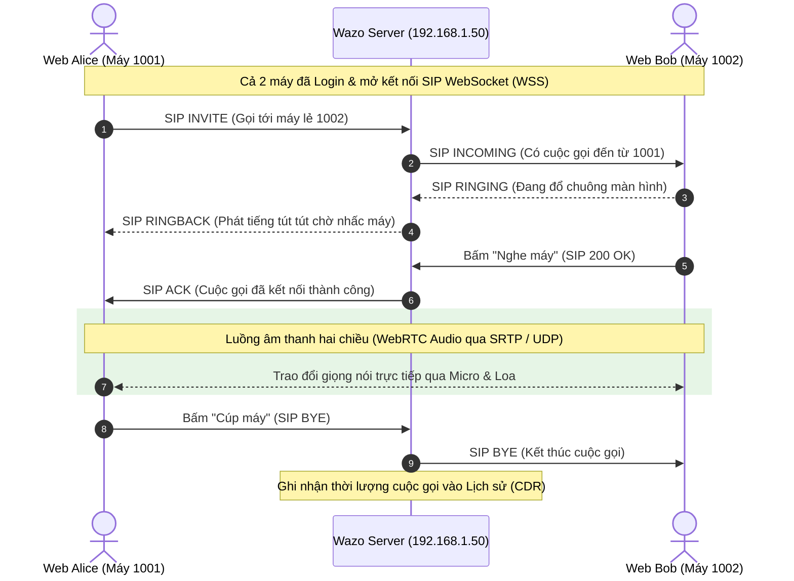
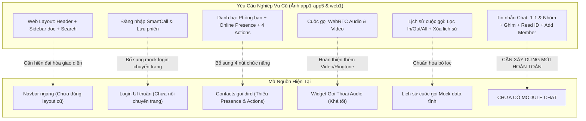

# SMARTCALL WEB — PHÂN TÍCH TOÀN DIỆN DỰ ÁN & LỘ TRÌNH TRIỂN KHAI

> **Tài liệu phân tích kỹ thuật và định hướng phát triển dành cho nhóm phát triển Web SmartCall**  
> *Dự án:* SmartCall Web (Client UC nội bộ)  
> *Công nghệ chủ đạo:* Vue 3 (Vite, Composition API), `@wazo/sdk`, Wazo Platform 26.10 (LAN Offline)  
> *Ngày lập tài liệu:* 11/11/2026

---

## MỤC LỤC
1. [Tổng Quan Dự Án & Bối Cảnh Lịch Sử](#1-tổng-quan-dự-án--bối-cảnh-lịch-sử)
2. [Từ Điển Công Nghệ & Thuật Ngữ Cốt Lõi (Dành Cho Người Mới)](#2-từ-điển-công-nghệ--thuật-ngữ-cốt-lõi-dành-cho-người-mới)
   - 2.1. Bản chất của Số máy lẻ (Extension) và Địa chỉ SIP
   - 2.2. Mối quan hệ giữa Database công ty (API Kỹ sư Backend) và Tổng đài Wazo
   - 2.3. Bảng giải nghĩa các thuật ngữ kỹ thuật cốt lõi
   - 2.4. Sơ đồ luồng cuộc gọi từ Web qua SIP và WebRTC
3. [Giải Thích Chi Tiết Toàn Bộ Tài Liệu Được Cung Cấp](#3-giải-thích-chi-tiết-toàn-bộ-tài-liệu-được-cung-cấp)
   - 3.1. Đoạn Chat Thảo Luận Nội Bộ (`chat.txt`)
   - 3.2. Tài Liệu Kỹ Thuật Server (`dev_guide.md`)
   - 3.3. Phân Tích Bộ Ảnh Giao Diện Cũ (`app1` – `app5`, `web1`)
   - 3.4. Phân Tích Mã Nguồn Hiện Tại Trong `sm_code_latest.xlsx`
4. [Đánh Giá Hiện Trạng & Phân Tích Khoảng Trống (Gap Analysis)](#4-đánh-giá-hiện-trạng--phân-tích-khoảng-trống-gap-analysis)
5. [Kiến Trúc Hệ Thống Đề Xuất Cho Web](#5-kiến-trúc-hệ-thống-đề-xuất-cho-web)
6. [Lộ Trình Các Bước Triển Khai Chi Tiết Cho Nhóm Web](#6-lộ-trình-các-bước-triển-khai-chi-tiết-cho-nhóm-web)
7. [Kế Hoạch Phân Chia Công Việc Cụ Thể](#7-kế-hoạch-phân-chia-công-việc-cụ-thể)
8. [Bảng Tổng Hợp Các API Wazo Cần Dùng Trong Dự Án](#8-bảng-tổng-hợp-các-api-wazo-cần-dùng-trong-dự-án)
9. [Cơ Chế Dữ Liệu Fake & Điểm Kết Nối Database Thật (Service / Adapter Pattern)](#9-cơ-chế-dữ-liệu-fake--điểm-kết-nối-database-thật-service--adapter-pattern)

---

## 1. TỔNG QUAN DỰ ÁN & BỐI CẢNH LỊCH SỬ

### 1.1. Bản chất sản phẩm SmartCall
- **SmartCall** là ứng dụng truyền thông hợp nhất (Unified Communications - UC) nội bộ của công ty/nhà máy.
- **Đối tượng sử dụng:** Toàn bộ nhân viên trong mạng nội bộ công ty (SDV LAN).
- **Môi trường hoạt động:** Chạy hoàn toàn **offline / mạng LAN nội bộ**, không có internet ra ngoài, không sử dụng dịch vụ đám mây công cộng (như Firebase Cloud Messaging hay Google Push).
- **Các tính năng trụ cột:**
  1. **Danh bạ (Contacts):** Tra cứu nhân viên, máy lẻ, phòng ban, kiểm tra trạng thái Online/Offline/Bận/Đang gọi.
  2. **Thoại WebRTC & Cuộc gọi (Voice Calls):** Gọi điện giữa các máy lẻ (1001, 1002, 1003...), nghe máy, cúp máy, tắt tiếng (mute), giữ máy (hold), chuyển cuộc gọi.
  3. **Tin nhắn (Messaging / Chat):** Trò chuyện 1-1, trò chuyện nhóm theo tổ/bộ phận, ghim tin nhắn, kiểm tra ai đã đọc tin (`Read ID`), quản lý thành viên nhóm.
  4. **Lịch sử cuộc gọi (Call History / CDR):** Nhật ký các cuộc gọi đến, gọi đi, gọi nhỡ với thời lượng và mốc thời gian chi tiết.

### 1.2. Sự chuyển dịch kiến trúc: Từ Cũ sang Mới
- **Hệ thống cũ:**
  - Viết bằng **PHP** kết hợp giao diện web chạy ở chế độ tương thích cũ (Internet Explorer mode trên MS Edge).
  - Tổng đài dùng **FreePBX / Asterisk cũ** (các máy chủ 85, 86) cùng cơ sở dữ liệu MySQL trực tiếp.
  - *Lý do dừng:* Khó bảo trì, công nghệ cũ, khó mở rộng tính năng WebRTC thời gian thực và trải nghiệm người dùng kém.
- **Hệ thống mới:**
  - Tổng đài: Nâng cấp toàn diện lên **Wazo Platform 26.10** (hệ sinh thái UC hiện đại mã nguồn mở dựa trên Debian/Docker/Asterisk, cung cấp REST API phong phú, SIP over WebSocket và WebRTC chuẩn quốc tế).
  - Client Web: Chuyển sang Single Page Application (SPA) với **Vue 3 (Vite)** và thư viện chính thức **`@wazo/sdk`**.

---

## 2. TỪ ĐIỂN CÔNG NGHỆ & THUẬT NGỮ CỐT LÕI (DÀNH CHO NGƯỜI MỚI)

Mục này giải thích chi tiết và trực quan toàn bộ các khái niệm tổng đài, giao thức và cơ chế hoạt động để bất kỳ lập trình viên nào mới tiếp cận dự án cũng có thể nắm bắt ngay.

### 2.1. Bản chất của Số máy lẻ (Extension) và Địa chỉ SIP
1. **Số máy lẻ (Extension):**
   * Trong một nhà máy hay công ty, ta không dùng số điện thoại di động thông thường (như 0912xxx) để liên lạc nội bộ, mà cấp cho mỗi vị trí làm việc hoặc mỗi nhân viên một **số máy lẻ ngắn** (thường gồm 4 chữ số, ví dụ dải `1000 – 1999` như `1001`, `1002`, `1003`...).
   * Khi muốn gọi ai, nhân viên chỉ cần bấm 4 số máy lẻ của người đó.
2. **SIP (Session Initiation Protocol - Giao thức khởi tạo phiên):**
   * SIP là giao thức tín hiệu chuẩn quốc tế cho thoại Internet (VoIP).
   * **Bản chất của SIP giống như địa chỉ Email:** Một tài khoản SIP thường có dạng `sip:<máy_lẻ>@<địa_chỉ_server>`, ví dụ: `sip:1001@192.168.1.50`.
   * **Nhiệm vụ của SIP:** SIP **không** trực tiếp mang giọng nói của bạn, mà làm nhiệm vụ "bắt tay" (Signaling):
     * *"Máy lẻ 1001 muốn gọi tới 1002."*
     * *"Server kiểm tra xem máy 1002 có đang online (Registered) không."*
     * *"Server gửi lệnh đổ chuông tới máy 1002."*
     * *"Khi 1002 nhấc máy, SIP thiết lập đường truyền âm thanh trực tiếp giữa 2 máy."*
     * *"Khi một bên gác máy, SIP gửi lệnh hủy phiên kết thúc cuộc gọi."*

---

### 2.2. Mối quan hệ giữa Database công ty (API Kỹ sư Backend) và Tổng đài Wazo
Trong dự án thực tế, có sự phối hợp nhịp nhàng giữa **Cơ sở dữ liệu nhân sự công ty** và **Tổng đài Wazo**:

```
[ Trình duyệt Web SmartCall ]
       │
       ├── (1) Gọi REST API của Kỹ sư Backend ──> [ Database Công ty (MySQL/Oracle) ]
       │   Lấy: Tên NV, Mã NV, Phòng ban,    (Lưu thông tin nhân sự & số máy lẻ)
       │        Số máy lẻ SIP (VD: 1001)
       │
       └── (2) Kết nối qua @wazo/sdk ─────> [ Wazo Platform Server (192.168.1.50) ]
           Bấm gọi: makeCall("1002")         (Xử lý đổ chuông, WebRTC & âm thanh)
```

* **Wazo:** Chỉ là máy chủ tổng đài chuyên xử lý cuộc gọi, tài khoản thoại (1001, 1002), chuyển tiếp cuộc gọi, phòng chat và âm thanh. Wazo **không quản lý** thông tin nhân sự chi tiết như nhân viên này thuộc bộ phận nào, chức vụ gì, mã thẻ chấm công là gì.
* **Database công ty (API do Kỹ sư Backend làm):** Là nơi lưu trữ danh bạ nhân viên thực tế của công ty. API này sẽ trả về thông tin: *"Nguyễn Văn A, Bộ phận Sản xuất, Số máy lẻ Wazo là 1001"*.
* **Vai trò của Web chúng ta:** Gọi API của Kỹ sư Backend để hiển thị danh bạ nhân viên lên màn hình. Khi người dùng bấm nút 📞 gọi một người nào đó, web sẽ lấy số máy lẻ tương ứng (`1001`) và chuyển cho `@wazo/sdk` để Wazo thực hiện cuộc gọi.

---

### 2.3. Bảng giải nghĩa các thuật ngữ kỹ thuật cốt lõi

| Thuật ngữ | Tên đầy đủ / Định nghĩa | Ý nghĩa và Vai trò thực tế trong dự án |
|---|---|---|
| **PBX** | *Private Branch Exchange* (Tổng đài nội bộ) | Hệ thống máy chủ trung tâm quản lý toàn bộ các đường máy lẻ trong công ty. Hệ thống cũ dùng FreePBX; hệ thống mới dùng **Wazo Platform 26.10**. |
| **WebRTC** | *Web Real-Time Communication* | Chuẩn công nghệ của trình duyệt cho phép truyền tải âm thanh (Micro) và Video trực tiếp giữa các trình duyệt với nhau qua mạng mà **không cần cài thêm phần mềm, driver hay plugin flash**. |
| **SIP over WSS** | *SIP over Secure WebSocket* | Đường truyền tín hiệu cuộc gọi (đăng ký máy lẻ, đổ chuông, cúp máy) chạy từ trình duyệt tới Wazo qua giao thức WebSocket mã hóa (`wss://192.168.1.50:9443/api/asterisk/ws`). |
| **RTP / SRTP** | *Secure Real-time Transport Protocol* | Giao thức truyền tải dòng dữ liệu âm thanh thực tế (giọng nói) sau khi cuộc gọi được chấp nhận, chạy qua các cổng mạng UDP `30000 – 30200`. |
| **`@wazo/sdk`** | Thư viện chính thức của Wazo | Đã gói gọn toàn bộ các thuật toán WebRTC và SIP phức tạp thành các hàm JavaScript dễ dùng (`Wazo.Auth.logIn`, `Wazo.Phone.connect`, `Wazo.Phone.call`). |
| **CDR** | *Call Detail Record* (Bản ghi chi tiết cuộc gọi) | Dữ liệu lịch sử cuộc gọi do service `wazo-call-logd` lưu trữ, bao gồm: ai gọi, gọi cho ai, thời gian bắt đầu, thời lượng đàm thoại (`duration`), cuộc gọi thành công hay nhỡ. |
| **Presence** | Trạng thái hiển thị người dùng | Tình trạng của máy lẻ tại thời điểm hiện tại: `available` (sẵn sàng), `talking` (đang bận nghe máy), `ringing` (đang đổ chuông), `offline` (chưa bật app). |
| **CA / SSL Cert** | *Certificate Authority* (Chứng chỉ số bảo mật) | Chứng chỉ `wazo-ca.crt` do server tự cấp. Trình duyệt bắt buộc máy tính phải tin cậy chứng chỉ này thì mới cho phép mở mic và kết nối WebSocket an toàn. |

---

### 2.4. Sơ đồ luồng cuộc gọi từ Web qua SIP và WebRTC



---

## 3. GIẢI THÍCH CHI TIẾT TOÀN BỘ TÀI LIỆU ĐƯỢC CUNG CẤP

### 3.1. Đoạn Chat Thảo Luận Nội Bộ (`chat.txt`)
Cuộc trò chuyện giữa 3 nhân sự chính:
- **Anh Nguyễn Hữu Hiếu (Kaito):** Quản lý / Điều phối dự án. Đưa ra yêu cầu trước mắt:
  > *"Em làm sao cho anh 1 web run được như sau: 1. Có màn hình login; 2. Có 2 màn hình hiển thị được như slide anh gửi (Danh bạ & Lịch sử/Tin nhắn). Dữ liệu thì fake được, kết nối DB tính sau."*
- **Anh Lê Thế Sơn (Denver):** Kỹ sư phụ trách hạ tầng/hệ thống cũ. Giải thích kiến trúc cũ (PHP + FreePBX tổng đài 85/86), cho biết hệ thống cũ hiện đã tắt (off), đồng thời xác nhận hệ thống mới dùng nền tảng Wazo mới.
- **Lê Việt Dũng (Hiki):** Lập trình viên Frontend cùng phụ trách web với bạn. Đã chủ động khởi tạo dự án Vue 3, đề xuất tích hợp `@wazo/sdk` và làm các mockup ban đầu.

---

### 3.2. Tài Liệu Kỹ Thuật Server (`dev_guide.md`)
Tài liệu hướng dẫn kết nối tới server **Wazo Platform 26.10** nội bộ. Các điểm cốt tử cần ghi nhớ:

1. **Địa chỉ mạng & Cổng kết nối:**
   - Server LAN IP: `192.168.1.50` (hoặc thông số cấu hình thực tế trong LAN).
   - REST API: `https://<HOST>/api/<service>/<version>/...` (Mặc định HTTPS port `9443`).
   - Realtime Events (WebSocket): `wss://<HOST>/api/websocketd/?token=<token>&version=2`.
   - SIP WebRTC (WebSocket): `wss://<HOST>/api/asterisk/ws` (subprotocol `sip`).
   - Âm thanh (Audio SRTP): Dải UDP `30000–30200` (không được bị firewall LAN chặn).
2. **Chứng chỉ bảo mật (SSL CA) — ĐIỀU KIỆN TIÊN QUYẾT:**
   - Server dùng chứng chỉ tự ký nội bộ `wazo-ca.crt` (tải từ `https://<HOST>/wazo-ca.crt`).
   - **Bắt buộc:** Trình duyệt / Máy tính dev phải cài chứng chỉ này vào **Trusted Root Certification Authorities**. Nếu không tin cậy chứng chỉ, WSS (WebSocket) sẽ bị chặn ngay lập tức và cuộc gọi WebRTC sẽ hỏng hoàn toàn.
   - Webapp bắt buộc chạy trên **HTTPS** (hoặc `localhost`) thì trình duyệt mới cho phép truy cập Microphone.
3. **Cơ chế xác thực (Auth):**
   - Đăng nhập lấy token qua `POST /api/auth/0.1/token` với Header Basic Auth.
   - Các API sau đó yêu cầu header: `X-Auth-Token: <token>`.
   - Lưu trữ `refresh_token` để tự động làm mới khi token hết hạn.
4. **Tài khoản dùng để kiểm thử (Test Accounts):**
   - `alice` / `Test@123` (Máy lẻ: `1001`)
   - `bob` / `Test@123` (Máy lẻ: `1002`)
   - `carol` / `Test@123` (Máy lẻ: `1003`)
5. **Các Service quan trọng của Wazo:**
   - `wazo-auth`: Đăng nhập, token, refresh token, danh tính user.
   - `wazo-confd`: Lấy thông tin user, máy lẻ, cấu hình line WebRTC.
   - `wazo-calld`: Điều khiển cuộc gọi từ server.
   - `wazo-call-logd`: Lịch sử cuộc gọi (CDR) qua endpoint `GET /api/call-logd/1.0/users/me/cdr`.
   - `wazo-dird`: Danh bạ nội bộ (`/api/dird/0.1/directories/...`).
   - `wazo-chatd`: Trạng thái Online/Offline (Presence) và Tin nhắn Chat.
   - `wazo-websocketd`: Nhận thông báo cuộc gọi đến, trạng thái máy lẻ đổi, tin nhắn mới tức thì.

---

### 3.3. Phân Tích Bộ Ảnh Giao Diện Cũ (`app1` – `app5`, `web1`)

#### 📷 Ảnh `app1.webp`: Danh sách cuộc trò chuyện & Luồng Thêm thành viên
- **Màn hình chính (Messages Tab):**
  - Thanh tìm kiếm phía trên.
  - Danh sách tin nhắn hiển thị: Tên người/nhóm (`TITLES`), tin nhắn mới nhất (`SHOW_MSG`), thời gian gửi (`TIME_SENT`), số tin chưa đọc (`NOT_READ`).
  - Thanh phím tắt nhanh trên từng item: Gọi thoại, Gọi video, Thêm/Xem thành viên.
- **Màn hình "ADD MEMBER":**
  - Nhập tên nhóm (`TITLE`), ô tìm kiếm nhân viên, danh sách kết quả tìm kiếm có nút `+` (thêm), danh sách thành viên hiện tại có nút `x` (xóa).

#### 📷 Ảnh `app2.webp`: Chi tiết phòng chat & Thao tác tin nhắn
- **Header phòng chat:** Tên nhóm (Ví dụ: `MOS PART - 31 thành viên`), nút Gọi thoại, Gọi video, Thêm thành viên.
- **Thanh ghim tin nhắn (`X Ghim: ...`):** Hiển thị nội dung thông báo quan trọng được ghim trên cùng.
- **Bong bóng tin nhắn:** Người gửi, nội dung, giờ gửi, chữ `Read 15:30` (Đã đọc).
- **Tính năng `READ_ID`:** Nhấp vào chữ `Read` sẽ bung popup danh sách những ai đã đọc tin nhắn đó.
- **Thanh Action bar trên tin nhắn:** Cho phép Gọi điện, Trích dẫn/Trả lời tin nhắn, Gọi video, Thêm vào nhóm.

#### 📷 Ảnh `app3.webp`: Quy tắc nghiệp vụ chi tiết của chức năng ADD MEMBER
- **Trường `TITLE`:** Lấy theo cột `TITLES`. **Chỉ ADMIN** mới có quyền chỉnh sửa tên nhóm (tối đa 100 ký tự).
- **Thao tác Thêm (`+`):** Hiện popup xác nhận *"Thêm id này?"* $\rightarrow$ Chọn *Yes* $\rightarrow$ Thực thi thêm $\rightarrow$ Tải lại màn hình.
- **Thao tác Xóa (`X`):** Hiện popup xác nhận *"Xóa id này?"* $\rightarrow$ Chọn *Yes* $\rightarrow$ Thực thi xóa $\rightarrow$ Tải lại màn hình.
  - **Ràng buộc:** Dòng nào là Admin thì **không hiển thị nút X**. Nếu danh sách thành viên gần đây $< 3$ người thì **không hiển thị nút X**.
- **Nút `OK`:** Chỉ hiển thị khi User là ADMIN và trường `TITLE` có thay đổi $\rightarrow$ Nhấn OK để cập nhật và quay lại màn hình trước.

#### 📷 Ảnh `app4.webp`: Danh bạ (Contacts Screen)
- Ô tìm kiếm danh bạ trên cùng.
- Từng liên hệ hiển thị: Tên (`HNAME`), Phòng ban (`DEPTNAME`), Chấm trạng thái Online (xanh lá).
- **4 Icon chức năng (`ICON_ADD`):**
  1. 📞 Gọi thoại (Audio Call)
  2. 💬 Nhắn tin (hiển thị badge tin chưa đọc `NOT_READ`; nếu `CALL_READ != 0` nhấn vào chuyển sang màn hình chat)
  3. 🎥 Gọi Video
  4. ❌ Xóa liên hệ (hiện thông báo *"Hỏi xóa không?"*)

#### 📷 Ảnh `app5.webp`: Trạng thái Cuộc gọi (Calling UI)
- **Cuộc gọi đến (Incoming Call):** Hiển thị tiêu đề `INCOMING CALL`, tên người gọi (`user10014`), địa chỉ SIP (`sip:10014@11.97.20.22`), avatar tròn lớn, nút Nghe máy (xanh) và Từ chối (đỏ).
- **Đang đàm thoại (Active Call):** Tên người gọi, đồng hồ đếm giây (`00:03`), avatar, thanh điều khiển:
  - `MIC`: Tắt/bật micro (Mute).
  - `SPEAKER`: Loa ngoài / Chọn thiết bị ra.
  - `MAX`: Âm lượng cực đại.
  - Nút Cúp máy (Đỏ).

#### 📷 Ảnh `web1.webp`: Giao diện Web SmartCall cũ trên PC
- **Header:**
  - Trái: Logo SmartCall hình bong bóng thoại màu xanh dương.
  - Phải: Avatar user, Tên đăng nhập `조창연 (이윤수)`, Dropdown trạng thái `🟢 ONLINE`, nút `SETTINGS`.
- **Thanh Sub-Header:** Ô tìm kiếm chung `[ Search input ] [ SEARCH ]`.
- **Sidebar bên trái (Màu tối xám đen):**
  - `HOME` (Trang chủ)
  - `CALLS` (Gọi điện thoại / Bàn phím số)
  - `CONTACTS` (Danh bạ)
  - `HISTORY` (Lịch sử cuộc gọi - đang active)
- **Khu vực nội dung chính (Main Content Area):**
  - Các Tab bộ lọc: `ALL`, `INCOMINGS`, `OUTGOINGS`.
  - Nút chức năng: `DELETE HISTORY` (Xóa lịch sử).
  - Danh sách lịch sử cuộc gọi: Avatar, Ngày giờ (`Date: 2023-10-27 10:39:27`), Thời lượng (`Duration: 00:09`), Chiều gọi (`Direction: Incoming`), Trạng thái (`Status: Success`).

---

### 3.4. Phân Tích Mã Nguồn Hiện Tại Trong `sm_code_latest.xlsx`

| Tên File | Chức Năng Đã Thực Hiện | Nhận Xét & Hướng Cải Tiến |
|---|---|---|
| `src/services/wazo.js` | Service bọc SDK `@wazo/sdk` | Khởi tạo Wazo Auth, Phone, gọi `call`, `hangup`, `accept`, `mute`, `hold`. Giữ nguyên `return ... \|\| true` để phục vụ mock test. Cần bổ sung lưu session `localStorage`. |
| `src/components/call/CallControlPanel.vue` | Panel gọi điện dạng widget nổi góc dưới phải | Hỗ trợ thu nhỏ/mở rộng, đếm thời gian gọi, bàn phím quay số máy lẻ. Cần làm đẹp thêm hiệu ứng. |
| `src/components/layout/Navbar.vue` | Thanh điều hướng cũ | Menu ngang đơn giản $\rightarrow$ Cần tái cấu trúc thành Sidebar dọc theo mẫu `web1.webp`. |
| `src/views/LoginView.vue` | Màn hình Đăng nhập | Giao diện form login đúng tông màu SmartCall $\rightarrow$ Cần thêm logic khi bấm nút LOGIN chuyển trang vào Dashboard. |
| `src/views/DashboardView.vue` | Màn hình Tổng quan | Thẻ thông tin user và kiểm tra trạng thái SDK. |
| `src/views/ContactsView.vue` | Màn hình Danh bạ | Đã có ô tìm kiếm debounce $\rightarrow$ Cần bổ sung 4 nút hành động theo đúng `app4.webp`. |
| `src/views/HistoryView.vue` | Màn hình Lịch sử cuộc gọi | Hiển thị dạng Card với bộ lọc hướng gọi và ngày tháng. |
| `src/App.vue` | Khung ứng dụng chính | Quản lý kết nối WebRTC Phone và lắng nghe sự kiện. |

---

## 4. ĐÁNH GIÁ HIỆN TRẠNG & PHÂN TÍCH KHOẢNG TRỐNG (GAP ANALYSIS)



---

## 5. KIẾN TRÚC HỆ THỐNG ĐỀ XUẤT CHO WEB

Để ứng dụng chuyên nghiệp, bám sát nghiệp vụ và giao diện hiện đại:

```
src/
├── assets/                  # CSS, Icons, Âm thanh chuông (ringtone.mp3)
├── components/
│   ├── layout/
│   │   ├── AppHeader.vue    # Topbar: Logo SmartCall, Search Bar, User Profile & Status Dropdown
│   │   └── AppSidebar.vue   # Menu dọc bên trái: Home, Calls, Contacts, Messages, History
│   ├── call/
│   │   ├── CallControlPanel.vue  # Floating call widget hoặc Fullscreen Call Modal
│   │   └── DialerPad.vue         # Bàn phím số quay máy lẻ
│   ├── chat/
│   │   ├── RoomList.vue          # Danh sách cuộc trò chuyện
│   │   ├── ChatBox.vue           # Khung chat, bong bóng tin nhắn, thanh ghim
│   │   └── AddMemberModal.vue    # Modal thêm/xóa thành viên theo đúng nghiệp vụ ảnh app3
│   └── common/
│       └── Toast.vue             # Thông báo trạng thái
├── services/
│   ├── wazo.js              # Khởi tạo SDK, Wazo.Auth, Wazo.Phone
│   ├── api.js               # Wrapper Axios / Fetch chuẩn có tự động gắn X-Auth-Token
│   ├── chatService.js       # API gọi wazo-chatd (rooms, messages)
│   ├── historyService.js    # API gọi wazo-call-logd (cdr)
│   └── websocketService.js  # Kết nối wss://.../websocketd nhận sự kiện realtime
├── stores/                  # Quản lý State tập trung (Pinia hoặc Reactive Object)
│   ├── auth.js              # Token, User info, trạng thái đăng nhập
│   ├── call.js              # Active call, Incoming call, thời lượng
│   └── chat.js              # Danh sách tin nhắn, phòng chat đang mở
├── views/
│   ├── LoginView.vue        # Đăng nhập
│   ├── DashboardView.vue    # Trang chủ Home
│   ├── DialerCallView.vue   # Trang quay số / danh sách cuộc gọi
│   ├── ContactsView.vue     # Danh bạ nhân viên
│   ├── ChatView.vue         # Giao diện Chat Web
│   └── HistoryView.vue      # Lịch sử cuộc gọi
├── router/
│   └── index.js             # Định tuyến & Guard xác thực
├── App.vue
└── main.js
```

---

## 6. LỘ TRÌNH CÁC BƯỚC TRIỂN KHAI CHI TIẾT CHO NHÓM WEB

### 📍 Giai đoạn 1: Chuẩn bị môi trường & Đưa code vào dự án (ĐÃ HOÀN THÀNH)
* Trích xuất mã nguồn `sm_code_latest.xlsx` vào thư mục `src/`.
* Biên dịch Vite thành công 100% không có lỗi.
* Dev server đã chạy tại `http://localhost:5174/`.

### 📍 Giai đoạn 2: Hoàn thiện Xác thực (Authentication) & Quản lý Session
* Cho phép đăng nhập thật nếu kết nối được server Wazo, hoặc đăng nhập chế độ Demo / Mock để kiểm thử toàn bộ giao diện.
* Lưu thông tin người dùng đăng nhập vào `localStorage` để khi F5 không bị mất phiên.

### 📍 Giai đoạn 3: Dựng Layout Web chuẩn Desktop theo mẫu `web1.webp` (Hiện đại hóa)
* **Top Header:** Logo SmartCall, thanh tìm kiếm nhanh, Avatar, Tên nhân viên và Dropdown chọn trạng thái (🟢 Online / 🟡 Away / 🔴 DND).
* **Sidebar bên trái:** Gọn gàng, hiện đại với các mục Home, Calls, Contacts, Messages, History.

### 📍 Giai đoạn 4: Hoàn thiện tính năng Cuộc gọi (WebRTC Calling)
* Bắt các sự kiện cuộc gọi đến (`ON_CALL_INCOMING`), đàm thoại (`ON_CALL_ACCEPTED`), kết thúc (`ON_CALL_ENDED`).
* Tích hợp âm thanh chuông gọi và chuông chờ.

### 📍 Giai đoạn 5: Hoàn thiện Danh bạ (Contacts) & Lịch sử cuộc gọi (History)
* Danh bạ: Bổ sung 4 nút chức năng (Gọi, Nhắn tin, Video, Xóa).
* Lịch sử: Các tab lọc (Tất cả, Gọi đến, Gọi đi, Gọi nhỡ) và nút Gọi lại nhanh.

### 📍 Giai đoạn 6: Xây dựng Module Tin Nhắn (Messaging / Chat)
* Giao diện Chat Web 2 cột: Danh sách phòng chat bên trái, Khung chat bên phải.
* Thanh ghim tin nhắn (`Ghim: ...`) theo `app2.webp`.
* Modal "ADD MEMBER" với đầy đủ ràng buộc Admin theo `app3.webp`.

### 📍 Giai đoạn 7: Kết Nối WebSocket Realtime (`wazo-websocketd`)
* Lắng nghe sự kiện `chatd_user_room_message_created` (tin nhắn mới) và `chatd_presence_updated` (thay đổi trạng thái online) để cập nhật giao diện thời gian thực.

---

## 7. KẾ HOẠCH PHÂN CHIA CÔNG VIỆC CỤ THỂ

| Hạng mục | Công việc thực hiện |
|---|---|
| **Bạn chủ động thực hiện** | 1. **Kiến trúc & Layout:** Dựng bố cục Web chuẩn theo `web1.webp` (Sidebar bên trái + Header có Online status).<br>2. **Authentication:** Xử lý đăng nhập, lưu session, auto-refresh token.<br>3. **Cuộc gọi & Lịch sử:** Hoàn thiện WebRTC Calling (`wazoService`), âm thanh chuông, popup nghe/gọi và trang `HistoryView.vue`.<br>4. **Danh bạ & Tin nhắn:** Hoàn thiện `ContactsView.vue` và xây dựng mới `ChatView.vue` với modal Add Member.<br>5. Bàn giao bản code ổn định cho đồng nghiệp bám theo. |

---

## 8. BẢNG TỔNG HỢP CÁC API WAZO CẦN DÙNG TRONG DỰ ÁN

| Nghiệp Vụ | Service | Method & Endpoint | Mục Đích |
|---|---|---|---|
| Đăng nhập | `wazo-auth` | `POST /api/auth/0.1/token` | Lấy access token, refresh token và metadata user |
| Refresh token | `wazo-auth` | `POST /api/auth/0.1/token` (body có `refresh_token`) | Làm mới token tự động |
| Thông tin user | `wazo-confd` | `GET /api/confd/1.1/users/{user_uuid}` | Lấy họ tên, phòng ban, máy lẻ |
| Nguồn danh bạ | `wazo-dird` | `GET /api/dird/0.1/directories/default/sources?backend=wazo` | Lấy UUID nguồn danh bạ nội bộ |
| Tải danh bạ | `wazo-dird` | `GET /api/dird/0.1/backends/wazo/sources/{uuid}/contacts?limit=1000` | Lấy danh sách toàn bộ nhân viên |
| Trạng thái Online | `wazo-chatd` | `GET /api/chatd/1.0/users/presences?user_uuid=...` | Kiểm tra trạng thái máy lẻ (Available / Talking / Offline) |
| Đổi trạng thái mình | `wazo-chatd` | `PUT /api/chatd/1.0/users/{me}/presences` | Cập nhật Online, Away, DND |
| Lịch sử cuộc gọi | `wazo-call-logd` | `GET /api/call-logd/1.0/users/me/cdr?limit=50&order=start&direction=desc` | Danh sách lịch sử cuộc gọi chi tiết |
| Danh sách phòng chat | `wazo-chatd` | `GET /api/chatd/1.0/users/me/rooms` | Tải các phòng chat của user |
| Tin nhắn phòng chat | `wazo-chatd` | `GET /api/chatd/1.0/users/me/rooms/{room_uuid}/messages?limit=50` | Tải lịch sử tin nhắn |
| Gửi tin nhắn | `wazo-chatd` | `POST /api/chatd/1.0/users/me/rooms/{room_uuid}/messages` | Gửi tin nhắn mới |
| Đăng ký SIP WebRTC | Asterisk WSS | `wss://<HOST>/api/asterisk/ws` (SIP protocol) | Thư viện `@wazo/sdk` tự quản lý qua `Wazo.Phone.connect()` |
| Sự kiện Realtime | `websocketd` | `wss://<HOST>/api/websocketd/?token=<token>&version=2` | Nhận sự kiện cuộc gọi, tin nhắn, presence |

---

## 9. CƠ CHẾ DỮ LIỆU FAKE & ĐIỂM KẾT NỐI DATABASE THẬT (SERVICE / ADAPTER PATTERN)

### 9.1. Triết lý thiết kế: Tách biệt Giao diện (UI) và Dữ liệu (Data)
Nhằm đảm bảo dự án phát triển độc lập, không bị phụ thuộc vào tiến độ triển khai Database của Kỹ sư Backend hay máy chủ Wazo tại nhà máy, toàn bộ ứng dụng áp dụng mô hình **Service / Adapter Pattern**:

```
[ Giao diện Vue (Views / Components) ]
                   │
                   ▼  (gọi hàm nghiệp vụ: getContacts(), getHistory(), sendMessage())
[ Tầng Dịch vụ (Service Layer: src/services/) ]
                   │
         ┌─────────┴─────────┐
         ▼                   ▼
 [ API Thật Wazo/DB ]   [ Dữ liệu Fake (Mock Data) ]
 (Khi có LAN & Token)  (Tự động kích hoạt khi dev offline)
```

* **Quy tắc bất di bất dịch:** Các file giao diện (`ContactsView.vue`, `HistoryView.vue`, `MessagesView.vue`...) **tuyệt đối không bao giờ** gọi `fetch()` URL trực tiếp hoặc thao tác thô với API. Mọi thao tác đọc/ghi dữ liệu bắt buộc phải đi qua các hàm của tầng `src/services/`.
* **Cơ chế Fallback thông minh:** Trong mỗi hàm Service luôn có khối lệnh `try ... catch`. Khi chưa có server Wazo hoặc đang dev offline, hệ thống tự động trả về Mock Data chuẩn định dạng doanh nghiệp SDV, giúp giao diện luôn hiển thị đầy đủ, không bao giờ bị văng lỗi màn hình trắng.

---

### 9.2. Bản đồ vị trí lưu trữ Dữ liệu Fake (Mock Data) trong dự án

| Phân Hệ | Vị Trí File Lưu Mock Data | Cấu Trúc Dữ Liệu Fake | Mục Đích Hiển Thị |
|---|---|---|---|
| **Danh bạ (Contacts)** | `src/services/contactService.js`<br>*(Mảng `MOCK_CONTACTS`)* | `id`, `name`, `email`, `dept`, `number`, `status`, `unreadCount` | Hiển thị bảng danh bạ nhân viên nội bộ SDV, hỗ trợ tìm kiếm và 4 nút hành động (📞 Gọi, 💬 Chat, 🎥 Video, ❌ Xóa). |
| **Tin nhắn (Messaging)** | `src/views/MessagesView.vue`<br>*(Mảng `rooms`, `currentRoomMembers`)* | `id`, `title`, `unread`, `icon`, `messages` (`sender`, `text`, `time`, `readStatus`, `readers`) | Hiển thị danh sách phòng chat, bong bóng tin nhắn 2 chiều, thanh ghim thông báo, modal xem ai đã đọc tin (Read ID) và modal Add Member. |
| **Lịch sử cuộc gọi (History)** | `src/services/historyService.js`<br>*(Mảng `MOCK_HISTORY`)* | `id`, `date`, `name`, `extension`, `dept`, `duration`, `direction`, `status`, `answered` | Hiển thị danh sách nhật ký cuộc gọi theo đúng mẫu `web1.webp`, hỗ trợ 4 tab lọc (`ALL`, `INCOMINGS`, `OUTGOINGS`, `MISSED`) và nút Gọi lại. |
| **Phiên người dùng (User Session)** | `localStorage`<br>*(Key `smartcall_user`, `smartcall_logged_in`)* | `username`, `name`, `extension`, `department`, `token` | Giữ trạng thái đăng nhập khi F5; hiển thị tên nhân viên đăng nhập (`Lê Việt Dũng`), máy lẻ (`1001`) và trạng thái SIP trên Top Header & Sidebar. |

---

### 9.3. Cơ chế dữ liệu được render lên Giao diện (Vue 3 Reactivity)
1. **Khởi tạo & Nạp dữ liệu:**
   - Trong `onMounted()` của mỗi View, hàm async của Service tương ứng sẽ được gọi (ví dụ: `await contactService.getContacts()`).
   - Dữ liệu trả về được gán vào biến phản ứng `const contacts = ref([])`.
2. **Lọc dữ liệu thời gian thực (Computed):**
   - Sử dụng `computed()` để tự động lọc dữ liệu theo ô tìm kiếm hoặc tab đang chọn mà không cần gọi lại API.
   - Ví dụ: `filteredContacts = computed(...)` lọc danh bạ theo tên/phòng ban/máy lẻ; `filteredCalls = computed(...)` lọc lịch sử theo tab `ALL` / `INCOMINGS` / `OUTGOINGS` / `MISSED`.
3. **Hiển thị trực quan (Directives):**
   - Vòng lặp `v-for` duyệt qua mảng dữ liệu đã lọc để render ra các dòng bảng, thẻ card, danh sách phòng chat.
   - Các cờ trạng thái `v-if="loading"`, `v-else-if="filtered.length === 0"` giúp hiển thị hiệu ứng xoay spinner hoặc thông báo trống thân thiện.

---

### 9.4. Điểm cắm API thật của Kỹ sư Backend (DB nhân sự) và Wazo Platform

Dưới đây là vị trí cụ thể trong mã nguồn đã được chừa sẵn để đấu nối API thật khi Kỹ sư Backend bàn giao:

#### 1. Đấu nối Danh bạ nhân viên (`src/services/contactService.js`):
```javascript
async getContacts() {
  try {
    const token = wazoService.getToken()
    if (!token) throw new Error('No token')

    // 🎯 ĐIỂM CẮM API DATABASE Kỹ sư Backend:
    // Khi Kỹ sư Backend cung cấp API máy chủ nội bộ (ví dụ: http://192.168.1.50:8080/api/employees),
    // Bạn chỉ cần mở file này và thay URL vào fetch:
    const res = await fetch('http://192.168.1.50:8080/api/employees', {
      headers: { 'Authorization': `Bearer ${token}` }
    })
    const data = await res.json()

    // Map dữ liệu từ DB công ty sang schema của SmartCall Web:
    return data.items.map(emp => ({
      id: emp.id || emp.employee_code,
      name: emp.full_name,
      dept: emp.department_name,
      number: emp.wazo_extension, // Máy lẻ 4 số (1001, 1002...)
      status: 'online',
      unreadCount: 0
    }))
  } catch (err) {
    // Tự động dùng Mock Data nếu mạng lỗi hoặc chưa có DB
    return this.localContacts
  }
}
```

#### 2. Đấu nối Lịch sử cuộc gọi (`src/services/historyService.js`):
Đã được viết sẵn theo đúng chuẩn tài liệu `dev_guide.md` (mục 4.3):
```javascript
// Gọi Wazo Call-Logd API:
GET https://192.168.1.50:9443/api/call-logd/1.0/users/me/cdr?limit=50&order=start&direction=desc
Headers: { 'X-Auth-Token': token }
```
Nếu sau này Kỹ sư Backend muốn lưu lịch sử vào Database riêng của công ty, chỉ việc đổi URL trong `historyService.js` sang endpoint của Kỹ sư Backend.

#### 3. Đấu nối Tin nhắn & WebSocket Realtime (`src/services/chatService.js` & `websocketService.js`):
Sẽ được chuẩn hóa ở Bước 5 bám sát các endpoint:
* Lấy phòng chat: `GET /api/chatd/1.0/users/me/rooms`
* Lấy tin nhắn: `GET /api/chatd/1.0/users/me/rooms/{uuid}/messages`
* Gửi tin nhắn: `POST /api/chatd/1.0/users/me/rooms/{uuid}/messages`
* Nhận tin nhắn mới tức thì: Lắng nghe qua WebSocket `wss://192.168.1.50:9443/api/websocketd/?token=<token>&version=2`.

---
*Tài liệu này được biên soạn để làm kim chỉ nam thực thi cho dự án SmartCall Web. Mọi thắc mắc kỹ thuật về Wazo API có thể đối chiếu thêm trong file `dev_guide.md`.*
