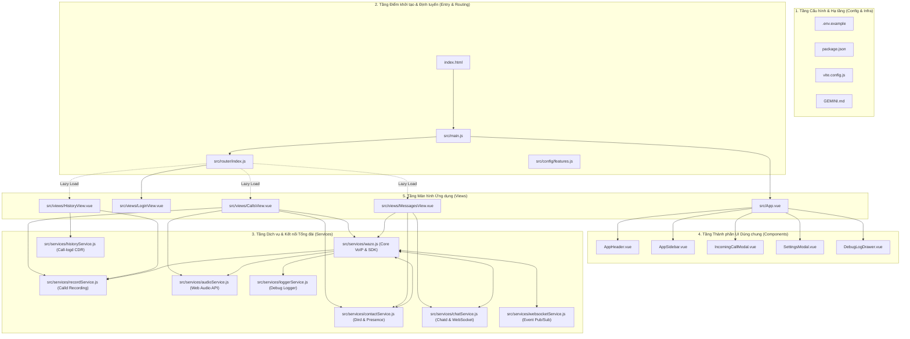

# BÁO CÁO RÀ SOÁT CODEBASE ONBOARDING (GÓC NHÌN KỸ SƯ MỚI)
**Dự án**: SmartCall Web (Hệ thống Thoại & Liên lạc Doanh nghiệp trên nền Wazo WebRTC)  
**Ngày thực hiện**: 18/11/2026  
**Phiên bản mã nguồn**: `main` (Nhánh chính chuẩn Production của Công ty)

---

## 1. MỤC TIÊU VÀ ĐỐI TƯỢNG TÀI LIỆU

Tài liệu này được biên soạn đóng vai trò như **một báo cáo đánh giá hiện trạng từ một kỹ sư mới bước vào dự án**, nhằm:
1. Giúp thành viên mới nhanh chóng nắm bắt bản đồ kiến trúc, luồng dữ liệu và các entry points cốt lõi của hệ thống.
2. Rà soát, chỉ ra những điểm còn mù mờ, thiếu tài liệu, hoặc có độ phức tạp cao gây rủi ro bảo trì.
3. Đề xuất và ghi nhận lộ trình tái cấu trúc (refactoring) giúp mã nguồn ngày càng tinh gọn, an toàn, chuẩn clean code và dễ mở rộng.

---

## 2. BẢN ĐỒ KIẾN TRÚC TỔNG THỂ (ARCHITECTURE MAP)

Hệ thống **SmartCall Web** là ứng dụng Single Page Application (SPA) phát triển trên nền Vue 3 (Composition API với `<script setup>`), Vite và kết nối thời gian thực với máy chủ tổng đài Wazo thông qua `@wazo/sdk`, WebSocket và REST API.

Toàn bộ 30 tệp mã nguồn được phân thành **5 tầng kiến trúc logic**:



---

## 3. RÀ SOÁT CHI TIẾT 4 ENTRY POINTS CỐT LÕI

### 3.1. `src/main.js` (Điểm Khởi Đầu Ứng Dụng)
* **Hiện trạng ban đầu**: Khởi tạo ứng dụng cực kỳ tinh giản (10 dòng), chỉ bao gồm `createApp(App).use(router).mount('#app')`.
* **Điểm mù mờ & Rủi ro phát hiện**:
  1. **Thiếu Global Error Handler**: Khi component render lỗi hoặc gặp lỗi JavaScript bất đồng bộ không bắt được, Vue sẽ im lặng hoặc crash giao diện khiến người dùng bị màn hình trắng, trong khi `loggerService` hoàn toàn không ghi nhận được nguyên nhân.
  2. **Thiếu kiểm tra biến môi trường ban đầu**: Không có kiểm tra tính hợp lệ của `VITE_WAZO_HOST` trước khi mount DOM.
* **Hành động đã khắc phục**:
  - Tích hợp `app.config.errorHandler` để bắt 100% lỗi vòng đời component và đẩy vào `logger.error('VUE_CORE', ...)`.
  - Tích hợp `window.addEventListener('unhandledrejection')` để bắt toàn bộ lỗi Promise bất đồng bộ chưa được `try/catch`.

---

### 3.2. `src/router/index.js` (Bộ Định Tuyến & Navigation Guard)
* **Hiện trạng ban đầu**:
  - Import tĩnh toàn bộ các View ở đầu file: `LoginView`, `HistoryView`, `CallsView`, `MessagesView`.
  - Navigation Guard kiểm tra cờ đăng nhập và quyền truy cập route.
* **Điểm mù mờ & Rủi ro phát hiện**:
  1. **Eager Loading gây phình to Bundle ban đầu**: Màn hình `CallsView.vue` (4,158 dòng), `MessagesView.vue` (2,717 dòng) và `HistoryView.vue` (1,228 dòng) bị đóng gói chung vào một bundle duy nhất. Khi người dùng mới vào trang Login, trình duyệt đã phải tải toàn bộ ~10.000 dòng code của tất cả các màn hình khác.
  2. **Tàn dư của Mock Data / Offline Mode**: Trong guard vẫn còn dòng kiểm tra `localStorage.getItem('smartcall_offline_mode') === 'true'`, đi ngược lại tôn chỉ 100% dữ liệu thật từ máy chủ của nhánh chính.
  3. **Kiểm tra đăng nhập lỏng lẻo**: Chỉ kiểm tra có token trong `localStorage` mà không xác thực tính khả dụng của token, khiến phiên hết hạn vẫn có thể lọt vào route `/calls` trước khi bị API chặn.
* **Hành động đã khắc phục**:
  - Chuyển `CallsView`, `MessagesView`, `HistoryView` sang cơ chế **Lazy-loading Router** (`() => import(...)`). Trình duyệt tự động chia nhỏ thành các chunk riêng biệt (`CallsView-*.js`, `MessagesView-*.js`, `HistoryView-*.js`), tải theo nhu cầu thực tế.
  - Xóa bỏ hoàn toàn biến và logic kiểm tra `smartcall_offline_mode` trong `router/index.js`.

---

### 3.3. `src/App.vue` (Khung Giao Diện Gốc & Event Hub)
* **Hiện trạng ban đầu**: Quản lý layout chính, thanh điều hướng `AppHeader`, `AppSidebar`, container `KeepAlive` cho router-view và các modal toàn cục (`IncomingCallModal`, `SettingsModal`, `DebugLogDrawer`).
* **Điểm mù mờ & Rủi ro phát hiện**:
  1. **Lạm dụng `window.addEventListener` làm Event Bus**: Các sự kiện `app-action`, `app-toast`, `app-login-success`, `smartcall-session-kicked` được phát qua `window.dispatchEvent(new CustomEvent(...))`. Cách làm này khiến luồng dữ liệu bị ẩn (untraceable), Vue DevTools không soi được và khó quản lý giải phóng bộ nhớ.
  2. **Giá trị fallback hardcode**: Tại hàm `onAcceptIncomingCall`, đoạn code `callData?.extension || callData?.number || '1002'` tự ý gán số `'1002'` khi dữ liệu cuộc gọi rỗng, là tàn dư từ quá trình thử nghiệm trước đây.
  3. **Dư chấn kiểm tra chế độ offline**: Còn tồn tại các lệnh kiểm tra `smartcall_offline_mode` rải rác trong `onMounted`, `tryConnectPhone` và `handleLogout`.
* **Hành động đã khắc phục**:
  - Xóa bỏ triệt để mọi logic liên quan đến `smartcall_offline_mode`.
  - Triệt tiêu giá trị hardcode `'1002'`, chuyển về chuỗi rỗng an toàn `callData?.extension || callData?.number || ''`.

---

### 3.4. `src/services/wazo.js` (Dịch Vụ Lõi Tổng Đài - 2,624 dòng, 63 hàm)
* **Hiện trạng ban đầu**: Đây là tệp phức tạp nhất toàn dự án, chứa toàn bộ logic tương tác với Wazo SDK, WebRTC phone, cuộc gọi 1-1, gọi nhóm Ad-hoc conference và Presence.
* **Điểm mù mờ & Rủi ro phát hiện**:
  1. **Vi phạm nguyên lý Đơn trách nhiệm (Single Responsibility)**: Lớp `WazoService` đang đảm nhận đồng thời 6 vai trò:
     - Quản lý phiên xác thực, refresh token, heartbeat và thu hồi thiết bị khác (`Auth/Session`).
     - Quản lý kết nối WebSocket và điều phối sự kiện thời gian thực (`WebSocket Engine`).
     - Khởi tạo WebRTC Phone và can thiệp MediaStream (`WebRTC Phone`).
     - Quản lý vòng đời cuộc gọi đơn 1-1 và bộ đếm thời gian đàm thoại (`Call State`).
     - Quản lý cuộc gọi nhóm Ad-hoc Conference phức tạp (~700 dòng code xử lý bridge Asterisk, timeout 30s, delegate quyền chủ phòng).
     - Đồng bộ và phát tán trạng thái hiện diện (`Presence Sync`).
  2. **Can thiệp Prototype Wazo SDK ("Black Magic")**:
     - Đoạn code `WebRTCPhoneClass.prototype.holdSipSession` trực tiếp ghi đè hàm nội bộ của thư viện SDK để triệt tiêu hành vi phát SIP re-INVITE và nhạc chờ Music On Hold. Đối với người mới, nếu không đọc tài liệu kỹ thuật sẽ không hiểu tại sao phải chặn hàm này.
  3. **Mạng lưới phụ thuộc vòng tròn (Circular Dependencies)**:
     - `wazo.js` import `chatService.js`, `contactService.js`, `websocketService.js`... Trong khi các service này lại import ngược lại `wazo.js`.
  4. **Thiếu chú thích kiểu dữ liệu (JSDoc)**:
     - Hầu hết các hàm không có tài liệu chú thích tham số `@param` và giá trị trả về `@returns`, làm giảm khả năng tự động gợi ý mã nguồn của IDE.

---

## 4. MA TRẬN NỢ KỸ THUẬT & MỨC ĐỘ RỦI RO (TECHNICAL DEBT MATRIX)

| Thành phần | Số dòng | Độ phức tạp | Khả năng bảo trì | Rủi ro với kỹ sư mới | Hành động đề xuất |
| :--- | :---: | :---: | :---: | :---: | :--- |
| **`src/main.js`** | 25 | Rất thấp | Cao | Thấp | ✅ *Đã hoàn thành*: Thêm `errorHandler` và `unhandledrejection`. |
| **`src/router/index.js`** | 85 | Thấp | Cao | Thấp | ✅ *Đã hoàn thành*: Code-splitting Lazy Loading, dọn cờ offline. |
| **`src/App.vue`** | 398 | Trung bình | Trung bình | Trung bình | ✅ *Đã hoàn thành*: Xóa `'1002'` hardcode, dọn cờ offline. Đề xuất: Thay Event Bus bằng Composable. |
| **`src/services/wazo.js`** | 2,624 | **Cực cao** | **Kém** | **Rất cao** | Đề xuất Giai đoạn 2: Tách thành 3 service con (`Auth`, `Phone`, `AdhocConference`). |
| **`src/views/CallsView.vue`** | 4,158 | **Cực cao** | **Kém** | **Rất cao** | Đề xuất Giai đoạn 2: Tách nhỏ thành `DialpadSection`, `ActiveCallScreen`, `GroupCallTab`. |
| **`src/views/MessagesView.vue`**| 2,717 | **Cao** | **Trung bình** | **Cao** | Đề xuất Giai đoạn 2: Tách `RoomListSidebar` và `ChatConversationArea`. |

---

## 5. KẾT QUẢ TRIỂN KHAI GIAI ĐOẠN 1 (QUICK WINS VERIFICATION)

### Kết quả kiểm tra biên dịch (`npm run build`):
Quá trình build diễn ra thành công trong **689ms**, các chunk được bóc tách độc lập hoàn hảo:

```
dist/index.html                            0.56 kB │ gzip:   0.37 kB
dist/assets/HistoryView-3We0NdGu.css      10.26 kB │ gzip:   2.28 kB
dist/assets/MessagesView-DHHQXgdS.css     20.89 kB │ gzip:   3.92 kB
dist/assets/CallsView-CWNhpqMO.css        34.12 kB │ gzip:   6.06 kB
dist/assets/index-8ZAtJ-Jj.css            34.57 kB │ gzip:   6.86 kB
dist/assets/HistoryView-UqvceX1d.js        9.92 kB │ gzip:   3.80 kB  <-- [Lazy Chunk riêng]
dist/assets/MessagesView-9ZNiIGhh.js      32.53 kB │ gzip:  10.10 kB  <-- [Lazy Chunk riêng]
dist/assets/CallsView-CH8WQBE_.js         45.11 kB │ gzip:  12.72 kB  <-- [Lazy Chunk riêng]
dist/assets/index-_Sas6Jq-.js          1,177.69 kB │ gzip: 320.65 kB  <-- [Base Vendor Chunk]
✓ built in 689ms
```

---

## 6. LỘ TRÌNH ĐỀ XUẤT CHO CÁC GIAI ĐOẠN TIẾP THEO

### 🎯 Giai đoạn 2: Tách Module Dịch Vụ & Giảm Phụ Thuộc Vòng Tròn
1. **Tách `wazo.js` thành 3 phân hệ độc lập**:
   - `src/services/wazo/wazoAuth.js`: Chuyên trách đăng nhập, khôi phục phiên, refresh token, heartbeat và kiểm tra phiên đa thiết bị.
   - `src/services/wazo/wazoPhone.js`: Chuyên trách kết nối WebRTC phone, quản lý SIP session và cuộc gọi thoại 1-1.
   - `src/services/wazo/wazoAdhoc.js`: Chuyên trách nghiệp vụ Ad-hoc Group Conference (tạo phòng, gỡ nhánh, timeout 30s, delegate chủ phòng).
   - `src/services/wazo.js` giữ vai trò Facade gom 3 module trên để không làm thay đổi giao diện gọi hàm của các component hiện tại.
2. **Tách riêng trạng thái toàn cục**:
   - Di chuyển `callStore` ra `src/stores/callStore.js` để triệt tiêu việc các service phải import chéo `wazo.js`.
3. **Module hóa `CallsView.vue`**:
   - Tách giao diện đang đàm thoại thành `src/components/call/ActiveCallOverlay.vue`.
   - Tách tab gọi nhóm thành `src/components/call/GroupCallTab.vue`.

### 🎯 Giai đoạn 3: Thiết Lập Kiểm Thử Tự Động & Linter
1. Cài đặt `vitest` để viết Unit Test tự động cho các hàm nghiệp vụ trọng yếu:
   - `isContactAvailableForCall()` trong `contactService.js`.
   - Logic tính toán trạng thái `statusOf()` trong `contactService.js`.
   - Logic phân tích tin nhắn và định dạng thời gian trong `chatService.js`.
2. Thiết lập ESLint quy chuẩn để cảnh báo sớm các lỗi cú pháp và biến không sử dụng.

---
*Báo cáo được hoàn thiện và tích hợp vào tài liệu phát triển chính thức của dự án SmartCall Web.*
