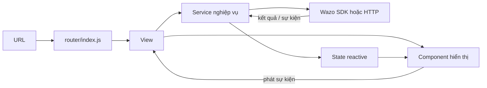

# Hướng dẫn frontend từ đầu đến cuối cho người mới

Cập nhật: 20/11/2026. Áp dụng cho D:/Project/Smart_Call_Web_Refactor, nhánh codex/refactor-architecture.

Bản này đã chuyển sang cấu trúc phẳng, bỏ các tầng app/core/features/shared và tách UI gọi điện theo cụm. Hãy bắt đầu bằng chương 3 để nhìn cây thư mục, chương 4 để biết luồng chạy và chương 20 để có lộ trình đọc ngắn. Các chương nghiệp vụ còn lại giải thích từ View tới SDK/API và dữ liệu trả về.

## Cách đọc tài liệu

Đọc các chương đầu theo thứ tự nếu bạn mới tham gia. Khi sửa một chức năng, mở chương luồng tương ứng và danh mục file ở cuối. Có thể dùng mục lục bên dưới hoặc Outline của editor để chuyển giữa các chương.

1. Bắt đầu từ khái niệm và cách chạy.
2. Hiểu cấu trúc và cách Web khởi động.
3. Theo luồng đăng nhập, danh bạ và gọi một người.
4. Đọc gọi nhóm, chat, lịch sử, ghi âm và cài đặt.
5. Hiểu request, response, state và sự kiện.
6. Đọc phân tích lớp API so với Android.
7. Dùng danh mục file, API và bài thực hành để tự lần code.

Không cần thuộc cả 53 file source. Lần đầu chỉ cần nắm index.html, main.js, App.vue, router, createServices và một chức năng đang làm.

## Mục lục tra cứu

- [1 Những khái niệm cần biết trước khi mở code](#1-những-khái-niệm-cần-biết-trước-khi-mở-code)
- [2 Chạy dự án và biết file nào cần nhìn](#2-chạy-dự-án-và-biết-file-nào-cần-nhìn)
- [3 Vì sao thư mục được chia như hiện tại](#3-vì-sao-thư-mục-được-chia-như-hiện-tại)
- [4 Từ khi mở URL đến khi thấy trang](#4-từ-khi-mở-url-đến-khi-thấy-trang)
- [5 Đăng nhập khôi phục phiên và đăng xuất](#5-đăng-nhập-khôi-phục-phiên-và-đăng-xuất)
- [6 Danh bạ presence tìm kiếm và yêu thích](#6-danh-bạ-presence-tìm-kiếm-và-yêu-thích)
- [7 Gọi một người từ lúc bấm nút đến khi nghe âm thanh](#7-gọi-một-người-từ-lúc-bấm-nút-đến-khi-nghe-âm-thanh)
- [8 Gọi nhóm và vì sao có service riêng](#8-gọi-nhóm-và-vì-sao-có-service-riêng)
- [9 Tin nhắn phòng trực tiếp và phòng nhóm](#9-tin-nhắn-phòng-trực-tiếp-và-phòng-nhóm)
- [10 Lịch sử cuộc gọi và bản ghi âm](#10-lịch-sử-cuộc-gọi-và-bản-ghi-âm)
- [11 Cài đặt hệ thống](#11-cài-đặt-hệ-thống)
- [12 Theo một request HTTP từ đầu đến cuối](#12-theo-một-request-http-từ-đầu-đến-cuối)
- [13 WebSocket sự kiện và cập nhật giao diện](#13-websocket-sự-kiện-và-cập-nhật-giao-diện)
- [14 Phía Android có file API còn Web thì sao](#14-phía-android-có-file-api-còn-web-thì-sao)
- [15 Đọc và sửa dự án như người mới](#15-đọc-và-sửa-dự-án-như-người-mới)
- [16 Những giới hạn người mới cần biết](#16-những-giới-hạn-người-mới-cần-biết)
- [17 Danh mục từng file source và lý do đặt tại đó](#17-danh-mục-từng-file-source-và-lý-do-đặt-tại-đó)
- [18 Các file cấu hình tài nguyên và kiểm thử](#18-các-file-cấu-hình-tài-nguyên-và-kiểm-thử)
- [19 Sổ tra các API mà source Web đang gọi](#19-sổ-tra-các-api-mà-source-web-đang-gọi)
- [20 Lộ trình đọc trong những ngày đầu](#20-lộ-trình-đọc-trong-những-ngày-đầu)
- [21 Cách đọc comment trong code](#21-cách-đọc-comment-trong-code)

## 1 Những khái niệm cần biết trước khi mở code

Bạn không cần học một mô hình kiến trúc lớn trước khi sửa dự án. Chỉ cần phân biệt bốn việc: trang nào hiển thị, khối giao diện nào được bấm, service nào xử lý và state nào được đổi.

| Khái niệm | Hiểu đơn giản | Ví dụ trong code hiện tại |
| --- | --- | --- |
| View | Một trang do router chọn theo URL | views/CallsView.vue tại /calls |
| Component | Một khối giao diện trong trang | DialerPanel, ActiveCallPanel, ContactCard |
| Service | Thực hiện nghiệp vụ hoặc nói chuyện với Wazo | CallService trong services/calls/callService.js |
| State | Dữ liệu Vue theo dõi để vẽ lại UI | callState.activeCall, recordingState |
| Composable | Hàm use... quản lý tương tác hoặc tài nguyên của Vue | useContactFilters, useMicrophoneMeter |
| Helper/mapper | Hàm đổi hoặc định dạng dữ liệu, không tự gọi API | mapDirectoryContacts, getAvatarInitials |

Một file .vue có template (HTML và sự kiện), script setup (dữ liệu/hàm) và style (CSS). ref thường giữ một giá trị; reactive giữ object có thể được Vue theo dõi; computed tính dữ liệu hiển thị từ state khác. Nếu service thay rooms hoặc tin nhắn qua proxy Vue, MessageList tự vẽ lại. Vì vậy sửa dữ liệu cần đi qua state/proxy đang được theo dõi, không chỉ sửa một object thô đứng ngoài nó.

Frontend chạy trong trình duyệt. Backend riêng của repository chưa chạy; hiện Web gọi các dịch vụ Wazo qua SDK và HTTP. Thư mục backend chỉ giữ phạm vi chuẩn bị cho API/IdP. Mã Android trong FileQuest dùng để tham khảo, không tham gia build.

SDK là thư viện @wazo/sdk. HTTP là request/response như lấy danh bạ; WebSocket mang sự kiện như có tin nhắn mới; WebRTC/SIP thiết lập thoại và media. Có token đăng nhập không đồng nghĩa thoại đã đăng ký SIP thành công.

Các lớp như PhoneAdapter hoặc CallControlApi vẫn là JavaScript bình thường: một lớp giữ cách dùng thiết bị/SDK, lớp kia chứa API điều khiển cuộc gọi trên server. Tên lớp không tạo thêm một framework.

## 2 Chạy dự án và biết file nào cần nhìn

### Chạy từ gốc clone

Cần Node đáp ứng engines trong frontend/package.json; bản đã kiểm tra dùng Node 22.19.0.

```powershell
npm --prefix frontend ci
# Chỉ tạo .env nếu chưa có
if (!(Test-Path frontend/.env)) {
  Copy-Item frontend/.env.example frontend/.env
}
npm run dev
```

Điền VITE_WAZO_HOST trong frontend/.env bằng host tổng đài phù hợp môi trường. Không đưa secret IdP vào biến VITE_ vì Vite có thể đưa giá trị vào bundle của trình duyệt. Không ghi đè .env đang dùng của người khác.

package.json ở gốc chỉ chuyển lệnh vào frontend. Ví dụ npm run build ở gốc chạy npm --prefix frontend run build. Dependency của Web và lockfile nằm trong frontend. Không cần cài lại dependency riêng ở gốc chỉ vì thấy package.json ở đó.

| Lệnh tại gốc | Mục đích | Đầu ra |
| --- | --- | --- |
| npm run dev | Chạy Vite để phát triển | URL local do terminal thông báo |
| npm run build | Build Web production | frontend/dist |
| npm test | Chạy Vitest một lượt | Kết quả các ca test |
| npm run lint | Kiểm tra một số lỗi mã/template | Danh sách lỗi ESLint |
| npm run check | Lint, ranh giới kiến trúc, test, build | Kết quả kiểm tra tổng hợp |

Format được kiểm tra riêng bằng npm --prefix frontend run format:check. Dev server phục vụ phát triển không phải backend nghiệp vụ của SmartCall. npm run build cũng không tự triển khai website lên server.

### Thư mục sinh tự động

node_modules chứa dependency và cache; dist chứa kết quả build. Không sửa chúng để sửa tính năng vì lần cài/build sau có thể ghi đè. .gitignore ngăn đưa các phần này lên Git, không làm chúng biến mất trên máy.

scripts, tests, eslint.config.js và vitest.config.js là mã/cấu hình kiểm tra cần giữ trong repository. Trong clone chúng nằm dưới frontend. Nếu test báo sai thì kiểm tra source và hợp đồng trước, không xóa test chỉ để kết quả xanh.

## 3 Vì sao thư mục được chia như hiện tại

Cập nhật ngày 20/11/2026: bỏ các tầng app/core/features/shared trong src. Giữ frontend/backend ở cấp repository theo yêu cầu; bên trong frontend dùng các thư mục quen thuộc. Không có thư mục app riêng và không có mã Android trong runtime. Theo phản hồi mới nhất, services được gom nhóm chức năng, chỉ sâu thêm một cấp.

Cây source hiện tại có 53 file, 20 thư mục con. CallsView hiện 976 dòng (đã gồm comment giải thích) thay vì 3.748; phần UI được chia sang các component có tên cụ thể. Độ sâu lớn nhất dưới src là hai tầng thư mục: ví dụ components/call. Trước lượt đơn giản hóa có 44 thư mục con.

```text
frontend/src/
├── assets/
│   └── main.css
├── components/
│   ├── call/
│   │   ├── ActiveCallPanel.vue
│   │   ├── AddParticipantModal.vue
│   │   ├── DialerPanel.vue
│   │   └── IncomingCallModal.vue
│   ├── common/
│   │   ├── DebugLogDrawer.vue
│   │   └── SettingsModal.vue
│   ├── contacts/
│   │   ├── ContactCard.vue
│   │   └── ContactsPanel.vue
│   ├── layout/
│   │   ├── AppHeader.vue
│   │   └── AppSidebar.vue
│   └── messages/
│       ├── MessageComposer.vue
│       └── MessageList.vue
├── composables/
│   ├── useContactFilters.js
│   ├── useMicrophoneMeter.js
│   └── useRecordingPlayer.js
├── config/
│   └── features.js
├── router/
│   └── index.js
├── services/
│   ├── audio/
│   │   ├── audioService.js
│   │   ├── recordingService.js
│   │   └── wazoPhone.js
│   ├── auth/
│   │   ├── authService.js
│   │   ├── sdkAuthenticationGate.js
│   │   └── sessionScope.js
│   ├── calls/
│   │   ├── callApi.js
│   │   ├── callService.js
│   │   ├── groupCallService.js
│   │   └── phoneEvents.js
│   ├── common/
│   │   ├── apiClient.js
│   │   └── loggerService.js
│   ├── data/
│   │   ├── chatService.js
│   │   ├── contactService.js
│   │   ├── historyService.js
│   │   └── settingsService.js
│   ├── realtime/
│   │   ├── eventBus.js
│   │   ├── wazoEventHandler.js
│   │   └── wazoEvents.js
│   ├── createServices.js
│   └── index.js
├── state/
│   ├── callState.js
│   └── sessionState.js
├── utils/
│   ├── avatar.js
│   ├── callHistoryMapper.js
│   ├── callPolicy.js
│   ├── contactMapper.js
│   ├── formatMessageDateTime.js
│   └── userProfile.js
├── views/
│   ├── CallsView.vue
│   ├── HistoryView.vue
│   ├── LoginView.vue
│   └── MessagesView.vue
├── App.vue
└── main.js
```

| Thư mục | Đặt gì ở đây | Vì sao |
| --- | --- | --- |
| views | Bốn trang chính | Mở URL nào thì tìm View tương ứng |
| components/call | Bàn phím, khung đàm thoại, modal nhận/mời cuộc gọi | Những cụm người dùng nhìn thấy trên màn hình gọi |
| components/contacts | Panel lọc danh bạ và một thẻ liên hệ | Panel giữ lựa chọn; ContactCard chỉ hiển thị/phát sự kiện |
| components/messages | Danh sách và ô soạn tin | Không đưa việc dựng tin nhắn vào service |
| components/common, layout | Modal dùng chung và khung ứng dụng | Không lẫn với nghiệp vụ API |
| services | Nghiệp vụ, SDK, HTTP, socket, session | Đường gọi phía Web dễ lần theo; không chia thêm folder cho từng file |
| state | Trạng thái cuộc gọi và người đăng nhập | Chia theo chủ sở hữu dữ liệu, không nhân bản state tại mỗi component |
| composables | Vòng đời/tương tác Vue | Tách mic, player, bộ lọc khỏi các trang |
| utils | Mapper và hàm thuần | Kiểm thử dữ liệu riêng mà không cần mở giao diện |
| router, config, assets | Điều hướng, cờ tính năng, CSS nền | Vai trò quen thuộc của ứng dụng Vue |

Không phải mở toàn bộ cây để sửa một việc. Nếu sửa màu/nút của một liên hệ, mở ContactCard. Nếu sửa gửi tin, mở MessagesView rồi chatService. Nếu sửa quyền ADD_REQ, mở wazoEventHandler. Nếu sửa API hội nghị, mở callApi.

CallService và GroupCallService vẫn tách nhau vì thoại một nhánh và hội nghị nhiều nhánh có timer/cleanup khác nhau. Tuy nhiên cả hai đều nằm trong services/calls; không phải đi qua domain/adapters/state của từng feature.

services/createServices.js nối các dependency tại một nơi. services/index.js tạo bộ instance dùng cho ứng dụng thật. Việc giữ hai file giúp test tạo service với SDK được kiểm soát mà không khởi động SDK thật. Các service nghiệp vụ không import ngược index.js, View hoặc component.


### Các nhóm trong services

| Nhóm | Chứa gì | Khi nào tìm ở đây |
| --- | --- | --- |
| auth | authService, sdkAuthenticationGate, sessionScope | Đăng nhập/khôi phục/thu hồi phiên, request cũ |
| calls | callService, groupCallService, callApi, phoneEvents | Gọi, nghe, cúp, DTMF, hội nghị và callback SDK |
| audio | audioService, recordingService, wazoPhone | Âm báo, ghi âm, mic/loa, remote stream và auto-hold SDK |
| realtime | wazoEvents, wazoEventHandler, eventBus | Socket, reconnect, presence và phân phối event server |
| data | contactService, chatService, historyService, settingsService | Danh bạ, chat, CDR và cấu hình dịch vụ Wazo |
| common | apiClient, loggerService | HTTP và nhật ký dùng chung |

index.js và createServices.js vẫn ở gốc services. Không thêm index trung gian cho từng nhóm; import trỏ thẳng file cần dùng. Nhóm realtime quản lý sự kiện WebSocket; phoneEvents thuộc calls vì đó là callback thoại của SDK. wazoPhone thuộc audio vì nó giữ thiết bị, stream và cách xử lý auto-hold, không tạo phiên xác thực.

## 4 Từ khi mở URL đến khi thấy trang

1. frontend/index.html tải /src/main.js.
2. main.js tạo ứng dụng Vue, cài router rồi mount App.vue.
3. services/index.js sử dụng createServices để tạo các instance. SDK thật chỉ được lắp ở điểm này.
4. router/index.js chọn LoginView, CallsView, MessagesView hoặc HistoryView và kiểm tra yêu cầu đăng nhập/cờ màn hình.
5. App.vue quản lý Header, Sidebar, KeepAlive, Settings và modal cuộc gọi đến. Khi thu hồi phiên, App bỏ view riêng tư trước khi đợi điều hướng xong.
6. View tải dữ liệu qua service và truyền dữ liệu cho component. Service đổi state; Vue vẽ lại phần phụ thuộc.



Ví dụ ở CallsView: DialerPanel phát dial; View gọi callService.startCall. ActiveCallPanel phát mute/record/hangup. ContactsPanel phát call/message/favorite/start-group. AddParticipantModal chỉ trả danh sách máy lẻ đã chọn. Không component con nào trong luồng này tự tạo token, URL hoặc socket.

Ứng dụng vẫn là Web SPA một phiên trong một tab. State module dùng chung cho SPA, không được hiểu là kiến trúc SSR hoặc nhiều người dùng đồng thời trong cùng runtime.

## 5 Đăng nhập khôi phục phiên và đăng xuất

### Người dùng thao tác ở đâu

Mở /login, nhập username/password và bấm đăng nhập. LoginView có username, password, loading, errorMessage và handleLogin. loading chặn bấm lại trong khi lệnh chưa hoàn tất.

handleLogin gọi authService.login(submittedUsername, password). Sau thành công, view lưu lựa chọn nhớ username, đặt cờ smartcall_logged_in, phát sự kiện thành công và chuyển /calls. Nó không tự lấy danh bạ hoặc tự cấu hình SIP ở template.

### AuthService thực hiện những bước nào

1. Gọi logout để vô hiệu scope cũ và dọn state; đợi SDK cleanup đã được ghi nhận.
2. initializeAuthentication cấu hình SDK bằng client ID và host.
3. authenticateCredentials đi qua SdkAuthenticationGate rồi mới initialize/gọi sdk.Auth.logIn. Thời gian chờ ở Web được giới hạn 15 giây, nhưng khóa SDK vẫn được giữ đến khi request và cleanup thật sự kết thúc.
4. Khi có session, kiểm tra context còn đúng; lấy token, refreshToken, UUID và thông tin SDK.
5. synchronizeUserProfile gọi GET /api/confd/1.1/users/me nếu có thể, rồi mapUserProfile ghép thông tin SDK/Confd thành hồ sơ Web.
6. Nạp lại lịch sử, thực hiện cơ chế thu hồi phiên thiết bị khác khi đủ dữ liệu, mở EventConnection và yêu cầu CallService.connect.
7. Gửi presence available, tạo session health timer rồi trả session cho view.

SDK Auth tự thực hiện thêm các bước HTTP bên trong thư viện. Không nên coi sdk.Auth.logIn là một API giả lập chỉ trả token. Nó cũng có state, nạp hồ sơ và quản lý kết nối SDK.

### Server và SDK trả dữ liệu ra sao

Với raw token response kiểu Wazo mà SDK xử lý, những trường quan trọng có dạng:

```json
{
  "data": {
    "token": "<access-token>",
    "refresh_token": "<refresh-token>",
    "session_uuid": "<session-uuid>",
    "metadata": { "uuid": "<user-uuid>" }
  }
}
```

SDK chuyển raw response thành Session có các thuộc tính như token, uuid, profile và các phương thức như primaryNumber(). Đây không còn là JSON thuần. AuthService dùng Session đó; userSessionState chỉ giữ hồ sơ đơn giản cho Vue.

mapUserProfile ưu tiên UUID từ session, máy lẻ từ primaryNumber hoặc Confd lines, tên từ profile SDK/Confd và phòng ban từ các trường đã hỗ trợ. Không có máy lẻ thật thì giá trị model có thể rỗng; không tự thêm số mẫu để biến thành người dùng hợp lệ.

### Khôi phục và làm mới

App gọi restoreSession khi cần khôi phục token đã lưu. AuthService dùng SDK validateToken. Nếu token cũ không dùng được và có refreshToken, refreshAccessToken POST /api/auth/0.1/token với client_id, refresh_token và expiration; sau đó xác minh lại.

verifySessionHealth dùng HEAD /api/auth/0.1/token/{token}. Các timer kiểm tra có thể phát hiện token hết hạn. Sự tồn tại của timer không bảo đảm mọi trường hợp mất mạng/thu hồi đã được xử lý hoàn chỉnh.

### Logout và những điều cần nhớ

Logout dọn token/UUID/các cache phiên trong RAM, ngắt thoại/socket và tăng epoch của sessionScope. Ngoại lệ mới: cache metadata bộ đếm tin đến được giữ theo tài khoản/máy chủ để đăng nhập lại còn số. localStorage giữ một số cấu hình kỹ thuật và lựa chọn khôi phục; RAM giữ phòng, tin nhắn và danh bạ đang sử dụng.

sessionScope là cơ chế chống kết quả cũ ghi vào phiên mới. Nếu A đang tải tin rồi B đăng nhập, tác vụ A không được phép cập nhật rooms của B. Cơ chế kiểm tra cả trước/sau request và sau khi đọc body JSON/blob.

Bản vá đã thêm SdkAuthenticationGate để chặn đăng nhập mới khi request SDK cũ còn chạy; kết quả muộn phải cleanup trước khi mở khóa. Nếu SDK treo hoặc cleanup lỗi, người dùng phải chờ hoặc tải lại trang. handleSessionRevocation nay dọn phiên qua logout và App bỏ UI riêng tư ngay. Chi tiết kiểm chứng và trạng thái các mục audit nằm ở phần cập nhật đầu FOLLOWUP_AUDIT_2026-11-19.md.

## 6 Danh bạ presence tìm kiếm và yêu thích

**Đường đọc UI hiện tại:** CallsView tải danh bạ và xử lý lệnh; ContactsPanel giữ bộ lọc, phòng ban và lựa chọn gọi nhóm; ContactCard hiển thị một người và phát sự kiện. Hai component nhận contacts/current extension/canInvite qua props, không đọc service hoặc token trực tiếp.

### Cách dùng trên giao diện

Vào Gọi điện và Danh bạ ở /calls. Người dùng có thể tìm tên/máy lẻ, lọc phòng ban/trạng thái, xem người có thể gọi, đánh dấu yêu thích, gọi hoặc mở chat từ liên hệ. ContactService phục vụ cả Calls, Messages và History nên nó nằm ở services/data/contactService.js thay vì giấu trong CallsView.

CallsView.loadContacts và refreshContacts gọi contactService.getContacts. useContactFilters giữ searchTerm, activeTab, selectedDepartment và các computed lọc danh sách. Bộ lọc chỉ tính từ dữ liệu đã tải, không có endpoint tìm kiếm riêng cho mỗi lần gõ trong UI này.

### Đường đi của dữ liệu danh bạ

1. getContacts gọi fetchFavorites để lấy ID yêu thích qua GET /api/dird/0.1/directories/favorites/default.
2. Hỏi danh sách nguồn bằng GET /api/dird/0.1/directories/default/sources?backend=wazo.
3. Nếu có sourceUuid, tải GET /api/dird/0.1/backends/wazo/sources/{sourceUuid}/contacts?limit=1000.
4. Nếu cách trên không có dữ liệu, thử lookup/default?term=1 theo logic hiện tại. Đây là cách dự phòng đang có, không phải khẳng định term=1 luôn trả toàn bộ danh bạ.
5. mapDirectoryContacts chuẩn hóa response.
6. loadPresencesForContacts hỏi trạng thái của các UUID.
7. Lọc bỏ chính người đăng nhập, sắp xếp và gán currentContacts. Vue đọc lại computed contacts.

Dird có thể trả items hoặc bảng column_types/results. Mapper tồn tại để CallsView không phải biết cả hai schema.

```json
{
  "items": [{
    "uuid": "u-peer",
    "id": "contact-42",
    "firstname": "An",
    "lastname": "Nguyễn",
    "exten": "4321",
    "department": "Kỹ thuật"
  }]
}
```

Sau mapper, phần UI đọc các tên thống nhất:

```json
{
  "id": "u-peer",
  "rawId": "contact-42",
  "uuid": "u-peer",
  "name": "An Nguyễn",
  "number": "4321",
  "dept": "Kỹ thuật",
  "status": "offline",
  "isFavorite": false
}
```

status offline ở bước mapping là giá trị khởi tạo. Presence sẽ được ghép sau, không phải mapper đã gọi mạng để biết người đó offline.

### Presence thay đổi bằng hai con đường

GET /api/chatd/1.0/users/presences?user_uuid=... lấy trạng thái theo lô. ContactService còn poll khoảng 10 giây và nhận window event wazo-presence-updated do handler WebSocket phát. updateSinglePresence đổi đúng liên hệ trong state.

Presence là tín hiệu hiện thời, không phải khóa bảo đảm người nhận sẽ rảnh tới lúc SIP kết nối. UI dùng nó để hướng dẫn/chặn một số thao tác; tổng đài vẫn quyết định kết quả thật của cuộc gọi.

### Đánh dấu yêu thích

CallsView.toggleFavorite gọi ContactService.toggleFavorite. Service xác định contact ID và source, chọn PUT để thêm hoặc DELETE để bỏ tại /api/dird/0.1/directories/favorites/{source}/{contactId}. HTTP404 có thể thử nguồn khác; lỗi khác trả ra để view hiển thị.

State chỉ đổi sau xác nhận HTTP thành công. pendingFavorites gộp bấm trùng cùng liên hệ. Vì source ID và user UUID có thể khác nhau, contact model giữ cả id/rawId/uuid thay vì chỉ một số máy lẻ.

## 7 Gọi một người từ lúc bấm nút đến khi nghe âm thanh

**Luồng chính sau khi tách UI:** DialerPanel → CallsView.handleDial → CallService.startCall → placeSdkCall/requestSdkCall → SDK Phone.call. Khi nghe máy: SDK ON_CALL_ACCEPTED → phoneEvents.createCallAcceptedHandler → kiểm tra SIP ID → callState.activeCall → ActiveCallPanel.

Event tới trước Promise call được giữ tạm và chỉ phát lại khi SIP ID khớp kết quả thật. Event của cuộc gọi cũ không được đổi session/timer của cuộc gọi mới. Hộp thoại AddParticipantModal giữ lựa chọn tạm và phát confirm; GroupCallService quyết định gọi trực tiếp hay ủy quyền; View chỉ chuyển lựa chọn và hiển thị lỗi.

### Các điểm bắt đầu

Người dùng nhập số trên DialerPanel rồi bấm Gọi; bấm nút gọi ở liên hệ; hoặc bấm gọi lại ở History/Messages. Những màn hình khác thường điều hướng sang /calls với query để CallsView bắt đầu thao tác, không tự tạo một CallService khác.

DialerPanel nhận modelValue/contact/isCalling/isDialing qua props. Khi bấm phím, nó emit digit; khi bấm Gọi, nó emit dial. CallsView nhận sự kiện và handleDial gọi callService.startCall(targetExtension). Controller là nơi kiểm tra nghiệp vụ cuối cùng.

### Các bước của startCall

1. Chuẩn hóa máy lẻ; chặn số rỗng, gọi chính mình, cuộc gọi đang hoạt động hoặc thao tác trùng.
2. Tìm contact trong cache hoặc qua getOrLookupContact. Giữ khóa dialing trong lúc lookup còn chờ.
3. callPolicy kiểm tra busy/talking/holding, ringing/progressing, dnd và offline/unavailable.
4. Kiểm tra thiết bị phù hợp nếu API trình duyệt có hỗ trợ, rồi kiểm tra lại context/thế hệ.
5. Tạo activeCall cục bộ với callId của Web, thông tin người nhận, direction outbound và status ringing.
6. Bật âm ringback, gọi placeSdkCall. Hàm này dùng sdk.Phone.call(extension, false), tức không bật camera.
7. Nhận SDK session và gắn vào activeCall nếu vẫn là lượt gọi đó. Kết quả success của lệnh chưa đồng nghĩa bên kia đã nghe máy.

CallService.connect đăng ký callback với SDK trước lệnh connect để không bỏ lỡ ON_REGISTERED phát sớm. Có token đăng nhập nhưng chưa ON_REGISTERED thì Header chưa được báo SIP sẵn sàng.

### Kết quả không chỉ là một response JSON

sdk.Phone.call trả session để điều khiển nhánh gọi. Sau đó SDK phát các sự kiện như ON_PROGRESS, ON_CALL_ACCEPTED, ON_CALL_FAILED, ON_CALL_ENDED. phoneEventHandlers tạo các callback; CallService gắn/gỡ chúng.

| Tín hiệu hoặc state | Web làm gì |
| --- | --- |
| ON_REGISTERED | callState.isRegistered=true |
| ON_PROGRESS | Giữ trạng thái đổ chuông nếu chưa connected |
| ON_CALL_ACCEPTED | Gắn session, chuyển connected, đặt startTime, chạy đồng hồ |
| ON_CALL_FAILED hoặc REJECTED | Kết thúc nhánh/cuộc gọi theo lý do |
| ON_CALL_ENDED | Chạy cleanup và ghi lịch sử tạm |

PhoneAdapter hỗ trợ gắn remote MediaStream vào audio element dự phòng và áp dụng mic/loa. MediaStream là luồng âm thanh sống, không phải file JSON hoặc bản ghi âm. File ghi âm server thuộc RecordingService, một việc khác.

### Gọi đến và nghe máy

ON_CALL_INCOMING đi vào createCallIncomingHandler, tìm tên liên hệ rồi ghi callState.incomingCall. App.vue đọc state này và mở IncomingCallModal, kể cả người dùng đang ở trang Messages.

Bấm Nghe máy phát accept từ modal; App gọi acceptIncomingCall. Controller dựng activeCall với status answering, xóa incomingCall và await SDK accept. Chỉ khi SDK xác nhận kết nối, handler mới chuyển connected và chạy thời gian đàm thoại.

Bấm Từ chối hoặc hết thời gian đổ chuông đi qua reject/miss và cleanup. Nếu đang bận, handler hiện có nhánh từ chối cuộc gọi mới và ghi CDR nhỡ.

### Mute DTMF và cúp máy

toggleMute đổi trạng thái microphone và gọi SDK mute/unmute. DTMF là các phím tín hiệu gửi vào cuộc gọi đang diễn ra, chẳng hạn chọn menu tổng đài; sendDtmfDigits chuyển tone tới SDK. Nó không gửi chat message.

hangupCurrentCall ra lệnh cúp và finalizeCallTermination điều phối kết thúc nhánh, ghi CDR tạm, dừng đồng hồ/âm thanh, xử lý hội nghị và xóa state cần thiết. Hàm finalize hiện còn lớn nên khi sửa phải đọc đủ nhánh host/member/secondary leg, không chỉ đoạn cuối xóa activeCall.

Hiện accepted handler còn thiếu đối chiếu danh tính cuộc gọi trong một số thứ tự sự kiện. Việc mô tả luồng chuẩn ở đây không có nghĩa mọi race của luồng đã được sửa.

## 8 Gọi nhóm và vì sao có service riêng

Tên lớp hiện tại là GroupCallService, nằm trong services/calls/groupCallService.js. Gọi nhóm không tạo thêm một ứng dụng hoặc một SDK thứ hai. Service này phối hợp với CallService và CallControlApi để quản lý các nhánh thoại/hội nghị. Event conference_deleted chỉ ngắt khi khớp ID hội nghị đang quản lý; participant_joined chỉ gắn ID khi call_id khớp nhánh server hiện tại.

### Cách người dùng khởi tạo

Người dùng chọn nhiều liên hệ trong Calls hoặc gọi các thành viên của phòng chat. View thu máy lẻ rồi gọi groupCallService.startGroupCall. Nếu chỉ còn một người hợp lệ, service có thể chuyển thành cuộc gọi một một.

GroupCallService quản lý host, danh sách máy lẻ, session nhánh phụ, timer lời mời và conference ID. CallService vẫn quản lý cuộc gọi chính, media và vòng đời dùng chung. Tách riêng giúp người sửa thao tác gọi một người không phải tìm trong toàn bộ logic hội nghị.

### Các nhánh được tạo và ghép ra sao

1. Chuẩn hóa danh sách, loại bản thân/trùng lặp và các liên hệ không khả dụng.
2. Đánh dấu người khởi tạo là host, lưu danh sách nhóm.
3. Bắt đầu nhánh đầu qua CallService.startCall.
4. Hẹn mời các nhánh còn lại bằng SDK, giữ secondaryCallSessions và timer chờ trả lời.
5. Khi có nhánh trả lời, syncActiveCallsToAdhocConference hẹn đồng bộ có debounce.
6. synchronizeActiveCalls gọi CallControlApi.listActiveCalls để lấy ID phía Calld.
7. Đối chiếu sip_call_id của session và talking_to để phân biệt nhánh host với nhánh peer.
8. Khi đủ nhánh phù hợp, POST tạo conference; sau này PUT thêm participant mới. DELETE giải tán khi kết thúc theo vai trò.

Ví dụ body mà CallControlApi.createConference gửi:

```json
{
  "host_call_id": "server-host-call",
  "participant_call_ids": [
    "server-peer-call-1",
    "server-peer-call-2"
  ]
}
```

Response code hiện đọc là object có conference_id. Nếu không có ID hoặc request lỗi, adapter trả null. addConferenceParticipant trả boolean dựa trên HTTP thành công. mergedCallIds dùng để không merge lặp các nhánh đã xác nhận.

### Những Map và Set nghĩa là gì

secondaryCallSessions ánh xạ máy lẻ sang SDK session. extensionToWazoCallIdMap ánh xạ máy lẻ sang ID nhánh server. mergedCallIds là tập ID đã ghép. Không dùng chung chúng vì một nhánh SDK và một nhánh Calld không có cùng vai trò.

Map chứa session SDK dùng shallowReactive để không bọc sâu toàn bộ object SIP. Không phải tất cả Map/Set trong group state đều tự có tính reactive sâu; cần hiểu nơi nào controller thay object, nơi nào UI thực sự đọc.

### Presence trong gọi nhóm

Các tag GROUP, ADD_REQ, NOTICE, LEFT đang được gửi qua status presence để đồng bộ/mời theo cơ chế tham khảo Android. Đây là giao thức ứng dụng đang dùng, không phải REST API quản trị hội nghị tiêu chuẩn tự cung cấp quyền.

Bản vá dùng handleGroupPresenceSignal trong services/realtime/wazoEventHandler.js để đối chiếu UUID server, peer/host và thành viên hiện tại; yêu cầu mời chỉ từ thành viên đã kết nối, LEFT chỉ được áp dụng cho chính người gửi. Nếu thiếu danh bạ hoặc UUID mâu thuẫn thì bỏ tín hiệu. Tag cũ chưa có call nonce/chữ ký nên không thay ACL server. F05 đã được sửa: chỉ xử lý conference_deleted khớp ID hội nghị hiện tại.

## 9 Tin nhắn phòng trực tiếp và phòng nhóm

### Giao diện và các phần được chia

MessagesView là trang chọn phòng và thực hiện lệnh. MessageList chỉ hiển thị nội dung/thời gian/lỗi gửi và cung cấp scrollToBottom. MessageComposer quản lý textarea, kích thước, phím Enter/IME rồi phát sự kiện send; quyết định gọi API nằm ở ChatService.

Người dùng có thể mở phòng, gửi tin, mở chat từ liên hệ, tạo nhóm có nhiều người và gọi điện từ phòng. Ghim và trạng thái đã gửi/đã xem vẫn được bỏ. Theo yêu cầu mới 20/11/2026, badge tin đến chưa mở đã được khôi phục ở menu và từng hội thoại, cùng cache tạm theo tài khoản/máy chủ; xem chương 22.

### Tải danh sách và mở phòng

MessagesView.loadRooms gọi ChatService.getRooms. Service GET /api/chatd/1.0/users/me/rooms, ánh xạ users thành members, tìm thông tin từ ContactService và phân loại phòng trực tiếp/phòng nhóm theo logic hiện tại.

Phòng là một model UI có id, title, isDirect, members, messages, preview, updatedAt... JSON server và model UI không giống hệt nhau. Preview là nội dung xem trước của tin cuối, không phải endpoint riêng.

Service có thể tải trước tối đa 15 tin gần nhất cho các phòng chưa có messages. Chọn phòng gọi getRoomMessages(roomId), mặc định limit 50, sắp xếp thời gian và ánh xạ thành các bubble. roomSelectionVersion giúp kết quả của lựa chọn trước không kéo UI về sai phòng.

```json
{
  "items": [{
    "uuid": "room-peer",
    "name": "",
    "users": ["u-me", "u-peer"]
  }]
}
```

Đây là dạng tối giản để hiểu luồng. Metadata quản trị phải đến từ trường server mà code hỗ trợ, ví dụ admin_uuid/creator_uuid; không được suy quyền từ việc tên có chữ admin hoặc mình là người đầu tiên trong mảng users.

### Mở chat từ danh bạ

CallsView.handleMessage chuyển sang /messages cùng query ext/name/uuid. checkDirectChatRoute tìm phòng RAM tương ứng, xóa query tránh chạy lặp rồi gọi getOrCreateDirectRoom.

Service tìm UUID đối phương qua ContactService, thử GET rooms?user_uuid={uuid}, nếu không tìm được phòng thích hợp thì POST /users/me/rooms với name và users. Khi chưa tạo được phòng server, code có thể giữ phòng tạm direct-{máy lẻ} trong RAM; đây là trạng thái chờ để UI mở hội thoại, không phải đã gửi được dữ liệu lên server.

### Gửi tin và nhận tin trở lại

1. MessagesView lấy inputText, kiểm tra phòng, lưu targetId rồi xóa ô nhập.
2. ChatService.sendMessage tạo ID cmsg-... cho tin tạm và thêm vào phòng trong RAM để hiển thị nhanh.
3. Nếu là phòng direct- tạm, service thử nâng cấp sang ID server thật.
4. POST /api/chatd/1.0/users/me/rooms/{id}/messages với content và alias.
5. Khi nhận JSON có uuid/id, cập nhật ID/thời gian của tin tạm. Lỗi HTTP được chuyển thành thông báo và sendFailed.
6. EventConnection có thể nhận event tin nhắn trước hoặc sau HTTP ACK. ChatService.handleIncomingMessage khử trùng ID/tin tạm rồi cập nhật phòng.
7. View đồng bộ lại danh sách, giữ nguyên phòng người dùng đang chọn và cuộn phù hợp.

```json
{
  "content": "Chào bạn",
  "alias": "Người gửi"
}
```

Response tối giản mà code nhận biết:

```json
{
  "uuid": "message-server-id",
  "created_at": "2026-11-19T10:00:00Z"
}
```

HTTP ACK là xác nhận request gửi của server, không phải bằng chứng đối phương đã đọc. Model UI dùng sender mine/theirs, senderName, text, time, timestamp. UUID người gửi đến từ server; không dùng alias hiển thị làm danh tính phân quyền.

### Nhóm và thao tác quản trị hiện có

createGroupRoom POST phòng với name và users, cần tổng cộng ít nhất ba UUID hợp lệ. renameGroup và deleteRoom hiện dùng tin command có tag ROOM_RENAME/ROOM_CLOSED; không phải đã có API đổi tên/đóng bền vững riêng. isTrustedRoomCommand chỉ chấp nhận từ admin UUID đã xác nhận trong model phòng.

addMembersToGroup và removeMemberFromGroup đang ném lỗi yêu cầu API server phù hợp; không tự tạo lại phòng rồi chuyển toàn bộ lịch sử như một cách giả cập nhật thành viên. deleteMultipleRooms trả deletedIds/failures để UI báo kết quả từng phần.

Có hai lỗi cần nhớ khi bảo trì: sendFailed có thể không kích hoạt render do tham chiếu object thô; tin thường sau tombstone có thể mở lại nhóm. “Xóa nhóm” hiện chưa phải thu hồi membership/xóa vĩnh viễn trên server.

## 10 Lịch sử cuộc gọi và bản ghi âm

### Xem lịch sử

HistoryView.fetchHistory lấy snapshot RAM để hiển thị nhanh nếu có, sau đó gọi historyService.getHistory với tab all, limit 100 và forceRefresh theo thao tác người dùng.

Service GET /api/call-logd/1.0/users/me/cdr?limit=...&order=start&direction=desc. mapCallHistoryRecord nhận từng CDR và máy lẻ hiện tại để xác định chiều. Với cuộc gọi internal, nguồn trùng máy lẻ của mình thì được coi là outbound; nếu không là inbound.

```json
{
  "items": [{
    "id": "cdr-42",
    "call_direction": "internal",
    "source_extension": "1000",
    "destination_extension": "4321",
    "destination_name": "An",
    "answered": true,
    "duration": 48,
    "start": "2026-11-19T10:00:00Z",
    "recordings": [{ "uuid": "recording-42" }]
  }]
}
```

UI nhận model có date, name, extension, direction, status, answered, recordings, hasRecording. View lọc ngày/từ khóa/tab và tính bộ đếm trên dữ liệu tương ứng. Không phải bấm tab nào cũng phát một endpoint hoàn toàn khác.

HistoryService.addRecord còn ghi CDR tạm trong RAM ngay sau kết thúc cuộc gọi, trước khi server kịp phản ánh vào call-logd. Nó không POST một bản ghi lịch sử vào database riêng. Service có logic ghép bản tạm và dữ liệu server để hạn chế trùng; không nên hiểu cache RAM là dữ liệu bền vững.

### Bắt đầu và dừng ghi âm server

Nút ghi âm trên Calls gọi RecordingService.startRecording. Nếu chưa có server call ID, service hỏi /api/calld/1.0/users/me/calls và hiện chọn cuộc gọi đầu tiên theo code. Điều này cần kiểm chứng thêm khi người dùng có nhiều nhánh/thiết bị đang hoạt động.

Start gọi PUT /users/me/calls/{id}/record/start. HTTP404 thử endpoint /calls/{id}/record/start. Chỉ khi server xác nhận mới đặt recordingState.isRecording. Stop tương tự với record/stop, có promise dùng chung để tránh thao tác stop trùng.

recordingState lưu isStarting/isStopping/isRecording/currentCallId/duration. Đây là trạng thái điều khiển ghi âm phía tổng đài, không phải trình duyệt tự dùng MediaRecorder để ghi cuộc gọi.

### Phát và tải file

HistoryView dùng useRecordingPlayer. Composable hỏi RecordingService.getAudioUrlForCall, service GET media tại /api/call-logd/1.0/users/me/cdr/{cdrId}/recordings/{recordingUuid}/media với X-Auth-Token.

Response ở đây là dữ liệu nhị phân. Service đọc blob, tạo ObjectURL bằng URL.createObjectURL và cache trong phiên; player gắn URL vào Audio. Không gọi response.json cho file âm thanh.

Khi đổi bản ghi/chuyển trang/có cuộc gọi mới, player dừng audio hoặc bỏ kết quả trả về đã lỗi thời. Logout thu hồi các ObjectURL trong cache. Nút tải tạo đường dẫn download; tên mặc định hiện có đuôi wav, không nên dùng tên nút/đuôi file để suy chắc codec mà server thực sự trả.

## 11 Cài đặt hệ thống

AppHeader phát open-settings; App mở SettingsModal. Modal có nhóm âm thanh, dịch vụ PBX, tài khoản/mật khẩu và cờ phân hệ. Một số tùy chọn ngôn ngữ/notification/âm lượng chuông chưa có triển khai đầy đủ nên đang vô hiệu hóa.

### Microphone và loa

Trình duyệt dùng mediaDevices để liệt kê thiết bị và xin microphone khi kiểm tra. useMicrophoneMeter sở hữu stream, AudioContext, analyser và vòng requestAnimationFrame để hiển thị mức tín hiệu; đóng modal phải dừng track/context.

Chọn mic để thử chỉ khởi động lại phép đo. Khi bấm Lưu, PhoneAdapter.applyAudioDevices áp dụng vào SDK và audio element khi trình duyệt hỗ trợ; sau đó mới lưu ID lựa chọn vào localStorage. Chọn thiết bị ở UI không bảo đảm mọi trình duyệt hỗ trợ setSinkId giống nhau.

### DND và chuyển tiếp

loadCallServices gọi SettingsService. Service dùng WazoApiClient để GET /api/confd/1.1/users/me/services/dnd và /users/me/forwards song song.

Response DND có enabled. Forwards gồm busy/noanswer/unconditional với enabled và destination. Service chuẩn hóa thành dnd và ba chuỗi số. Trường tải lỗi giữ null trong baseline để không tự ghi đè cấu hình server chưa biết.

handleSave gửi các giá trị đã thay đổi. saveCallServices PUT từng đường services/dnd hoặc forwards/{type}; trả baseline mới và failures. Lưu một phần lỗi thì modal không được báo thành công toàn bộ.

### Tài khoản và cờ giao diện

Đổi mật khẩu gọi AuthService.changePassword; đặt lại mật khẩu gọi resetPassword. Hai luồng này có vấn đề audit về trim mật khẩu và nhầm display name với username cần sửa, không xem chúng là mẫu xử lý mật khẩu chuẩn.

saveFeatures giữ các cờ calls/messages/history trong localStorage và phát smartcall-features-changed. Sidebar ẩn/hiện mục, router kiểm tra route. Cờ này là lựa chọn giao diện trên client, không thay ACL server và không được dùng làm cơ chế phân quyền bảo mật.

Hiện tắt cả ba cờ có thể gây vòng lặp router; đây là lỗi đã tái hiện, không phải hành vi mong muốn của sản phẩm.

## 12 Theo một request HTTP từ đầu đến cuối

### Ví dụ thực tế là lưu DND

DND nghĩa là Không làm phiền. Người dùng mở Settings, chọn tab dịch vụ, đợi dữ liệu rồi thay đổi DND và bấm Lưu.

Đường đi cụ thể là SettingsModal.handleSave → SettingsService.saveCallServices → WazoApiClient.putJson → request → createSessionFetch → fetch của trình duyệt. Khi request thành công, service cập nhật baseline; modal nhận kết quả và hiện thông báo.

```javascript
// Tương ứng cách SettingsService gọi client hiện tại
await this.apiClient.putJson(
  '/api/confd/1.1/users/me/services/dnd',
  { enabled: true },
  { context }
)
```

WazoApiClient ghép host, lấy token từ AuthService, thêm Accept/X-Auth-Token/Content-Type, JSON.stringify body và đặt method PUT. HTTP request này đi từ trình duyệt tới Wazo Confd, không đi qua thư mục backend trong repository.

Với HTTP204 thành công, không nhất thiết có JSON body. putJson hiện trả Response để caller biết request đã được xác nhận. Với GET JSON, getJson đọc response.json; 204 trả null.

### Nhìn request trong DevTools

Mở Network và lọc theo phần đường dẫn, ví dụ services/dnd. Đối chiếu Request Method, URL, Status Code, Request Headers, Payload và Response. Khi chia sẻ ảnh/log, che X-Auth-Token, Authorization, cookie và các dữ liệu riêng tư.

Nếu không thấy HTTP request khi bấm gọi, có thể thao tác đang qua SDK/SIP/WebSocket hoặc bị controller chặn trước bước gửi. Đặt breakpoint trong handleDial và startCall để biết nó dừng ở đâu; không mặc định lỗi là do API server.

### Những kiểu lỗi khác nhau

| Hiện tượng | Ý nghĩa thường gặp trong luồng này |
| --- | --- |
| Không phát request | UI chưa gọi hàm, điều kiện chặn, thiếu token hoặc lỗi JS |
| Request bị chặn trước response | CORS, chứng chỉ, mạng, DNS hoặc secure context |
| HTTP401 | Credential thiếu/hết hiệu lực hoặc server từ chối xác thực |
| HTTP403 | Server không cấp quyền cho thao tác |
| HTTP404 | Đường dẫn/nguồn/đối tượng không tồn tại; có nhánh fallback riêng |
| HTTP500 hoặc 503 | Server/dịch vụ phía sau lỗi hoặc chưa sẵn sàng |
| HTTP thành công nhưng UI sai | Mapping, state, reactivity, chọn sai ID hoặc response đã lỗi thời |

fetch chỉ reject với các lỗi kiểu mạng/abort, không tự reject mọi HTTP4xx/5xx. Caller phải kiểm tra res.ok hoặc status. await giúp viết chuỗi bất đồng bộ dễ đọc; nó không đóng băng toàn bộ giao diện để chờ mạng.

### Ba lớp bảo vệ không được nhầm

HTTP kiểm tra server có nhận lệnh thành công không. sessionScope kiểm tra kết quả còn thuộc đúng phiên Web không. Mapper kiểm tra/đổi dữ liệu sang dạng UI cần. Không lớp nào tự thay thế ACL của server.

Ví dụ API trả 200 cho request của A nhưng B đã đăng nhập trước lúc body được đọc: response không nên được đưa lên UI của B. Ngược lại, scope còn đúng mà server trả 403 thì không được báo thành công.

### Chỗ chưa thống nhất của code hiện tại

WazoApiClient đang được SettingsService dùng rõ nhất. ContactService/ChatService/AuthService/RecordingService và CallControlApi vẫn có nhiều lời gọi createSessionFetch rồi tự dựng URL/header. Một số hàm throw; một số trả false, null hoặc danh sách RAM khi lỗi. Vì vậy người mới cần đọc hợp đồng return/catch của chính hàm đang gọi.

Không được lấy một catch im lặng hoặc mảng rỗng làm bằng chứng server đang không có dữ liệu. Đây cũng là lý do nên chuẩn hóa lớp API và lỗi trong bước tiếp theo.

## 13 WebSocket sự kiện và cập nhật giao diện

EventConnection mở wss://{host}/api/websocketd/?token=...&version=2. Khi socket mở, nó gửi các lệnh subscribe theo event_name rồi op start. Đường truyền này giữ kết nối để server chủ động báo thay đổi.

Envelope mà handleWazoEvent đang xử lý có thể ở dạng:

```json
{
  "op": "event",
  "data": {
    "name": "chatd_user_room_message_created",
    "data": {
      "room_uuid": "room-peer",
      "uuid": "message-server-id",
      "user_uuid": "u-peer",
      "content": "Chào bạn"
    }
  }
}
```

EventConnection chịu trách nhiệm socket và reconnect. handleWazoEvent đọc tên/nội dung, xử lý một số nghiệp vụ cuộc gọi/presence rồi đẩy eventHub.emit(name, data). ChatService đăng ký với EventHub để nhận tin/phòng mới.

Ngoài EventHub còn có window CustomEvent như app-toast, app-login-success, smartcall-cdr-updated, smartcall-rooms-updated và wazo-presence-updated. Hai cơ chế cùng tồn tại, nên phải xem nơi phát và nơi nghe, không chỉ tìm một event bus duy nhất.

| Sự kiện | Nơi phát hoặc chuyển tiếp | Nơi nhận tiêu biểu |
| --- | --- | --- |
| app-login-success | LoginView | App.vue |
| app-toast | Nhiều service/view | App.vue |
| smartcall-cdr-updated | HistoryService | HistoryView |
| smartcall-rooms-updated | ChatService | MessagesView |
| wazo-presence-updated | handleWazoEvent | ContactService |
| chatd_user_room_message_created | EventConnection qua EventHub | ChatService |
| ON_CALL_ACCEPTED | SDK Phone | phoneEventHandlers |

Có ba điều cần kiểm tra khi debug event: event có tới không, tên/schema có đúng không, event có thực sự thuộc phiên/cuộc gọi đang hoạt động không. Chỉ kiểm tra event.name là chưa đủ cho quyền và danh tính đối tượng.

Nếu một trang được KeepAlive giữ lại, nó có thể vẫn còn listener. Tác vụ chỉ nên cập nhật/phát media khi view còn hoạt động; tài nguyên cần có đường dừng trên deactivate/dispose phù hợp.

## 14 Phía Android có file API còn Web thì sao

### File Android thực tế chứa gì

File FileQuest/CodeAndroid/wazoApiService.py có dòng đầu WazoApiService.java và nội dung Java interface dùng Retrofit. Phần mở rộng .py là tên file lưu tham khảo, không biến đoạn code đó thành Python.

Ví dụ interface khai báo @GET cho danh bạ/CDR, @POST cho phòng/conference/token, @PUT cho presence và @DELETE cho phiên/nhánh gọi. @Header, @Path, @Query, @Body mô tả cách tạo request. Retrofit thực hiện phần HTTP; DTO biểu diễn dữ liệu trả về.

Nó tập trung các lời gọi REST được khai báo trong file đó. Không đồng nghĩa mọi SIP/WebRTC/socket và mọi API nội bộ thư viện Android đều nằm ở đó. Logic Activity, lifecycle, quyền mic và điều khiển cuộc gọi vẫn có nơi khác.

### Bản Web đang có phần tương đương nào

| Phần Web hiện có | Tương đương trách nhiệm gì | Phạm vi thực tế |
| --- | --- | --- |
| WazoApiClient | Cách gửi HTTP chung | Ghép host/token/header, timeout, lỗi HTTP; chưa được mọi service dùng |
| CallControlApi | Một API service theo nhóm endpoint | REST Calld cho active call và hội nghị |
| createSessionFetch | Fetch được ràng buộc phiên | Kiểm tra context và đọc body |
| AuthService và các feature service | Vừa transport vừa nghiệp vụ | Còn tự dựng nhiều endpoint/header |
| sdk.Auth và sdk.Phone | Thư viện kết nối mức cao | Có lời gọi/protocol nội bộ không khai báo thành URL trong source Web |

Vì vậy câu trả lời là: Web đã có những thành phần làm việc này, nhưng chưa có một nơi duy nhất liệt kê toàn bộ REST như WazoApiService của Android. Không nên nói rằng có WazoApiClient là API đã được gom hết.

### Có nên tập trung API không

Nên có một cổng REST rõ ràng vì hiện có nhiều nhóm endpoint và header/host/lỗi bị lặp. Nó giúp người mới tìm “endpoint này ở đâu”, giúp đổi timeout/lỗi đồng nhất và giảm tải cho ChatService/AuthService. Việc dùng SDK cho SIP và một client cho HTTP là bình thường.

Tuy nhiên một file API không nên chứa cả tạo UI, sorting, đồng hồ gọi, lifecycle, permission popup và cache phòng. Nếu chuyển toàn bộ service vào API.js thì chỉ đổi tên một file lớn, không giải quyết sự khó hiểu.

### Hướng đơn giản phù hợp dự án này

Đề xuất chưa triển khai: giữ WazoApiClient cho transport chung, thêm một cổng WazoApi có các nhóm auth/contacts/chat/calls/recordings/settings. Có thể bắt đầu bằng một file REST nhỏ theo nhóm hàm để dễ tìm; chỉ tách các nhóm thành file riêng khi thật sự lớn. CallControlApi có thể được tái sử dụng thay vì viết lại.

```text
View
  -> Feature service hoặc controller
  -> WazoApi theo nhóm REST
  -> WazoApiClient
  -> createSessionFetch
  -> Wazo
```

Luồng SDK Phone và WebSocket vẫn có adapter riêng. Không bắt chúng đi qua một hàm fetch JSON chỉ để trông giống Android.

Ví dụ cách gọi đề xuất:

```javascript
// ĐỀ XUẤT tên và hợp đồng, hiện chưa có trong source
const dto = await wazoApi.chat.listRooms({ context })
const rooms = mapRoomsForDisplay(dto, contacts)
// State và quy tắc phòng vẫn thuộc ChatService
```

API layer trả DTO/kết quả request; service quyết định cập nhật state nào, giữ lựa chọn nào, có được thực hiện lệnh không. Mapper chuẩn hóa trường dữ liệu. Cách chia này cho phép giao diện tiếp tục gọi ChatService.getRooms mà không cần biết URL đã chuyển file.

### Điều kiện để việc gom API có ích

1. Mỗi hàm có method/path/body/query và kiểu kết quả rõ; có JSDoc/typedef nếu vẫn dùng JavaScript.
2. Thống nhất xử lý HTTP204, abort, 401/403, lỗi server và lỗi parse JSON.
3. Không giấu thất bại dưới mảng rỗng trừ khi hợp đồng nói rõ là trả cache/dự phòng.
4. Token/host lấy từ cùng một nguồn, không tự hardcode riêng ở mỗi nhóm.
5. Test request contract và giữ các test nghiệp vụ/race hiện có.
6. Chuyển từng nhóm, không copy endpoint Android mà Web chưa dùng; không đổi endpoint theo phỏng đoán.
7. Không đổi quyền server thành kiểm tra trên UI. Lớp API gọn hơn không tự sửa được lỗ hổng phân quyền.

Nên sửa các lỗi P1 đã audit trước hoặc cùng lúc với việc tách lớp liên quan. Chỉ gom endpoint mà chưa sửa identity/lifecycle sẽ làm file đẹp hơn nhưng lỗi vẫn còn.

## 15 Đọc và sửa dự án như người mới

### Bài thực hành một là lần nút Gọi

Mở CallsView, tìm handleDial. Đi tới CallService.startCall, đọc điều kiện chặn và callPolicy. Tiếp tục placeSdkCall rồi createCallAcceptedHandler. Cuối cùng quay lại CallsView tìm computed từ callState.activeCall. Bạn phải chỉ ra được nơi tạo ID Web, nơi nhận SDK session và nơi chuyển connected.

### Bài thực hành hai là thêm một trường danh bạ để hiển thị

Trước tiên kiểm tra server có trả trường đó không. Nếu có, thêm mapping ở contactMapper để tạo tên UI ổn định. Sau đó bổ sung chỗ hiển thị trong view/panel và test mapper với dạng items/bảng cột phù hợp. Không đọc field server rải rác ở mọi template.

Nếu server chưa có trường, sửa giao diện không tự tạo ra dữ liệu thật; cần hợp đồng API trước.

### Bài thực hành ba là sửa thông báo gửi thất bại

Theo MessageComposer emit send đến MessagesView.sendMessage và ChatService.sendMessage. Kiểm tra response HTTP500, object trong rooms và phần MessageList đọc sendFailed. Dùng test reactivity/component thật; chỉ expect trên object raw trả về là chưa đủ bắt lỗi render.

### Khi sửa lỗi hãy trả lời sáu câu hỏi

- Người dùng làm thao tác nào và mong điều gì?
- Hàm UI đầu tiên nhận thao tác là gì?
- Service/controller nào sở hữu quyết định?
- Có HTTP, SDK, WebSocket hoặc thiết bị nào tham gia?
- Response/event thuộc đúng session/call/selection hiện tại không?
- State đổi ở đâu và test có quan sát đúng state/giao diện không?

### Những việc không nên làm

Không sửa node_modules hoặc dist để vá tính năng. Không thêm fetch vào template/view vì thấy tiện. Không bỏ assertSessionContext để làm lỗi biến mất. Không lấy display name làm UUID hay username. Không tự coi timer hoặc toast là xác nhận server đã thực hiện lệnh.

Không bật lại ghim/read receipt vì nhìn thấy comment lịch sử. Không tạo endpoint backend/IdP chưa tồn tại. Không copy nguyên lifecycle Android sang Vue; trên Web cần lifecycle component, tab, quyền trình duyệt và SDK khác nhau.

## 16 Những giới hạn người mới cần biết

- Backend/IdP chưa có implementation hoặc hợp đồng tích hợp hoàn chỉnh. Không đổi URL thành endpoint tự nghĩ ra và không đặt secret vào VITE_*.
- Đóng nhóm chat hiện là giao thức SmartCall: Web ghi/đọc tombstone đáng tin, ẩn nhóm và chặn gửi tiếp. Đây không phải API xóa phòng hoặc thu hồi membership trên Wazo. Client khác gọi API trực tiếp vẫn cần server kiểm soát quyền.
- Tin thường không được mở lại UUID nhóm đã đóng. Khi tải phòng, Web tìm tombstone trên server ngoài trang tin mới nhất. Nếu không xác minh được trạng thái của nhóm có admin đã được server xác nhận, tạm ẩn và thông báo thay vì tự coi là mở.
- Gate xác thực chỉ kết thúc chờ form khi timeout; giữ khóa SDK đến khi request cũ và logout hoàn tất. Nếu SDK treo hoặc cleanup lỗi, cần chờ/tải lại trang. Không bắt đầu login chồng để che lỗi.
- GROUP/ADD_REQ/LEFT/NOTICE kiểm tra UUID, peer, host và thành viên; kiểm tra Web không thay thế ACL Wazo. Schema Android cũ chưa có nonce/chữ ký ràng buộc mỗi cuộc gọi.
- Thiếu conference ID/call_id đáng tin thì bỏ qua event hội nghị; không đoán theo tên hoặc số người.
- Các sửa F01–F08 đã có kiểm thử trong source hiện tại. Báo cáo audit cũ là bằng chứng tại snapshot trước; đọc phần cập nhật ngày 20/11 ở đầu báo cáo để biết trạng thái mới.
- 143 test hiện tại kiểm soát SDK/network/device tại ranh giới; chưa thay thế kiểm tra SIP, media và Android trên tổng đài thật. Không khẳng định coverage 100% hoặc không còn mọi lỗi.
- Chỉnh ngôn ngữ, desktop notification, chat sound và âm lượng chuông chưa được triển khai hoàn chỉnh; UI vô hiệu các điều khiển đó. Ghim/read receipts/trạng thái đã gửi-đã xem vẫn bị bỏ. Badge chưa mở đã được khôi phục theo yêu cầu mới, không phải read receipt.

## 17 Danh mục từng file source và lý do đặt tại đó

Đây là danh mục toàn bộ 53 file runtime trong frontend/src. Các nhóm là thư mục vật lý hiện tại, không phải các tầng kiến trúc bắt buộc. File cấu hình/test được giải thích ở chương 18.

| File | Trách nhiệm cụ thể | Khi nào mở file này |
| --- | --- | --- |
| [App.vue](../frontend/src/App.vue) | Khung ứng dụng, modal và vòng đời phiên/UI riêng tư | Sửa logout, menu, cách giữ hoặc bỏ màn hình |
| [assets/main.css](../frontend/src/assets/main.css) | CSS nền dùng chung | Đổi giao diện nền chung |
| [components/call/ActiveCallPanel.vue](../frontend/src/components/call/ActiveCallPanel.vue) | Tên/avatar, thời gian, ghi âm và nút đàm thoại | Sửa phần hiển thị cuộc gọi đang diễn ra |
| [components/call/AddParticipantModal.vue](../frontend/src/components/call/AddParticipantModal.vue) | Lọc người có thể mời và giữ lựa chọn tạm | Sửa hộp thoại mời người |
| [components/call/DialerPanel.vue](../frontend/src/components/call/DialerPanel.vue) | Ô số và bàn phím; phát digit/dial/erase | Sửa phím số và bố cục bàn phím |
| [components/call/IncomingCallModal.vue](../frontend/src/components/call/IncomingCallModal.vue) | Thông báo cuộc gọi đến; phát accept/reject/timeout | Sửa UI nhận cuộc gọi |
| [components/common/DebugLogDrawer.vue](../frontend/src/components/common/DebugLogDrawer.vue) | Hiển thị và xuất nhật ký đã che thông tin nhạy cảm | Xem luồng debug |
| [components/common/SettingsModal.vue](../frontend/src/components/common/SettingsModal.vue) | Form thiết bị, dịch vụ tổng đài, mật khẩu và cờ UI | Sửa phần hiển thị cài đặt |
| [components/contacts/ContactCard.vue](../frontend/src/components/contacts/ContactCard.vue) | Một liên hệ và các nút gọi/chat/yêu thích | Sửa giao diện một hàng liên hệ |
| [components/contacts/ContactsPanel.vue](../frontend/src/components/contacts/ContactsPanel.vue) | Tìm kiếm, tabs, bộ phận và lựa chọn gọi nhóm | Sửa cách lọc/chọn liên hệ |
| [components/layout/AppHeader.vue](../frontend/src/components/layout/AppHeader.vue) | Tên người dùng, tìm kiếm chung, SIP status và menu | Sửa Header/tìm kiếm từ mọi trang |
| [components/layout/AppSidebar.vue](../frontend/src/components/layout/AppSidebar.vue) | Menu theo cờ tính năng | Sửa điều hướng bên trái |
| [components/messages/MessageComposer.vue](../frontend/src/components/messages/MessageComposer.vue) | Nhập tin, xử lý Enter/IME và phát send | Sửa thao tác soạn tin |
| [components/messages/MessageList.vue](../frontend/src/components/messages/MessageList.vue) | Vẽ tin nhắn và trạng thái lỗi gửi | Sửa cách hiển thị hội thoại |
| [composables/useContactFilters.js](../frontend/src/composables/useContactFilters.js) | Tìm kiếm không dấu, tab và bộ phận | Sửa quy tắc lọc giao diện danh bạ |
| [composables/useMicrophoneMeter.js](../frontend/src/composables/useMicrophoneMeter.js) | Preview mic/VU meter và thu hồi stream đến muộn | Sửa mic preview/lifecycle |
| [composables/useRecordingPlayer.js](../frontend/src/composables/useRecordingPlayer.js) | Player audio, lựa chọn mới nhất và cleanup | Sửa phát/dừng khi đổi trang/bản ghi |
| [config/features.js](../frontend/src/config/features.js) | Chuẩn hóa ba cờ calls/messages/history | Thay cách bật/tắt màn hình |
| [main.js](../frontend/src/main.js) | Điểm khởi tạo Vue và router | Tìm nơi ứng dụng bắt đầu |
| [router/index.js](../frontend/src/router/index.js) | Ánh xạ URL, xác thực và cờ màn hình | Thêm trang hoặc sửa điều hướng |
| [services/common/apiClient.js](../frontend/src/services/common/apiClient.js) | WazoApiClient và ApiError cho HTTP dùng chung | Sửa xử lý HTTP chung/timeout/status |
| [services/audio/audioService.js](../frontend/src/services/audio/audioService.js) | CallToneService phát DTMF/ringback/nhạc báo cục bộ | Sửa âm báo Web, không sửa file ghi âm server |
| [services/auth/authService.js](../frontend/src/services/auth/authService.js) | Login, restore, refresh, logout, profile và thu hồi phiên | Sửa xác thực/định danh/cleanup phiên |
| [services/calls/callApi.js](../frontend/src/services/calls/callApi.js) | CallControlApi chứa HTTP điều khiển Calld | Thêm/sửa endpoint gọi/hội nghị |
| [services/calls/callService.js](../frontend/src/services/calls/callService.js) | CallService: gọi/nhận/cúp/mute/DTMF, kết nối SIP và state cuộc gọi | Sửa luồng một nhánh và kiểm tra SIP ID |
| [services/data/chatService.js](../frontend/src/services/data/chatService.js) | Rooms, messages, quyền command và tombstone trong RAM/API | Sửa gửi/nhận/đóng/đổi tên phòng |
| [services/data/contactService.js](../frontend/src/services/data/contactService.js) | Dird, presence, yêu thích và cache danh bạ RAM | Sửa nguồn danh bạ hoặc cập nhật favorite |
| [services/createServices.js](../frontend/src/services/createServices.js) | Tạo service và nối dependency/lifecycle tại một nơi | Thêm dependency hoặc tạo fixture kiểm thử |
| [services/realtime/eventBus.js](../frontend/src/services/realtime/eventBus.js) | EventHub phát sự kiện nội bộ và trả hàm hủy đăng ký | Nối người nhận event, không tạo socket mới |
| [services/calls/groupCallService.js](../frontend/src/services/calls/groupCallService.js) | GroupCallService: mời nhánh, timeout, ghép và dọn hội nghị | Sửa nghiệp vụ gọi nhóm |
| [services/data/historyService.js](../frontend/src/services/data/historyService.js) | Call-logd, ánh xạ CDR và chống refresh đảo thứ tự | Sửa lịch sử cuộc gọi |
| [services/index.js](../frontend/src/services/index.js) | Lắp SDK thật vào bộ service và export instance | View lấy service từ đây; nghiệp vụ không import ngược file này |
| [services/common/loggerService.js](../frontend/src/services/common/loggerService.js) | Logger giữ snapshot, che credential và tránh object vòng | Sửa log/console/export |
| [services/calls/phoneEvents.js](../frontend/src/services/calls/phoneEvents.js) | Callback SDK đã đặt tên, gắn đúng listener/session/call | Tìm ON_CALL_ACCEPTED/ENDED/FAILED/PROGRESS |
| [services/audio/recordingService.js](../frontend/src/services/audio/recordingService.js) | Bắt đầu/dừng ghi âm và lấy audio server; dọn ObjectURL | Sửa ghi âm hoặc tải bản ghi |
| [services/auth/sdkAuthenticationGate.js](../frontend/src/services/auth/sdkAuthenticationGate.js) | Tuần tự hóa thao tác Auth SDK có side effect | Sửa timeout và SDK session về muộn |
| [services/auth/sessionScope.js](../frontend/src/services/auth/sessionScope.js) | Đánh dấu chủ sở hữu phiên, abort fetch và chặn kết quả cũ | Sửa ranh giới tài khoản/request |
| [services/data/settingsService.js](../frontend/src/services/data/settingsService.js) | Load/save DND/forward với baseline và kết quả từng phần | Sửa dữ liệu tổng đài của Settings |
| [services/realtime/wazoEventHandler.js](../frontend/src/services/realtime/wazoEventHandler.js) | Phân loại envelope WebSocket; kiểm tra tín hiệu nhóm và ID hội nghị | Tìm GROUP/ADD_REQ/LEFT/NOTICE/conference_deleted |
| [services/realtime/wazoEvents.js](../frontend/src/services/realtime/wazoEvents.js) | EventConnection sở hữu một socket và reconnect theo thế hệ | Sửa subscribe/kết nối/đóng WebSocket |
| [services/audio/wazoPhone.js](../frontend/src/services/audio/wazoPhone.js) | PhoneAdapter giữ thiết bị, remote stream và phần can thiệp auto-hold SDK | Sửa mic/loa/audio hoặc tương thích SDK |
| [state/callState.js](../frontend/src/state/callState.js) | callState, recordingState và factory state hội nghị | Đọc các trường trạng thái cuộc gọi/ghi âm |
| [state/sessionState.js](../frontend/src/state/sessionState.js) | userSessionState cho hồ sơ người đang đăng nhập | Đọc tên/UUID/máy lẻ trên Header và View |
| [utils/avatar.js](../frontend/src/utils/avatar.js) | Chữ viết tắt và màu avatar ổn định | Sửa avatar dùng chung |
| [utils/callHistoryMapper.js](../frontend/src/utils/callHistoryMapper.js) | CDR → bản ghi lịch sử theo góc nhìn người dùng | Sửa chiều gọi/trạng thái missed/định dạng CDR |
| [utils/callPolicy.js](../frontend/src/utils/callPolicy.js) | Chuẩn hóa máy lẻ và lý do chặn cuộc gọi | Sửa điều kiện busy/DND/offline |
| [utils/contactMapper.js](../frontend/src/utils/contactMapper.js) | Dird items hoặc bảng cột → Contact chuẩn | Sửa schema danh bạ |
| [utils/formatMessageDateTime.js](../frontend/src/utils/formatMessageDateTime.js) | Định dạng timestamp tin nhắn | Sửa hiển thị thời gian chat |
| [utils/userProfile.js](../frontend/src/utils/userProfile.js) | SDK/Confd → hồ sơ Web có định danh rõ | Sửa cách đọc profile |
| [views/CallsView.vue](../frontend/src/views/CallsView.vue) | Nối sự kiện của UI gọi điện với router và service | Tìm lệnh từ bàn phím/danh bạ/khung cuộc gọi |
| [views/HistoryView.vue](../frontend/src/views/HistoryView.vue) | Lọc lịch sử và điều khiển phát bản ghi | Tìm luồng xem/phát CDR |
| [views/LoginView.vue](../frontend/src/views/LoginView.vue) | Form đăng nhập và quên mật khẩu | Sửa validation hoặc thông báo form |
| [views/MessagesView.vue](../frontend/src/views/MessagesView.vue) | Chọn phòng, gửi tin và phối hợp UI chat | Tìm luồng chat trực tiếp/nhóm |

Một phần CSS của màn hình gọi có selector phụ thuộc grid/trạng thái của trang. Khi tách component, các selector đó được giữ với namespace .calls-view; animation được đổi tiền tố calls-view-. Điều này giữ layout hiện tại mà không để CSS tác động các trang khác. Không chuyển API hoặc SDK vào component chỉ để làm View ngắn hơn.

State cuộc gọi/ghi âm/hội nghị được đặt chung file vì cùng thuộc một vòng đời gọi, nhưng vẫn là các object có chủ sở hữu riêng. Riêng SDK session trong Map không được deep reactive. Hợp đồng props/event của các component mới:

| Component | Nhận dữ liệu | Phát sự kiện | Không làm |
| --- | --- | --- | --- |
| DialerPanel | Số nhập, liên hệ khớp, trạng thái gọi | digit/dial/erase | Không gọi SDK |
| ActiveCallPanel | call, group, contacts, recording, durationText | mute/record/hangup/add-participant | Không tạo request |
| ContactsPanel | contacts, trạng thái tải/gọi, máy lẻ hiện tại, canInviteContact | call/message/favorite/refresh/start-group/clear-search | Không giữ bản sao danh bạ |
| ContactCard | Một contact, selected/self/busy/canInvite | select/call/message/favorite | Không đọc session/service |
| AddParticipantModal | contacts, call/group, máy lẻ hiện tại, canInviteContact | close/confirm | Không tự mời hoặc chuyển quyền host |

## 18 Các file cấu hình tài nguyên và kiểm thử

### Cấu hình frontend

| File hoặc thư mục | Dùng để làm gì và khi nào sửa |
| --- | --- |
| index.html | Trang HTML gốc có #app và script vào main.js; chỉnh metadata HTML hoặc điểm nạp |
| package.json | Khai báo dependency, script và Node engines; thêm thư viện có chủ đích tại đây |
| package-lock.json | Chốt cây phiên bản cho npm ci; đi cùng thay đổi dependency, không tùy ý xóa |
| vite.config.js | Vue plugin và alias @ cho build/dev; không phải cấu hình server Wazo |
| vitest.config.js | Plugin/alias, happy-dom, đường dẫn test và chế độ mock; không chứa logic sản phẩm |
| eslint.config.js | Các quy tắc phát hiện identifier/import/template sai; không chứng minh nghiệp vụ đúng |
| jsconfig.json | Alias cho editor để Ctrl Click và gợi ý import; cần khớp cấu hình Vite |
| .prettierrc.json | Quy ước trình bày code; format không tự sửa rule nghiệp vụ |
| .env.example | Mẫu cấu hình công khai để tạo .env; được lưu Git |
| .env | Cấu hình local, được ignore; VITE_* vẫn là cấu hình phía trình duyệt |
| public/app-icon.webp | Icon dùng theo URL /app-icon.webp, không cần import từ src |
| public/favicon.ico và favicon.png | Tài nguyên icon thay thế/được giữ; index.html đang tham chiếu icon được cấu hình |
| node_modules | Dependency/cache cài tự động; không sửa để vá source |
| dist | Build output; static host phục vụ phần này sau khi build |

public phù hợp tài nguyên cần URL cố định. src/assets là source được import vào bundle. Đây là hai cách đưa tài nguyên vào Web khác nhau, không phải hai bản CSS của cùng chức năng.

### Script kiểm tra kiến trúc

frontend/scripts/check-architecture.mjs dùng parser đọc JS/SFC, kiểm tra đường import, cycle, core import ngược, nghiệp vụ import app, một số field callState cũ và dấu vết tính năng đã bỏ. Nó không chạy SIP, không phân tích toàn bộ quyền server và không chứng minh tất cả fetch dưới mọi alias đều được phát hiện.

Nếu checker thất bại, sửa nguyên nhân hoặc cập nhật rule có lý do. Không chuyển module sang vị trí khác chỉ để né kiểm tra.

### Bộ kiểm thử hiện hành

| File dưới frontend/tests | Nội dung chính |
| --- | --- |
| helpers/createFixture.js | Tạo service thật với SDK/network/device/timer fixture; reset state và cleanup |
| helpers/mountComponent.js | Mount Vue component bằng createApp để kiểm tra UI thật trong happy-dom |
| unit/services.test.js | Ownership phiên, chat/quyền command, cuộc gọi/hội nghị, ghi âm và socket |
| unit/feature-contracts.test.js | ACK favorites, kết quả từng phần, reactive state, settings, media và lookup |
| unit/outgoing-calls.test.js | Chặn số/status, khóa quay số, lookup dài và SDK trả muộn |
| unit/authentication-security.test.js | SDK có state, timeout, cleanup và thu hồi phiên đầy đủ |
| unit/group-presence-security.test.js | Quyền UUID/host/member, nhóm hiện tại, tương thích ADD_REQ cũ |
| components/session-revocation.test.js | Bỏ view riêng tư/Settings và chuyển login khi bị thu hồi phiên |
| unit/connection-lifecycle.test.js | Kết nối trùng, listener muộn, timeout, restore, host và SDK cleanup |
| unit/mappers.test.js | Schema danh bạ và ánh xạ CDR/cờ giao diện |
| components/presentation.test.js | DialerPanel, MessageComposer, MessageList |
| components/feature-views.test.js | LoginView, Header, Settings và các tương tác MessagesView |

Test là ví dụ thực thi về hợp đồng mong đợi. Một số mock nhẹ hơn SDK thật nên vẫn có khoảng trống. Bộ audit riêng ngoài tests chính có các ca đỏ được ghi tại doc/refactor/AUDIT_REPRO_CASES.md.

## 19 Sổ tra các API mà source Web đang gọi

Bổ sung kiểm tra nhóm đóng: ChatService._verifyRoomClosure gọi GET /api/chatd/1.0/users/me/rooms/{roomId}/messages với search=[SYSTEM:ROOM_CLOSED, limit và offset để tìm tombstone ngoài trang gần nhất. Chỉ UUID admin đã được metadata server xác nhận mới được xem là command đóng nhóm.

Các URL dưới đây tính từ host AuthService, bỏ phần https://{host}. X-Auth-Token được dùng cho đa số request đã đăng nhập; refresh/reset có cách xác thực riêng theo hàm. Cột dữ liệu mô tả phần code hiện đọc, không phải đặc tả toàn bộ response Wazo.

### Xác thực hồ sơ và presence

| Lệnh và đường dẫn | Hàm hoặc lớp | Dữ liệu quan trọng |
| --- | --- | --- |
| POST /api/auth/0.1/token | AuthService.refreshAccessToken; login do SDK thực hiện | Refresh body có client_id, refresh_token, expiration; đọc data hoặc payload token |
| HEAD /api/auth/0.1/token/{token} | verifySessionHealth | Status để kiểm chứng phiên; không cần JSON body |
| GET /api/confd/1.1/users/me | synchronizeUserProfile; changePassword fallback | uuid, tên, lines, phòng ban |
| PUT /api/auth/0.1/users/{uuid}/password | changePassword | Body old_password, new_password; caller kiểm tra HTTP |
| GET /api/auth/0.1/users/password/reset?username=... hoặc email=... | resetPassword | Status; không phải đọc hồ sơ trả về |
| GET /api/auth/0.1/users/{uuid}/sessions | revokeOtherDeviceSessions | items chứa UUID phiên |
| DELETE /api/auth/0.1/users/{uuid}/sessions/{sessionUuid} | revokeOtherDeviceSessions | Status xác nhận |
| GET /api/auth/0.1/users/{uuid}/tokens | revokeOtherDeviceSessions | items chứa client_id/clientId |
| DELETE /api/auth/0.1/users/{uuid}/tokens/{clientId} | revokeOtherDeviceSessions | Status xác nhận |
| PUT /api/chatd/1.0/users/{uuid}/presences | updatePresence | Body state và status; trả boolean res.ok |

Token login/SDK session có nhiều dữ liệu hơn bảng này. Việc SDK gọi endpoint SIP/profile bên trong không được coi là URL trực tiếp do source Web khai báo. Khi kiểm tra SDK, đọc đúng phiên bản được lock, không chỉ so tên hàm.

### Danh bạ và yêu thích

| Lệnh và đường dẫn | Nơi gọi | Code nhận gì |
| --- | --- | --- |
| GET /api/dird/0.1/directories/default/sources?backend=wazo | ContactService.getContacts | items, nguồn đầu và uuid |
| GET /api/dird/0.1/backends/wazo/sources/{uuid}/contacts?limit=1000 | getContacts | items hoặc schema mapper hỗ trợ |
| GET /api/dird/0.1/directories/lookup/default?term=... | getContacts fallback, resolveUserUuid | items hoặc bảng cột; tìm số/UUID |
| GET /api/dird/0.1/directories/favorites/default | fetchFavorites | ID liên hệ/source, items hoặc bảng cột |
| PUT /api/dird/0.1/directories/favorites/{source}/{contactId} | setContactFavorite | HTTP thành công rồi commit state |
| DELETE cùng đường favorites/{source}/{contactId} | setContactFavorite | HTTP thành công rồi bỏ yêu thích |
| GET /api/chatd/1.0/users/presences?user_uuid=... | loadPresencesForContacts | items mảng hoặc object theo UUID |

### Phòng và tin nhắn

| Lệnh và đường dẫn | Nơi gọi | Code nhận hoặc gửi gì |
| --- | --- | --- |
| GET /api/chatd/1.0/users/me/rooms | ChatService.getRooms | items, uuid, name, users, metadata quản trị nếu có |
| GET cùng rooms?user_uuid={targetUuid} | getOrCreateDirectRoom | Danh sách ứng viên phòng 1 một |
| POST /api/chatd/1.0/users/me/rooms | getOrCreateDirectRoom, createGroupRoom | Body name/users; nhận uuid hoặc id |
| GET /api/chatd/1.0/users/me/rooms/{roomId}/messages?limit=... | getRoomMessages | items, content, người gửi, created_at, uuid |
| POST /api/chatd/1.0/users/me/rooms/{roomId}/messages | sendMessage, lời chào tạo nhóm | Body content/alias; nhận uuid/id/thời gian |

Hiện không có endpoint membership đang hoạt động trong service Web để thêm/xóa thành viên an toàn. rename/delete nhóm qua command message không được nhầm thành PUT/DELETE quản trị phòng do server xác nhận trạng thái bền vững.

### Điều khiển hội nghị

| Lệnh và đường dẫn | Hàm CallControlApi | Kết quả cho controller |
| --- | --- | --- |
| GET /api/calld/1.0/users/me/calls | listActiveCalls | items hoặc mảng các call |
| POST /api/calld/1.0/users/me/conferences/adhoc | createConference | conference_id hoặc null |
| PUT /api/calld/1.0/users/me/conferences/adhoc/{conferenceId}/participants/{callId} | addConferenceParticipant | Boolean HTTP |
| DELETE /api/calld/1.0/users/me/conferences/adhoc/{conferenceId} | deleteConference | Boolean HTTP |
| DELETE /api/calld/1.0/users/me/calls/{callId} | hangupServerCall | Boolean HTTP |

Việc quay số thông thường hiện dùng sdk.Phone.call. Android có khai báo POST /api/calld/1.0/calls trong file tham khảo, nhưng không có nghĩa Web đang gọi endpoint đó cho mọi lần bấm Gọi.

### Lịch sử và ghi âm

| Lệnh và đường dẫn | Nơi gọi | Kết quả |
| --- | --- | --- |
| GET /api/call-logd/1.0/users/me/cdr?limit=...&order=start&direction=desc | HistoryService.getHistory | items CDR |
| GET /api/calld/1.0/users/me/calls | RecordingService.getActiveServerCall | Cuộc gọi server đầu tiên theo logic hiện tại |
| PUT /api/calld/1.0/users/me/calls/{id}/record/start | startRecording | HTTP thành công để bật state |
| PUT /api/calld/1.0/calls/{id}/record/start | Fallback HTTP404 của start | HTTP thành công |
| PUT /api/calld/1.0/users/me/calls/{id}/record/stop | stopRecording và hủy start muộn | HTTP thành công để dừng state |
| PUT /api/calld/1.0/calls/{id}/record/stop | Fallback HTTP404 của stopRecording | HTTP thành công |
| PUT /api/calld/1.0/users/me/calls/{id}/record/pause | pauseRecording | Boolean; có trong service, không đồng nghĩa có nút UI tương ứng |
| PUT /api/calld/1.0/users/me/calls/{id}/record/resume | resumeRecording | Boolean; có trong service |
| GET /api/call-logd/1.0/users/me/cdr/{cdrId}/recordings/{recordingUuid}/media | getAudioUrlForCall | Blob âm thanh, chuyển ObjectURL |

### Cài đặt và socket

| Lệnh và đường dẫn | Nơi gọi | Dữ liệu |
| --- | --- | --- |
| GET /api/confd/1.1/users/me/services/dnd | SettingsService.loadCallServices | enabled |
| GET /api/confd/1.1/users/me/forwards | loadCallServices | busy/noanswer/unconditional |
| PUT /api/confd/1.1/users/me/services/dnd | saveCallServices | enabled |
| PUT /api/confd/1.1/users/me/forwards/{type} | saveCallServices | enabled/destination |
| WSS /api/websocketd/?token=...&version=2 | EventConnection | subscribe/start và envelope event |

Sổ này phục vụ tìm code và đối chiếu. Trước khi đổi endpoint, kiểm tra API reference của đúng môi trường, ACL và phản hồi thực. Không dùng bảng để tự cấp quyền hoặc thử lệnh ghi trên tổng đài thật ngoài phạm vi được giao.

## 20 Lộ trình đọc trong những ngày đầu

### Lần đầu, chỉ mở tám nơi

1. frontend/index.html và src/main.js: ứng dụng vào từ đâu.
2. src/App.vue: khung chung và khi nào màn hình riêng tư xuất hiện/bị gỡ.
3. src/router/index.js: URL đi tới View nào.
4. src/views/CallsView.vue: các component được nối với command nào.
5. src/components/call/DialerPanel.vue: một nút bấm phát event như thế nào.
6. src/components/contacts/ContactsPanel.vue và ContactCard.vue: cha giữ lựa chọn, con phát hành động.
7. src/services/calls/callService.js: startCall kiểm tra gì trước khi dùng SDK.
8. src/services/calls/phoneEvents.js: SDK báo nghe máy thì dữ liệu/UI đổi ra sao.

Không cần đọc logger, mic meter, mapper và toàn bộ gọi nhóm trong ngày đầu nếu chưa sửa các phần đó. Dùng chương 17 để tra đúng file khi có việc cụ thể.

### Đi theo một thao tác cụ thể

- Đổi giao diện nút cúp: ActiveCallPanel. Đổi việc cúp: CallsView.hangupCall rồi CallService.hangupCurrentCall.
- Đổi quy tắc lọc danh bạ: useContactFilters. Đổi response Dird: contactMapper. Đổi endpoint: contactService.
- Gửi tin lỗi: MessageComposer → MessagesView.sendMessage → ChatService.sendMessage → proxy tin nhắn/sendFailed → MessageList.
- Hội nghị bị kết thúc nhầm: wazoEventHandler → kiểm tra conference ID/call_id → CallService; không sửa cách hiển thị title.
- Dữ liệu A hiện ở tài khoản B: xem logout/sessionScope và nơi commit sau await; không sửa bằng cách ẩn card trên UI.

### Khi thêm một chức năng

1. Xác định trang/component hiển thị nó; giữ logic lựa chọn của UI ở component phù hợp.
2. Nếu cần Wazo/backend, viết command ở service đang sở hữu nghiệp vụ; không tạo folder mới cho một hàm nhỏ.
3. Xác nhận endpoint/schema/quyền từ tài liệu, không suy giao thức IdP qua URL trình duyệt.
4. Sau await, kiểm tra phiên/thế hệ trước khi sửa state. Xác định cleanup cho listener/timer/stream/URL.
5. Thêm ca kiểm thử có ý nghĩa cho lỗi hoặc race thực tế; không chỉ test lại cấu trúc source.
6. Chạy check và format:check. Cập nhật phần luồng và API trong tài liệu này nếu hành vi thay đổi.

### Những việc phải thử với tổng đài thật

Login/restore/logout hai thiết bị; cấp quyền mic; gọi/nhận/cúp; nhiều nhánh hội nghị; host rời nhóm; ghi âm start/stop và phát từ CDR; Chatd search/tombstone và metadata quản trị. Các test hiện tại kiểm soát ranh giới để tái hiện timing, không tự thay cho môi trường này.

## 21 Cách đọc comment trong code

Comment đã được bổ sung trước các hàm có tên, method, getter/setter và computed của frontend. JSDoc trước hàm giải thích công việc, dữ liệu hoặc tài nguyên mà hàm sở hữu; comment // trong thân hàm giải thích lý do của các kiểm tra quan trọng. Các điểm watch/lifecycle cũng ghi rõ khi nào luồng chạy.

Khi đọc một chức năng, xem comment trước handler của View, rồi Ctrl+Click command service. Không cần đọc mọi helper ngay: chỉ đi tiếp vào phần liên quan tới việc đang sửa.

| Gặp kiểm tra | Hiểu vì sao cần nó | Nơi xem ví dụ |
| --- | --- | --- |
| Context/thế hệ sau await | Người dùng có thể logout, đổi tài khoản, cúp máy hoặc chọn dữ liệu khác trong lúc request còn chạy | services/auth/sessionScope.js, services/calls/callService.js |
| SIP ID/conference ID | Event cũ không được đổi session hoặc kết thúc cuộc gọi hiện tại | services/calls/phoneEvents.js, services/realtime/wazoEventHandler.js |
| Gate Auth còn bận/cleanup lỗi | Timeout ở form không hủy side effect trong SDK; không cho hai lần xác thực ghi đè nhau | services/auth/sdkAuthenticationGate.js |
| UUID/admin/host/member | Không tin tên hiển thị hoặc nội dung tag để tự cấp quyền | services/data/chatService.js, services/realtime/wazoEventHandler.js |
| HTTP ok và kết quả từng phần | Không báo ghi thành công nếu API thất bại hoặc chỉ một phần request được xác nhận | services/common/apiClient.js, services/data/settingsService.js |
| Phòng đã đóng | Tin thường hoặc response tải lại không được tự mở lại nhóm | services/data/chatService.js |
| Listener/timer/stream cần dọn | Component bị ẩn/hủy hoặc phiên đổi thì tài nguyên cũ không được tiếp tục tác động UI | composables/useMicrophoneMeter.js, composables/useRecordingPlayer.js |

Đợt thêm comment được đối chiếu AST với snapshot: thân chương trình không đổi; template và CSS cũng được giữ nguyên. Nếu sửa logic sau này, cập nhật comment ngay trong cùng thay đổi để tránh tài liệu mô tả hành vi cũ.

## 22 Các bản sửa mới và cách lần luồng — 20/11/2026

### A vẫn là host khi B thêm C

A gọi B tạo cuộc gọi outbound ở A và inbound ở B. B chọn C trong AddParticipantModal → CallsView.confirmAddParticipants → GroupCallService.addParticipantsToGroupCall. Vì B đang nhận cuộc gọi, service gửi ADD_REQ tới A thay vì tự gọi C. wazoEventHandler trên A kiểm tra UUID, peer hiện tại, trạng thái connected và host đích; A nâng thành nhóm rồi gọi/ghép C. A cúp thì yêu cầu giải tán/ngắt B/C; B hoặc C rời thì nhóm tiếp tục với A giữ host.

### Vì sao C nghe mà trước đây vẫn báo rời?

call_ended có thể chỉ kết thúc kênh SIP khi tổng đài chuyển vào ConfBridge. Nó không trực tiếp xóa người khỏi nhóm nữa. Chỉ participant_left của đúng conference_id/call_id mới cập nhật rời phòng. CallService giữ sự kiện kết thúc nhánh đã nghe trong queue của GroupCallService nếu REST đang ghép; khi REST xong mới quyết định giữ thành viên hay dọn nhánh lỗi. Reset/cúp vô hiệu queue và kết quả muộn.

### Kết nối SDK và phím số

CallService.connect gắn listener sau khi Phone.connect hoàn tất vì SDK xóa listener bên trong. Sự kiện REGISTERED phát sớm được bù bằng trạng thái đăng ký thật của inner phone; token không chứng minh SIP sẵn sàng. CallsView nhập số/gửi DTMF trước tiếng phím. CallToneService phát WAV ngắn qua HTMLAudio, không tạo AudioContext ở lần bấm đầu. Cần thử lại trên máy từng bị khựng để xác minh độ trễ thực tế.

### Badge ngoài menu và trong hội thoại

Event Web/Mobile → ChatService.handleIncomingMessage → chuẩn hóa UUID/room/người gửi → khử trùng → state.unreadByRoom. Sidebar đọc totalUnread, MessagesView đọc getUnreadCount(room.id). Tin của chính mình và lệnh quản trị đã xác minh không tăng số.

MessagesView gọi ChatService.setVisibleRoom, được điều phối bằng watcher/lifecycle cùng focus/visibility. Mở đúng phòng ở cửa sổ đang hiển thị xóa số; KeepAlive/tab ẩn hoặc màn hình khác vẫn nhận số. Khi F5 hoặc đăng nhập lại, Sidebar gọi ChatService.restoreUnreadNotifications để nạp cache và đối chiếu metadata phòng thật trước khi hiện tổng.

Theo ngoại lệ tạm đã chốt, localStorage chỉ lưu metadata bộ đếm theo host/UUID: ID phòng, UUID chưa mở và ID gần nhất để khử trùng. Không lưu nội dung tin nhắn. Logout giữ cache riêng nhưng dọn RAM, tài khoản khác không dùng chung số. Chưa đồng bộ trạng thái đọc với Mobile/trình duyệt khác và không tự biết toàn bộ tin tới khi Web tắt nếu server không phát lại. Ghim và read receipt vẫn bị bỏ.

Xem [đường dẫn file, cơ chế, 143 kiểm thử và bảng thử tổng đài](refactor/LATEST_FIXES_2026-11-20.md). Các phần trước mô tả lịch sử được hiểu theo cập nhật mới này khi có mâu thuẫn.


## Đồng bộ bổ sung hiển thị nhóm Web — 20/11/2026

Đã chuyển tiếp bản main d0dc85d vào refactor theo yêu cầu mới: tách groupConnectedExtensions/groupPendingExtensions, snapshot GROUP_STATE có revision, GROUP_SYNC khi incoming/accepted/reconnect. ActiveCallPanel chỉ đếm người đã kết nối, bỏ tiêu đề số cũ. Giữ ánh xạ ID B/C sau merge và dọn lời mời khi SDK lỗi/null/timeout. EventConnection báo mở socket qua callback được lắp tại createServices, không import ngược nghiệp vụ.

Kết quả hiện hành: 148/148 test (14 file), lint/architecture/build đạt; các số 143 ở mục trước là mốc trước bổ sung này. Đã gồm toàn bộ bản sửa trước về host, listener SDK, tiếng phím và badge lưu tạm. Chưa thử tổng đài thật; cả ba máy Web cần cập nhật cùng bản.


## Gọi từ hội thoại — 20/11/2026

MessagesView.startVoiceCall chỉ phát app-action/dial cho chat 1-1. App.onDial là nơi duy nhất chuyển route kèm number/autocall; CallsView nhận query và gọi CallService.startCall. Không gọi router.push('/calls') thêm lần nữa vì sẽ làm mất query tự gọi.

Chat nhóm: MessagesView lấy máy lẻ thành viên, bỏ chính mình/trùng số → GroupCallService.startGroupCall → ContactService.isContactAvailableForCall loại bận/đổ chuông/DND/offline/không xác định khả dụng → không còn ai: dừng; còn một: CallService.startCall; nhiều người: khởi tạo nhóm và mời các nhánh còn lại. Phần kiểm tra SIP, mic và phiên vẫn thuộc dịch vụ gọi. Người gọi ban đầu giữ host.

View chờ kết quả success trước khi chuyển màn hình/gửi thông báo chat; khóa bấm lặp và trả khóa trong finally. Giữ room ID lúc bắt đầu, kiểm tra session trước khi xử lý kết quả. Thông báo chỉ nói đã khởi tạo cuộc gọi, chưa khẳng định người được mời đã nghe máy. Bộ lọc dùng presence hiện có, cần xử lý cả trường hợp trạng thái đổi sau kiểm tra và tổng đài từ chối. Không thay đổi admin.

Kiểm chứng mới nhất: 155/155 test (14 file), lint/architecture/build/format đạt; còn cảnh báo chunk lớn. Test mới kiểm tra router thật giữ query, nhóm một/nhiều/không có người rảnh, bấm lặp, đổi phòng khi chờ, logout, hủy và exception. Chưa thử tổng đài thật. Khi test: chat 1-1 gọi được; nhóm chỉ mời người khả dụng; tất cả bận/offline thì ở lại màn hình chat; người chưa nghe máy không tính đã tham gia.

Danh bạ 2.000 người mới chỉ thảo luận, chưa code: phân trang API 50/lần, tìm tên/số trên server, presence chỉ cho trang đang xem và người sắp gọi; không bắt buộc polling toàn bộ danh bạ. Nguồn Wazo Dird có limit/offset/search/uuid theo tài liệu cục bộ, cần thử trên server thực tế. Chỉ cắt mảng sau khi tải toàn bộ sẽ giảm DOM nhưng không giảm dữ liệu mạng. Không đổi số cột để thay cho phân trang. Khi triển khai sau này phải giữ lookup UUID/máy lẻ độc lập với trang hiển thị để không làm hỏng chat, mời nhóm và xác minh thành viên; presence chia lô theo giới hạn máy chủ.


## Sửa mục 3, 4, 5, 7 — 20/11/2026

- MessagesView.loadRooms giữ danh sách/phòng trong RAM khi REST cập nhật nền, chỉ loading lần đầu nếu chưa có dữ liệu. selectRoom không che lịch sử có sẵn bằng spinner. KeepAlive vẫn đồng bộ server khi mở lại, WebSocket/badge và kiểm tra session giữ nguyên. Không lưu nội dung chat cục bộ, chưa giảm số REST request.
- LoginView chỉ hiện hướng dẫn kiểm tra chứng chỉ sau lỗi kết nối/TLS phù hợp; ẩn mặc định và khi thử lại. Lỗi HTTP/credentials/timeout chung/TypeError nội bộ không kích hoạt. Failed to fetch có thể là mạng, CORS hoặc TLS; hướng dẫn không khẳng định nguyên nhân. Link tab mới có noopener/noreferrer.
- ActiveCallPanel sửa SVG mic thường cho cân đối; giữ icon muted và emit mute. Nút thêm người dùng nền hover bán trong suốt giống các nút điều khiển trên nền tối.
- MessagesView bổ sung CSS btn-action bị thiếu (36x36, viền, nền, flex căn giữa và hover) theo bản gốc, khôi phục diện mạo nút gọi/video. Chưa triển khai gọi video.
- 158/158 test (14 file), lint/architecture/build đạt; format:check đạt. Test mới dùng DOM/KeepAlive thật với REST trì hoãn, lịch sử có sẵn và các nhánh lỗi đăng nhập. Còn cảnh báo chunk lớn. Chưa xác nhận giao diện trên môi trường tổng đài thật.
- Người dùng thử: chuyển qua lại Tin nhắn, mở phòng cũ, nhập sai mật khẩu và thử lỗi kết nối, mic bật/tắt và hover thêm người trong cuộc gọi, nút gọi/video ở header chat. Admin không đổi; danh bạ phân trang vẫn chỉ thảo luận. Giữ nguyên backend/doc của người dùng, không đưa vào commit.


## Tích hợp backend Single ID và cấp tài khoản Wazo — 20/11/2026

Backend hiện có FastAPI (main), cấu hình (config), Redis session/SQLite mapping (store), OIDC (oidc) và cấp phát Wazo (wazo). Frontend thêm nút Single ID ở LoginView, route/CallbackView công khai và singleIdApi; AuthService dùng chung completeAuthenticatedSession cho mật khẩu và token SSO. App không đưa callback về login trước khi hoàn tất. Vite dùng cổng 8800, proxy /api tới backend 8801.

Giữ luồng tham chiếu code → token → ID token claims, bổ sung state gắn browser và GETDEL, nonce/issuer/audience/exp/chữ ký/JWKS, PKCE, cookie HttpOnly/Secure theo origin, Origin/CSRF cho POST và no-store. Không trả token IdP về Web. Profile trong RAM, UUID/máy lẻ theo Wazo. Redis namespace riêng, SQLite lưu liên kết issuer/sub/tenant với Wazo UUID, không lưu password/token.

Tạo mới qua Confd POST user gộp auth/line/extension/SIP, password test 12345 theo yêu cầu, số ngẫu nhiên còn trống trong dải cấu hình, context internal và template global/webrtc được xác minh trên server, SIP secret riêng. Email đã có không tự reset password; hỗ trợ opt-in thử password cấu hình hoặc báo cần liên kết. Chưa có federation/token exchange Wazo tự giả định.

Kiểm chứng: 14 test backend; 167 test frontend/16 file, lint/architecture/build/format. Health/proxy thật ok, callback HTML 200, guest profile 401. Chưa gọi IdP/Wazo công ty từ môi trường này. Cần điền credential cấp phát và tenant Wazo; IdP/Redis cục bộ lấy chọn lọc từ bản tham chiếu vào .env bị ignore. Hai file dán trong backend/doc giữ nguyên và được bỏ khỏi Git vì chứa secret.

Hướng dẫn chạy, biến môi trường, API và bảng test đầy đủ: xem [backend/README.md](../backend/README.md). Từ handbook ở doc/ dùng đường dẫn ../backend/README.md.


## Host bị thu hồi phiên và cleanup nhóm — 21/11/2026

Logout giữ snapshot token SDK/conference ID/call ID trước khi vô hiệu phiên, gửi DELETE độc lập có timeout và không cập nhật state theo ACK muộn. Không dùng token mới trong storage. UI/cache/scope vẫn bị dọn ngay, SDK nhánh chính được hangup trước disconnect. Finalize trong logout không gửi REST lần hai.

Phiên mới chờ revokeOtherDeviceSessions trước kết nối SIP; nếu có session khác thì đọc calls của user, lấy bridges và thử DELETE adhoc bằng token mới trước revoke. Wazo xác minh user là host; 404 của bridge thường/nhóm tham gia được bỏ qua, không cúp nhánh người khác. Lỗi server hiển thị chưa xác nhận. Logout thành viên không giải tán nhóm.

Kiểm chứng: 172 test frontend/17 file, lint/architecture/build/format đạt; bản gốc 124 test/build. Có ca token cũ 401 nhưng token mới dọn nhóm trước revoke, ACK muộn không phục hồi phiên và cuộc gọi mới không bị dọn. Chưa thử Wazo thật. Hai máy Web phải cập nhật; client cũ/Android chưa tích hợp và mất mạng hoàn toàn cần phối hợp server để bảo đảm tuyệt đối. Race server đang tạo hội nghị chưa trả ID còn cần thử tổng đài, không khẳng định đã cover mọi tình huống offline.

Theo yêu cầu rõ ràng của người dùng ngày 21/11/2026, backend/.env được đưa lên Git (ngoại lệ thay hướng dẫn ignore trước đây); chứa credential thật và người đọc repo/lịch sử Git có thể lấy được. Chỉ file này được cho phép track, không đưa hai bản dán tham chiếu hoặc các mật khẩu dịch vụ khác lên Git. backend/main.py đang có thay đổi của người dùng được giữ nguyên và không stage trong commit này.


## Logout Single ID để đổi tài khoản — 21/11/2026

Callback có nút Đăng xuất Single ID / Đổi tài khoản. Nút đăng nhập chỉ có khi chưa có hồ sơ, không còn gây hiểu nhầm rằng login lại sẽ xóa phiên SSO. Khi đã vào /calls bằng Single ID, nút logout trên header cũng dùng luồng IdP này. Login mật khẩu vẫn logout Wazo như trước.

Backend lưu ID token đã xác minh trong Redis cùng thời hạn phiên để làm id_token_hint; GET user_info vẫn không trả token đó. POST /api/auth/idp-logout yêu cầu Origin/CSRF, tạo ticket cookie HttpOnly sống 60 giây và xóa phiên backend. Web dọn SDK rồi điều hướng cửa sổ tới GET /api/auth/idp-logout/continue. Endpoint GETDEL một lần trả 302 tới end_session_endpoint lấy từ discovery với id_token_hint và post_logout_redirect_uri, giống logic logout mẫu. Không dùng fetch để theo redirect logout tới IdP.

SMARTCALL_IDP_LOGOUT_REDIRECT được lấy từ ONEAI_IDP__LOGOUT_REDIRECT trong mẫu; mặc định origin + /logout. Đường dẫn này cần được IdP cho phép. Web /logout chuyển về /login. Phần router.isReady trước mount cũng được đưa vào source để không mất sửa khởi động callback khi lấy code mới.

Phiên tạo trước bản sửa chưa có id_token_hint: chọn Về trang đăng nhập rồi Single ID một lần để tạo phiên mới, sau đó bấm logout/đổi tài khoản. Thiếu end_session_endpoint hoặc handoff hết hạn sẽ hiện lỗi, không giả báo đã logout IdP. Việc IdP có hiển thị form mật khẩu sau logout còn phụ thuộc chính sách SSO tích hợp của máy chủ; cần thử trên hệ thống công ty.

Kiểm chứng: 18 test backend và 175 test frontend/17 file; lint, architecture, build và format đạt. Chưa gọi logout IdP thật. Giữ nguyên đoạn chạy uvicorn trực tiếp do người dùng thêm trong backend/main.py ở working tree, không đưa đoạn đó vào commit tính năng.


## Tenant cha/con, recurse và create_user — 21/11/2026

Đã đối chiếu dữ liệu Postman do người dùng cung cấp: tài khoản điện thoại và context internal thuộc tenant 0e9ab2d3-5a36-4c35-b1de-91e06ddde771. Context thật là ctx-lancompany-internal-45609ff7-078d-4513-ba32-2f89e8cf7bf5, user_ranges 1000–1999. backend/.env được cập nhật đúng các giá trị đó; credential đã có giữ nguyên.

recurse=false chỉ đọc tenant chọn bởi Wazo-Tenant (hoặc tenant mặc định của token nếu không có header). recurse=true thêm các tenant con mà token được phép nhìn thấy. Nó không cấp thêm ACL, không phải phân trang, không quyết định tenant nhận POST. Token admin có thể ở tenant cha, khác tenant chứa điện thoại; không nên mặc định gán metadata.tenant_uuid làm tenant cấp phát nếu user/context ở tenant con.

Backend phân biệt WAZO_TENANT_UUID (tenant cấp phát, luôn gửi header khi đọc/ghi Confd) và WAZO_AUTH_TENANT_UUID (tùy chọn lúc xin token; để trống dùng tenant mặc định của credential). Các API list user/context/template/extension gửi recurse=true và bỏ view=full theo kết quả máy chủ của người dùng. Khi chọn tài nguyên vẫn kiểm tra tenant_uuid nếu server trả trường này: không chọn context/template/user khác tenant; email chỉ tồn tại ngoài tenant báo WAZO_EMAIL_OTHER_TENANT thay vì tự tạo trùng.

create_user được viết rõ từng bước, thay các tên s/c/used/free/selected bằng biến có nghĩa, tách authentication_payload, sip_endpoint_payload, extension_payload, line_payload và create_user_payload. Trước khi POST kiểm tra context enabled, template UUID, số chưa dùng và phần giao giữa kho cấu hình với user_ranges. SIP password vẫn ngẫu nhiên riêng; password đăng nhập giữ cấu hình test do người dùng yêu cầu. Không retry POST mù.

Cấu hình xác nhận:
~~~dotenv
SMARTCALL_WAZO_TENANT_UUID=0e9ab2d3-5a36-4c35-b1de-91e06ddde771
SMARTCALL_WAZO_CONTEXT=ctx-lancompany-internal-45609ff7-078d-4513-ba32-2f89e8cf7bf5
SMARTCALL_WAZO_EXTENSION_MIN=1000
SMARTCALL_WAZO_EXTENSION_MAX=1999
SMARTCALL_WAZO_AUTH_TENANT_UUID=
~~~

Postman: lấy token bằng Basic Auth tài khoản cấp phát; đọc GET /api/confd/1.1/users hoặc /contexts với X-Auth-Token, Wazo-Tenant là tenant đích ở trên, Params recurse=true, limit=100, offset=0. Không dùng view=full. Có thể so sánh recurse=false/true với cùng header để thấy phạm vi tenant; token không có quyền tenant đích vẫn lỗi, recurse không vượt phân quyền. Nếu đổi Wazo-Tenant sang tenant cha thì POST vẫn tạo ở cha, dù GET đệ quy thấy context con; không dùng cấu hình đó để cấp user.

Kiểm chứng: 24/24 test backend, pip check đạt. Có regression query recurse/no full, auth tenant khác target, context/user khác tenant, giới hạn và hết user_ranges. Test dùng transport giả, chưa gọi Wazo thật. Frontend không thay đổi. Giữ nguyên backend/main.py của người dùng. Khi cập nhật máy công ty, giữ credential Wazo đã điền trong .env và áp dụng các dòng tenant/context/kho số trên, rồi khởi động lại backend.

Nguồn: https://raw.githubusercontent.com/wazo-platform/wazo-confd/master/wazo_confd/helpers/restful.py (_build_tenant_list và build_tenant).
