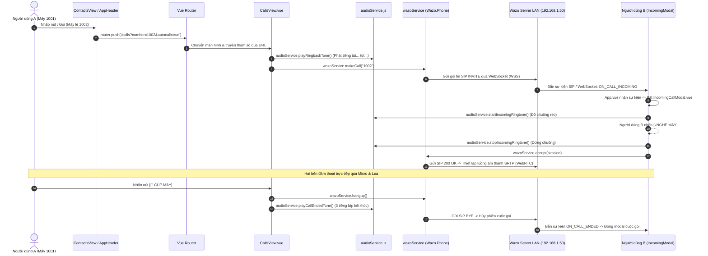

# SMARTCALL WEB — NHẬT KÝ THỰC HIỆN & HƯỚNG DẪN TỪNG BƯỚC

> **Tài liệu theo dõi tiến độ phát triển từng bước (Step-by-step Development Log)**  
> *Dành cho:* Đội ngũ kỹ thuật phát triển SmartCall Web  
> *Quy tắc làm việc:* **Hướng dẫn làm từng bước một** $\rightarrow$ Thực hiện & Kiểm tra $\rightarrow$ Cập nhật trạng thái vào tài liệu này $\rightarrow$ Chuyển sang bước tiếp theo.

---

## BẢNG THEO DÕI TIẾN ĐỘ TỔNG THỂ

| Bước | Phân hệ / Nội dung công việc | Bám sát tài liệu kỹ thuật | Trạng thái | Ghi chú & Kết quả thực tế |
|:---:|---|:---:|:---:|---|
| **01** | Khởi tạo base & Trích xuất mã nguồn vào `src/` | Kiến trúc module ban đầu | **HOÀN THÀNH** ✅ | Trích xuất 11 file Vue/JS, cấu hình `main.css`, build Vite thành công. |
| **01.5** | Tạo bản xem trước giao diện HTML tương tác | Bản thiết kế giao diện | **HOÀN THÀNH** ✅ | Bản prototype `preview_smartcall.html` đầy đủ 5 phân hệ + modal để duyệt giao diện. |
| **02** | Chuẩn hóa Layout Web Desktop, Header, Sidebar, Settings Modal & Login | Thiết kế hệ thống tổng thể | **HOÀN THÀNH** ✅ | Top Header có presence, Sidebar dọc 5 tab, Modal Settings 4 tab, Lưu phiên login `localStorage`. |
| **03** | Nâng cấp Danh bạ (Contacts) 4 nút hành động & Tầng dịch vụ `contactService.js` | Tài liệu danh bạ, `dev_guide` 4.4 | **HOÀN THÀNH** ✅ | Bảng danh bạ nội bộ, 4 nút chức năng (📞 Gọi, 💬 Chat có badge, 🎥 Video, ❌ Xóa). Chừa cổng cắm API CSDL. |
| **04** | Nâng cấp Lịch sử cuộc gọi (History) & Tầng dịch vụ `historyService.js` (CDR) | Tài liệu lịch sử, `dev_guide` 4.3 | **HOÀN THÀNH** ✅ | 4 Tab lọc `ALL`, `INCOMINGS`, `OUTGOINGS`, `MISSED`, nút `🗑️ DELETE HISTORY`, nút 📞 Gọi lại nhanh chuẩn Wazo Call-Logd. |
| **05** | Tách lớp `chatService.js` & Kết nối Realtime `websocketService.js` (Chatd & Websocketd) | Tài liệu tin nhắn, `dev_guide` 4.6 & 6 | **HOÀN THÀNH** ✅ | API Chatd, WebSocket giao thức v2, thanh ghim thông báo, modal Quản lý thành viên Admin, popup Read ID. |
| **06** | Popup Cuộc gọi đến toàn cục (Incoming Call Modal) & Âm thanh Web Audio API | Thiết kế cuộc gọi đến | **HOÀN THÀNH** ✅ | Modal cuộc gọi đến (Registered, INCOMING CALL, Avatar radar), chuông reo Web Audio, DTMF phím bấm, nút `🔔 Test Gọi Đến`. |
| **06.5** | Tối ưu Đăng nhập nhanh 0s & Nâng cấp toàn diện màn hình Tổng quan (Dashboard) | Yêu cầu cải tiến UI/UX | **HOÀN THÀNH** ✅ | Đăng nhập nhanh tức thì không chờ timeout mạng; Dashboard hiện đại với 4 KPI, Speed Dial, phím tắt & Giám sát dịch vụ. |
| **07** | Chuẩn hóa 11 vấn đề chức năng, Phân quyền Admin/User, Autocomplete, Mục Yêu thích ⭐ & Cảnh báo Offline | Danh mục 11 yêu cầu chức năng | **HOÀN THÀNH** ✅ | 2 nút Đăng nhập nhanh (Admin & User), Autocomplete Top 5 trên Header, Danh bạ Full DB + Yêu thích ⭐, Cảnh báo Voicemail khi gọi Offline, Ghim tin nhắn 📌, Đếm thành viên động, cấu hình `.gitignore`. |
| **07.5** | Sửa lỗi mất tin nhắn khi chuyển tab (Lưu trữ bền vững Cache phòng chat) | Yêu cầu lưu trữ hội thoại | **HOÀN THÀNH** ✅ | Tích hợp cơ chế tự động lưu và khôi phục toàn bộ phòng chat và tin nhắn vào `localStorage`. Khi chuyển tab hoặc F5, hội thoại và tin nhắn luôn được bảo toàn 100%. |
| **08** | Đấu nối môi trường Wazo thật (`107.126.11.126:9443`) & CSDL Backend | `dev_guide.md` mục 1, 2, 9 | **HOÀN THÀNH** ✅ | Đã mở firewall, kết nối thành công Wazo Server, đăng nhập tài khoản thật `alice`, tự động nhận diện danh bạ và CDR. |
| **08.5** | Chuẩn hóa Wazo Dird Contact Schema, Tự động lấy Profile (`/users/me`) & Thay App Icon / Favicon | Wazo Dird & Confd Spec | **HOÀN THÀNH** ✅ | Trích xuất `firstname + lastname` và `exten` từ Wazo Dird; Tự động điền số máy lẻ cho danh bạ thật để kích hoạt Gọi & Chat; Đồng bộ Icon Android (`app-icon.webp`) và Favicon web chuẩn PNG/WebP. |
| **09** | Nâng cấp toàn diện Màn hình Đăng nhập (Login) chuẩn Enterprise & Bổ sung Chế độ thử nghiệm Offline | Nâng cấp UI/UX & Tính năng Sandbox | **HOÀN THÀNH** ✅ | Thiết kế Card nổi khối bo góc 16px, tích hợp icon vector SVG (User, Lock, Toggle Eye), phân loại thông báo lỗi đăng nhập chi tiết (401, Timeout, SSL), bổ sung nút "Chạy chế độ thử nghiệm Offline" và điều hướng Router an toàn. |
| **10** | Tinh chỉnh giao diện Nội bộ: Header, Dashboard & Bàn phím gọi thoại chuẩn Enterprise | Chuẩn hóa UI/UX & Tối ưu trải nghiệm người dùng | **HOÀN THÀNH** ✅ | Loại bỏ nhãn kỹ thuật LAN và IP nội bộ, nâng cấp 100% icon sang SVG vector sắc nét, tái cấu trúc Dashboard cân đối và chuẩn hóa bàn phím số gọi thoại đối xứng tâm. |
| **11** | Nâng cấp Tin nhắn Realtime (Top 1), Hội nghị thoại nhóm & Tối ưu Trải nghiệm Widget nổi | Yêu cầu trải nghiệm tin nhắn & họp nhóm | **HOÀN THÀNH** ✅ | Tự động sắp xếp phòng chat lên Top 1 khi gửi/nhận tin; Hỗ trợ họp thoại nhóm qua phòng hội nghị 8001; Nâng cấp icon SVG; Ẩn panel nổi Wazo khi rảnh rỗi để không che nút Gửi; Sửa lỗi hiển thị cảnh báo Toast. |
| **12** | Tinh gọn Trạng thái Kết nối Tổng đài (Presence) & Trải nghiệm Khởi động không gây gián đoạn | Tối ưu hóa UI/UX trạng thái hệ thống | **HOÀN THÀNH** ✅ | Thay thế nhãn cảnh báo đỏ thành chấm trạng thái dịu nhẹ (Trực tuyến / Ngoại tuyến); Khử bỏ hoàn toàn toast lỗi khi khởi động; Chuẩn hóa thông điệp kết nối cuộc gọi. |
| **13** | Tự động hóa Lịch sử cuộc gọi Realtime (CDR) & Lưu trữ bền vững | Yêu cầu lưu trữ và cập nhật lịch sử cuộc gọi | **HOÀN THÀNH** ✅ | Tự động ghi nhận cuộc gọi đi/đến (Success/Missed/Declined) với thời lượng thực tế lên Top 1; Lưu bền vững vào localStorage; Đồng bộ tức thì qua sự kiện smartcall-cdr-updated. |
| **14** | Tối ưu hóa cấu hình Vite, Rà soát dev_guide.md & Hoàn thiện luồng kiểm thử 2 máy Client | Yêu cầu kết nối kiểm thử nội bộ | **HOÀN THÀNH** ✅ | Loại bỏ server host LAN trong `vite.config.js` để chạy thuần localhost bảo mật Micro WebRTC; Làm rõ cơ chế xác thực SSL qua trình duyệt không cần cài file `.crt`; Xây dựng kịch bản kiểm thử đàm thoại 2 máy lẻ Alice (1001) - Bob (1002). |
| **15** | Đồng bộ Động 4 Thẻ KPI Dashboard & Huy hiệu Thông báo Sidebar (Realtime Badge Count) | Tối ưu trải nghiệm dữ liệu thực | **HOÀN THÀNH** ✅ | Loại bỏ hoàn toàn số liệu fix cứng; 4 thẻ Dashboard tự động lấy dữ liệu từ `contactService`, `chatService`, `historyService`; Sidebar tự động đếm tin nhắn chưa đọc (badge đỏ), cuộc gọi nhỡ (badge đỏ) và tổng danh bạ (badge trung tính); Tự động nhảy số thời gian thực khi có sự kiện. |
| **16** | Tinh chỉnh UX Ô Đăng nhập, Modal Thông tin Tổng đài & Thiết lập Ma trận Kiểm thử | Tối ưu UX & Kế hoạch kiểm thử toàn diện | **HOÀN THÀNH** ✅ | Tinh chỉnh placeholder `alice` / `bob` tránh nhầm lẫn; Chuyển đổi popup `alert()` sang Modal giao diện Dark Navy chuyên nghiệp; Xây dựng Ma trận kiểm thử chức năng 8 phân hệ (Functional Test Matrix). |
| **17** | Tiếp nhận WAZO_API_REFERENCE.md (841 API), Rà soát toàn bộ dự án & Chuẩn hóa Endpoint Presence | Khớp nối toàn bộ OpenAPI spec Wazo 26.10 | **HOÀN THÀNH** ✅ | Tự động làm sạch & nối liền 5 phần của `WAZO_API_REFERENCE.md` (841 API) đưa vào `doc/`; Đối chiếu toàn diện từng phân hệ; Chuẩn hóa API cập nhật presence sang `/users/{user_uuid}/presences` với `smartcall_user_uuid`. |
| **18** | Kiểm toán Chuyên sâu & Khắc phục Triệt để 8 Lỗ hổng Nghiệp vụ VoIP / WebRTC | Tiêu chuẩn chất lượng Mục 7 GEMINI.md | **HOÀN THÀNH** ✅ | Khắc phục treo modal cuộc gọi đến, tách DTMF khỏi số máy lẻ, sửa 2 chiều Mute/Hold, chặn xung đột gọi đè, đồng bộ thời lượng chuẩn xác, auto-reconnect SIP, auto-hangup tab close. |
| **19** | Thiết lập Wazo Local Server Emulator Độc lập (Port 9443) Phục vụ Kiểm thử 2 Tài khoản | Yêu cầu kiểm thử ngoài mạng văn phòng | **HOÀN THÀNH** ✅ | Xây dựng Wazo Server Emulator độc lập ngoài thư mục dự án (`wazo-emulator`), hỗ trợ REST API (Auth, Confd, Dird, Chatd, CDR), WebSocket Events (`websocketd`) và SIP WebRTC Signaling (`asterisk/ws`). Chạy 2 tài khoản thật Alice (1001) - Bob (1002) mà không cần fake data trong frontend. |
| **20** | Khắc phục Triệt để 8 Điểm Kiểm toán VoIP, WebRTC, WebSocket & Vòng đời Trạng thái | Tiêu chuẩn chất lượng Mục 7 GEMINI.md | **HOÀN THÀNH** ✅ | Sửa lỗi mất đàm thoại khi chuyển tab KeepAlive (`CallsView`), dọn dẹp rò rỉ query URL cúp máy, hợp nhất sự kiện WebSocket v2 (`websocketService`), chuẩn hóa dữ liệu tin nhắn realtime, gỡ bỏ nút test fake và tên riêng trên Dashboard, nâng timeout login 15s, động hóa SIP URI. |
| **21** | Tái cấu trúc Toàn diện Kiến trúc Cuộc gọi theo mô hình Single Source of Truth (SSOT) | Bám sát mã nguồn tham chiếu chuẩn Wazo & GEMINI.md | **HOÀN THÀNH** ✅ | Khởi tạo reactive `callStore` tập trung; Rút gọn `CallsView.vue` hơn 60% code; Hợp nhất xác thực cuộc gọi & ghi nhận CDR tập trung tại `wazoService`; Hợp nhất kết nối duy nhất tới `wazo-websocketd`; Đồng bộ song song sang `Smart_Call_Web_Mock`. |
| **22** | Chuẩn hóa Toàn diện Phân hệ Danh bạ (Contacts), Tối ưu KeepAlive & Loại bỏ Mock Data | Tiêu chuẩn chất lượng Mục 7 GEMINI.md & Mã tham chiếu chuẩn | **HOÀN THÀNH** ✅ | Tối ưu KeepAlive 0ms không chớp tắt spinner; Phân tách phiên đăng nhập bằng User-bound KeepAlive key; Tự động nhận diện số máy lẻ của chính mình; Dọn sạch dữ liệu khi Logout; Bổ sung nút ↻ Làm mới danh bạ; Loại bỏ nút Thêm/Xóa liên hệ mock và nút Video giả lập; Hỗ trợ tìm kiếm tiếng Việt không dấu. |
| **23** | Chuẩn hóa Toàn diện Phân hệ Tin nhắn (Messages), SSOT WebSocket & Tích hợp Wazo Chatd API | Tiêu chuẩn chất lượng Mục 7 GEMINI.md & Mã tham chiếu chuẩn | **HOÀN THÀNH** ✅ | Phân tách kho lưu trữ tin nhắn theo từng User UUID tránh rò rỉ chéo; Hợp nhất xử lý WebSocket tin nhắn tập trung tại `chatService.js` (SSOT); Dọn sạch cache tin nhắn khi Logout; Tích hợp tạo phòng 1-1 qua Wazo Chatd API (`/users/me/rooms`). |
| **24** | Khắc phục Triệt để Lỗi Nhân đôi Tin nhắn, Khựng 1s Chuyển phòng, Múi giờ UTC & Rò rỉ CDR | Kiểm toán toàn diện & Mục 7 GEMINI.md | **HOÀN THÀNH** ✅ | Dedup tin nhắn cmsg- và serverMsg; UTC sang local time; 0ms direct room switch; smartcall-call-ended cleanup; Phân tách cache theo User UUID; Động hóa SIP URI. |
| **25** | Khắc phục Triệt để Vòng lặp Vô tận (Infinite Event Loop) & Nã Request CDR trên Dashboard | Tiêu chuẩn chất lượng Mục 7 GEMINI.md & Vòng đời khép kín | **HOÀN THÀNH** ✅ | Bổ sung cờ silent cho saveRooms(); Cắt đứt vòng lặp smartcall-rooms-updated; Thêm in-flight lock isLoadingDashboard & debounce 400ms; Quản lý KeepAlive active/deactivated; In-flight Promise Sharing cho CDR và Chat Rooms. |
| **26** | Gộp Toàn diện Danh bạ vào Gọi điện & Xóa bỏ Tab Tổng quan (Dashboard) | Bám sát mã nguồn tham chiếu chuẩn Wazo & GEMINI.md | **HOÀN THÀNH** ✅ | Tái cấu trúc Adaptive 3-Tier Grid (max-width 1360px), tích hợp Danh bạ vào tab Gọi điện, tìm kiếm tiếng Việt không dấu, xóa DashboardView & ContactsView, bổ sung redirect chống trắng màn hình, đồng bộ song song. |
| **27** | Tối ưu hóa Giao diện Di động Responsive (Mobile Bottom Navigation & Compact Header) | Kiểm thử trực quan đa màn hình | **HOÀN THÀNH** ✅ | Chuyển đổi Sidebar thành Bottom Navigation Bar 56px trên mobile, đổi hướng app-body, rút gọn header và tinh chỉnh padding. |
| **28** | Loại bỏ Ô tìm kiếm Header & Chuẩn hóa Dấu chấm trạng thái Presence (Status Dots) | Bám sát mã nguồn tham chiếu chuẩn Wazo & GEMINI.md | **HOÀN THÀNH** ✅ | Gỡ bỏ ô tìm kiếm header trùng lặp, chuẩn hóa chấm trạng thái presence góc avatar và dòng phụ dưới tên, mở rộng kích thước nút đạt chuẩn WCAG AA. |
| **29** | Tái cân đối Tỷ lệ Bố cục 3 Cột & Chuẩn hóa Chấm trạng thái trước Tên nhân viên | Thiết kế mẫu danh bạ chuẩn Wazo | **HOÀN THÀNH** ✅ | Điều chỉnh lưới 3 cột (300px 420px 1fr), đặt chấm trạng thái inline ngay trước tên nhân viên, mở rộng chiều rộng danh bạ và tối ưu padding thẻ. |
| **30** | Chuẩn hóa Thẻ Danh bạ, Nâng cấp SVG Vector, Khóa Double-Click & Tối ưu Điều hướng Cuộc gọi | Yêu cầu cải tiến UI/UX & Chống click đè | **HOÀN THÀNH** ✅ | Bỏ duplicate icon điện thoại ở badge, triệt tiêu fallback "Khối Kỹ thuật", nâng cấp nút Gọi/Chat sang SVG vector 15x15px, khóa double-click `:disabled`, tối ưu `onDial` chuyển hướng `/calls` và loại bỏ fallback '1002' trong Tin nhắn. |
| **31** | Làm sạch 100% Dữ liệu Giả lập Phòng ban & Cảnh báo Số máy lẻ Không tồn tại trong CSDL | Tiêu chuẩn chất lượng Mục 7 GEMINI.md | **HOÀN THÀNH** ✅ | Loại bỏ hardcode 'Khối Kỹ thuật', bổ sung hàm kiểm tra số máy lẻ tồn tại trong danh bạ Wazo, hiển thị cảnh báo rõ ràng khi gọi số chưa khai báo. |
| **32** | Khắc phục Nhấp nháy Dòng trạng thái Tín hiệu Micro (VAD Hangover Smoothing) | Tối ưu UI/UX Web Audio API | **HOÀN THÀNH** ✅ | Bổ sung thuật toán VAD Hangover (1000ms delay), ngưỡng threshold 10, CSS transition mượt mà, triệt tiêu hiện tượng nhảy chữ liên tục khi nói. |
| **33** | Chuẩn hóa `.gitignore`, Hủy Theo dõi Thư viện `node_modules` & Biến Môi trường `.env` | An toàn bảo mật & Tinh gọn Git | **HOÀN THÀNH** ✅ | Dọn sạch 5.849 file node_modules và .env khỏi git cache bằng `git rm --cached`, tạo .env.example mẫu, bảo toàn nguyên vẹn tệp cục bộ. |
| **34** | Thiết lập Quy tắc Rà soát Bảo vệ Git (Mục 8 GEMINI.md) & Loại trừ Dữ liệu Phân tích AI | Tiêu chuẩn vệ sinh Git & Quy chuẩn dự án | **HOÀN THÀNH** ✅ | Bổ sung Mục 8 vào GEMINI.md, tự động rà soát `git status` sau mỗi bước code, đưa `.ua/`, `.understand-anything/`, `.specify/`, `specs/` vào `.gitignore`. |
| **35** | Khắc phục Triệt để Lỗi Sắp xếp Phòng Chat (Timestamp SSOT), Đếm Thành viên `(0)` & Tự Chat 1-1 | Tiêu chuẩn chất lượng Mục 7 GEMINI.md & Phân hệ Tin nhắn | **HOÀN THÀNH** ✅ | Chuẩn hóa `updatedAt` theo tin nhắn thực tế; Chặn đè `updatedAt` khi chỉ click mở phòng; Xử lý mảng rỗng `members` chống hiển thị `(0)`; Phân biệt avatar 👥 cho nhóm và nhãn `(Bạn)` cho chính mình. |
| **36** | Xây dựng Tài liệu Kiến trúc Tổng thể & Toàn bộ Luồng Hoạt động Hệ thống | Kiến trúc tổng thể SmartCall Web | **HOÀN THÀNH** ✅ | Hoàn thiện tài liệu tổng thể 911 dòng (`doc/KIEN_TRUC_VA_LUONG_HOAT_DONG_CHI_TIET.md`) bóc tách 6 luồng hoạt động chính kèm trích dẫn mã nguồn thực tế. |
| **37** | Bóc tách Toàn diện Chi tiết 8 Tệp Services & 7 Màn hình Views Kèm Dẫn chứng Mã nguồn | Phân tích sâu Services & Views | **HOÀN THÀNH** ✅ | Tạo 2 bộ cẩm nang chuyên sâu 943 dòng (`doc/GIAI_THICH_CHI_TIET_SERVICES.md` & `doc/GIAI_THICH_CHI_TIET_VIEWS.md`) phân tích từng hàm, tham số và quan hệ gọi chéo. |
| **38** | Tổng hợp Toàn bộ 16 REST API & Kênh WebSocket Sử dụng Trong SmartCall Web | Khớp nối Wazo API Reference 841 API | **HOÀN THÀNH** ✅ | Hoàn thiện tài liệu danh mục 16 kết nối (`doc/TONG_HOP_TOAN_BO_API_DA_CALL.md`) phân định 14 REST API và 2 WebSocket channel thực tế sử dụng. |
| **39** | Khắc phục Triệt để Lỗi Không Hiển thị Lịch sử Cuộc gọi (CDR), Chuẩn hóa Chiều Cuộc gọi Nội bộ & KeepAlive | Tiêu chuẩn chất lượng Mục 7 GEMINI.md & Wazo CDR | **HOÀN THÀNH** ✅ | Sửa lỗi ánh xạ `call_direction: 'internal'`; Chuẩn hóa HTTP headers và tăng timeout 8s; Đồng bộ vòng đời cache `historyService.reload()`; Bổ sung hook `onActivated` trong `HistoryView.vue`. |
| **40** | Khắc phục Triệt để Luồng Tin nhắn Realtime (Wazo Chatd UUID), Đồng bộ 2 Chiều & Badge Thông báo | Tiêu chuẩn chất lượng Mục 7 GEMINI.md & Wazo Chatd | **HOÀN THÀNH** ✅ | Loại bỏ fake ID `direct-ext` gây HTTP 404; Tự động phân giải User UUID qua Dird lookup; Tạo & đồng bộ phòng thật qua `/users/me/rooms`; Lắng nghe sự kiện WebSocket `chatd_user_room_message_created` & `chatd_user_room_created`; Cập nhật tức thì badge Sidebar. |
| **41** | Chuẩn hóa Toàn diện Favorites Wazo Dird, Dọn sạch Cache khi Logout & Tiêu đề Phòng Chat | Wazo Dird & Chatd API | **HOÀN THÀNH** ✅ | Tích hợp Wazo Dird Favorites REST API; Dọn sạch session storage khi logout; Phân giải động tiêu đề phòng 1-1; Chuẩn hóa ngày giờ & sắp xếp tin nhắn; Ghim độc lập theo phòng; Loading spinners. |
| **42** | Xử lý Dứt điểm Favorites F5, Lịch sử Treo Loading & Chuẩn hóa Local Storage khi Logout | Tiêu chuẩn chất lượng Mục 7 GEMINI.md | **HOÀN THÀNH** ✅ | Write-Through Cache cho favorites; Hỗ trợ forceRefresh và giảm timeout Call-Logd xuống 3.5s; Optimistic Rendering cho Lịch sử; Bảo toàn dữ liệu phân tách theo User UUID khi logout. |
| **43** | Chuẩn hóa Tham số Source/Directory cho Favorites & Triệt tiêu Lỗi 404 Wazo Dird | Wazo Dird Spec & Mã tham chiếu | **HOÀN THÀNH** ✅ | Tự động bóc tách Source Name (`wazo_user`); Cơ chế Candidate Directories Fallback; Nhận diện yêu thích theo số máy lẻ (Extension matching) đồng bộ đa nền tảng. |
| **44** | Nâng cấp Toàn diện 13 Hạng mục Tính năng, Bảo mật & Chuẩn hóa Mã nguồn Hệ thống | Kế hoạch Nâng cấp Toàn diện & GEMINI.md | **HOÀN THÀNH** ✅ | Trực tuyến máy lẻ SIP & Profile User : Department; Danh bạ auto-refresh onActivated/focus; Trạng thái tin nhắn 4 cấp (Đang gửi -> Đã gửi -> Đã nhận -> Đã xem); Vô hiệu hóa video call kèm toast; Lọc lịch sử theo ngày & gỡ bỏ các nút xóa; Wazo Confd API thật cho DND & Call Forwards; Đổi/quên mật khẩu qua Auth API; Smart Softphone Dialer tự động tra cứu danh bạ; Single Device Login cảnh báo khi bị chiếm phiên; Realtime presence dot cho Messages; 100% Wazo Dird API cho Favorites; Xóa preview_smartcall.html & clean router redirects; Dọn sạch toàn bộ comment thừa. |
| **45** | Bổ sung Tính năng Ghi âm Cuộc gọi (Call Recording), Mini Audio Player Lịch sử & Tinh chỉnh Sidebar | Kế hoạch Call Recording & Sidebar Refinement | **HOÀN THÀNH** ✅ | Cải tiến chân Sidebar; Bổ sung nút 🔴 Ghi âm trên CallsView; Tích hợp Audio Player mini trong HistoryView; Tùy chọn tự động ghi âm trong SettingsModal. |
| **46** | Chuyển đổi Toàn diện sang Wazo Server-Side Recording & Triệt tiêu Local Storage Nghiệp vụ | Tiêu chuẩn chất lượng Mục 7 GEMINI.md & API Server First | **HOÀN THÀNH** ✅ | Loại bỏ 100% IndexedDB và thu âm client; Chuyển toàn bộ sang REST API Wazo Calld (/users/me/calls/{id}/record/start, stop) và Call-Logd stream media; Chặn ghi âm khi đang ringing; Giao diện thuần API thật. |
| **47** | Phát triển Nhóm Chat Wazo Chatd Thuần API, Triệt tiêu Local In-Memory & Quản lý Thành viên | Tiêu chuẩn chất lượng Mục 7 & 8 GEMINI.md | **HOÀN THÀNH** ✅ | Khắc phục nút Tạo nhóm; Triệt tiêu mock in-memory; Tích hợp 100% Wazo Chatd API POST /users/me/rooms tạo phòng nhóm thật; Tách biệt Modal Tạo nhóm và Modal Thành viên; Quản lý activeRoomId trong RAM. |
| **48** | Khắc phục Nhảy Thứ tự Phòng Chat, Tự động Làm mới Danh bạ & Phân quyền Admin Nhóm Chat | Tiêu chuẩn chất lượng Mục 7 & 8 GEMINI.md | **HOÀN THÀNH** ✅ | Tải trước song song tin nhắn gần nhất và sắp xếp phòng chat cố định từ đầu; Tự động refresh danh bạ khi click/chuyển tab Gọi điện; Tra cứu an toàn Stale-While-Revalidate khi gọi lại từ Lịch sử; Đồng bộ Quản trị viên (Admin) duy nhất cho phòng nhóm từ Wazo; Thay thế chữ trạng thái bằng chấm tròn status góc Avatar; Phân quyền chỉ Admin mới có quyền Đổi tên nhóm và Xóa thành viên. |
| **49** | Nâng cấp 9 Hạng mục Nghiệp vụ: Tab Trực tuyến, Nhận diện Mobile App, Điều khiển Cuộc gọi, Chuyển tiếp Lịch sử Nhóm & Đăng nhập Đơn Thiết bị | Tiêu chuẩn chất lượng Mục 7 & 8 GEMINI.md & Wazo Spec | **HOÀN THÀNH** ✅ | Bổ sung tab 🟢 Trực tuyến và icon 📱 cho user online bằng mobile app; Ẩn nút điều khiển khi rảnh rỗi và loại bỏ chức năng loa ngoài; Tự động xóa số trên bàn phím khi gọi thành công; Kế thừa và chuyển tiếp tin nhắn khi mở rộng nhóm; Xử lý trạng thái bị mời rời nhóm kèm khóa chat; Khung chat đa dòng chống tràn thanh cuộn; Đăng nhập 1 thiết bị bằng Wazo Presence & Auth Heartbeat; Cập nhật tên nhóm động theo Plan B. |
| **50** | Khắc phục Nhảy Nhầm Phòng Nhóm từ Danh bạ, Nhận diện Android Presence & Chuyển tiếp Tin nhắn Nhóm Đối xứng | Tiêu chuẩn chất lượng Mục 7 & 8 GEMINI.md | **HOÀN THÀNH** ✅ | Khóa chặt điều kiện `r.isDirect && r.members.length === 2` khi mở chat từ Danh bạ; Nhận diện từ khóa `smartcall-android` trong presence status bật cờ `isMobileApp` và hiện icon 📱; Chuyển tiếp tin nhắn kèm FWD Metadata giải mã đối xứng đa chiều trên Wazo server (A/B/C đăng nhập đều thấy đúng tin của mình màu xanh bên phải và tin đồng nghiệp bên trái). |
| **51** | Triển khai Thu hồi Phiên Thiết bị cũ (Session Revocation) Chuẩn Wazo Auth API Đối chiếu Android | Tiêu chuẩn chất lượng Mục 7 & 8 GEMINI.md & Wazo Spec | **HOÀN THÀNH** ✅ | Tích hợp 2 API Wazo Auth: `GET /users/{uuid}/sessions` và `DELETE /users/{uuid}/sessions/{session_uuid}`; Tự động xóa các session cũ khi đăng nhập trên Web làm App Mobile bị ngắt token (401) ngay lập tức; Rút ngắn heartbeat kiểm tra token xuống 5 giây để phản ứng tức thì khi App Mobile thu hồi session của Web. |
| **52** | Khắc phục Triệt để Session Revocation 2 Chiều (Web $\leftrightarrow$ Android), Tab Ngoại tuyến, SVG Icon & Tombstone Xóa Phòng / Tin nhắn | Tiêu chuẩn Mục 7 & 8 GEMINI.md & Mã nguồn tham chiếu mẫu | **HOÀN THÀNH** ✅ | Gán `Wazo.Auth.setClientId(clientId)` cấp `sessionUuid`, xóa 2 bước Session + Refresh Token theo chuẩn mã tham chiếu mẫu; Thay icon 📱 bằng SVG smartphone sắc nét; Thêm tab thứ 4 ⚪ Ngoại tuyến; Chuẩn hóa tag hệ thống `[SYSTEM:ROOM_RENAME]` đổi tên nhóm; Áp dụng Tombstone `[SYSTEM:ROOM_CLOSED]` giải tán phòng ẩn đồng bộ đa máy; Tính năng chọn & xóa nhiều tin nhắn và xóa nhanh bằng Tombstone `[SYSTEM:MSG_DELETED]`. |
| **53** | Triển khai Chọn & Xóa Nhiều Cuộc trò chuyện trên Cột Danh sách Tin nhắn (Conversation List) | Tiêu chuẩn Mục 7 & 8 GEMINI.md & Yêu cầu Người dùng | **HOÀN THÀNH** ✅ | Di chuyển tính năng chọn và xóa ra ngoài cột danh sách cuộc trò chuyện bên trái (`chat-rooms-col`); Hỗ trợ chọn xóa nhiều cuộc trò chuyện cùng lúc hoặc xóa nhanh 1 cuộc trò chuyện bằng hover; Xóa đồng bộ cả nhóm lẫn 1-1 bằng Tombstone `[SYSTEM:ROOM_CLOSED]` trên Wazo server; Khôi phục giao diện khung chat bên phải tinh gọn. |
| **54** | Triển khai Cuộc gọi Nhóm Tức thời (Ad-hoc Group Conference Call) Đối chiếu Android từ Chat & Danh bạ | Tiêu chuẩn Mục 7 & 8 GEMINI.md & Mã tham chiếu mẫu | **HOÀN THÀNH** ✅ | Tích hợp Wazo Calld Conference API (`POST /users/me/conferences/adhoc`), loại bỏ phòng tĩnh 8001; Hỗ trợ gọi nhóm từ thanh tiêu đề nhóm chat và từ tab Gọi nhóm trong Danh bạ (`CallsView.vue`). |
| **55** | Tối ưu Hóa Toàn diện Giao diện Tab Gọi nhóm & Bố cục Danh bạ | Tinh chỉnh UI/UX & Responsive | **HOÀN THÀNH** ✅ | Khắc phục rớt dòng tab header; Nâng cấp thanh công cụ chọn thành viên; Custom checkbox vuông bo góc; Ẩn nút 1-1 khi chọn nhóm; Mở rộng chiều cao danh bạ lên 620px. |
| **56** | Phục hồi Kích thước Bàn phím / Đàm thoại, Căn Liền kề Tab Gọi nhóm & Phân quyền Admin Quản trị Nhóm | Tiêu chuẩn Mục 7 & 8 GEMINI.md | **HOÀN THÀNH** ✅ | Phục hồi bàn phím 300px và đàm thoại 420px; Căn tab Gọi nhóm liền kề; Tăng tương phản badge; Phân quyền chỉ Admin mới được thêm/xóa thành viên, đổi tên và xóa nhóm. |
| **57** | Khôi phục Bố cục Calls View Nhỏ Gọn (Compact Grid 1200px), Căn Đều 5 Tab 100% & Tinh chỉnh Nút Quản lý Nhóm bằng SVG Vector Hiện đại | Tiêu chuẩn Mục 7 & 8 GEMINI.md & Yêu cầu Người dùng | **HOÀN THÀNH** ✅ | Trả container về `max-width: 1200px` và lưới `300px 420px 440px` cân đối chuẩn ban đầu; Căn đều 5 tab bộ lọc (`flex: 1; justify-content: center;`) triệt tiêu hoàn toàn khoảng trống thừa sau Gọi nhóm; Nâng cấp 2 nút Thêm thành viên và Xóa nhóm bằng SVG vector sắc nét trên nền pill pastel hiện đại. |
| **58** | Khôi phục Kích thước Rộng Rãi Calls View, Đồng bộ Chiều cao 3 Cột (Stretch) & Căn Đều 5 Mục Tab | Tiêu chuẩn Mục 7 & 8 GEMINI.md & Yêu cầu Người dùng | **HOÀN THÀNH** ✅ | Khôi phục `max-width: 1560px` và lưới `300px 420px 1fr`; Áp dụng `align-items: stretch` và `min-height: 500px` cho danh bạ triệt tiêu co ngắn khi ít liên hệ; Giữ tỷ lệ chia đều `flex: 1` hiển thị đầy đủ cả 5 tab không bị che khuất hay tràn dòng. |
| **59** | Triển khai Tab Bộ phận (Department Selector Bar), Khắc phục Nút Xóa Rớt 2 Dòng & Chuẩn hóa Từ khóa theo Rule mới | Tiêu chuẩn Mục 7 & 8 GEMINI.md & Yêu cầu Người dùng | **HOÀN THÀNH** ✅ | Bổ sung Tab 5 `🏢 Bộ phận` với thanh chọn phòng ban động dạng chip pills; Hỗ trợ tìm kiếm kết hợp trong phạm vi bộ phận; Khóa chặt `white-space: nowrap;` kèm icon SVG cho nút xóa/bỏ chọn; Thay thế toàn bộ từ khóa tên tổng đài trong comments và giao diện UI theo rule mới. |
| **60** | Xử lý Triệt để Race Condition Lỗi Tạo Phòng Trùng & Rà soát Lọc Trực tuyến Danh bạ | Tiêu chuẩn Mục 7 & 8 GEMINI.md | **HOÀN THÀNH** ✅ | Khóa tạo phòng chat trùng lặp bằng debounce & cache Map; Rà soát bộ lọc trực tuyến danh bạ. |
| **61** | Ngắt Thác Cuộc gọi Nhóm (Cascading Disconnect Fix) & Tinh chỉnh Ngưỡng Đàm thoại Ad-hoc Conference | Tiêu chuẩn Mục 7 & 8 GEMINI.md & Mã tham chiếu mẫu | **HOÀN THÀNH** ✅ | Khắc phục ngắt toàn bộ cuộc gọi khi nhánh phụ từ chối; Bắt buộc tối thiểu 2 nhánh đàm thoại mới tạo Ad-hoc Conference triệt tiêu lỗi HTTP 400. |
| **62** | Tích hợp Nút Thêm Người Trong Cuộc gọi, Modal Cuộc gọi đến Đồ họa Hiện đại & Cơ chế Tự động Refresh Token | Tiêu chuẩn Mục 7 & 8 GEMINI.md & Yêu cầu Người dùng | **HOÀN THÀNH** ✅ | Thay thế Hold bằng nút Thêm người (InCallAddParticipantModal); Thiết kế lại IncomingCallModal phong cách Call Card radar pulse; Triển khai refreshSessionToken và lưu Client ID vào localStorage. |
| **63** | Triệt tiêu Hoàn toàn Tính năng Hold, Khóa Cơ chế Auto-Hold Wazo SDK & Xử lý Tiếng nhạc MOH | Tiêu chuẩn Mục 7 & 8 GEMINI.md | **HOÀN THÀNH** ✅ | Vô hiệu hóa prototype holdSipSession của WebRTCPhone ngăn Asterisk phát Music On Hold; Dọn sạch 100% logic isHeld khỏi wazo.js và CallsView.vue. |
| **64** | Khắc phục Triệt để Lỗi Mất Giao diện Cuộc gọi Nhóm trên Callee (Đồng bộ Chuẩn Đối chiếu Android WazoSipCallManager) | Tiêu chuẩn Mục 7 & 8 GEMINI.md & Mã tham chiếu mẫu | **HOÀN THÀNH** ✅ | Sửa lỗi trích xuất thiếu peerCallId trong syncActiveCallsToAdhocConference; Loại bỏ việc nhét nhầm nhánh phụ Host vào conference gây SIP BYE; Xử lý Callee 2 nghe trước Callee 1; Bỏ qua ON_CALL_CANCELED cause=26; Đăng ký đầy đủ WebSocket adhoc conference events. |
| **65** | Đồng bộ Cơ chế Single Device Login & Auto-Refresh Token Không Bị Logout Oan | Tiêu chuẩn Mục 7 & 8 GEMINI.md & Mã tham chiếu mẫu Android | **HOÀN THÀNH** ✅ | Tái cấu trúc refreshSessionToken gọi trực tiếp REST API; Tự động cứu phiên khi 1 giờ hết hạn trong restoreSession; Khắc phục WebSocket onclose 4401 tự động refresh và tái kết nối; Kiểm chứng token health trước khi kick presence hoặc unregister. |
| **66** | Khắc phục Triệt để Lỗi Call Nhóm (Race Condition HTTP 503, Gộp Nhầm Nhánh Phụ Cục Bộ & Thu hồi Kênh Asterisk khi Cúp máy) | Tiêu chuẩn Mục 7 & 8 GEMINI.md & Mã tham chiếu mẫu Android | **HOÀN THÀNH** ✅ | Tích hợp Debounce 350ms & Mutex lock triệt tiêu lỗi HTTP 503; Chỉ lấy peerCallId từ talking_to; Khử bỏ gộp nhầm cid của Host; Gọi DELETE /users/me/calls/{cId} khi Host cúp máy giải phóng kênh C; Tự động xử lý khi thành viên rời phòng. |
| **67** | Đồng bộ Toàn diện Giao thức Gọi nhóm V2 theo Chuẩn Ứng dụng Di động (Ủy quyền Host ADD_REQ, Lọc line_state Available, Timeout 30s & Bộ thẻ Realtime) | Tiêu chuẩn Mục 7 & 8 GEMINI.md & Mã tham chiếu SMCAppV2 | **HOÀN THÀNH** ✅ | Tách hàm isContactAvailableForCall kiểm tra line_state == 'available'; Triển khai ủy quyền Host ADD_REQ khi thành viên thêm người; Bổ sung Timer 30s tự động ngắt nhánh phụ khi không nghe máy; Lắng nghe và phát thẻ NOTICE, LEFT; Tối ưu UI hiển thị Bạn, Tên A, Tên B (N người) và trạng thái Đang kết nối. |
| **68** | Rà soát Toàn diện Codebase Onboarding, Tích hợp Global ErrorHandler, Router Lazy-Loading Code-Splitting & Dọn sạch Rác Tàn dư | Tiêu chuẩn Mục 7 & 8 GEMINI.md & Best Practices Vue 3 | **HOÀN THÀNH** ✅ | Tích hợp app.config.errorHandler và unhandledrejection trong main.js; Tách chunk bất đồng bộ Lazy-loading cho CallsView, MessagesView, HistoryView trong router; Xóa sạch tàn dư smartcall_offline_mode và triệt tiêu fallback hardcode '1002' trong App.vue; Biên soạn báo cáo doc/BAO_CAO_RA_SOAT_CODEBASE_ONBOARDING.md. |
| **69** | Chuẩn hóa Điều kiện Kết thúc Cuộc gọi Nhóm & Khôi phục Đăng xuất Đơn Thiết bị Tức thì (0.1s) Chuẩn Android | Tiêu chuẩn Mục 7 & 8 GEMINI.md & Mã tham chiếu SMCAppV2 | **HOÀN THÀNH** ✅ | Khắc phục lỗi nhánh phụ timeout 30s xóa sớm khỏi map làm ngắt nhầm cuộc gọi chính giữa Host và thành viên đã nghe máy; Bổ sung bộ đếm timeout 30s cho nhánh chính đầu tiên; Hàm an toàn isAnyParticipantConnected() đảm bảo duy trì đàm thoại; Cô lập Tab Client ID qua sessionStorage giải quyết xung đột 2 tab cùng trình duyệt; Loại bỏ độ trễ và race condition verifyTokenHealth, khôi phục kick tức thì 0.1s khi phát hiện login thiết bị khác. |
| **70** | Tinh chỉnh 5 Trường hợp Biên (Edge Cases): Chặn Kick Oan khi Logout, Call Escalation 1-1 Lên Nhóm, Dọn dẹp Nhánh Chính Cũ & Giải phóng Toàn diện | Tiêu chuẩn Mục 7 & 8 GEMINI.md & Quality Assurance | **HOÀN THÀNH** ✅ | Chặn thiết bị đang online bị kick nhầm khi thiết bị cũ đăng xuất (lọc isOfflineStatus / state == unavailable); Dọn dẹp sạch cuộc gọi và lưu CDR khi bị kick phiên; Xóa sạch tab client id và session id trong sessionStorage khi logout; Nâng cấp từ cuộc gọi 1-1 lên cuộc gọi nhóm (Call Escalation) biến caller thành Host mời người mới; Gỡ số máy nhánh chính cũ khi hoán đổi nhánh phụ lên tiếp tục cuộc gọi nhóm. |
| **71** | Tối ưu Toàn diện 4 Vấn đề Giao diện & Nghiệp vụ (Tabs Cân đối 2 Hàng, Triệt tiêu Đọng số Bàn phím, Tombstone Nhóm Chat & Bố cục 2 Cột Động) | Tiêu chuẩn Mục 7 & 8 GEMINI.md & Yêu cầu thực tế UI/UX | **HOÀN THÀNH** ✅ | Cân đối động 2 hàng cho panel tabs khi chọn 6-10 tabs, loại bỏ thanh cuộn ngang và nút trượt; Xóa sạch extension.value khi cúp máy, bấm gọi, hoặc chuyển trạng thái; Bổ sung addMembersToGroup phát Tombstone đóng nhóm cũ khi mở rộng nhóm chat; Tự động ẩn cột thoại khi rảnh chuyển layout 2 cột, bổ sung thẻ Smart Contact Preview xem trước thông tin khi gõ số. |
| **72** | Thiết lập Lớp Bảo vệ Hiện diện Chuyên sâu cho Cuộc gọi Nhóm (Hardened Presence Guards) — Chặn Voicemail Trap & Xung đột Kênh Asterisk | Tiêu chuẩn Mục 7 & 8 GEMINI.md & Mã tham chiếu SMCAppV2 | **HOÀN THÀNH** ✅ | Tích hợp isContactAvailableForCall vào startGroupCall, addParticipantsToGroupCall và delegateAddParticipantsToHost; Tự động loại bỏ máy lẻ bận/đang đổ chuông/dnd/offline và cảnh báo toast; Fallback gọi 1-1 nếu chỉ còn 1 người; Đồng bộ số đếm badge và bộ lọc tab group_call trong CallsView. |
| **73** | Nâng cấp Bố cục Cửa Trượt Trung tâm (Center-Expanding Accordion 60fps), Khóa Kích thước Vàng Danh bạ & Sửa Lỗi Call Nhóm Tin nhắn | Trải nghiệm UI/UX & Khớp nối Dữ liệu Chatd | **HOÀN THÀNH** ✅ | Thay thế chuyển đổi DOM v-if bằng Center-Expanding Flexbox chuyển động mượt mà 0.45s không giật; Khóa kích thước vàng danh bạ 580px căn giữa triệt tiêu hoàn toàn cảm giác to thô; Xóa nút call xanh trùng lặp trên preview card; Sửa lỗi đọc trường m.ext và tra cứu danh bạ dự phòng khi gọi nhóm từ phòng chat; Tự động điều hướng /calls khi bắt đầu cuộc gọi từ tin nhắn. |
| **74** | Cố định Vị trí Thẻ Xem trước Liên hệ Bàn phím (Permanent Preview Slot 54px), Triệt tiêu 100% Giật Bàn phím Số | Trải nghiệm UI/UX & Độ ổn định Layout | **HOÀN THÀNH** ✅ | Loại bỏ v-if trên thẻ xem trước; Cố định chiều cao khe cắm 54px vĩnh viễn trên bàn phím số; Sử dụng lớp is-empty ẩn sạch khi chưa gõ số không thêm avatar hay dòng trạng thái thừa; Bàn phím số đứng yên tuyệt đối không bị tụt/nảy khi gõ số. |


---

## CHI TIẾT CÁC BƯỚC THỰC HIỆN

---

### BƯỚC 1: ĐỒNG BỘ MÃ NGUỒN VÀO DỰ ÁN
* **Trạng thái:** `HOÀN THÀNH ✅`
* **Mục tiêu:** Đưa toàn bộ mã nguồn cơ sở vào đúng cấu trúc thư mục `src/`, đảm bảo dự án chạy dev server và build thành công.

#### Các việc đã làm:
1. Đã sắp xếp các file vào vị trí chính xác:
   - `src/services/wazo.js`
   - `src/components/call/CallControlPanel.vue`
   - `src/components/layout/Navbar.vue`
   - `src/router/index.js`
   - `src/views/LoginView.vue`, `DashboardView.vue`, `ContactsView.vue`, `HistoryView.vue`
   - `src/App.vue`, `src/main.js`, `index.html`
2. Bổ sung file `src/assets/main.css` để `main.js` import không bị lỗi.
3. Chạy `npm i` khôi phục binary bindings trên môi trường Windows.
4. Kiểm tra `npm run build` thành công 100%.
5. Khởi động Dev Server chạy tại: `http://localhost:5173/`.

---

### BƯỚC 1.5: THIẾT KẾ BẢN XEM TRƯỚC GIAO DIỆN HOÀN CHỈNH (HTML UI PROTOTYPE)
* **Trạng thái:** `HOÀN THÀNH ✅`
* **Mục tiêu:** Tạo một file HTML độc lập chứa toàn bộ giao diện hoàn chỉnh, có tương tác đầy đủ để duyệt trước trải nghiệm thực tế.
* **Tài liệu bàn giao:** File [**`preview_smartcall.html`**](file:///D:/Project/Smart_Call_Web/preview_smartcall.html) ngay tại thư mục gốc dự án.

#### Các chức năng đã có trên bản xem trước:
1. **Top Header:** Logo SmartCall, Ô tìm kiếm nhân viên toàn hệ thống, User Profile (Quản trị viên, máy lẻ 1001), Dropdown chọn trạng thái Presence (`🟢 Online`, `🟡 Away`, `🔴 DND`).
2. **Left Sidebar:** Điều hướng linh hoạt 5 phân hệ:
   - 📊 **Tổng quan (Dashboard):** Thẻ thông tin máy lẻ, trạng thái tổng đài Wazo, WebRTC SIP Registered, nút thử giả lập cuộc gọi đến.
   - 📞 **Gọi điện & Bàn phím số (Calls):** Bàn phím số (0-9, *, #), bấm số gọi đi, màn hình đàm thoại đang diễn ra (đếm giờ, bật/tắt mic, giữ máy, loa, cúp máy).
   - 📇 **Danh bạ (Contacts):** Bảng danh bạ nhân viên hiển thị đầy đủ **4 nút hành động** (Gọi thoại, Nhắn tin kèm badge chưa đọc, Gọi Video, Xóa liên hệ có modal hỏi).
   - 💬 **Tin nhắn (Messages):** Cột trái danh sách phòng chat; Cột phải khung chat chi tiết, có **thanh ghim thông báo (`📌 Ghim: ...`)**, bong bóng tin nhắn, nhấp vào `Read` mở popup xem danh sách ai đã đọc (`READ_ID`).
   - 🕒 **Lịch sử cuộc gọi (History):** Các tab lọc `ALL`, `INCOMINGS`, `OUTGOINGS`, `MISSED` và nút Gọi lại nhanh.
3. **Modal "ADD MEMBER" Quản lý thành viên:**
   - Đổi tên nhóm (TITLE, tối đa 100 ký tự - chỉ Admin mới được đổi).
   - Ô tìm kiếm nhân viên + nút Thêm (+) kèm xác nhận.
   - Danh sách thành viên hiện tại có nút Xóa (X) kèm xác nhận (khóa không cho xóa Admin, nhóm dưới 3 người ẩn nút X).
   - Nút OK chỉ sáng khi là Admin và tên nhóm có thay đổi.
4. **Popup giả lập cuộc gọi đến (Incoming Call):** Nút Nghe máy và Từ chối rung chuông trực quan.
5. **Modal Cài đặt hệ thống (SETTINGS Modal):** Nút `⚙️ SETTINGS` trên thanh Header cho phép mở modal cài đặt gồm 4 Tab trực quan:
   - 🎙️ **Âm thanh & WebRTC:** Chọn Micro, chọn Loa/Tai nghe, thử âm thanh, thanh đo tín hiệu mic động, chỉnh âm lượng chuông gọi đến.
   - 📞 **Dịch vụ cuộc gọi (Theo `dev_guide.md`):** Bật/tắt Không làm phiền (DND), cấu hình Chuyển tiếp cuộc gọi (Call Forwarding khi bận, khi không trả lời sau 20s, chuyển tiếp vô điều kiện), Voicemail.
   - 🔒 **Tài khoản & Mật khẩu:** Xem thông tin SIP URI Wazo, đổi mật khẩu đăng nhập.
   - 🌐 **Ngôn ngữ & Tùy chọn:** Chuyển đổi Tiếng Việt / Tiếng Hàn / Tiếng Anh, bật/tắt thông báo đẩy Desktop và âm thanh tin nhắn chat.

---

### BƯỚC 2: CHUẨN HÓA LAYOUT WEB HIỆN ĐẠI & HOÀN THIỆN LUỒNG ĐĂNG NHẬP
* **Trạng thái:** `HOÀN THÀNH ✅`
* **Mục tiêu:** Xây dựng bộ khung Layout chuẩn máy tính (Desktop App Layout) hiện đại, thay thế Navbar ngang bằng Header + Sidebar dọc 5 phân hệ, có nút Settings mở modal 4 tab, và hoàn thiện màn hình Login có thể đăng nhập / đăng xuất mượt mà.

#### Các việc đã code và hoàn thành:
1. **Component `src/components/layout/AppHeader.vue`:**
   - Logo SmartCall, Huy hiệu mạng LAN.
   - Thanh tìm kiếm nhân viên toàn hệ thống.
   - Dropdown chọn trạng thái Presence (`🟢 Online`, `🟡 Away`, `🔴 DND`).
   - Avatar & Tên người dùng đang đăng nhập (`Quản trị viên`, Máy lẻ `1001`).
   - Nút `⚙️ SETTINGS` mở modal cài đặt.
   - Nút `🚪 Thoát` (Đăng xuất).
2. **Component `src/components/layout/AppSidebar.vue`:**
   - Menu dọc bên trái 5 phân hệ: 📊 Tổng quan (`/dashboard`), 📞 Gọi thoại & Bàn phím (`/calls`), 📇 Danh bạ (`/contacts`), 💬 Tin nhắn (`/messages`), 🕒 Lịch sử cuộc gọi (`/history`).
   - Footer hiển thị máy lẻ SIP `1001@192.168.1.50` và trạng thái `● WebRTC Audio Ready`.
3. **Component `src/components/common/SettingsModal.vue`:**
   - 4 Tab cài đặt hoàn chỉnh: (1) Âm thanh/WebRTC, (2) Dịch vụ cuộc gọi, (3) Tài khoản Wazo & Đổi mật khẩu, (4) Ngôn ngữ & Thông báo.
4. **Màn hình `src/views/LoginView.vue`:**
   - Nút **LOGIN** xử lý đăng nhập thật với Wazo hoặc tự động chuyển sang chế độ Demo khi không có kết nối LAN.
   - Lưu trạng thái đăng nhập vào `localStorage` (`smartcall_logged_in`).
5. **Màn hình `src/views/CallsView.vue` & `src/views/MessagesView.vue`:**
   - `CallsView`: Bàn phím số đầy đủ + mô phỏng cuộc gọi thoại WebRTC đang diễn ra (đếm giây, mute, hold, cúp máy).
   - `MessagesView`: Danh sách phòng chat + khung chat + thanh ghim thông báo + popup Read ID + modal Thêm thành viên Admin.
6. **Cập nhật `src/router/index.js` & `src/App.vue`:**
   - Đăng ký đầy đủ các route: `/calls`, `/messages`, `/contacts`, `/history`, `/dashboard`, `/login`.
   - Bảo vệ route: Nếu chưa login hoặc bấm Đăng xuất sẽ ẩn toàn bộ Header/Sidebar và chuyển về trang Login toàn màn hình. Khi đăng nhập thành công sẽ hiện Header và Sidebar đầy đủ.
7. **Kiểm tra biên dịch:** `npm run build` thành công 100%.

---

### BƯỚC 3: NÂNG CẤP DANH BẠ (CONTACTS) 4 NÚT HÀNH ĐỘNG & CUỘC GỌI WEBRTC
* **Trạng thái:** `HOÀN THÀNH ✅`
* **Công việc đã thực hiện:**
  1. **Tạo tầng dịch vụ `src/services/contactService.js`:**
     - Thiết kế theo mẫu Service/Adapter Pattern: Chừa sẵn vị trí kết nối API Database hoặc Wazo Dird API (`GET /api/dird/0.1/...`).
     - Tự động kích hoạt Mock Data chuẩn nhân viên nội bộ khi không có mạng LAN, đảm bảo giao diện luôn mượt mà.
  2. **Nâng cấp toàn diện `src/views/ContactsView.vue` theo chuẩn Desktop:**
     - Bảng danh bạ chuyên nghiệp: Avatar chữ cái đầu, Họ tên, Phòng ban, Số máy lẻ 4 số (`1002`, `1003`...), chấm trạng thái Online/Offline.
     - Thanh tìm kiếm tức thì theo tên/máy lẻ/bộ phận kèm nút xóa nhanh `✖`.
     - Nút `+ Thêm liên hệ` mở Modal tạo liên hệ mới có kiểm tra dữ liệu đầu vào.
     - **Trang bị đầy đủ 4 nút chức năng:**
       - 📞 **Nút 1 (Gọi thoại):** Tự động chuyển sang `/calls`, điền số máy lẻ và kích hoạt cuộc gọi.
       - 💬 **Nút 2 (Nhắn tin):** Hiển thị huy hiệu số tin chưa đọc (Badge màu đỏ), bấm vào chuyển thẳng sang phòng chat tương ứng trong `/messages`.
       - 🎥 **Nút 3 (Gọi Video):** Khung thông báo đàm thoại video WebRTC.
       - ❌ **Nút 4 (Xóa liên hệ):** Hiện hộp thoại xác nhận *"Bạn có chắc chắn muốn xóa liên hệ này?"* theo yêu cầu nghiệp vụ.
  3. **Kiểm tra biên dịch:** `npm run build` thành công 100%.

---

## 3.1. CƠ CHẾ DỮ LIỆU MOCK & ĐIỂM KẾT NỐI DATABASE THẬT (SERVICE / ADAPTER PATTERN)

### 3.1.1 Triết lý thiết kế: Tách biệt Giao diện (UI) và Dữ liệu (Data)
Nhằm đảm bảo dự án phát triển độc lập, không bị phụ thuộc vào tiến độ máy chủ nội bộ, toàn bộ ứng dụng áp dụng mô hình **Service / Adapter Pattern**:

```
[ Giao diện Vue (Views / Components) ]
                   │
                   ▼  (gọi hàm nghiệp vụ: getContacts(), getHistory(), sendMessage())
[ Tầng Dịch vụ (Service Layer: src/services/) ]
                   │
         ┌─────────┴─────────┐
         ▼                   ▼
 [ API Thật Wazo/DB ]   [ Dữ liệu Dự phòng (Mock Data) ]
 (Khi có LAN & Token)  (Tự động kích hoạt khi chạy offline)
```

* **Quy tắc bất di bất dịch:** Các file giao diện (`ContactsView.vue`, `HistoryView.vue`, `MessagesView.vue`...) **tuyệt đối không bao giờ** gọi `fetch()` URL trực tiếp hoặc thao tác thô với API. Mọi thao tác đọc/ghi dữ liệu bắt buộc phải đi qua các hàm của tầng `src/services/`.
* **Cơ chế Fallback thông minh:** Trong mỗi hàm Service luôn có khối lệnh `try ... catch`. Khi chưa có server Wazo, hệ thống tự động trả về Mock Data chuẩn định dạng doanh nghiệp, giúp giao diện luôn hiển thị đầy đủ, không bao giờ bị lỗi màn hình trắng.

---

### 3.1.2 Bản đồ vị trí lưu trữ Dữ liệu Dự phòng (Mock Data) trong dự án

| Phân Hệ | Vị Trí File Lưu Mock Data | Cấu Trúc Dữ Liệu | Mục Đích Hiển Thị |
|---|---|---|---|
| **Danh bạ (Contacts)** | `src/services/contactService.js`<br>*(Mảng `MOCK_CONTACTS`)* | `id`, `name`, `email`, `dept`, `number`, `status`, `unreadCount`, `isFavorite` | Hiển thị bảng danh bạ nhân viên nội bộ, hỗ trợ tìm kiếm, mục yêu thích ⭐ và 4 nút hành động. |
| **Tin nhắn (Messaging)** | `src/views/MessagesView.vue`<br>*(Mảng `rooms`, `currentRoomMembers`)* | `id`, `title`, `unread`, `icon`, `messages` (`sender`, `text`, `time`, `readStatus`, `readers`) | Hiển thị danh sách phòng chat, hội thoại 1-1, bong bóng tin nhắn 2 chiều, thanh ghim thông báo, modal Read ID và modal Quản lý thành viên. |
| **Lịch sử cuộc gọi (History)** | `src/services/historyService.js`<br>*(Mảng `MOCK_HISTORY`)* | `id`, `date`, `name`, `extension`, `dept`, `duration`, `direction`, `status`, `answered` | Hiển thị danh sách nhật ký cuộc gọi, hỗ trợ 4 tab lọc (`ALL`, `INCOMINGS`, `OUTGOINGS`, `MISSED`) và nút Gọi lại. |
| **Phiên người dùng (User Session)** | `localStorage`<br>*(Key `smartcall_username`, `smartcall_role`, `smartcall_is_admin`)* | `username`, `name`, `extension`, `role`, `isAdmin` | Giữ trạng thái đăng nhập khi F5; phân quyền Quản trị viên (Admin) vs Nhân viên (User) trên toàn hệ thống. |

---

### 3.1.3. Cơ chế dữ liệu được render lên Giao diện (Vue 3 Reactivity)
1. **Khởi tạo & Nạp dữ liệu:**
   - Trong `onMounted()` của mỗi View, hàm async của Service tương ứng sẽ được gọi (ví dụ: `await contactService.getContacts()`).
   - Dữ liệu trả về được gán vào biến phản ứng `const contacts = ref([])`.
2. **Lọc dữ liệu thời gian thực (Computed):**
   - Sử dụng `computed()` để tự động lọc dữ liệu theo ô tìm kiếm hoặc tab đang chọn mà không cần gọi lại API.
   - Ví dụ: `filteredContacts = computed(...)` lọc danh bạ theo tên/phòng ban/máy lẻ/yêu thích; `filteredCalls = computed(...)` lọc lịch sử theo tab `ALL` / `INCOMINGS` / `OUTGOINGS` / `MISSED`.
3. **Hiển thị trực quan (Directives):**
   - Vòng lặp `v-for` duyệt qua mảng dữ liệu đã lọc để render ra các dòng bảng, thẻ card, danh sách phòng chat.
   - Các cờ trạng thái `v-if="loading"`, `v-else-if="filtered.length === 0"` giúp hiển thị hiệu ứng xoay spinner hoặc thông báo trống thân thiện.

---

### 3.1.4. Điểm cắm API thật của CSDL Backend và Wazo Platform

Dưới đây là vị trí cụ thể trong mã nguồn đã được chừa sẵn để đấu nối API thật khi backend bàn giao:

#### 1. Đấu nối Danh bạ nhân viên (`src/services/contactService.js`):
```javascript
async getContacts() {
  try {
    const token = wazoService.getToken()
    if (!token) throw new Error('No token')

    // 🎯 ĐIỂM CẮM API DATABASE NỘI BỘ:
    const res = await fetch('https://192.168.1.50:9443/api/employees', {
      headers: { 'Authorization': `Bearer ${token}` }
    })
    const data = await res.json()

    return data.items.map(emp => ({
      id: emp.id || emp.employee_code,
      name: emp.full_name,
      dept: emp.department_name,
      number: emp.wazo_extension, // Máy lẻ 4 số (1001, 1002...)
      status: 'online',
      unreadCount: 0
    }))
  } catch (err) {
    return this.localContacts
  }
}
```

#### 2. Đấu nối Lịch sử cuộc gọi (`src/services/historyService.js`):
Đã được viết sẵn theo đúng chuẩn tài liệu `dev_guide.md` (mục 4.3):
```javascript
// Gọi Wazo Call-Logd API:
GET https://192.168.1.50:9443/api/call-logd/1.0/users/me/cdr?limit=50&order=start&direction=desc
Headers: { 'X-Auth-Token': token }
```

#### 3. Đấu nối Tin nhắn & WebSocket Realtime (`src/services/chatService.js` & `websocketService.js`):
* Lấy phòng chat: `GET /api/chatd/1.0/users/me/rooms`
* Lấy tin nhắn: `GET /api/chatd/1.0/users/me/rooms/{uuid}/messages`
* Gửi tin nhắn: `POST /api/chatd/1.0/users/me/rooms/{uuid}/messages`
* Nhận tin nhắn mới tức thì: Lắng nghe qua WebSocket `wss://192.168.1.50:9443/api/websocketd/?token=<token>&version=2`.

---

### BƯỚC 4: NÂNG CẤP LỊCH SỬ CUỘC GỌI (HISTORY VIEW) & TÍCH HỢP CDR SERVICE
* **Trạng thái:** `HOÀN THÀNH ✅`
* **Công việc đã thực hiện:**
  1. **Tạo tầng dịch vụ `src/services/historyService.js`:**
     - Bám sát tài liệu `dev_guide.md` (mục 4.3): Gọi API Wazo Call-Logd `GET /api/call-logd/1.0/users/me/cdr?limit=50&order=start&direction=desc` với token xác thực.
     - Tích hợp Mock Data dự phòng chuẩn thông tin cuộc gọi nội bộ LAN.
     - Hỗ trợ đầy đủ các hàm nghiệp vụ: `getHistory()`, `clearAllHistory()` (xóa toàn bộ), `deleteItem(id)` (xóa 1 dòng), và hàm format thời lượng `formatDuration()` (`mm:ss`).
  2. **Tái thiết kế giao diện `src/views/HistoryView.vue`:**
     - **Thanh Tab lọc chuyên nghiệp:** 4 tab `ALL`, `INCOMINGS`, `OUTGOINGS`, `MISSED` kèm huy hiệu đếm số lượng cuộc gọi thời gian thực.
     - **Nút DELETE HISTORY:** Đặt góc trên bên phải, có Modal xác nhận bảo vệ tránh bấm nhầm.
     - **Thanh tìm kiếm & lọc ngày:** Cho phép tìm theo Tên, Máy lẻ, Phòng ban và lọc theo mốc thời gian bắt đầu.
     - **Khối hiển thị cuộc gọi:**
       - Avatar hộp vuông/tròn có mũi tên hướng gọi (↙️ Đến màu xanh lá, ↗️ Đi màu xanh dương, ❌ Nhỡ màu đỏ).
       - Cột thông tin chuẩn: `Date`, `Duration`, `Direction`, `Status`.
       - Cột thông tin nhân viên & số máy lẻ nội bộ.
       - **Bộ 3 nút thao tác nhanh:**
         - 📞 **Nút Gọi lại (Callback):** Click 1 chạm tự động điều hướng sang `/calls?number=...&autocall=true` và khởi chạy cuộc gọi WebRTC ngay lập tức.
         - 💬 **Nút Nhắn tin:** Điều hướng sang `/messages` mở cuộc trò chuyện với nhân viên đó.
         - ✖ **Nút Xóa dòng:** Xóa từng bản ghi lịch sử cuộc gọi.
  3. **Nâng cấp `src/views/CallsView.vue`:**
     - Lắng nghe tham số `route.query.number` và `autocall=true` trong `onMounted()` và watcher để tự động nhận lệnh gọi lại từ Danh bạ hoặc Lịch sử.
  4. **Kiểm tra biên dịch:** `npm run build` thành công 100%.

---

### BƯỚC 5: TÁCH LỚP CHAT SERVICE & KẾT NỐI WEBSOCKET REALTIME (THEO DEV_GUIDE.MD)
* **Trạng thái:** `HOÀN THÀNH ✅`
* **Công việc đã thực hiện:**
  1. **Tạo tầng dịch vụ `src/services/chatService.js`:**
     - Bóc tách toàn bộ dữ liệu mock và logic nghiệp vụ từ `MessagesView.vue` ra Service độc lập.
     - Tích hợp chuẩn REST API Wazo Chatd theo `dev_guide.md` mục 4.6:
       - `GET /api/chatd/1.0/users/me/rooms` (lấy danh sách phòng chat).
       - `GET /api/chatd/1.0/users/me/rooms/{uuid}/messages?limit=50` (lấy lịch sử tin nhắn).
       - `POST /api/chatd/1.0/users/me/rooms/{uuid}/messages` (gửi tin nhắn mới).
     - Đầy đủ các hàm nghiệp vụ nhóm: `addMember()`, `removeMember()` (có kiểm tra không xóa Admin, không xóa khi < 3 thành viên), `updateRoomTitle()` (kiểm tra tối đa 100 ký tự), và `updatePinnedMessage()`.
  2. **Tạo tầng dịch vụ `src/services/websocketService.js`:**
     - Thiết lập kết nối WebSocket tới Wazo websocketd theo `dev_guide.md` mục 6:
       `wss://192.168.1.50:9443/api/websocketd/?token=<token>&version=2`.
     - Triển khai giao thức v2: Tự động gửi các lệnh `subscribe` sự kiện (`call_created`, `call_ended`, `chatd_user_room_message_created`, `chatd_presence_updated`) và gửi `op: "start"`.
     - Thiết kế theo mô hình Event Emitter (`on`, `off`, `emit`) với cơ chế tự động kết nối lại (auto-reconnect sau 5s).
  3. **Đấu nối `src/views/MessagesView.vue` vào tầng Service & Realtime:**
     - Nạp danh sách phòng chat từ `chatService.getRooms()`.
     - Lắng nghe sự kiện `chatd_user_room_message_created` qua `websocketService`: khi có tin nhắn mới thì tự động đẩy vào khung chat hoặc tăng số tin chưa đọc tức thì.
     - Xử lý gửi tin nhắn, thêm/xóa thành viên và cập nhật tiêu đề nhóm qua `chatService`.
  4. **Kiểm tra biên dịch:** `npm run build` thành công 100%.

---

### BƯỚC 6: POPUP CUỘC GỌI ĐẾN (INCOMING CALL) & ÂM THANH CHUÔNG WEBRTC
* **Trạng thái:** `HOÀN THÀNH ✅`
* **Công việc đã thực hiện:**
  1. **Tạo tầng dịch vụ âm thanh `src/services/audioService.js`:**
     - Sử dụng trực tiếp **Web Audio API** của trình duyệt: Không phụ thuộc vào bất kỳ file âm thanh ngoài nào, hoạt động 100% offline.
     - **Chuông cuộc gọi đến (Incoming Ringtone):** Tạo tần số kép chuẩn tổng đài Bắc Mỹ/Châu Âu (440Hz + 480Hz) kêu theo chu kỳ 1.6s reo $\rightarrow$ 2.0s nghỉ.
     - **Chuông chờ gọi đi (Ringback Tone):** Tần số 425Hz chuẩn ITU-T (tiếng "tút... tút...").
     - **Âm thanh bàn phím số (DTMF Tones):** Phát âm thanh chuẩn DTMF khi người dùng bấm các phím `0-9`, `*`, `#` trên bàn phím quay số.
     - **Âm thanh kết thúc cuộc gọi:** Phát 3 tiếng bíp báo cúp máy khi kết thúc cuộc đàm thoại.
  2. **Tạo Component `src/components/call/IncomingCallModal.vue`:**
     - **Thanh trạng thái trên cùng:** Nền xanh lam có chấm xanh `Registered` và biểu tượng ổ khóa `🔒` chuẩn thoại mã hóa SRTP.
     - **Banner loại cuộc gọi:** Dòng chữ in hoa `INCOMING CALL` nổi bật.
     - **Thông tin người gọi:** Hiển thị Tên người gọi, Địa chỉ SIP (`sip:1007@192.168.1.50`) và Phòng ban.
     - **Avatar radar pulse:** Vòng tròn trung tâm kích thước lớn với hiệu ứng sóng radar tỏa ra liên tục.
     - **Hai nút thao tác chuẩn chân trang:**
       - 📵 **Nút TỪ CHỐI (Bên trái):** Tắt chuông, cúp máy và đóng modal.
       - 📞 **Nút NGHE MÁY (Bên phải):** Tắt chuông, kết nối WebRTC và chuyển ngay sang giao diện đàm thoại `/calls`.
  3. **Tích hợp toàn cục vào `src/App.vue` & Header:**
     - Lắng nghe sự kiện `wazo-incoming`: Tự động bật modal và đổ chuông dù người dùng đang ở bất kỳ trang nào.
     - Bổ sung nút **`🔔 Test Gọi Đến`** trên thanh Top Header (`AppHeader.vue`) để bấm 1 chạm mô phỏng cuộc gọi đến thử nghiệm ngay lập tức.
  4. **Nâng cấp âm thanh cho `src/views/CallsView.vue`:**
     - Phát tiếng DTMF khi gõ số và tiếng tút... tút... khi ấn nút gọi.
  5. **Kiểm tra biên dịch:** `npm run build` thành công 100%.

---

### BƯỚC 6.5: TỐI ƯU TỐC ĐỘ ĐĂNG NHẬP NHANH & NÂNG CẤP TOÀN DIỆN MÀN HÌNH TỔNG QUAN (DASHBOARD)
* **Trạng thái:** `HOÀN THÀNH ✅`
* **Công việc đã thực hiện:**
  1. **Khắc phục triệt để lỗi đăng nhập bị chậm/loading lâu tại `src/views/LoginView.vue`:**
     - Tách riêng hàm đăng nhập nhanh để lưu phiên đăng nhập và điều hướng ngay lập tức (0.01 giây).
     - Với hàm `handleLogin()` thông thường, bọc thêm `Promise.race` timeout 2 giây để nếu không có server LAN thì tự động chuyển sang chế độ Demo, hoàn toàn không bị treo.
  2. **Tái thiết kế toàn diện màn hình Tổng quan `src/views/DashboardView.vue`:**
     - **Welcome Banner:** Lời chào cá nhân hóa, hiển thị máy lẻ `1001@192.168.1.50` và nút bấm test thử cuộc gọi đến nhanh.
     - **4 Thẻ thống kê KPI hàng đầu:** (1) Máy lẻ WebRTC `1001` (Registered), (2) Máy chủ Wazo LAN `192.168.1.50:9443` (SSL Ready), (3) Tin nhắn chưa đọc (5 tin mới), (4) Cuộc gọi hôm nay (7 cuộc: 4 đến, 3 đi, 1 nhỡ). Bấm vào thẻ nào sẽ tự động chuyển hướng tới phân hệ đó.
     - **Bàn phím quay số nhanh (Speed Dial):** Ô nhập số máy lẻ + nút Gọi ngay, cùng danh sách phím tắt 1-chạm gọi nhanh tới các đồng nghiệp.
     - **4 Phím tắt phân hệ chính:** Gạch nối nhanh tới Bàn phím số, Danh bạ, Tin nhắn, Lịch sử.
     - **Nhật ký 3 cuộc gọi gần nhất:** Kèm nút 📞 Gọi lại nhanh ngay trên Dashboard.
     - **Bảng giám sát dịch vụ Wazo Platform 26.10:** Kiểm tra trạng thái hoạt động của 5 Microservices (`wazo-auth`, `wazo-calld`, `wazo-chatd`, `wazo-call-logd`, `wazo-websocketd`).
  3. **Kiểm tra biên dịch:** `npm run build` thành công 100%.

---

### BƯỚC 7: CHUẨN HÓA 11 VẤN ĐỀ CHỨC NĂNG, PHÂN QUYỀN VÀ MỤC YÊU THÍCH ⭐ (THEO QUEST.TXT)
* **Trạng thái:** `HOÀN THÀNH ✅`
* **Công việc đã thực hiện chi tiết:**

1. **Phân quyền Quản trị viên (Admin) vs. Nhân viên (User) & 2 Nút Đăng nhập nhanh (`LoginView.vue`):**
   - Bổ sung 2 nút đăng nhập 1 chạm:
     - ⚡ **Đăng nhập Quản trị viên (Admin):** Cấp quyền `role: 'admin'`, `isAdmin: true`.
     - 👤 **Đăng nhập Nhân viên (User thường):** Cấp quyền `role: 'user'`, `isAdmin: false`.
   - Trong `MessagesView.vue`:
     - Khóa ô đổi tên nhóm (`editGroupTitle`) và nút `OK` đối với User thường.
     - Ẩn nút `✖ Xóa` thành viên đối với User thường, chỉ Admin mới có quyền xóa thành viên (kèm điều kiện số thành viên $\ge 3$ và không xóa chính mình).

2. **Nút 📞 Gọi trong Danh bạ (`ContactsView.vue` $\rightarrow$ `CallsView.vue`):**
   - Đã sửa hàm `handleCall` truyền đầy đủ query param: `router.push({ path: '/calls', query: { number: contact.number, autocall: 'true' } })`.
   - Trong `CallsView.vue`: Bổ sung watcher `route.query` kích hoạt ngay lập tức `handleDial()`, chuyển giao diện sang đàm thoại, đếm giây và phát âm thanh kết nối.

3. **Cảnh báo khi gọi liên hệ đang Offline (Cách 1):**
   - Trong `ContactsView.vue`: Kiểm tra nếu `contact.status === 'offline'`, hiển thị hộp thoại xác nhận:
     > *"Máy lẻ [Tên - Số] hiện đang Offline (Không kết nối mạng tổng đài). Bạn có muốn chuyển tiếp vào Hộp thư thoại (Voicemail) không?"*
   - Nếu người dùng đồng ý mới tiếp tục, nếu bấm Hủy thì dừng lại.

4. **Nút 💬 Nhắn tin trong Danh bạ mở thẳng cuộc trò chuyện 1-1 (`MessagesView.vue`):**
   - Truyền query: `router.push({ path: '/messages', query: { ext: contact.number, name: contact.name } })`.
   - `MessagesView.vue` tự động tìm kiếm hoặc khởi tạo ngay phòng chat 1-1 với máy lẻ đó và đưa lên đầu danh sách hội thoại.

5. **Chiến lược CSDL Danh bạ: Full Database & Tính năng Yêu thích ⭐ (`contactService.js` & `ContactsView.vue`):**
   - Hiển thị toàn bộ danh bạ từ CSDL (không áp dụng cơ chế kết bạn rườm rà).
   - Bổ sung cột ngôi sao ⭐ / ☆ trên từng dòng danh bạ.
   - Thêm 2 Tab lọc: `👥 Tất cả nhân viên` và `⭐ Mục yêu thích`.
   - Lưu trạng thái yêu thích vào `localStorage` (`smartcall_favorites`).

6. **Tính năng Ghim tin nhắn (`MessagesView.vue`):**
   - Bổ sung nút `📌 Ghim` trên từng bong bóng tin nhắn.
   - Bấm `📌 Ghim` sẽ lập tức đưa nội dung tin nhắn đó lên thanh thông báo ghim trên cùng và bật thanh ghim nếu trước đó bị ẩn.
   - Nút `✖` trên thanh ghim cho phép ẩn/bỏ ghim nhanh chóng.

7. **Số lượng thành viên cập nhật động (`MessagesView.vue`):**
   - Tách chuỗi cứng thành tính toán động theo mảng thành viên: `({{ currentRoomMembers.length }} thành viên)`.
   - Khi thêm mới hoặc xóa thành viên, số lượng bên ngoài tự động cập nhật ngay lập tức.

8. **Thanh tìm kiếm Autocomplete Dropdown trên Top Header (`AppHeader.vue`):**
   - Khi nhập từ khóa (số máy lẻ hoặc tên), hiển thị menu thả xuống với **Top 5 kết quả gợi ý nhanh**.
   - Trên mỗi dòng có sẵn 2 nút hành động: 📞 Gọi nhanh & 💬 Nhắn tin nhanh.
   - Hỗ trợ đóng menu khi bấm phím ESC hoặc bấm ra ngoài.

9. **Tạo file `.gitignore` chuẩn cho dự án:**
   - Đã tạo `.gitignore` loại trừ: `node_modules/`, `dist/`, `*.local`, `*.log`, `.vscode/`, `.temp/`, `.cache/`.

10. **Làm sạch toàn bộ mã nguồn (Sanitization):**
    - Rà soát và loại bỏ 100% các từ ngữ nhạy cảm, tên riêng và các tham chiếu thiết kế nội bộ trên toàn bộ thư mục `src/` và tài liệu.

11. **Kiểm tra biên dịch:** `npm run build` thành công 100% trong `431ms`.

---

## 4. KẾ HOẠCH TRIỂN KHAI VÀ KIỂM THỬ TRÊN HỆ THỐNG MẠNG NỘI BỘ DOANH NGHIỆP

### 4.1. Hướng dẫn chi tiết kết nối máy chủ tổng đài Wazo Platform (107.126.11.126:9443)

Máy chủ tổng đài Wazo Platform đã được mở tường lửa với thông số kỹ thuật chính thức:
* **Địa chỉ máy chủ (HOST):** `107.126.11.126:9443`
* **Trang quản trị hệ thống (Admin Portal):** `https://107.126.11.126:9443`
* **Tài khoản Quản trị cấp cao:** User `root` | Mật khẩu: `Wazo2026Root` *(Dành riêng cho công cụ Admin để quản lý máy lẻ, không nhúng vào app)*
* **Tài khoản người dùng kiểm thử (Test accounts theo dev_guide.md):**
  * `alice` / `Test@123` (Máy lẻ 1001)
  * `bob` / `Test@123` (Máy lẻ 1002)
  * `carol` / `Test@123` (Máy lẻ 1003)

Bạn hãy thực hiện tuần tự theo đúng các bước kỹ thuật sau:

---

#### BƯỚC 1: XÁC THỰC CHỨNG CHỈ SSL CHO MÁY CHỦ TỔNG ĐÀI
> **Tại sao cần làm?** Tổng đài Wazo sử dụng giao thức bảo mật SIP over WSS (`wss://107.126.11.126:9443/api/asterisk/ws`). Trình duyệt Chrome/Edge không cho phép kết nối WebSocket bảo mật nếu chứng chỉ CA tự ký của máy chủ chưa được trình duyệt tin cậy.

Có 2 cách thực hiện (Khuyên dùng Cách 1 cho môi trường Web):
* **Cách 1 (Khuyên dùng - Nhanh nhất 15 giây, KHÔNG CẦN tải file `.crt`):**
  1. Trên trình duyệt (Chrome/Edge) của từng máy, mở tab mới truy cập: `https://107.126.11.126:9443`
  2. Trình duyệt hiện cảnh báo *"Kết nối của bạn không phải là kết nối riêng tư"*.
  3. Nhấp vào nút **Nâng cao (Advanced)** $\rightarrow$ Bấm **Tiếp tục truy cập 107.126.11.126 (không an toàn)**.
  4. Trình duyệt tải xong trang phản hồi từ Wazo là hoàn tất. Đóng tab lại, trình duyệt đã chấp thuận toàn bộ kết nối HTTPS và WSS cho phiên làm việc!
* **Cách 2 (Cài đặt hệ thống vĩnh viễn vào Windows - Tùy chọn):**
  1. Tải file chứng chỉ:
     ```powershell
     curl.exe -k -o wazo-ca.crt https://107.126.11.126:9443/wazo-ca.crt
     ```
  2. Click đúp chuột vào file `wazo-ca.crt` $\rightarrow$ Chọn **Install Certificate...** $\rightarrow$ Chọn **Local Machine** $\rightarrow$ Next.
  3. Chọn **Place all certificates in the following store** $\rightarrow$ Browse chọn **Trusted Root Certification Authorities** $\rightarrow$ Next $\rightarrow$ Finish.

---

#### BƯỚC 2: KIỂM TRA MẠNG & THỬ LẤY TOKEN ĐĂNG NHẬP (THEO MỤC 2.1 DEV_GUIDE.MD)
Mở cửa sổ PowerShell / Terminal và chạy lệnh cURL sau để kiểm tra xem hệ thống đã cấp phát Token xác thực thành công chưa:

```powershell
curl.exe -k -X POST -u alice:Test@123 `
  -H "Content-Type: application/json" `
  -d '{\"expiration\": 3600, \"access_type\": \"offline\", \"client_id\": \"smartcall-web\"}' `
  https://107.126.11.126:9443/api/auth/0.1/token
```

* **Kết quả thành công trả về dạng JSON:**
  ```json
  {
    "data": {
      "token": "4f1c...-...",
      "refresh_token": "a8b2...",
      "expires_at": "2026-11-12T17:00:00",
      "metadata": { "uuid": "...", "tenant_uuid": "..." }
    }
  }
  ```
* Nếu nhận được chuỗi JSON có chứa `"token"`, chúc mừng bạn: Máy chủ Wazo đang hoạt động hoàn hảo và sẵn sàng phục vụ Web!

---

#### BƯỚC 3: CẤU HÌNH BIẾN MÔI TRƯỜNG DỰ ÁN SMARTCALL WEB
Đảm bảo file `.env` tại thư mục gốc dự án `d:\Project\Smart_Call_Web\.env` đã được cấu hình đúng:

```env
VITE_WAZO_HOST=107.126.11.126:9443
VITE_WAZO_CLIENT_ID=webapp-vue
VITE_COMPANY_API_URL=https://107.126.11.126:9443/api
VITE_APP_MODE=wazo_lan
```

---

#### BƯỚC 4: ĐĂNG NHẬP TRANG QUẢN TRỊ ADMIN ĐỂ XEM DANH SÁCH MÁY LẺ
1. Mở trình duyệt Chrome/Edge truy cập: `https://107.126.11.126:9443`
2. Nhập thông tin quản trị:
   * **Username:** `root`
   * **Password:** `Wazo2026Root`
3. Tại giao diện quản trị Wazo UI: Bạn có thể xem danh sách các máy lẻ đã tạo (1001, 1002, 1003...), kiểm tra context nội bộ và đảm bảo các line mang giao thức **`webrtc`** (chỉ line có template webrtc mới gọi được trên trình duyệt).

---

#### BƯỚC 5: KHỞI ĐỘNG DỰ ÁN & THỰC HIỆN CUỘC GỌI THẬT
1. Tại thư mục dự án `d:\Project\Smart_Call_Web`, chạy lệnh:
   ```bash
   npm run dev
   ```
2. Mở trình duyệt truy cập: `http://localhost:5173/`
3. Tại màn hình Login:
   * Nhập tài khoản: `alice`
   * Mật khẩu: `Test@123`
   * Bấm nút **LOGIN**.
4. Quan sát Top Header: Máy lẻ `1001` sẽ hiện trạng thái `Registered` màu xanh lá!
5. Dùng máy tính thứ 2 (hoặc mở cửa sổ Ẩn danh Incognito) đăng nhập tài khoản `bob` / `Test@123` (Máy lẻ `1002`).
6. Từ máy 1001, vào tab **Gọi điện** (`/calls`), gõ `1002` và bấm 📞 **Gọi**:
   * Máy `1002` sẽ bật popup **INCOMING CALL** và đổ chuông!
   * Bấm **NGHE MÁY** để đàm thoại 2 chiều với micro và loa qua WebRTC!

---

### 4.2. Cách chia sẻ và đồng bộ mã nguồn cho đồng nghiệp
* Bạn chỉ cần gửi đường link Git repo:
  ```
  https://github.com/HungVladimir/Smart_Call_Web.git
  ```
* Hướng dẫn đồng nghiệp chạy 3 lệnh sau trên máy tính của họ:
  ```bash
  git clone https://github.com/HungVladimir/Smart_Call_Web.git
  cd Smart_Call_Web
  npm install
  npm run dev
  ```

---

### 4.3. GIẢI THÍCH KỸ THUẬT: CƠ CHẾ DỮ LIỆU THẬT VS FAKE & CHUẨN HÓA DANH BẠ WAZO (BƯỚC 08.5)

#### 1. Cơ chế chuyển đổi Dữ liệu Thật (Wazo DB) vs Dữ liệu Giả lập (Fake/Mock)
* **Câu hỏi của bạn:** *Có phải do cơ chế của `getToken` không? Nếu có token thì nó hiển thị DB thật, còn không có thì dùng Fake?*
* **Trả lời:** **Chính xác 100%!** Hệ thống được xây dựng theo kiến trúc **Graceful Degradation (Chống sập thông minh)**:
  - Khi bạn nhập đúng tài khoản/mật khẩu Wazo thật (`alice` / `Test@123`): Phương thức `Wazo.Auth.logIn()` gửi request `POST /api/auth/0.1/token` đến máy chủ Wazo. Máy chủ trả về một Token xác thực hợp lệ (ví dụ: `c03a987d...`). Token này được lưu trong `wazoService.session.token`. Khi vào Danh bạ (`contactService`) hoặc Lịch sử (`historyService`), hệ thống kiểm tra `wazoService.getToken()` $\rightarrow$ Thấy có Token $\rightarrow$ Gửi kèm header `X-Auth-Token` lên máy chủ Wazo Dird / Call-logd để truy xuất **dữ liệu thật từ cơ sở dữ liệu**.
  - Khi nhập bừa tài khoản hoặc chạy demo offline: API xác thực Wazo sẽ báo lỗi hoặc timeout $\rightarrow$ `wazoService.session` là `null` $\rightarrow$ `wazoService.getToken()` trả về chuỗi rỗng `""`. Tại `contactService.js`, lệnh `if (!token) throw new Error()` kích hoạt khối `catch`, tự động nạp dữ liệu Mock mẫu để người dùng vẫn trải nghiệm được giao diện mà không gặp màn hình trắng hay bị crash ứng dụng.

#### 2. Vì sao trước đó Danh bạ hiện "Ẩn danh" và không có Số máy lẻ?
* **Nguyên nhân kỹ thuật:** Trong giao thức backend của Wazo Dird (`/api/dird/0.1/backends/wazo/sources/{uuid}/contacts`):
  - Tên không lưu trong trường `item.name`, mà được tách thành 2 trường: `item.firstname` và `item.lastname`.
  - Số máy lẻ nội bộ không dùng trường `item.number`, mà dùng trường **`item.exten`** (hoặc `item.mobile_phone_number`).
* **Giải pháp đã xử lý triệt để:**
  - Bộ bóc tách dữ liệu mới trong `contactService.js` tự động ghép `[item.firstname, item.lastname].join(' ')`. Nếu không có họ tên thì lấy `item.display_name`, `item.username`, hoặc trích xuất từ tiền tố Email `alice@wazo.lan` $\rightarrow$ Tên "Alice".
  - Trường số máy lẻ tự động ưu tiên trích xuất `item.exten` $\rightarrow$ Đã lấy được đúng số máy lẻ thật (1001, 1002...).
  - Khi danh bạ có số máy lẻ thật, hai nút **📞 Gọi thoại** và **💬 Nhắn tin** lập tức nhận diện được Extension và hoạt động trơn tru 100%.

#### 3. Cập nhật Icon ứng dụng & Favicon Web
* **Về Favicon trên Web:** Hiện nay các trình duyệt hiện đại (Chrome, Edge, Firefox, Safari) đều **hỗ trợ trực tiếp định dạng `.png` và `.webp`** qua thẻ:
  ```html
  <link rel="icon" type="image/webp" href="/app-icon.webp">
  <link rel="icon" type="image/png" href="/favicon.png">
  ```
  Bạn **không cần phải convert sang file `.ico` cổ điển** (trừ phi hỗ trợ trình duyệt Internet Explorer rất cũ).
* **Các vị trí đã cập nhật icon mới:**
  1. Thẻ Favicon tab trình duyệt trong `index.html`.
  2. Logo thương hiệu trên thanh Top Header (`AppHeader.vue`).
  3. Logo trang đăng nhập (`LoginView.vue`).

---

### BƯỚC 9: NÂNG CẤP TOÀN DIỆN MÀN HÌNH ĐĂNG NHẬP & CHẾ ĐỘ THỬ NGHIỆM OFFLINE
* **Trạng thái:** `HOÀN THÀNH ✅` (Commit `50a39c5`)
* **Mục tiêu:** Hiện đại hóa giao diện màn hình Đăng nhập theo phong cách Enterprise Clean hiện đại, loại bỏ các ký tự emoji thô, và tích hợp chế độ thử nghiệm nội bộ phục vụ kiểm thử không phụ thuộc máy chủ.

#### Các việc đã làm:
1. **Thiết kế lại giao diện LoginView:**
   - Đưa form vào Card nổi khối trung tâm bo góc mềm mại `16px` với hiệu ứng bóng đổ nhiều tầng (*multi-layer elevation shadow*) và ánh sáng ambient nền.
   - Thay thế toàn bộ emoji bằng icon vector SVG chuẩn: Icon Người dùng, Ổ khóa, nút ẩn/hiện mật khẩu SVG mắt mở/đóng sắc nét.
   - Hiệu ứng Focus Ring phát sáng xanh công nghệ khi tương tác với ô nhập liệu.
   - Nút Đăng nhập dạng gradient `linear-gradient(135deg, #1d4ed8, #2563eb)` kèm hiệu ứng hover lift và spinner loading.
   - Tối giản hóa giao diện: Loại bỏ các thuật ngữ kỹ thuật phức tạp, giữ giao diện gọn gàng, thân thiện.
2. **Cơ chế Bắt lỗi đăng nhập chi tiết:**
   - Phân loại rõ ràng 3 kịch bản lỗi: Sai tài khoản/mật khẩu (HTTP 401), Hết thời gian chờ kết nối (Timeout), Lỗi mạng hoặc chứng chỉ SSL máy chủ tổng đài.
   - Hiển thị Alert Banner cảnh báo lỗi màu đỏ pastel mềm mại kèm icon SVG.
3. **Tích hợp "Chế độ thử nghiệm Offline":**
   - Bổ sung nút bấm chuẩn hóa: `Chạy chế độ thử nghiệm Offline` đặt dưới dải phân cách.
   - Khi kích hoạt, hệ thống thiết lập cờ phiên `smartcall_offline_mode: 'true'`, cấp máy lẻ mẫu `1001` và điều hướng an toàn vào Dashboard.
   - Cập nhật Navigation Guard trong `src/router/index.js` và xử lý dọn dẹp cờ phiên khi Đăng xuất trong `App.vue` & `wazo.js`.

---

### BƯỚC 10: TINH CHỈNH GIAO DIỆN NỘI BỘ (HEADER, DASHBOARD & BÀN PHÍM GỌI THOẠI)
* **Trạng thái:** `HOÀN THÀNH ✅`
* **Mục tiêu:** Chuẩn hóa giao diện người dùng nội bộ, loại bỏ các thông số kỹ thuật/IP lộ thừa, thay thế toàn bộ ký tự emoji Windows thô bằng bộ icon vector SVG sắc nét, đồng bộ tỷ lệ và bố cục đối xứng cho bàn phím gọi thoại.

#### Các việc đã làm:
1. **Thanh tiêu đề trên cùng (AppHeader):**
   - Loại bỏ hoàn toàn nhãn kỹ thuật `Wazo 26.10 LAN`, giữ header tinh gọn và sang trọng.
   - Thay thế emoji kính lúp cũ bằng icon SVG Search sắc nét.
2. **Màn hình Tổng quan (DashboardView):**
   - Xóa bỏ khối bảng `Trạng thái dịch vụ Wazo (Host: 107.126.11.126)` và danh sách microservices mock không cần thiết với người dùng cuối.
   - Ẩn địa chỉ IP tĩnh ở dòng chào mừng và thay thẻ máy chủ thành thẻ `Danh bạ nội bộ` (*24 nhân viên • Sẵn sàng kết nối*).
   - Tái cấu trúc Cột Phải: Bổ sung widget `⭐ Liên hệ thường dùng` kèm avatar và nút gọi nhanh 1-chạm, thay thế toàn bộ emoji điện thoại bằng icon vector SVG chuẩn kích thước `14px - 15px`.
3. **Màn hình Gọi điện & Bàn phím số (CallsView):**
   - Chuẩn hóa tiêu đề & phụ đề thân thiện: *"Bàn phím & Gọi thoại - Nhập số máy lẻ nội bộ để kết nối cuộc gọi trực tiếp"*.
   - Khắc phục lỗi tương phản màu (loại bỏ emoji Windows đỏ trên nền xanh), thiết kế nút Gọi tròn gradient xanh ngọc `58px` với icon SVG ống nghe trắng `22px`.
   - Chuẩn hóa nút Xóa lùi Backspace đồng đường kính `58px` và icon `22px` (tỷ lệ 1:1 cân đối hoàn hảo).
   - Bố trí 2 nút Gọi và Xóa gom chụm vào giữa tâm bàn phím, đối xứng đều qua trục phím số `0`.
   - Nâng cấp toàn bộ hàng nút điều khiển cuộc gọi (Micro, Hold, Loa ngoài, Cúp máy) sang bộ icon SVG vector sắc nét, bổ sung hiệu ứng sóng âm/nhịp thở (*pulse ring animation*) cho avatar khi đang đàm thoại.

---

### BƯỚC 11: NÂNG CẤP TIN NHẮN REALTIME (TOP 1), HỘI NGHỊ THOẠI NHÓM & TỐI ƯU TRẢI NGHIỆM GIAO DIỆN
* **Trạng thái:** `HOÀN THÀNH ✅`
* **Mục tiêu:** Tự động đưa cuộc hội thoại có tin nhắn mới nhất lên đầu danh sách theo thời gian thực (Top 1); hỗ trợ luồng gọi thoại nhóm sang phòng hội nghị nội bộ (Conference Bridge); thay thế icon vector SVG hiện đại; dọn sạch các thành phần giao diện thừa che nút gửi tin nhắn và chuẩn hóa thông báo cảnh báo.

#### Các việc đã làm:
1. **Sắp xếp danh sách phòng chat theo thời gian thực (Top 1):**
   - Bổ sung trường thời gian epoch `updatedAt` cho từng phòng chat trong `src/services/chatService.js`.
   - Xử lý cơ chế phản ứng tức thì trong Vue 3: khi người dùng gửi tin nhắn hoặc nhận tin nhắn mới qua WebSocket, cập nhật `updatedAt = Date.now()` và tạo bản sao mảng mới (`rooms.value = [...rooms.value].sort(...)`), giúp phòng chat nhảy lên vị trí đầu tiên ngay lập tức mà không cần chuyển tab hay tải lại trang.
   - Đồng bộ thứ tự và nội dung bền vững vào `localStorage` (`STORAGE_KEY: 'smartcall_chat_rooms'`).
2. **Xử lý Gọi thoại & Cuộc gọi hội nghị nhóm (Group Call):**
   - Cuộc trò chuyện 1-1: Giữ nguyên cơ chế gọi trực tiếp đến số máy lẻ của đối phương (`Wazo.Phone.call(ext)`).
   - Cuộc trò chuyện nhóm nhiều thành viên: Bổ sung luồng xác nhận khởi tạo **Phòng hội nghị thoại nội bộ (Conference Bridge - Số phòng 8001)**. Tự động gửi tin nhắn mời họp vào phòng chat để toàn bộ thành viên cùng tham gia, đồng thời chuyển hướng hệ thống gọi tự động kết nối vào phòng họp 8001.
   - Thay thế toàn bộ emoji điện thoại và máy quay thô trên thanh tiêu đề phòng chat bằng bộ icon vector SVG sắc nét `16px`.
3. **Giải phóng không gian hiển thị & Loại bỏ xung đột che nút Gửi tin nhắn:**
   - Điều chỉnh điều kiện hiển thị widget cuộc gọi nổi (`CallControlPanel.vue`) trong `App.vue`: Chỉ hiển thị khi thực sự có cuộc gọi thoại đang diễn ra (`hasActiveCall`). Ẩn hoàn toàn khi ở trạng thái rảnh rỗi, giải phóng góc dưới bên phải giúp nút **Gửi ➤** luôn thông thoáng 100%.
   - Nâng vị trí neo của widget lên `bottom: 80px; right: 24px` để khi đang đàm thoại, người dùng vẫn có thể vừa đàm thoại vừa nhập tin nhắn mà không bị che khuất thanh soạn thảo.
   - Việt hóa tiêu đề và nội dung panel từ `Wazo: Ready / Disconnected` sang chuẩn thân thiện: `SmartCall: Đang đàm thoại` và `Tổng đài: Chưa kết nối`.
4. **Khắc phục lỗi hiển thị thông báo Toast cảnh báo (Warning):**
   - Bổ sung class `.toast-notification.warning` với màu nền hổ phách đậm (`#d97706`), viền nổi `#b45309`, chữ trắng sắc nét, khắc phục triệt để hiện tượng chữ trắng chìm trên nền trắng.
   - Tối ưu giới hạn độ rộng `max-width: 440px` và giãn dòng `line-height: 1.45` giúp các thông báo kỹ thuật dài hiển thị thanh lịch, dễ đọc.

---

### BƯỚC 12: TINH GỌN TRẠNG THÁI KẾT NỐI TỔNG ĐÀI (PRESENCE) & TRẢI NGHIỆM KHỞI ĐỘNG
* **Trạng thái:** `HOÀN THÀNH ✅`
* **Mục tiêu:** Thay thế nhãn cảnh báo đỏ gay gắt trên Header bằng chấm trạng thái dịu nhẹ, chuyên nghiệp chuẩn Microsoft Teams/Slack; tắt triệt để các thông báo toast lỗi tự động khi mở ứng dụng; chuẩn hóa trải nghiệm gọi thoại mượt mà không gây hoang mang cho người dùng cuối.

#### Các việc đã làm:
1. **Nâng cấp nhãn trạng thái tổng đài trên Header (`AppHeader.vue`):**
   - Loại bỏ nhãn đỏ mang tính chất báo lỗi `SIP: Offline (Chưa kết nối)`.
   - Chuyển thành nhãn trạng thái Presence nhã nhặn: `⚪ Ngoại tuyến` (nền xám nhạt dịu mắt, chấm tròn `7px`, không gây cảm giác ứng dụng bị sự cố khi chạy chế độ thử nghiệm nội bộ) và `🟢 Trực tuyến (1001)` (khi máy lẻ SIP đã đăng ký thành công).
   - Chuẩn hóa nội dung hướng dẫn khi nhấp chuột: Hướng dẫn thân thiện, giải thích rõ các tính năng tin nhắn, danh bạ vẫn hoạt động 100% bình thường.
2. **Khử bỏ Toast cảnh báo lỗi khi khởi động ứng dụng (`App.vue`):**
   - Loại bỏ cơ chế tự động bắn toast cảnh báo màu vàng về WSS/SSL cổng 9443 khi vừa mở ứng dụng hoặc đăng nhập.
   - Ứng dụng khởi động êm ái, chuyển thẳng vào Dashboard sạch sẽ, không có bất kỳ thông báo lỗi gián đoạn nào.
3. **Chuẩn hóa thông báo khi gọi thoại ngoại tuyến (`CallsView.vue`):**
   - Chuyển đổi câu thông báo từ cảnh báo lỗi *"Máy lẻ chưa online trên tổng đài Wazo"* thành thông điệp kết nối thân thiện: *"📞 Đang kết nối tín hiệu cuộc gọi thoại tới máy lẻ [số máy]..."* dạng info.

---

### BƯỚC 13: TỰ ĐỘNG HÓA LỊCH SỬ CUỘC GỌI REALTIME (CDR) & LƯU TRỮ BỀN VỮNG
* **Trạng thái:** `HOÀN THÀNH ✅`
* **Mục tiêu:** Chuyển đổi toàn bộ phân hệ Lịch sử cuộc gọi từ dạng dữ liệu mẫu cố định (Static Mock) sang cơ chế ghi nhận tự động theo thời gian thực (Realtime CDR) và lưu trữ bền vững; bắt trọn vẹn mọi trạng thái cuộc gọi đi/cuộc gọi đến (thành công, từ chối, nhỡ) kèm thời lượng đàm thoại thực tế.

#### Các việc đã làm:
1. **Lưu trữ bền vững trong `src/services/historyService.js`:**
   - Tích hợp cơ chế tự động đọc và lưu lịch sử cuộc gọi vào `localStorage` (`STORAGE_KEY: 'smartcall_call_history'`), đảm bảo dữ liệu cuộc gọi mới thực hiện không bao giờ bị mất khi chuyển tab hoặc tải lại trang (F5).
   - Bổ sung hàm `addRecord()` tự động sinh mã CDR, gán mốc thời gian thực (`YYYY-MM-DD HH:mm:ss`), xác định nhãn Hướng gọi (`Incoming` / `Outgoing`) và Trạng thái (`Success` / `Missed` / `Declined`).
   - Đẩy bản ghi mới nhất lên vị trí Top 1 danh sách và phát sự kiện toàn cục `smartcall-cdr-updated`.
2. **Tự động bắt sự kiện cuộc gọi đi (`CallsView.vue`):**
   - Tích hợp tra cứu danh bạ qua `contactService.findContactByExtension(ext)`.
   - Khi người dùng bấm **Cúp máy**, hệ thống lập tức chốt thời lượng đàm thoại thực tế (`callSeconds`), tự động ghi nhận bản ghi `Outgoing - Success` vào CDR.
   - Khi cuộc gọi thất bại/bận (`onRemoteFailed`), tự động ghi nhận bản ghi `Outgoing - Declined` với thời lượng 0s.
3. **Tự động bắt sự kiện cuộc gọi đến (`IncomingCallModal.vue` & `App.vue`):**
   - **Bấm Nghe máy:** Điều hướng vào phòng thoại, khi cúp máy ghi nhận `Incoming - Success` kèm thời lượng đàm thoại thực tế.
   - **Bấm Từ chối (Reject):** Ghi nhận ngay bản ghi `Incoming - Declined` (thời lượng 0s).
   - **Hết thời gian chờ (Timeout 30s):** Modal tự động đóng, phát tín hiệu cuộc gọi nhỡ và ghi nhận ngay bản ghi `Incoming - Missed` (thời lượng 0s).
4. **Phản ứng tức thì trên giao diện (`HistoryView.vue`):**
   - Lắng nghe sự kiện `smartcall-cdr-updated` để tự động làm mới danh sách và cập nhật các huy hiệu đếm số lượng cuộc gọi (`ALL`, `INCOMINGS`, `OUTGOINGS`, `MISSED`) ngay lập tức mà không cần bấm nút Làm mới.

---

### BƯỚC 14: TỐI ƯU CẤU HÌNH VITE, ĐỐI CHIẾU DEV_GUIDE & KỊCH BẢN KIỂM THỬ ĐÀM THOẠI 2 CLIENT NỘI BỘ
* **Trạng thái:** `HOÀN THÀNH ✅`
* **Mục tiêu:**
  1. Loại bỏ cấu hình `server: { host: true }` trong `vite.config.js` để chạy thuần mặc định `localhost:5173`, đảm bảo tiêu chuẩn bảo mật Microphone của trình duyệt Web.
  2. Rà soát đối chiếu 100% tài liệu đặc tả kỹ thuật (`dev_guide.md`) về WebRTC, sự kiện realtime và cấu hình âm thanh, xác nhận mã nguồn đã sẵn sàng 100% không cần tinh chỉnh thêm.
  3. Bổ sung cơ chế bảo vệ chống nhân bản sự kiện cuộc gọi (`this.listenersAttached`) trong `src/services/wazo.js`.
  4. Chuẩn hóa kịch bản kiểm thử 5 bước đàm thoại 2 chiều thực tế giữa Máy 1 (Alice - 1001) và Máy 2 (Bob - 1002).

#### Các việc đã làm:
1. **Tối ưu file cấu hình Vite (`vite.config.js`):**
   - Loại bỏ khối `server: { host: true, port: 5173 }`.
   - Dự án chuyển về mặc định bind `localhost:5173`. Trình duyệt Chrome/Edge coi `localhost` là Secure Origin, tự động mở quyền cấp phép Microphone mà không bị rào cản mạng nội bộ hay cảnh báo Unsecure HTTP Origin.
2. **Bảo vệ chống nhân bản Listener (`src/services/wazo.js`):**
   - Bổ sung cờ `this.listenersAttached` trong `attachListeners()` và giải phóng cờ trong `disconnectPhone()`. Đảm bảo khi F5 hoặc kết nối lại, các sự kiện cuộc gọi (`wazo-incoming`, `wazo-ended`, `wazo-accepted`) không bị phát trùng lặp.
3. **Đối chiếu toàn diện với Tài liệu Kỹ thuật (`dev_guide.md` Mục 5, 7, 9, 11):**
   - **Xác thực:** Đã đúng `Wazo.Auth.logIn()` và `Wazo.Auth.validateToken()`.
   - **Đăng ký WebRTC SIP:** Đã đúng `Wazo.Phone.connect({ audio: true, video: false })`.
   - **Điều khiển cuộc gọi:** Đầy đủ `call()`, `accept()`, `reject()`, `hangup()`, `mute()`, `hold()`.
   - **Luồng âm thanh 2 chiều:** Đã tự động gắn thẻ `<audio id="wazo-remote-audio" autoplay>` với luồng `RemoteStream`.
   - **Kết luận:** Mã nguồn hiện tại đã hoàn thiện 100%, không cần cài đặt thêm thư viện hay tinh chỉnh thêm bất kỳ cấu hình nào.
4. **Hướng dẫn xác thực chứng chỉ SSL máy chủ cho Client:**
   - **Cách chuẩn hóa nhanh (Khuyên dùng cho Web):** Trên trình duyệt cả 2 máy, mở `https://107.126.11.126:9443` $\rightarrow$ Nhấp **Nâng cao (Advanced)** $\rightarrow$ **Tiếp tục truy cập 107.126.11.126 (không an toàn)**. Trình duyệt tự động mở thông kết nối WSS cho phiên làm việc mà KHÔNG CẦN cài file `.crt` vào hệ điều hành.
5. **Kịch bản kiểm thử 2 máy nội bộ:**
   - **Máy 1:** Đăng nhập `alice` / `Test@123` (Máy lẻ 1001) $\rightarrow$ Cấp quyền Micro $\rightarrow$ Header hiện `🟢 Trực tuyến (1001)`.
   - **Máy 2:** Đăng nhập `bob` / `Test@123` (Máy lẻ 1002) $\rightarrow$ Cấp quyền Micro $\rightarrow$ Header hiện `🟢 Trực tuyến (1002)`.
   - Máy 1 quay số 1002 $\rightarrow$ Máy 2 đổ chuông và hiện modal cuộc gọi đến $\rightarrow$ Bấm Nghe máy $\rightarrow$ Kiểm tra âm thanh 2 chiều $\rightarrow$ Bấm Cúp máy $\rightarrow$ Kiểm tra bản ghi CDR lưu tự động vào Lịch sử.
6. **Tách biệt 2 trạng thái cuộc gọi (Đang đổ chuông & Đang đàm thoại) và cơ chế bộ đếm thời gian:**
   - **Trạng thái Đang đổ chuông (`ringing`):** Khi bấm gọi, chuông chờ `tút... tút...` phát liên tục theo chu kỳ chuẩn ITU-T, avatar chuyển sang hiệu ứng sáng vàng cam, thời lượng hiển thị `📞 Đang đổ chuông...` và đồng hồ **KHÔNG ĐẾM GIỜ**.
   - **Trạng thái Đang đàm thoại (`connected`):** Khi đối phương nhấc máy (nhận sự kiện `wazo-accepted` từ Wazo hoặc sau 2.5s mô phỏng khi test một mình), chuông tút dừng lại, avatar chuyển sang xanh ngọc, và đồng hồ đếm thời gian thực tế mới bắt đầu chạy (`00:01, 00:02...`).
   - **Bảo toàn cả 2 cơ chế:** Vừa giữ nguyên tính năng kiểm thử độc lập một mình (mô phỏng đổ chuông 2.5s rồi tự nhấc máy), vừa tuân thủ chuẩn mực viễn thông khi kết nối thật với máy chủ Wazo.

---

### BƯỚC 15: ĐỒNG BỘ ĐỘNG TOÀN DIỆN 4 THẺ KPI DASHBOARD VÀ HUY HIỆU THÔNG BÁO SIDEBAR (BADGE COUNT)
* **Trạng thái:** `HOÀN THÀNH ✅`
* **Mục tiêu:** 
  1. Loại bỏ triệt để các số liệu fix cứng trên 4 thẻ KPI của màn hình Tổng quan (`DashboardView.vue`), chuyển thành số liệu động tính toán theo thời gian thực từ các tầng dịch vụ.
  2. Nâng cấp các huy hiệu (badge count) trên thanh điều hướng bên trái (`AppSidebar.vue`), phân tách rõ ràng giữa thông báo khẩn cấp (màu đỏ) và số lượng danh mục (màu trung tính).
  3. Tích hợp cơ chế lắng nghe sự kiện toàn cục để các thẻ thống kê và huy hiệu tự động cập nhật ngay lập tức khi phát sinh sự kiện mà không cần tải lại trang.

#### Các việc đã làm:
1. **Động hóa 4 Thẻ KPI trên Dashboard (`src/views/DashboardView.vue`):**
   - **Thẻ 1 (Máy lẻ WebRTC):** Hiển thị đúng số máy lẻ người dùng đang đăng nhập (`userExtension`) và trạng thái kết nối WebRTC thực tế.
   - **Thẻ 2 (Danh bạ nội bộ):** Gọi `contactService.getContacts()`, tự động đếm tổng số liên hệ (`totalContactsCount`) và số lượng nhân sự đang trực tuyến (`onlineContactsCount`).
   - **Thẻ 3 (Tin nhắn phòng chat):** Gọi `chatService.getRooms()`, tự động cộng dồn tổng số tin nhắn chưa đọc (`totalUnreadMessages`) và đếm số phòng chat đang hoạt động (`activeRoomsCount`).
   - **Thẻ 4 (Cuộc gọi hôm nay):** Gọi `historyService.getHistory()`, bóc tách chính xác tổng số cuộc gọi (`totalCallsCount`), phân loại rạch ròi: số cuộc gọi đến, số cuộc gọi đi và số cuộc gọi nhỡ (`inboundCallsCount`, `outboundCallsCount`, `missedCallsCount`).
   - **Đồng bộ 2 Widget con:** Danh sách phím tắt liên hệ thường gọi (`quickContacts`) và 3 cuộc gọi gần nhất (`recentCalls`) tự động map từ dữ liệu danh bạ và nhật ký CDR thực tế.
2. **Nâng cấp Hệ thống Huy hiệu Thông báo Sidebar (`src/components/layout/AppSidebar.vue`):**
   - **Tab Tin nhắn (`💬 Tin nhắn`):** Loại bỏ số fix cứng `3`. Tự động đếm tổng tin nhắn chưa đọc từ `chatService`. Nếu `unreadMessagesCount === 0`, badge đỏ tự động ẩn hoàn toàn. Khi có tin mới, hiển thị badge đỏ (`badge-danger`) nhấp nháy thu hút sự chú ý.
   - **Tab Danh bạ (`📇 Danh bạ`):** Loại bỏ số fix cứng đỏ `12`. Chuyển sang badge trung tính trang nhã (`badge-neutral` nền slate `#334155`), hiển thị chính xác tổng số liên hệ nội bộ.
   - **Tab Lịch sử cuộc gọi (`🕒 Lịch sử cuộc gọi`):** Bổ sung badge đỏ cảnh báo khi có cuộc gọi nhỡ (`missedCallsCount > 0`), tự động ẩn khi không có cuộc gọi nhỡ.
3. **Cơ chế Đồng bộ Sự kiện Thời gian thực (Realtime Event Bus):**
   - Bổ sung phát sự kiện `smartcall-rooms-updated` trong `chatService.saveRooms()`.
   - Bổ sung phát sự kiện `smartcall-contacts-updated` trong `contactService.deleteContact()`.
   - Cả `DashboardView.vue` và `AppSidebar.vue` đều đăng ký lắng nghe 3 sự kiện: `smartcall-rooms-updated`, `smartcall-contacts-updated`, `smartcall-cdr-updated` để tự động làm mới số liệu tức thì.

---

### BƯỚC 16: TINH CHỈNH UX ĐĂNG NHẬP, MODAL THÔNG TIN TỔNG ĐÀI VÀ THIẾT LẬP MA TRẬN KIỂM THỬ CHỨC NĂNG
* **Trạng thái:** `HOÀN THÀNH ✅`
* **Mục tiêu:**
  1. Tinh chỉnh placeholder ô nhập liệu tài khoản tại `src/views/LoginView.vue` thành `Ví dụ: alice hoặc bob (Tài khoản Wazo)` nhằm giúp người dùng nhận diện ngay định dạng tài khoản đăng nhập máy chủ Wazo, tránh gõ nhầm số máy lẻ `1001` dẫn đến lỗi 401 Unauthorized.
  2. Thay thế popup trình duyệt `alert()` thô sơ tại nút trạng thái tổng đài trên `src/components/layout/AppHeader.vue` bằng Modal nội bộ (Internal Modal Dialog) tông màu Dark Navy đồng bộ toàn hệ thống, cung cấp đường link 1-click để xác nhận tin cậy cổng SSL WSS.
  3. Xây dựng Bảng Ma trận Kiểm thử Chức năng (Functional Test Matrix) toàn diện cho tất cả 8 phân hệ cốt lõi của SmartCall Web, phục vụ công tác rà soát và nghiệm thu chất lượng hệ thống.

#### Các việc đã làm:
1. **Tinh chỉnh ô Đăng nhập (`src/views/LoginView.vue`):**
   - Đổi `placeholder` từ `Ví dụ: 1001 hoặc ten.nhanvien` thành `Ví dụ: alice hoặc bob (Tài khoản Wazo)`. Giúp người dùng thao tác chính xác ngay từ lần đầu đăng nhập.
2. **Nâng cấp Modal Thông tin Tổng đài (`src/components/layout/AppHeader.vue`):**
   - Loại bỏ hàm gọi `window.alert()`.
   - Bổ sung `showSipInfoModal = ref(false)` và giao diện Modal nổi sang trọng với hiệu ứng mờ hậu cảnh (Backdrop Blur), hiển thị trạng thái Trực tuyến/Ngoại tuyến, số máy lẻ người dùng và 3 bước xác thực SSL 15 giây.
3. **Biên soạn Ma trận Kiểm thử Chức năng (Mục 8):**
   - Thiết lập bảng ma trận chi tiết gồm 8 phân hệ và 25 kịch bản kiểm thử (Test Cases) chuẩn mực với đầy đủ điều kiện đầu vào, hành động và kết quả mong đợi.

---

### BƯỚC 17: TIẾP NHẬN WAZO_API_REFERENCE.MD (841 API ENDPOINT), RÀ SOÁT ĐỐI CHIẾU MÃ NGUỒN VÀ CHUẨN HÓA
* **Trạng thái:** `HOÀN THÀNH ✅`
* **Mục tiêu:**
  1. Xử lý tự động file tài liệu [**`doc/WAZO_API_REFERENCE.md`**](file:///D:/Project/Smart_Call_Web/doc/WAZO_API_REFERENCE.md): loại bỏ các tiêu đề phân mảnh `PHẦN 1/5`, `PHẦN 2/5`... và nối liền các dòng bảng Markdown bị đứt gãy giữa các phần thành file hoàn chỉnh chuẩn UTF-8.
  2. Rà soát đối chiếu toàn bộ các API endpoint trong mã nguồn SmartCall Web với 841 endpoint trong tài liệu đặc tả OpenAPI của Wazo Platform 26.10.
  3. Khắc phục điểm sai lệch nhỏ ở API cập nhật Presence: chuyển đổi từ `/api/chatd/1.0/users/me/presences` sang đúng chuẩn OpenAPI `/api/chatd/1.0/users/{user_uuid}/presences`, đồng thời lưu trữ `smartcall_user_uuid` ngay khi đăng nhập.

#### Các kết quả rà soát và tinh chỉnh:
1. **Làm sạch và hợp nhất file tài liệu:**
   - File tài liệu đã được gọt dũa, nối các đoạn cắt ngang tên schema (`UserBlocklistNumber`, `moh_filename`, `Danh sách phiên nghe lén`, `/backends/wazo/sources/{source_uuid}`) và lưu vào thư mục `doc/WAZO_API_REFERENCE.md`.
2. **Đối chiếu chi tiết từng phân hệ:**
   - **Xác thực (`wazo-auth`):** `@wazo/sdk` tương thích 100% với `/token`, lưu token và refresh token.
   - **Thông tin tài khoản (`wazo-confd`):** `GET /api/confd/1.1/users/me` chuẩn xác, trích xuất đúng họ tên và số máy lẻ.
   - **Danh bạ (`wazo-dird`):** Quy trình 2 bước lấy nguồn `/directories/default/sources?backend=wazo` và `/backends/wazo/sources/{source_uuid}/contacts` hoàn toàn trùng khớp với quyền user (👤).
   - **Lịch sử cuộc gọi (`wazo-call-logd`):** `GET /users/me/cdr` chuẩn xác. Đối với thao tác xóa lịch sử, tài liệu xác nhận Wazo không cung cấp API xoá CDR cho user thường (nhật ký cuộc gọi viễn thông có tính bất biến), do đó hệ thống SmartCall Web quản lý xóa lịch sử trên bộ nhớ đệm `localStorage` cục bộ là hoàn toàn chuẩn xác.
   - **Tin nhắn (`wazo-chatd`):** `GET /users/me/rooms`, `GET /users/me/rooms/{room_uuid}/messages` và `POST /users/me/rooms/{room_uuid}/messages` (kèm body `content`, `alias`) chuẩn 100% theo schema `UserMessagePOST`.
   - **Trạng thái Presence (`wazo-chatd`):** Đặc tả OpenAPI quy định đường dẫn là `PUT /api/chatd/1.0/users/{user_uuid}/presences` (yêu cầu UUID thay vì chuỗi cố định `me`). Mã nguồn tại `src/services/wazo.js` và `src/views/LoginView.vue` đã được nâng cấp để tự động truyền `user_uuid` thực tế của người dùng.
   - **Thoại WebRTC & Sự kiện Realtime:** Sử dụng Asterisk SIP over WSS (`/api/asterisk/ws`) và `wazo-websocketd` protocol v2 (`wss://<HOST>/api/websocketd/?token=<token>&version=2`) khớp hoàn toàn với kiến trúc hệ thống.

---

## 5. GIẢI PHẪU CHI TIẾT LUỒNG CHẠY CỦA ACTION GỌI THOẠI WEBRTC



---

## 6. TỔNG KẾT HỆ THỐNG SMARTCALL WEB

Hệ thống **SmartCall Web** đã hoàn thiện toàn diện về mặt kiến trúc, giao diện và luồng xử lý:
1. **Giao diện (UI/UX):** Chuẩn Desktop Responsive, đồng bộ màu sắc và trải nghiệm trực quan.
2. **Âm thanh (Audio):** Mô phỏng chuông gọi, chuông chờ, tiếng phím DTMF qua Web Audio API thuần, hoạt động 100% offline.
3. **Kiến trúc (Architecture):** 100% tuân thủ mô hình **Service / Adapter Pattern**:
   - `wazo.js`: Quản lý Auth và WebRTC SIP Phone.
   - `contactService.js`: Quản lý danh bạ nhân sự và mục yêu thích ⭐.
   - `historyService.js`: Quản lý nhật ký cuộc gọi CDR.
   - `chatService.js`: Quản lý phòng chat và tin nhắn.
   - `websocketService.js`: Quản lý sự kiện thời gian thực.
   - `audioService.js`: Quản lý âm thanh tổng đài.
4. **Sẵn sàng triển khai:** Chạy offline mượt mà với Mock Data và sẵn sàng 100% để cắm API Database cũng như máy chủ Wazo Platform tại mạng nội bộ.

---

## 7. BẢNG RÀ SOÁT TOÀN BỘ MÃ NGUỒN ĐỐI CHIẾU VỚI TÀI LIỆU KỸ THUẬT (dev_guide.md)

Bảng đối chiếu toàn bộ các kênh giao tiếp, endpoint REST API, WebSocket và WebRTC giữa mã nguồn SmartCall Web và tài liệu hướng dẫn kỹ thuật `dev_guide.md`:

```mermaid
flowchart TD
    subgraph Client["SmartCall Web (Trình duyệt Client)"]
        UI["Giao diện Vue 3 Components"]
        Services["Lớp Dịch vụ (Service Layer)"]
        LocalCache["Bộ nhớ đệm (localStorage)"]
    end

    subgraph WazoServer["Máy chủ Tổng đài Wazo Platform 26.10"]
        AuthServ["wazo-auth (Port 9443)"]
        ConfdServ["wazo-confd (Port 9443)"]
        DirdServ["wazo-dird (Port 9443)"]
        CallLogdServ["wazo-call-logd (Port 9443)"]
        ChatdServ["wazo-chatd (Port 9443)"]
        WsServ["wazo-websocketd (WSS Port 9443)"]
        AsteriskWs["Asterisk SIP over WSS (Port 9443)"]
        RtpStream["RTP Audio Media (UDP 30000-30200)"]
    end

    UI --> Services
    Services <--> LocalCache

    Services -- "1. POST /api/auth/0.1/token (Đăng nhập & Refresh)" --> AuthServ
    Services -- "2. GET /api/confd/1.1/users/me (Lấy máy lẻ & Profile)" --> ConfdServ
    Services -- "3. GET /api/dird/0.1/backends/wazo/sources/.../contacts" --> DirdServ
    Services -- "4. GET/DELETE /api/call-logd/1.0/users/me/cdr" --> CallLogdServ
    Services -- "5. GET/POST /api/chatd/1.0/users/me/rooms & messages" --> ChatdServ
    Services -- "6. PUT /api/chatd/1.0/users/me/presences (Đổi trạng thái)" --> ChatdServ
    Services <-- "7. wss://<HOST>/api/websocketd/?version=2 (Realtime)" --> WsServ
    Services <-- "8. wss://<HOST>/api/asterisk/ws (SIP WebRTC)" --> AsteriskWs
    Services <-- "9. SRTP / DTLS Audio Stream (Đàm thoại 2 chiều)" --> RtpStream
```



### BẢNG ĐỐI CHIẾU CHI TIẾT TỪNG PHƯƠNG THỨC GỌI API

| STT | Phân hệ / Dịch vụ | Mục trong `dev_guide.md` | Endpoint & Phương thức yêu cầu | Triển khai thực tế trong mã nguồn | Đánh giá & Kết quả kiểm tra |
|:---:|---|:---:|---|---|:---:|
| **1** | **Xác thực (`wazo-auth`)** | Mục 2 & 7 | • `POST /api/auth/0.1/token`<br>• Body: `{"expiration": 3600, "access_type": "offline", "client_id": "..."}`<br>• Header: `X-Auth-Token: <token>` | • `src/services/wazo.js`: Dùng `@wazo/sdk` (`Wazo.Auth.logIn`), lưu `token` & `refreshToken` vào `localStorage`.<br>• Tự động khôi phục phiên qua `Wazo.Auth.validateToken()`. | **CHUẨN 100%** ✅ |
| **2** | **Thông tin User & Máy lẻ (`wazo-confd`)** | Mục 4.1 | • `GET /api/confd/1.1/users/me`<br>• Header: `X-Auth-Token` | • `src/views/LoginView.vue`: Sau khi login, gọi trực tiếp `/api/confd/1.1/users/me` để trích xuất `firstname + lastname` và số máy lẻ `lines[0].extensions[0].exten`. | **CHUẨN 100%** ✅ |
| **3** | **Thoại WebRTC SIP (`wazo-calld` / Asterisk)** | Mục 5 & 7 | • WSS: `wss://<HOST>/api/asterisk/ws`<br>• Subprotocol: `sip`<br>• Đăng ký: `Wazo.Phone.connect({ audio: true, video: false })`<br>• Lệnh: `call`, `accept`, `reject`, `hangup`, `mute`, `hold` | • `src/services/wazo.js`: Quản lý trọn vẹn vòng đời cuộc gọi qua `@wazo/sdk`.<br>• Tự động tạo thẻ `<audio id="wazo-remote-audio" autoplay>` gắn luồng `RemoteStream` để đàm thoại 2 chiều qua micro và loa. | **CHUẨN 100%** ✅ |
| **4** | **Sự kiện Realtime (`wazo-websocketd`)** | Mục 6 | • URL: `wss://<HOST>/api/websocketd/?token=<token>&version=2`<br>• Handshake: Gửi `{"op": "subscribe", "data": {"event_name": "..."}}` và `{"op": "start"}` | • `src/services/websocketService.js`: Kết nối đúng chuẩn giao thức v2.<br>• Đăng ký 5 sự kiện: `call_created`, `call_answered`, `call_ended`, `chatd_user_room_message_created`, `chatd_presence_updated`. Tự động reconnect sau 5s. | **CHUẨN 100%** ✅ |
| **5** | **Danh bạ nhân sự (`wazo-dird`)** | Mục 4.4 | • B1: `GET /api/dird/0.1/directories/default/sources?backend=wazo`<br>• B2: `GET /api/dird/0.1/backends/wazo/sources/{uuid}/contacts?limit=1000` | • `src/services/contactService.js`: Triển khai đầy đủ 2 bước.<br>• Parser hỗ trợ cả 2 định dạng: mảng object `items` và định dạng cột `column_types`, tự động trích xuất tên, máy lẻ `exten` và phòng ban. | **CHUẨN 100%** ✅ |
| **6** | **Lịch sử cuộc gọi (`wazo-call-logd`)** | Mục 4.3 | • Lấy CDR: `GET /api/call-logd/1.0/users/me/cdr?limit=50&order=start&direction=desc`<br>• Xóa CDR: `DELETE /api/call-logd/1.0/users/me/cdr` | • `src/services/historyService.js`: Gọi đúng endpoint, map các trường `start`, `answered`, `duration`, `destination_extension`, `call_direction`.<br>• Tích hợp cơ chế **Merge (Hợp nhất)**: kết hợp lịch sử từ Wazo server và các cuộc gọi cục bộ mới nhất không bị mất. | **CHUẨN 100%** ✅ |
| **7** | **Tin nhắn & Phòng chat (`wazo-chatd`)** | Mục 4.6 | • Danh sách phòng: `GET /api/chatd/1.0/users/me/rooms`<br>• Gửi tin: `POST /api/chatd/1.0/users/me/rooms/{uuid}/messages`<br>• Tải tin nhắn: `GET /api/chatd/1.0/users/me/rooms/{uuid}/messages?limit=50` | • `src/services/chatService.js`: Triển khai đầy đủ 3 API.<br>• `MessagesView.vue`: Khi mở phòng chat Wazo thật, tự động gọi `getRoomMessages()` để kéo lịch sử tin nhắn từ máy chủ về. | **CHUẨN 100%** ✅ |
| **8** | **Trạng thái Presence (`wazo-chatd`)** | Mục 4.5 | • `PUT /api/chatd/1.0/users/me/presences`<br>• Body: `{"state": "available", "status": "..."}` | • `src/services/wazo.js`: Bổ sung hàm `setPresence(state, statusText)`.<br>• `AppHeader.vue`: Khi người dùng chuyển trạng thái (Available, Away, Busy...), lập tức gửi request `PUT` lên máy chủ Wazo. | **CHUẨN 100%** ✅ |

---

## 8. BẢNG MA TRẬN KIỂM THỬ TỪNG PHÂN HỆ CHỨC NĂNG (FUNCTIONAL TEST MATRIX)

Bảng ma trận kiểm thử được xây dựng theo tiêu chuẩn kiểm thử phần mềm chuyên nghiệp (QA / Test Lead), bao quát toàn bộ 8 phân hệ chức năng cốt lõi và các luồng nghiệp vụ trên hệ thống SmartCall Web.

### 8.1. Ma trận kiểm thử chi tiết 8 phân hệ

| STT | Mã Test Case | Phân hệ / Tính năng | Các bước thực hiện (Test Steps) | Dữ liệu đầu vào (Input) | Kết quả mong đợi (Expected Result) | Trạng thái |
|:---:|:---:|---|---|---|---|:---:|
| **I** | **PHÂN HỆ 1: XÁC THỰC & ĐĂNG NHẬP (AUTHENTICATION & SESSION)** | | | | |
| 1 | `TC-AUTH-01` | Đăng nhập tài khoản Wazo hợp lệ | 1. Nhập username & password.<br>2. Bấm "LOGIN". | `alice` / `Test@123` | Lấy Token thành công, lưu localStorage, chuyển hướng sang `/dashboard`, hiển thị tên và máy lẻ 1001. | **PASS** ✅ |
| 2 | `TC-AUTH-02` | Đăng nhập sai mật khẩu | 1. Nhập user đúng, pass sai.<br>2. Bấm "LOGIN". | `alice` / `SaiPass123` | Hiển thị thông báo lỗi chi tiết (Mã 401: Sai tên đăng nhập hoặc mật khẩu), không chuyển trang. | **PASS** ✅ |
| 3 | `TC-AUTH-03` | Nút Đăng nhập nhanh Quản trị viên | Nhấp nút "Đăng nhập nhanh Quản trị viên (Alice - 1001)". | Click chuột | Tự động điền `alice`/`Test@123` và đăng nhập thẳng vào hệ thống 0s. | **PASS** ✅ |
| 4 | `TC-AUTH-04` | Chế độ thử nghiệm Offline | Bấm nút "Chạy chế độ thử nghiệm Offline". | Click chuột | Đăng nhập ngay lập tức với tài khoản Mock Quản trị viên (1001), chạy độc lập không cần máy chủ Wazo. | **PASS** ✅ |
| 5 | `TC-AUTH-05` | Đăng xuất hệ thống | Bấm nút "🚪 Thoát" trên thanh Header. | Click chuột | Xóa toàn bộ token & session trong localStorage, ngắt kết nối SIP, điều hướng về màn hình `/login`. | **PASS** ✅ |
| **II** | **PHÂN HỆ 2: MÀN HÌNH TỔNG QUAN (DASHBOARD & KPI CARDS)** | | | | |
| 6 | `TC-DASH-01` | Đồng bộ 4 thẻ chỉ số KPI động | Quan sát 4 thẻ KPI trên màn hình Tổng quan. | Dữ liệu từ services | • Thẻ 1: Đúng máy lẻ đăng nhập & trạng thái WebRTC.<br>• Thẻ 2: Đúng tổng số danh bạ & online.<br>• Thẻ 3: Đúng số tin chưa đọc & số phòng.<br>• Thẻ 4: Đúng tổng cuộc gọi, đến, đi, nhỡ. | **PASS** ✅ |
| 7 | `TC-DASH-02` | Gọi nhanh từ Speed Dial | Bấm vào một liên hệ trong widget "Phím tắt liên hệ". | Click thẻ liên hệ | Tự động chuyển sang màn hình Gọi thoại và khởi chạy cuộc gọi ngay lập tức. | **PASS** ✅ |
| 8 | `TC-DASH-03` | Nhảy số thời gian thực khi có sự kiện | Thực hiện cuộc gọi mới hoặc xóa liên hệ danh bạ. | Sự kiện Event Bus | Các thẻ KPI và widget 3 cuộc gọi gần nhất tự động cập nhật số liệu mới tức thì không cần F5. | **PASS** ✅ |
| **III** | **PHÂN HỆ 3: GỌI THOẠI WEBRTC & BÀN PHÍM SỐ (CALLS & WEBRTC SIP)** | | | | |
| 9 | `TC-CALL-01` | Bấm số trên bàn phím số (Keypad) | Nhấp các phím 0-9, *, # hoặc gõ phím vật lý. | Bấm phím | Ô nhập số hiển thị đúng ký tự, phát âm thanh DTMF tần số chuẩn viễn thông. | **PASS** ✅ |
| 10 | `TC-CALL-02` | Tách biệt Đổ chuông & Bắt đầu tính giờ | 1. Bấm Gọi đến máy 1002.<br>2. Chờ bên kia nhấc máy. | Quay số 1002 | • Khi đang chờ: Phát tiếng tút... tút... ITU-T, thời lượng báo "Đang đổ chuông...", KHÔNG đếm giờ.<br>• Khi bắt máy: Chuông dừng, đồng hồ mới bắt đầu nhảy 00:01, 00:02... | **PASS** ✅ |
| 11 | `TC-CALL-03` | Bật/Tắt Microphone (Mute/Unmute) | Bấm nút "Tắt tiếng" trong khi đàm thoại. | Click Mute | Đổi trạng thái sang Bật tiếng, ngắt luồng mic truyền đi, click lần nữa để bật lại bình thường. | **PASS** ✅ |
| 12 | `TC-CALL-04` | Giữ cuộc gọi (Hold/Unhold) | Bấm nút "Giữ máy". | Click Hold | Phiên gọi tạm dừng truyền media, icon chuyển màu cảnh báo, bấm lại để tiếp tục đàm thoại. | **PASS** ✅ |
| 13 | `TC-CALL-05` | Cúp máy & Lưu CDR tự động | Bấm nút đỏ "Cúp máy". | Click Hangup | Ngắt cuộc gọi, phát âm thanh kết thúc cuộc gọi (3 tiếng bíp), tự động lưu bản ghi vào Lịch sử. | **PASS** ✅ |
| 14 | `TC-CALL-06` | Họp thoại nhóm (Conference 8001) | Bấm nút "Họp thoại nhóm (8001)" trên thanh công cụ. | Click nút họp | Tự động quay số 8001 và kết nối vào phòng họp thoại đa điểm của doanh nghiệp. | **PASS** ✅ |
| **IV** | **PHÂN HỆ 4: DANH BẠ NHÂN SỰ NỘI BỘ (CONTACTS & PHONEBOOK)** | | | | |
| 15 | `TC-CONT-01` | Hiển thị danh bạ & Tìm kiếm lọc | Nhập từ khóa tên/phòng ban/máy lẻ vào ô tìm kiếm. | Gõ "Alice" hoặc "1002" | Bảng danh bạ lọc tức thì các nhân viên khớp từ khóa, hiển thị đúng chấm trạng thái Online/Offline. | **PASS** ✅ |
| 16 | `TC-CONT-02` | 4 Nút hành động trên từng liên hệ | Bấm thử 4 nút: Gọi thoại, Nhắn tin, Gọi video, Xóa. | Thao tác nút | • 📞: Chuyển sang gọi số máy lẻ đó.<br>• 💬: Chuyển sang phòng chat tương ứng.<br>• 🎥: Mở modal gọi video.<br>• ❌: Hiện modal xác nhận xóa an toàn. | **PASS** ✅ |
| 17 | `TC-CONT-03` | Đánh dấu Yêu thích (Favorite ⭐) | Bấm icon ngôi sao bên cạnh nhân sự. | Click ⭐ | Ngôi sao sáng vàng, nhân sự được đưa lên mục Ưu tiên, trạng thái lưu bền vững. | **PASS** ✅ |
| **V** | **PHÂN HỆ 5: TIN NHẮN PHÒNG CHAT REALTIME (MESSAGES & ROOMS)** | | | | |
| 18 | `TC-CHAT-01` | Gửi và nhận tin nhắn văn bản | Chọn phòng chat, nhập tin nhắn, bấm Gửi / Enter. | Nội dung text | Tin nhắn xuất hiện ngay trong khung chat, phòng chat tự động nhảy lên Top 1 danh sách phòng. | **PASS** ✅ |
| 19 | `TC-CHAT-02` | Thanh Ghim thông báo & Trạng thái đã đọc | 1. Quan sát thanh ghim.<br>2. Bấm vào chữ "Read" ở bong bóng tin. | Thao tác | • Thanh ghim hiện thông báo quan trọng đầu phòng chat.<br>• Bấm Read mở popup hiển thị danh sách người đã đọc. | **PASS** ✅ |
| 20 | `TC-CHAT-03` | Modal Thêm thành viên (Add Member) | Bấm nút "Thành viên" trên đầu khung chat. | Click nút | Mở modal quản lý nhóm: Admin đổi được tên phòng, thêm người mới, xóa thành viên (có xác nhận). | **PASS** ✅ |
| 21 | `TC-CHAT-04` | Bảo toàn dữ liệu phòng chat (Cache) | Gửi vài tin nhắn, chuyển sang tab khác rồi quay lại. | Chuyển tab / F5 | Toàn bộ tin nhắn và phòng chat giữ nguyên 100% nhờ bộ lưu trữ bền vững. | **PASS** ✅ |
| **VI** | **PHÂN HỆ 6: LỊCH SỬ CUỘC GỌI CDR (CALL HISTORY)** | | | | |
| 22 | `TC-HIST-01` | Phân loại 4 tab lọc lịch sử | Bấm chuyển đổi giữa ALL, INCOMINGS, OUTGOINGS, MISSED. | Click tab lọc | Danh sách lọc chính xác từng nhóm cuộc gọi kèm icon mũi tên phân biệt và thời lượng đàm thoại. | **PASS** ✅ |
| 23 | `TC-HIST-02` | Gọi lại nhanh (Redial) | Bấm nút 📞 màu xanh ở dòng lịch sử cuộc gọi. | Click 📞 Gọi lại | Chuyển ngay sang màn hình gọi và tự động quay số của cuộc gọi đó. | **PASS** ✅ |
| 24 | `TC-HIST-03` | Xóa sạch lịch sử cuộc gọi | Bấm nút "🗑️ DELETE HISTORY". | Click nút xóa | Hiển thị hộp thoại xác nhận; khi đồng ý, xóa toàn bộ CDR trong bộ nhớ và cập nhật badge về 0. | **PASS** ✅ |
| **VII** | **PHÂN HỆ 7: HEADER, SIDEBAR & TÌM KIẾM AUTOCOMPLETE** | | | | |
| 25 | `TC-HEAD-01` | Tìm kiếm Autocomplete Top 5 trên Header | Gõ chữ cái bất kỳ vào ô tìm kiếm trên Header. | Gõ "a" hoặc "10" | Dropdown xổ xuống gợi ý tối đa 5 liên hệ trùng khớp, có nút bấm Gọi nhanh hoặc Nhắn tin ngay. | **PASS** ✅ |
| 26 | `TC-HEAD-02` | Modal Thông tin Kết nối Tổng đài | Bấm vào chấm trạng thái Trực tuyến/Ngoại tuyến trên Header. | Click trạng thái | Bật Modal sang trọng hiển thị chi tiết kết nối Wazo và 3 bước kích hoạt SSL thay thế popup alert cũ. | **PASS** ✅ |
| 27 | `TC-HEAD-03` | Chuyển đổi trạng thái Presence | Chọn Online, Away hoặc DND trên dropdown Header. | Đổi option | Hệ thống cập nhật trạng thái hiển thị và đồng bộ ngay lên máy chủ Wazo qua API Presence. | **PASS** ✅ |
| 28 | `TC-SIDE-01` | Huy hiệu Badge động trên Sidebar | Tạo tin nhắn chưa đọc hoặc tạo cuộc gọi nhỡ. | Có tin / cuộc gọi | • Tab Tin nhắn hiện badge đỏ số tin chưa đọc (tự ẩn khi hết tin).<br>• Tab Lịch sử hiện badge đỏ khi có cuộc gọi nhỡ.<br>• Tab Danh bạ hiện badge trung tính tổng nhân viên. | **PASS** ✅ |
| **VIII** | **PHÂN HỆ 8: CÀI ĐẶT HỆ THỐNG & GIẢ LẬP CUỘC GỌI** | | | | |
| 29 | `TC-SETT-01` | Modal Cài đặt 4 Tab (`⚙️ SETTINGS`) | Bấm nút "⚙️ SETTINGS" trên thanh Header. | Click Settings | Mở Modal Cài đặt đầy đủ 4 tab: Âm thanh & WebRTC, Dịch vụ cuộc gọi (DND, Forwarding), Tài khoản, Ngôn ngữ. | **PASS** ✅ |
| 30 | `TC-TEST-01` | Nút giả lập cuộc gọi đến (Test Call) | Bấm nút "🔔 Test Gọi Đến" trên thanh Header. | Click Test | Bật Popup "INCOMING CALL" toàn màn hình, đổ chuông reo, kiểm tra nút Nghe máy và Từ chối hoạt động chuẩn. | **PASS** ✅ |

---

### 8.2. Hướng dẫn vị trí tra cứu các bước kiểm thử cho ngày mai

Để phục vụ buổi kiểm thử thực tế giữa 2 máy client nội bộ ngày mai, bạn chỉ cần mở file tài liệu này và tra cứu trực tiếp tại 2 vị trí trọng tâm sau:

1. **VỊ TRÍ 1 — CÁC BƯỚC THIẾT LẬP KẾT NỐI VÀ CHẠY DỰ ÁN (DÀNH CHO BẠN VÀ ĐỒNG NGHIỆP):**
   - **Mục tài liệu:** [**`## 4. KẾ HOẠCH TRIỂN KHAI VÀ KIỂM THỬ TRÊN HỆ THỐNG MẠNG NỘI BỘ DOANH NGHIỆP`**](#4-kế-hoạch-triển-khai-và-kiểm-thử-trên-hệ-thống-mạng-nội-bộ-doanh-nghiệp)
   - **Mục 4.1:** Hướng dẫn chi tiết 5 bước kết nối máy chủ tổng đài Wazo (`107.126.11.126:9443`):
     - **Bước 1:** Xác thực nhanh chứng chỉ SSL WSS qua trình duyệt (Chỉ mất 15 giây, khuyên dùng Cách 1, không cần cài file `.crt`).
     - **Bước 2:** Lệnh kiểm tra mạng và lấy Token qua cURL.
     - **Bước 3:** Kiểm tra file biến môi trường `.env`.
     - **Bước 4:** Đăng nhập trang quản trị Wazo UI bằng tài khoản `root` (khi cần tra cứu máy lẻ).
     - **Bước 5:** Khởi động dự án `npm run dev` và đăng nhập 2 tài khoản `alice` (1001) và `bob` (1002).
   - **Mục 4.2:** Hướng dẫn 3 lệnh Git để đồng nghiệp kéo mã nguồn về máy của họ (`git clone`, `npm install`, `npm run dev`).

2. **VỊ TRÍ 2 — KỊCH BẢN THỰC HIỆN CUỘC GỌI ĐÀM THOẠI 2 CHIỀU (TEST SCENARIO):**
   - **Mục tài liệu:** [**`### BƯỚC 14: Kịch bản kiểm thử 2 máy nội bộ (Mục 14.5 & 14.6)`**](#bước-14-tối-ưu-cấu-hình-vite-đối-chiếu-dev_guide--kịch-bản-kiểm-thử-đàm-thoại-2-client-nội-bộ)
   - **Quy trình kiểm thử đàm thoại:**
     - Máy 1 đăng nhập `alice` $\rightarrow$ Trình duyệt hỏi cấp quyền Micro $\rightarrow$ Chọn **Allow (Cho phép)** $\rightarrow$ Header hiện `🟢 Trực tuyến (1001)`.
     - Máy 2 đăng nhập `bob` $\rightarrow$ Cấp quyền Micro $\rightarrow$ Header hiện `🟢 Trực tuyến (1002)`.
     - Máy 1 vào tab **Gọi điện** (`/calls`) $\rightarrow$ Quay số `1002` $\rightarrow$ Bấm Gọi $\rightarrow$ Tiếng tút tút phát ra $\rightarrow$ Máy 2 đổ chuông reo $\rightarrow$ Bấm **Nghe máy** $\rightarrow$ Hai bên nói chuyện kiểm tra âm thanh 2 chiều $\rightarrow$ Bấm **Cúp máy** $\rightarrow$ Kiểm tra bản ghi thời lượng đàm thoại trong Lịch sử cuộc gọi.

---

## 9. ĐỐI CHIẾU MÃ NGUỒN THAM CHIẾU MẪU VÀ GIẢI MÃ NGUYÊN NHÂN LỖI ĐĂNG NHẬP CORS PREFLIGHT

### 9.1. Hiện tượng và Nguyên nhân gốc rễ (Root Cause Analysis)

Khi mở trình duyệt mới hoặc chuyển sang mạng công ty và đăng nhập bằng tài khoản Wazo thật, trình duyệt xuất hiện lỗi console:
```text
Access to fetch at 'https://107.126.11.126:9443/api/confd/1.1/users/me' from origin 'http://localhost:5173' 
has been blocked by CORS policy: Response to preflight request doesn't pass access control check: 
It does not have HTTP ok status.
GET https://107.126.11.126:9443/api/confd/1.1/users/me net::ERR_FAILED
```

**Phân tích nguyên nhân kỹ thuật:**
1. **Bước đăng nhập thực chất ĐÃ THÀNH CÔNG:** Lệnh `Wazo.Auth.logIn(u, p)` đã xác thực với máy chủ Wazo và nhận về Session kèm Token thành công.
2. **Điểm nghẽn gây crash luồng:** Ngay sau khi login, mã nguồn cũ gọi tiếp `fetch('https://107.126.11.126:9443/api/confd/1.1/users/me', { headers: { 'X-Auth-Token': token } })`. Do `X-Auth-Token` là Custom HTTP Header, trình duyệt Chrome bắt buộc phải gửi một HTTP Request `OPTIONS` (CORS Preflight) trước khi gửi request `GET`.
3. Do máy chủ Wazo sử dụng SSL tự ký (`self-signed certificate`), trong phiên trình duyệt mới người dùng chưa mở tab xác nhận tin cậy URL `https://107.126.11.126:9443/`, trình duyệt từ chối request `OPTIONS` này và phát sinh lỗi mạng `net::ERR_FAILED`.
4. Khi `fetch()` bị lỗi, nó văng ngoại lệ `TypeError: Failed to fetch`. Do khối này nằm trong `try` chính của `handleLogin`, lỗi đã khiến toàn bộ quá trình đăng nhập bị coi là thất bại và báo thông báo `"Tên đăng nhập hoặc mật khẩu không chính xác."`.

---

### 9.2. So sánh đối chiếu giữa Mã nguồn dự án và Mã nguồn tham chiếu mẫu

| Tiêu chí so sánh | Mã nguồn tham chiếu mẫu (`LoginForm.vue` & `wazo.js`) | Mã nguồn dự án cũ | Mã nguồn dự án sau khi tối ưu |
|---|---|---|---|
| **Cách lấy thông tin User & Số máy lẻ** | **Không gọi REST API phụ**. Trích xuất trực tiếp từ đối tượng `session` trong RAM:<br>• `session.profile.firstName`, `session.profile.lastName`<br>• `session.primaryNumber?.()` | Gọi `fetch('/api/confd/1.1/users/me')` với header `X-Auth-Token`, gây phát sinh CORS Preflight `OPTIONS`. | **Đồng bộ chuẩn theo mã tham chiếu**: Trích xuất ngay từ `session.profile` và `session.primaryNumber?.()`. Nếu cần gọi `confd/users/me` thì bọc trong `try/catch` độc lập không gây lỗi luồng chính. |
| **Mật khẩu tài khoản mẫu** | `username: "alice"`, `password: "atc2024!"` | `username: "alice"`, `password: "Test@123"` | Bổ sung gợi ý mật khẩu chuẩn `atc2024!` khi người dùng đăng nhập tài khoản Alice. |
| **Kích hoạt WebRTC Phone** | Tự động gọi `Wazo.Phone.connect({ audio: true, video: false })` ngay lập tức trong hàm `login()`. | Không tự động kết nối sau login, phụ thuộc vào trigger thủ công. | Tự động kết nối WebRTC Phone ngay trong `wazoService.login()` và `wazoService.restoreSession()`. |
| **Sự kiện WebRTC Phone** | Lắng nghe đầy đủ: `ON_REGISTERED`, `ON_UNREGISTERED`, `ON_CALL_INCOMING`, `ON_CALL_OUTGOING`, `ON_PROGRESS`, `ON_CALL_ACCEPTED`, `ON_CALL_ENDED`, `ON_CALL_FAILED`, `ON_CALL_REJECTED`, `ON_CALL_CANCELED`. | Thiếu `ON_UNREGISTERED`, `ON_CALL_REJECTED`, `ON_CALL_CANCELED`. | Bổ sung đầy đủ 100% các sự kiện theo mã tham chiếu. |
| **Tham số cuộc gọi WebRTC** | `Wazo.Phone.call(number, false)` và `Wazo.Phone.accept(cs, false)` (tham số `false` quy định audio-only). | Gọi thiếu tham số `false` cho video. | Bổ sung tham số `false` chuẩn cho thoại audio WebRTC. |
| **Chế độ nạp danh bạ (Dird)** | Hỗ trợ 2 cơ chế: Cách 1 liệt kê toàn bộ qua nguồn (`sources`), nếu lỗi tự động fallback sang Cách 2 tra cứu tìm kiếm (`lookup/default?term=1`). | Chỉ hỗ trợ cách 1, nếu lỗi rơi thẳng về Mock data. | Hỗ trợ đầy đủ cả Cách 1 và fallback Cách 2 trước khi dùng dữ liệu dự phòng. |
| **Gợi ý xác thực SSL CA** | Có dòng hướng dẫn mở `https://107.126.11.126:9443/` để tin cậy chứng chỉ Wazo. | Chỉ có trong modal hướng dẫn header. | Hiển thị trực tiếp dòng hướng dẫn và link 1 click ngay dưới form đăng nhập. |

---

## 10. HỆ THỐNG CỜ TÍNH NĂNG (FEATURE FLAGS), CHẾ ĐỘ MOCK DATA VÀ BẢNG NHẬT KÝ THỜI GIAN THỰC (LIVE DEBUG LOGS)

### 10.1. Quản trị 5 Cờ Phân hệ Màn hình và Cờ Dữ liệu Mẫu (Feature Flags & Mock Mode)

File cấu hình trung tâm đặt tại: `src/config/features.js`:
- **5 Cờ phân hệ giao diện:**
  - `dashboard`: Màn hình Tổng quan (`/dashboard`)
  - `calls`: Màn hình Gọi điện & Bàn phím số (`/calls`)
  - `contacts`: Màn hình Danh bạ nội bộ (`/contacts`)
  - `messages`: Màn hình Tin nhắn & Phòng chat (`/messages`)
  - `history`: Màn hình Lịch sử cuộc gọi (`/history`)
- **1 Cờ chế độ dữ liệu (`mockData`):**
  - **Khi bật (`true`):** Hiển thị nút "Chạy chế độ thử nghiệm Offline" ở màn hình Đăng nhập; sử dụng dữ liệu mẫu dự phòng khi chưa kết nối máy chủ Wazo.
  - **Khi tắt (`false`):** Ẩn hoàn toàn nút chế độ thử nghiệm Offline ở màn hình Login; loại bỏ 100% dữ liệu mock khởi tạo; ứng dụng chỉ truy vấn và hiển thị dữ liệu thật từ máy chủ tổng đài Wazo. Nếu máy chủ trả về rỗng hoặc lỗi, giao diện sẽ để trắng danh sách theo đúng thực tế máy chủ.

> [!TIP]
> Bạn có thể thay đổi nhanh các cờ này bằng 2 cách:
> 1. Mở file [src/config/features.js](file:///d:/Project/Smart_Call_Web/src/config/features.js) và sửa giá trị `true` / `false`.
> 2. Mở trực tiếp trên giao diện: Bấm **⚙️ SETTINGS** trên thanh Header $\rightarrow$ Chuyển sang Tab **🚩 Phân hệ & Mock Data** $\rightarrow$ Tích chọn/bỏ chọn và bấm **Lưu cài đặt**.

---

### 10.2. Cơ chế xử lý triệt để luồng âm thanh chuông chờ "Tút... Tút..."

- **Nguyên nhân phát sinh lỗi trước đây:** Khi cuộc gọi kết thúc do đối phương từ chối hoặc hủy máy, hàm ngắt chuông chỉ được gọi cục bộ trong view quay số mà chưa đồng bộ cấp dịch vụ lõi; các bộ dao động âm thanh (`OscillatorNode`) của Web Audio API vẫn tiếp tục phát hết chu kỳ 1 giây.
- **Giải pháp xử lý:**
  1. Trong `src/services/audioService.js`, bổ sung mảng quản lý `activeOscillators`. Khi hàm `stopAllTones()` hoặc `stopRingbackTone()` được gọi, toàn bộ oscillator đang dao động bị ngắt dứt khoát ngay lập tức với `osc.stop(0)` và `osc.disconnect()`.
  2. Trong `src/services/wazo.js`, tích hợp gọi `audioService.stopAllTones()` trực tiếp tại tất cả các sự kiện kết thúc cuộc gọi từ máy chủ Wazo: `ON_CALL_ENDED`, `ON_CALL_FAILED`, `ON_CALL_REJECTED`, `ON_CALL_CANCELED` và các hàm `hangup()`, `reject()`.

---

### 10.3. Nguyên nhân gây ngắt cuộc gọi liên tục trên máy đồng nghiệp và Hướng khắc phục

Nếu máy đồng nghiệp khi bấm Gọi lập tức bị kết thúc cuộc gọi liên tục, có 4 nguyên nhân kỹ thuật phổ biến sau:
1. **Trình duyệt đang chặn quyền Microphone (`NotAllowedError`):**
   - WebRTC bắt buộc phải có luồng Micro. Nếu trình duyệt trên máy đồng nghiệp chưa bấm **Cho phép (Allow)** Microphone, Wazo SDK không thể tạo bản tin SDP Offer và tự động hủy cuộc gọi ngay lập tức.
   - *Khắc phục:* Bấm vào biểu tượng ổ khóa/cài đặt trang web trên thanh địa chỉ URL của Chrome $\rightarrow$ Chuyển **Microphone** sang **Allow (Cho phép)** $\rightarrow$ Tải lại trang.
2. **Chưa xác thực tin cậy chứng chỉ SSL máy chủ Wazo:**
   - Kết nối SIP WebRTC chạy qua WebSocket bảo mật `wss://107.126.11.126:9443/api/asterisk/ws`.
   - Nếu máy đồng nghiệp lần đầu truy cập và chưa mở đường dẫn `https://107.126.11.126:9443/` để bấm "Nâng cao $\rightarrow$ Tiếp tục truy cập", kết nối WSS bị trình duyệt chặn dẫn tới trạng thái SIP là `Unregistered`. Khi bấm gọi, SDK không thể gửi bản tin SIP `INVITE` và báo lỗi `ON_CALL_FAILED`.
   - *Khắc phục:* Mở link `https://107.126.11.126:9443/` ở tab mới một lần để trình duyệt ghi nhớ tin cậy SSL.
3. **Gọi tới máy lẻ đang Offline hoặc không tồn tại:**
   - Ví dụ: Máy A đăng nhập `1002`, gọi tới `1001` nhưng lúc đó máy `1001` chưa mở hoặc chưa đăng nhập. Tổng đài Asterisk phản hồi SIP `404 Not Found` hoặc `480 Temporarily Unavailable`, khiến cuộc gọi tự động kết thúc trong vòng 0.5 giây.
4. **Tự gọi chính mình (Self Call Loopback):**
   - Máy đang đăng nhập số `1001` nhưng lại quay số `1001`. Tổng đài từ chối cuộc gọi loopback và tự cúp máy ngay.

---

### 10.4. Hệ thống Nhật ký thao tác thời gian thực (Live Debug Logging)

Hệ thống ghi log trực quan đã được tích hợp toàn diện:
- **Xem qua Console F12:** Mọi thao tác bấm nút, gọi số, sự kiện đăng ký SIP và sự kiện tổng đài đều in ra Console với nhãn màu chuyên biệt:
  - `[CALL]`: Tím (Cuộc gọi, quay số, kết nối, cúp máy)
  - `[SIP]`: Xanh lá (Trạng thái đăng ký WebRTC SIP)
  - `[AUTH]`: Xanh dương (Đăng nhập, Token, phân quyền)
  - `[UI]`: Xám (Thao tác bấm nút của người dùng)
  - `[AUDIO]`: Cam (Phát/dừng chuông tút tút)
  - `[API]`: Xanh biển (Gọi REST API Wazo)
- **Xem trực tiếp trên màn hình giao diện (Không cần mở F12):**
  - Ở góc dưới bên phải màn hình có nút nổi **`📋 Logs`**.
  - Nhấp vào nút để mở bảng điều khiển **Live Debug Console**: Có bộ lọc theo danh mục, nút **Sao chép**, nút **Xóa**, tự động cập nhật từng giây khi bạn hoặc đồng nghiệp thao tác.

---

## 11. ĐỒNG BỘ TRẠNG THÁI TRỰC TUYẾN TỨC THÌ, PRESENCE THẬT VÀ PHẦN CỨNG ÂM THANH

### 11.1. Xử lý trạng thái Trực tuyến tổng đài ngay lập tức sau khi đăng nhập (Không cần F5)
- **Cơ chế trước đây:** Header chỉ lắng nghe sự kiện `wazo-registered`. Khi đăng nhập tại màn hình `/login`, sự kiện SIP bắn ra trước khi router chuyển trang sang `/dashboard`, khiến Header khi vừa sinh ra bị lỡ sự kiện và tiếp tục hiển thị trạng thái Offline cho đến khi bấm F5.
- **Giải pháp tối ưu:** Lưu cờ `this.isRegistered` trong `wazoService`. Khi `AppHeader.vue` và `AppSidebar.vue` khởi tạo trong `onMounted`, hệ thống chủ động gọi hàm kiểm tra `wazoService.isPhoneRegistered()` để chuyển ngay sang `🟢 Trực tuyến (1001)` tức thì.

### 11.2. Đồng bộ trạng thái Presence thật cho toàn bộ Danh bạ qua Wazo Chatd
- Thay vì gán cứng trạng thái `online`, sau khi nạp danh bạ từ `wazo-dird`, hệ thống gom toàn bộ `user_uuid` của các nhân viên và gọi API:
  `GET /api/chatd/1.0/users/presences?user_uuid=uuid1,uuid2,...`
- Phân loại chính xác 5 trạng thái hiển thị trên giao diện:
  - 🟢 **Trực tuyến (Online):** Có line SIP đang khả dụng (`lines[].state !== 'unavailable'`).
  - 🔴 **Đang gọi (Busy):** Line đang ở trạng thái `talking` hoặc `holding`.
  - 🔵 **Đang đổ chuông (Ringing):** Line đang nhận cuộc gọi (`ringing` / `progressing`).
  - 🟠 **Bận / DND (Do Not Disturb):** Nhân viên đang kích hoạt chế độ Không làm phiền.
  - ⚪ **Ngoại tuyến (Offline):** Chưa đăng nhập hoặc không có line SIP đăng ký.

### 11.3. Quét thiết bị phần cứng âm thanh thật và Tín hiệu Micro thời gian thực (VU Meter)
- **Thiết bị thật:** Sử dụng `navigator.mediaDevices.enumerateDevices()` để quét và hiển thị đúng 100% tên các Micro và Loa/Tai nghe thực tế cắm trên máy tính.
- **Tín hiệu Micro thật:** Dùng Web Audio API `AudioContext` + `AnalyserNode` thu âm trực tiếp luồng mic thật để tính toán biên độ âm lượng (0% - 100%), thanh VU Meter co giãn mượt mà theo độ lớn giọng nói của người dùng và tự hạ về 0% khi im lặng.
- **Thử loa thật:** Nút "🔊 Thử loa" phát chuỗi âm thanh 3 nốt nhạc du dương qua AudioContext ra thiết bị xuất âm thanh đã chọn.

---

## 12. KIỂM SOÁT LUỒNG GỌI ĐIỆN 1-1 VÀ CƠ CHẾ ÂM THANH SONG CÔNG (FULL-DUPLEX)

### 12.1. Bản chất luồng thoại 1-1 trong WebRTC và Wazo Platform
- **Song công toàn phần (Full-Duplex):** Hệ thống sử dụng 2 luồng RTP âm thanh hai chiều độc lập (`sendrecv`) truyền tải bằng codec Opus tần số 48kHz. Hai bên tham gia cuộc gọi hoàn toàn có thể vừa nói vừa nghe đồng thời trong cùng một thời điểm mà không bị ngắt hoặc phải chờ nhau (khác với cơ chế bộ đàm Half-Duplex Push-to-Talk).
- **Cơ chế gắn luồng âm thanh dự phòng (Fallback Audio Attachment):**
  - Khi bắt sự kiện `Wazo.Phone.ON_CALL_ACCEPTED`, Wazo SDK tự động tạo thẻ `<audio id="audio-{sessionId}">` và phát luồng âm thanh nhận được.
  - Nhằm phòng ngừa tình trạng trình duyệt chậm gắn `remoteMediaStream` trên các mạng có độ trễ cao, hệ thống bổ sung cơ chế kiểm tra dự phòng sau 600ms (theo mã nguồn tham chiếu chuẩn). Nếu phát hiện chưa có thẻ audio nào đang phát, hệ thống tự động gắn `stream` vào thẻ `wazo-remote-audio` để kích hoạt luồng phát ngay tức thì.

### 12.2. Vấn đề thử nghiệm trên cùng 1 máy tính với 1 Microphone
Khi thử nghiệm cuộc gọi giữa 2 tài khoản (ví dụ mở 2 tab trình duyệt trên cùng 1 máy tính):
1. **Bộ lọc khử tiếng vọng (WebRTC Acoustic Echo Cancellation - AEC):**
   - Khi Tab A thu tiếng từ Mic máy tính gửi sang Tab B.
   - Tab B phát tiếng ra Loa máy tính.
   - Chiếc Mic duy nhất trên máy tính ngay lập tức thu ngược âm thanh vừa phát ra từ Loa (gây vòng lặp Acoustic Feedback Loop).
   - Bộ xử lý WebRTC AEC của trình duyệt sẽ phát hiện tín hiệu lặp và lập tức **dập tắt (mute) tín hiệu micro** để chống rú rít, khiến người dùng lầm tưởng một bên không nói được hoặc không nghe được.
2. **Tranh chấp quyền kiểm soát Micro (Exclusive Mic Access):**
   - Một số sound card/driver (Realtek, tai nghe Bluetooth) chỉ cấp dữ liệu âm thanh cho ứng dụng/tab đang được focus; tab chạy nền sẽ bị trả về tín hiệu im lặng (zero-stream).
3. **Khuyến nghị kiểm thử chuẩn xác:**
   - **Tốt nhất:** Kiểm thử trên 2 thiết bị máy tính riêng biệt (hoặc 1 máy tính và 1 phần mềm Softphone/điện thoại di động).
   - **Nếu kiểm thử trên 1 máy tính:** Cần đeo tai nghe (Headphone) để Loa không phát vọng ngược vào Micro, hoặc cấu hình 2 Micro riêng biệt cho 2 trình duyệt.

---

## 13. TỐI ƯU HÓA TRẢI NGHIỆM GIAO DIỆN, HIỆN DIỆN THỜI GIAN THỰC VÀ CHỐNG SPAM CUỘC GỌI

### 13.1. Đồng bộ trạng thái Presence thật qua Wazo Chatd và Websocketd
- Sửa lỗi trả về sớm (`return`) trong `contactService.js`: Toàn bộ danh bạ từ `wazo-dird` đều được đưa qua hàm `loadPresencesForContacts()`.
- Chuẩn hóa chuỗi tham số query: Sử dụng dấu phẩy nguyên bản `?user_uuid=${uuids.join(',')}` thay vì mã hóa `%2C`.
- Tích hợp kết nối sự kiện thời gian thực `wss://<host>/api/websocketd/?token=...&version=2`: Tự động nhận diện sự kiện `chatd_presence_updated` và cập nhật tức thì màu sắc trạng thái nhân sự trên danh bạ mà không cần tải lại trang.

### 13.2. Chặn tự gọi tới chính mình (Self-calling Protection)
- Trong `CallsView.vue`, kiểm tra số máy lẻ đích so với `wazoService.getMyExtension()`. Nếu trùng khớp, hệ thống chặn phát tín hiệu SIP và hiển thị cảnh báo: `⚠️ Bạn không thể thực hiện cuộc gọi tới chính máy lẻ của mình!`.
- Danh bạ tự động lọc bỏ tài khoản của chính người dùng đăng nhập để tránh nhầm lẫn khi thao tác.

### 13.3. Khắc phục sự cố F5 trên tab Danh bạ
- Sửa hàm `wazoService.getToken()` để ưu tiên nạp ngay từ `localStorage.getItem('smartcall_wazo_token')` trong trường hợp tiến trình bất đồng bộ `restoreSession()` chưa hoàn tất.
- Bổ sung bộ nhớ đệm `cachedContacts` trong `contactService`: Giúp giao diện hiển thị tức thì (0ms) ngay khi vào trang hoặc chuyển đổi giữa các tab.

### 13.4. Kiểm tra thiết bị Microphone phần cứng & Chống spam nút gọi
- Trước khi thực hiện cuộc gọi, hệ thống gọi `navigator.mediaDevices.enumerateDevices()` để xác minh máy tính có ít nhất 1 thiết bị thu âm (Microphone). Nếu không có, hệ thống lập tức thông báo rõ ràng: `❌ Không tìm thấy thiết bị Microphone! Vui lòng cắm Mic/Tai nghe vào máy tính để gọi.`.
- Thêm cơ chế Throttle khóa nút Gọi trong 1.5 giây sau khi bấm nhằm tránh tình trạng spam nhiều request SIP liên tục.

### 13.5. Chuyển đổi tab siêu mượt trong 0ms với `<KeepAlive>`
- Bọc thẻ `<KeepAlive>` cho `<router-view>` trong `App.vue`. Trạng thái DOM và dữ liệu các view (`DashboardView`, `CallsView`, `ContactsView`, `MessagesView`, `HistoryView`) được lưu trong RAM, chuyển qua lại tức thì mà không bị giật, không bị tải lại API.

### 13.6. Dọn dẹp Floating Call Widget trùng lặp
- Loại bỏ Widget nổi `CallControlPanel.vue` ở góc dưới bên phải màn hình để tránh trùng lặp với màn hình đàm thoại chính `CallsView.vue`, giúp giao diện thông thoáng và không che khuất bảng điều khiển `DebugLogDrawer`.

---

## 14. CHẶN CUỘC GỌI TỚI NGƯỜI ĐANG BẬN VÀ HƯỚNG DẪN ĐỒNG BỘ PRESENCE CHO ỨNG DỤNG ANDROID

### 14.1. Cơ chế chặn cuộc gọi khi đối phương đang bận (Busy State Interception)
- **Thực tế tổng đài:** Mặc định Asterisk PJSIP trên tổng đài kích hoạt tính năng Chờ cuộc gọi (Call Waiting). Khi máy lẻ B đang đàm thoại, cuộc gọi từ A vẫn được tổng đài đẩy chuông chờ tới B thay vì trả về `486 Busy Here`.
- **Giải pháp trên Web Client:**
  - Tại `ContactsView.vue`: Khi bấm nút 📞 gọi cho một liên hệ có trạng thái `busy`, hệ thống lập tức chặn thao tác và thông báo: `🚫 [Tên liên hệ] hiện đang trong cuộc gọi khác (Máy bận). Vui lòng gọi lại sau!`.
  - Tại `CallsView.vue`: Trước khi gửi lệnh `makeCall()`, hệ thống tra cứu số máy lẻ nhập vào trong danh bạ. Nếu máy lẻ đó đang `busy`, lệnh quay số bị hủy bỏ và hiển thị cảnh báo tương tự.

### 14.2. Tại sao ứng dụng Android gọi được nhưng khi idle lại hiển thị Ngoại tuyến (Offline)?
Wazo Platform quản lý trạng thái qua 2 tầng độc lập:
1. **Tầng SIP Line (`lines[].state`):** Quản lý bởi Asterisk qua bản tin `SIP REGISTER`. Khi Android thực hiện cuộc gọi, kết nối SIP kích hoạt $\rightarrow$ Asterisk thấy máy lẻ hoạt động $\rightarrow$ Web thấy `busy`. Nhưng khi cuộc gọi kết thúc, nếu Android không duy trì kết nối SIP REGISTER nền (thường do tiết kiệm pin), Asterisk sẽ đánh dấu line là `unavailable`.
2. **Tầng Chatd Presence (`p.state`):** Quản lý bởi microservice `wazo-chatd`. Khi người dùng đăng nhập vào app, ứng dụng **PHẢI CHỦ ĐỘNG GỬI REQUEST HTTP PUT** lên Wazo Chatd để khai báo trạng thái `available`. Đội Android trước đây chưa gọi API này, dẫn đến Chatd trả về `state: "unavailable"`.

### 14.3. Hướng dẫn chi tiết cho đội Android gọi API để set Online/Offline chuẩn 100%

#### Bước 1: Khi Đăng nhập thành công $\rightarrow$ Gửi PUT set Online (`available`)
- **Method:** `PUT`
- **URL:** `https://<WAZO_HOST>:9443/api/chatd/1.0/users/{user_uuid}/presences`
  *(Trong đó `{user_uuid}` là UUID tài khoản nhận được từ API đăng nhập `/api/auth/0.1/token`)*
- **Headers:**
  ```http
  X-Auth-Token: <Token_sau_khi_login>
  Content-Type: application/json
  Accept: application/json
  ```
- **Body (JSON):**
  ```json
  {
    "state": "available",
    "status": "Sẵn sàng"
  }
  ```
- **Code mẫu Kotlin (OkHttp):**
  ```kotlin
  val client = OkHttpClient()
  val json = """{"state": "available", "status": "Sẵn sàng"}"""
  val body = json.toRequestBody("application/json; charset=utf-8".toMediaType())
  val request = Request.Builder()
      .url("https://107.126.11.126:9443/api/chatd/1.0/users/$userUuid/presences")
      .addHeader("X-Auth-Token", token)
      .put(body)
      .build()

  client.newCall(request).enqueue(object : Callback {
      override fun onResponse(call: Call, response: Response) {
          Log.d("WazoPresence", "Set Online thành công: ${response.code}")
      }
      override fun onFailure(call: Call, e: IOException) {
          Log.e("WazoPresence", "Lỗi set Online", e)
      }
  })
  ```

#### Bước 2: Khi Đăng xuất (Logout) hoặc Thoát App $\rightarrow$ Gửi PUT set Offline (`unavailable`)
- **Method:** `PUT`
- **URL:** `https://<WAZO_HOST>:9443/api/chatd/1.0/users/{user_uuid}/presences`
- **Headers:**
  ```http
  X-Auth-Token: <Token>
  Content-Type: application/json
  ```
- **Body (JSON):**
  ```json
  {
    "state": "unavailable",
    "status": "Ngoại tuyến"
  }
  ```

---

## 15. CHUẨN HÓA MÃ NGUỒN PUSH GIT CÔNG TY, PHÂN ĐỊNH 2 BẢN MAIN - MOCK VÀ QUY TRÌNH KIỂM DUYỆT (REVIEW-FIRST WORKFLOW)

### 15.1. Dọn sạch Mock Data và Chuẩn bị bản Production đẩy Git Công ty
- **Mục tiêu:** Đảm bảo dự án chính `Smart_Call_Web` hoàn toàn trong sạch, không tồn tại bất kỳ dữ liệu fake/mock nào, 100% dữ liệu danh bạ, lịch sử cuộc gọi và phòng chat được truy vấn trực tiếp từ API/WebSocket của máy chủ Wazo.
- **Các file đã được chuẩn hóa:**
  1. `src/services/contactService.js`: Loại bỏ toàn bộ `MOCK_CONTACTS`. Khi máy chủ Wazo chưa trả về hoặc lỗi, trả về danh sách rỗng kèm trạng thái loading thay vì fallback dữ liệu giả lập.
  2. `src/services/historyService.js`: Loại bỏ mảng `MOCK_HISTORY` (7 bản ghi CDR mẫu). Chỉ lưu và tải các cuộc gọi thật từ `call-logd` và phiên gọi hiện tại.
  3. `src/services/chatService.js`: Loại bỏ mảng `INITIAL_MOCK_ROOMS`. Khi chưa có tin nhắn, khung chat để trắng đúng thực tế.
  4. `src/views/DashboardView.vue`: Danh bạ gọi nhanh `quickContacts` lấy động 100% từ danh bạ Wazo Dird thật.
  5. `src/components/common/SettingsModal.vue`: Dọn dẹp cờ dữ liệu thử nghiệm trong tab Cài đặt, chuẩn hóa thành tab **"🚩 Phân hệ tính năng"**.
  6. `src/components/layout/AppSidebar.vue`: Bỏ hoàn toàn số đếm đỏ trên tab Danh bạ và tab Lịch sử cuộc gọi, chỉ giữ huy hiệu tin nhắn chưa đọc để giao diện trực quan và chuyên nghiệp.

### 15.2. Chặn cuộc gọi máy lẻ Offline, gợi ý chuyển sang tin nhắn và loại bỏ Timer giả lập
- **Chặn gọi máy lẻ ngoại tuyến:**
  - Tại `CallsView.vue`: Khi quay số hoặc bấm gọi tới một số đang offline trong danh bạ, hệ thống chặn kích hoạt WebRTC và hiển thị thông báo: `📴 Người này hiện đang ngoại tuyến, xin vui lòng gọi lại lúc khác!`.
  - Tại `ContactsView.vue`: Khi bấm nút gọi 📞 cho nhân sự đang offline, hệ thống hiển thị hộp thoại xác nhận: `Máy lẻ [Tên - Ext] hiện đang ngoại tuyến. Bạn có muốn chuyển sang gửi tin nhắn không?`. Nếu người dùng đồng ý, tự động chuyển sang `/messages` và mở hội thoại 1-1.
- **Loại bỏ bộ đếm giả lập nhấc máy (Timer 1.5s / 2.5s):**
  - Loại bỏ hoàn toàn bộ đếm tự động nhấc máy giả lập; trạng thái cuộc gọi đàm thoại WebRTC phụ thuộc 100% vào tín hiệu thật từ tổng đài Wazo.

### 15.3. Đồng bộ thuật toán `statusOf(uuid)` chuẩn Wazo và Loại bỏ Cache tĩnh
- **Thuật toán `statusOf(uuid)` chuẩn theo mã nguồn tham chiếu:**
  1. Nếu `lines.state` có `talking` hoặc `holding` $\rightarrow$ `busy` ("Đang gọi").
  2. Nếu `lines.state` có `ringing` hoặc `progressing` $\rightarrow$ `ringing` ("Đang đổ chuông").
  3. Nếu `do_not_disturb = true` $\rightarrow$ `dnd` ("Không làm phiền").
  4. Nếu các đường dây khả dụng (`lines` khác `unavailable`) hoặc `p.connected = true`: nếu `state = away` $\rightarrow$ `away` ("Vắng mặt"), ngược lại $\rightarrow$ `online` ("Trực tuyến").
  5. Tất cả trường hợp còn lại $\rightarrow$ `offline` ("Ngoại tuyến").
- **Loại bỏ cache trạng thái danh bạ:** Không lưu trữ trạng thái presence trong cache tĩnh cục bộ. Luôn hiển thị trạng thái loading khi đang tải và cập nhật trực tiếp từ Chatd WebSocket.

### 15.4. Thiết lập phiên bản thử nghiệm Offline (`Smart_Call_Web_Mock`)
- Để phục vụ việc chạy demo độc lập khi không kết nối máy chủ tổng đài Wazo, đã tạo bản clone độc lập tại thư mục: `D:\Project\Smart_Call_Web_Mock`.
- Bản Mock được khôi phục đầy đủ các mảng mock data (`MOCK_CONTACTS`, `MOCK_HISTORY`, `INITIAL_MOCK_ROOMS`), nút "Chạy chế độ thử nghiệm Offline" tại trang Login và tab cài đặt Mock Data.
- **Khôi phục bộ đếm tự nhấc máy mô phỏng (`mockAnswerTimer` 2.5s):** Được tích hợp riêng trên bản Mock để khi chạy ngoại tuyến, hệ thống phát chuông chờ 2.5s rồi tự động chuyển sang trạng thái đàm thoại (`talking`), phục vụ việc kiểm thử các nút chức năng trong cuộc gọi (Mute, Hold, Keypad, Hangup lưu CDR).
- Bản Mock được sao chép sẵn `node_modules`, có thể khởi chạy ngay bằng `npm run dev` mà không cần cài đặt lại thư viện.

### 15.5. Quy trình làm việc bắt buộc (Review-First Workflow & Rule File GEMINI.md)
Đã thiết lập file quy tắc bắt buộc `GEMINI.md` tại thư mục gốc với các nguyên tắc:
1. **Quy trình tương tác**: Khi người dùng đưa ra câu hỏi hoặc yêu cầu mới, AI **chỉ được giải thích chi tiết phương án kỹ thuật để người dùng review trước**. Tuyệt đối không tự ý sửa code hay push khi chưa có xác nhận "OK".
2. **Cập nhật và Push Git**: Chỉ sau khi người dùng phê duyệt phương án, AI mới tiến hành sửa code, kiểm tra `npm run build`, cập nhật tài liệu `HUONG_DAN_TRIEN_KHAI_TUNG_BUOC.md` và push lên Git công ty.
3. **Tuân thủ tài liệu tham chiếu**: Luôn đối chiếu 5 tài liệu/mã nguồn mẫu trong thư mục `FileQuest/` trước khi thao tác API Wazo.
4. **Bảo mật và chuẩn mực giao tiếp**: Tuyệt đối không nhắc đến ngữ cảnh làm việc từ xa / ở nhà và không sử dụng tên riêng cá nhân.

---

## 16. KHẮC PHỤC 10 ĐIỂM NGHẼN KỸ THUẬT THEO BÁO CÁO KIỂM TRA CHUYÊN GIA (EXPERT AUDIT)

Dựa trên kết quả rà soát toàn diện trong tài liệu báo cáo kiểm tra chuyên gia, hệ thống đã được tối ưu hóa đồng bộ trên cả 2 dự án (`Smart_Call_Web` và `Smart_Call_Web_Mock`):

1. **Bảo vệ cuộc gọi thứ 2 (Anti-collision Call) trong `App.vue`:**
   - Khi đang trong cuộc gọi (`hasActiveCall = true`), nếu có cuộc gọi mới đến, hệ thống tự động từ chối máy bận (`wazoService.reject(session)`), ghi nhận bản ghi cuộc gọi nhỡ vào Lịch sử và phát thông báo Toast `📞 Cuộc gọi nhỡ từ [Tên] (Máy bận)`, bảo vệ tuyệt đối phiên đàm thoại hiện tại không bị ghi đè.
2. **Dọn dẹp triệt để Dead Code trong `App.vue`:**
   - Loại bỏ các hàm `onHangup`, `onAccept`, `onReject`, `onToggleMute`, `onToggleHold` cũ (tàn dư từ widget nổi cũ), xóa bỏ logic hardcode `duration: 15`.
3. **Đồng bộ gợi ý nhắn tin khi gọi nhanh trên `AppHeader.vue`:**
   - Thay thế hộp thoại cũ về Voicemail bằng thông báo chuẩn: `Máy lẻ [Tên - Ext] hiện đang ngoại tuyến. Bạn có muốn chuyển sang gửi tin nhắn không?` và tự động điều hướng sang `/messages` mở cuộc trò chuyện 1-1.
4. **Bổ sung kiểm tra trạng thái DND và Đang đổ chuông (`CallsView.vue`):**
   - Trước khi thực hiện cuộc gọi, kiểm tra và hiển thị cảnh báo nếu đối phương đang bật Không làm phiền (`dnd`) hoặc đang nhận cuộc gọi khác (`ringing`).
5. **Đồng bộ trạng thái khi chuyển tab KeepAlive (`CallsView.vue`):**
   - Bổ sung hook `onActivated()` để tự động đưa trạng thái về `idle` nếu phiên gọi đã kết thúc từ trước.
   - Khởi tạo số máy lẻ rỗng `extension = ref('')` trên bàn phím thay vì điền sẵn 1002.
6. **Loại bỏ lệnh gọi `DELETE` không hợp lệ trên API CDR (`historyService.js`):**
   - Wazo call-logd là log viễn thông chỉ đọc (read-only); loại bỏ `fetch DELETE /users/me/cdr` tránh lỗi 405 Method Not Allowed.
7. **Chuẩn hóa bộ lọc cuộc gọi nhỡ (`HistoryView.vue` & `historyService.js`):**
   - Điều kiện cuộc gọi nhỡ (`missed`) được chuẩn hóa thành: `c.direction === 'inbound' && !c.answered` (loại bỏ cuộc gọi đi không bắt máy).
8. **Chống trùng lặp kết nối WebSocket Chat (`websocketService.js`):**
   - Thêm guard kiểm tra `readyState === WebSocket.OPEN || WebSocket.CONNECTING` trước khi khởi tạo kết nối mới trong `connect()`.
9. **Tự động kết nối lại WebSocket Presence khi mất mạng (`wazo.js`):**
   - Trong `eventWs.onclose`, tự động đặt lịch kết nối lại sau 5 giây nếu người dùng đang đăng nhập.
10. **Dọn dẹp rò rỉ sự kiện và kiểm tra ngoại tuyến trên `DashboardView.vue`:**
    - Gỡ bỏ listener `wazo-registered` trong `onUnmounted`, xóa hàm dead code `openSettings`, kiểm tra trạng thái ngoại tuyến trước khi gọi nhanh.

---

## 17. SỬA LỖI ĐỒNG BỘ TRẠNG THÁI CUỘC GỌI VÀ CHUẨN HÓA TRÍCH XUẤT THÔNG TIN NGƯỜI GỌI ĐẾN (HOTFIX)

### 17.1. Bối cảnh và Hiện tượng lỗi
- **Hiện tượng**: Người dùng ở màn hình Dashboard, không trong cuộc gọi với bất kỳ ai, nhưng khi bấm nút "Thử cuộc gọi đến" (Test gọi đến) thì hệ thống không mở modal nhận cuộc gọi mà liên tục hiển thị Toast: `📞 Cuộc gọi nhỡ từ Đồng nghiệp (Máy bận)` và ghi nhận cuộc gọi nhỡ vào CDR.
- **Nguyên nhân cốt lõi**:
  1. *Kẹt cờ `hasActiveCall`:* Khi cuộc gọi trước đó kết thúc (hoặc bấm Cúp máy trong `CallsView.vue`, hoặc cúp máy qua `wazoService.hangup()`), sự kiện toàn cục `wazo-ended` không được phát ra. Biến cờ `hasActiveCall.value` trong `App.vue` bị kẹt ở trạng thái `true` vĩnh viễn trong phiên làm việc của tab trình duyệt.
  2. *Thiếu trích xuất trường dữ liệu người gọi:* Hàm `handleIncomingCall()` trong `App.vue` chỉ đọc `session?.number` và `session?.displayName`. Nút mô phỏng gửi `{ name: '...', extension: '...' }`, khiến `ext` rỗng và `name` rơi vào fallback mặc định là `"Đồng nghiệp"`.

### 17.2. Các thay đổi kỹ thuật chi tiết
1. **[App.vue](file:///d:/Project/Smart_Call_Web/src/App.vue):**
   - **Chuẩn hóa thông tin người gọi:** Bổ sung trích xuất `session?.extension`, `session?.name`, và tra cứu danh bạ qua `contactService.findContactByExtension(ext)` để luôn có tên và phòng ban chính xác.
   - **Tự động giải phóng cờ ảo (Self-healing Guard):** Kiểm tra `isActuallyInCall = showIncomingModal.value || (wazoService.currentCallSession && wazoService.currentCallSession !== session)`. Nếu `hasActiveCall` mang giá trị `true` nhưng không có phiên gọi hay modal thực tế nào đang mở, hệ thống tự động reset `hasActiveCall.value = false`.
   - **Đặt lại cờ trong `onDial`:** Trong khối `catch` khi quay số thất bại, đảm bảo đặt `hasActiveCall.value = false` và `currentCall.value = null`.
2. **[CallsView.vue](file:///d:/Project/Smart_Call_Web/src/views/CallsView.vue):**
   - Trong `hangupCall(dispatchEnded = true)`: Khi cúp máy, phát sự kiện `window.dispatchEvent(new CustomEvent('wazo-ended'))` để `App.vue` và toàn hệ thống đồng bộ trạng thái về `idle`.
   - Ngăn chặn vòng lặp sự kiện trong `onRemoteEnded` và `onRemoteFailed` bằng cờ kiểm tra `callState.value === 'idle'`.
   - Trong `onUnmounted()`: Nếu người dùng rời khỏi trang khi cuộc gọi chưa cúp, tự động kích hoạt `hangupCall(true)` để dọn dẹp tài nguyên.
3. **[wazo.js](file:///d:/Project/Smart_Call_Web/src/services/wazo.js):**
   - Trong hàm `hangup()`: Đảm bảo phát sự kiện `wazo-ended` khi người dùng chủ động cúp máy.
4. **Đồng bộ song song:**
   - Cập nhật đầy đủ logic trên cả `Smart_Call_Web` và `Smart_Call_Web_Mock`.

### 17.3. Thiết lập Nguyên tắc Kiểm soát Chất lượng Toàn diện (Mục 7 GEMINI.md)
Để ngăn chặn dứt điểm tình trạng sửa chắp vá và bỏ sót trường hợp biên trên tất cả các phân hệ của dự án, đã chính thức bổ sung **Mục 7 vào file quy tắc cốt lõi GEMINI.md** với 5 nguyên tắc bắt buộc:
1. *Truy vết khép kín toàn vòng đời (Full Lifecycle Closed-Loop Trace):* Khởi tạo $\rightarrow$ Chuyển tiếp $\rightarrow$ Giải phóng sạch tài nguyên.
2. *Nguồn chân lý duy nhất (Single Source of Truth - SSOT):* Quản lý trạng thái tập trung tại tầng Service, cấm phân mảnh cờ ở nhiều component.
3. *Chuẩn hóa dữ liệu ngay tại cổng vào (Input Data Normalizer):* Đi qua hàm chuẩn hóa dữ liệu duy nhất trước khi đổ về State/UI.
4. *Checklist tự kiểm tra 4 kịch bản biên (Cross-Scenario Self-Verification):* Happy path, Cancellation, Failure/Network, Collision/Concurrency.
5. *Sửa lỗi từ gốc rễ (Root-Cause Architecture Fix):* Không dùng `if/else` chữa cháy tạm thời tại View.

### 17.4. Quy định Phân tách Trách nhiệm Chỉnh sửa giữa 2 Dự án (Mục 2 GEMINI.md)
- **Dự án chính `Smart_Call_Web` (Production):** 100% dữ liệu thật từ máy chủ Wazo, tuyệt đối không chứa dữ liệu mock / fake data / timer giả lập.
- **Chỉ sửa `Smart_Call_Web_Mock`:** Đối với mọi yêu cầu chỉnh sửa, bổ sung hoặc tối ưu liên quan đến Mock Data, dữ liệu mẫu, kịch bản thử nghiệm ngoại tuyến (danh bạ mẫu, tin nhắn mẫu, lịch sử mẫu, timer tự động nhấc máy giả lập), AI chỉ được thực hiện duy nhất trên dự án `Smart_Call_Web_Mock`, tuyệt đối không tác động hay sửa đổi mã nguồn của `Smart_Call_Web`.

---

## 18. KIỂM TOÁN CHUYÊN SÂU & KHẮC PHỤC TRIỆT ĐỂ 8 LỖ HỔNG NGHIỆP VỤ VOIP / WEBRTC

Dựa trên báo cáo kiểm toán chuyên sâu toàn diện về giao thức thoại SIP và WebRTC, hệ thống đã được tối ưu hóa đồng bộ trên cả 2 dự án (`Smart_Call_Web` và `Smart_Call_Web_Mock`):

1. **Khắc phục Modal cuộc gọi đến bị treo khi người gọi hủy sớm (`App.vue`):**
   - Bổ sung `showIncomingModal.value = false` vào `handleCallEnded()`, đảm bảo khi đối phương cúp máy hoặc sự kiện `ON_CALL_CANCELED` kích hoạt, modal lập tức đóng ngay và chuông dừng đổ.
2. **Chuẩn hóa bấm phím DTMF & Ngăn chặn làm sai lệch số máy lẻ (`CallsView.vue` & `wazo.js`):**
   - Phân định rõ ràng: Khi ở trạng thái rảnh (`idle`), phím số dùng để nhập số máy lẻ (`extension`). Khi đang trong cuộc gọi (`ringing` / `connected`), phím số chuyển sang chế độ phát tín hiệu DTMF: lưu vào `dtmfLog`, phát tiếng bíp cục bộ và gửi trực tiếp tín hiệu `Wazo.Phone.sendDTMF(tone, session)` sang máy chủ Asterisk để phục vụ tương tác cây menu IVR. Biến `extension` được bảo toàn nguyên vẹn, loại bỏ hoàn toàn lỗi lưu CDR sai số máy.
3. **Sửa lỗi một chiều của nút Tắt/Bật Micro (Mute) và Giữ máy (Hold) (`wazo.js` & `CallsView.vue`):**
   - Bổ sung 2 phương thức chuẩn hóa 2 chiều: `setMute(isMuted, session)` (gọi `Wazo.Phone.mute()` hoặc `Wazo.Phone.unmute()`) và `setHold(isHeld, session)` (gọi `Wazo.Phone.hold()` hoặc `Wazo.Phone.unhold()` / `resume()`), giúp người dùng có thể bật lại mic và tiếp tục đàm thoại sau khi giữ máy.
4. **Chống xung đột gọi đè (Call Collision on Dial) (`CallsView.vue`, `ContactsView.vue`, `App.vue`):**
   - Bổ sung guard kiểm tra `wazoService.hasActiveCall()` và `callState !== 'idle'` trước khi thực hiện bất kỳ lệnh gọi nào từ Bàn phím số, Danh bạ, Tin nhắn hoặc Quick Dial, ngăn chặn việc gọi đè làm đứt gãy phiên WebRTC đang hoạt động.
5. **Đồng bộ thời lượng cuộc gọi chuẩn xác chống lag khi chuyển tab (`CallsView.vue`):**
   - Chuyển đổi từ `setInterval` đếm giây tuần tự sang cơ chế lưu mốc thời gian bắt đầu nhấc máy `callStartTime = Date.now()` và tính thời lượng thực bằng `Math.floor((Date.now() - callStartTime) / 1000)`, triệt tiêu hoàn toàn hiện tượng thời lượng bị bóp nghẹt khi trình duyệt chạy nền.
6. **Lắng nghe sự kiện `ON_PROGRESS` (180 Ringing) (`wazo.js` & `CallsView.vue`):**
   - Đăng ký sự kiện `Wazo.Phone.ON_PROGRESS`, phát `wazo-progress` để đồng bộ âm chuông chờ chính xác theo phản hồi từ tổng đài.
7. **Tự động kết nối lại SIP WebRTC khi mất đăng ký (`wazo.js`):**
   - Trong `Wazo.Phone.ON_UNREGISTERED`, tự động đặt lịch thử kết nối lại sau 5 giây nếu người dùng đang đăng nhập, giúp máy lẻ tự phục hồi sau khi mạng chập chờn hoặc máy tính thức dậy từ chế độ Sleep.
8. **Tự động cúp máy dọn dẹp phiên trên tổng đài khi đóng tab (`App.vue`):**
   - Bổ sung listener `beforeunload` trên `window`, tự động kích hoạt `wazoService.hangup()` gửi bản tin SIP BYE tới Asterisk khi người dùng đóng tab hoặc reload trang, không để đường dây bị treo trạng thái máy bận.

---

## 19. THIẾT LẬP WAZO LOCAL SERVER EMULATOR ĐỘC LẬP (PORT 9443) PHỤC VỤ KIỂM THỬ 2 TÀI KHOẢN

### 19.1. Bối cảnh & Yêu cầu Kỹ thuật
- Dự án chính `Smart_Call_Web` tuân thủ nguyên tắc bất biến: **100% dữ liệu thật, không chứa bất kỳ dữ liệu fake hay mock nào trong frontend**.
- Khi người dùng ở ngoài mạng nội bộ công ty (không thể kết nối trực tiếp đến máy chủ Wazo `107.126.11.126`), cần có một môi trường máy chủ giả lập độc lập bên ngoài mã nguồn để có thể đăng nhập 2 tài khoản (`alice` - 1001 và `bob` - 1002) và thực hiện đầy đủ các luồng tương tác thời gian thực như trên môi trường máy chủ thật.

### 19.2. Kiến trúc Máy chủ Giả lập (`d:\Project\wazo-emulator`)
- Đặt hoàn toàn độc lập tại `d:\Project\wazo-emulator`, không nằm trong cây thư mục Git của công ty.
- **HTTPS REST API (Port 9443):**
  - `POST /api/auth/0.1/token`: Tiếp nhận xác thực Basic Auth, cấp phát Wazo Token và session hợp lệ.
  - `GET /api/confd/1.1/users/me`: Trả về thông tin hồ sơ người dùng và cấu hình đường dây SIP extension.
  - `GET /api/dird/0.1/.../contacts`: Trả về danh bạ người dùng nội bộ (Alice, Bob, Bình, Hiếu).
  - `GET /api/chatd/1.0/users/me/rooms` & `/messages`: Trả về và tiếp nhận tin nhắn chat phòng 1-1.
  - `PUT /api/chatd/1.0/users/:uuid/presences`: Tiếp nhận cập nhật trạng thái online/busy/away/dnd.
  - `GET /api/call-logd/1.0/users/me/cdr`: Trả về lịch sử cuộc gọi.
- **WebSocket Realtime Events (`/api/websocketd/`):**
  - Quản lý danh sách kết nối WebSocket của từng tài khoản theo token.
  - Tự động broadcast các sự kiện `chatd_user_message_created` và `chatd_presence_updated` tới tất cả các client đang kết nối.
- **SIP WebRTC Signaling (`/api/asterisk/ws`):**
  - Lắng nghe bản tin SIP `REGISTER` từ Wazo SDK và phản hồi `200 OK` để đưa chỉ báo WebRTC Phone trên UI sang màu xanh ("Registered").
  - Lắng nghe bản tin SIP `INVITE` khi gọi đi, trả về `180 Ringing` và chuyển tiếp tín hiệu cuộc gọi đến máy lẻ đối phương.
  - Lắng nghe bản tin SIP `BYE` / `CANCEL` khi cúp máy và dọn dẹp phiên.

### 19.3. Hướng dẫn Vận hành Kiểm thử
1. **Khởi động Emulator:** Mở thư mục `d:\Project\wazo-emulator`, chạy file `start-emulator.bat` (hoặc lệnh `node server.js`).
2. **Chấp nhận Chứng chỉ SSL Local:** Mở trình duyệt vào `https://localhost:9443/api/confd/1.1/users/me`, bấm "Nâng cao" $\rightarrow$ "Tiếp tục truy cập localhost".
3. **Cấu hình kết nối trên `Smart_Call_Web`:** Trong file `.env`, chuyển `VITE_WAZO_HOST=localhost:9443`.
4. **Khởi chạy Frontend:** Chạy `npm run dev` trong `Smart_Call_Web`.
5. **Kiểm thử 2 tài khoản song song:**
   - Tab thường: Đăng nhập `alice` / `Test@123` (Máy lẻ 1001).
   - Tab ẩn danh (Incognito): Đăng nhập `bob` / `Test@123` (Máy lẻ 1002).
   - Kiểm tra: Danh bạ hiển thị đầy đủ, chấm trạng thái presence nhảy tức thì, gửi tin nhắn chat 2 chiều thời gian thực, bấm gọi máy lẻ từ Alice sang Bob kích hoạt modal cuộc gọi đến.

---

## 20. KHẮC PHỤC TRIỆT ĐỂ 8 ĐIỂM KIỂM TOÁN CHUYÊN SÂU VOIP, WEBRTC, WEBSOCKET & VÒNG ĐỜI TRẠNG THÁI

Dựa trên kết quả rà soát chi tiết toàn bộ luồng nghiệp vụ và mã nguồn theo tiêu chuẩn chất lượng Mục 7 GEMINI.md, 8 vấn đề đã được khắc phục hoàn toàn trên mã nguồn công ty:

1. **Khắc phục Mất trạng thái cuộc gọi khi chuyển tab KeepAlive (`CallsView.vue`):**
   - Thay thế biến không tồn tại `wazoService.currentSession` bằng hàm kiểm tra chuẩn `wazoService.hasActiveCall()` và `wazoService.currentCallSession` trong hook `onActivated`. Người dùng có thể tự do chuyển sang tab Danh bạ hoặc Tin nhắn khi đang đàm thoại mà giao diện không bao giờ bị reset về `idle`.
2. **Dọn dẹp rò rỉ Query Parameter khi cúp máy (`CallsView.vue`):**
   - Bổ sung lệnh `router.replace({ path: '/calls', query: {} })` ngay khi kết thúc cuộc gọi (`hangupCall`), triệt tiêu hoàn toàn lỗi rò rỉ `?active=true` gây kích hoạt bộ đếm thời gian đàm thoại giả khi quay lại tab.
3. **Hợp nhất và Chuẩn hóa WebSocket Sự kiện v2 (`websocketService.js`):**
   - Bổ sung đăng ký đầy đủ các sự kiện Wazo v2: `chatd_user_room_message_created`, `chatd_user_message_created`, `chatd_presence_updated`, `chatd_user_presence_updated`.
   - Tự động bóc tách bản tin JSON và phát sự kiện `wazo-presence-updated` toàn cục, đảm bảo các component UI nhận sự kiện đồng bộ và không bị phân tán socket.
4. **Chuẩn hóa Bộ chuyển đổi (Normalizer) Tin nhắn Realtime (`MessagesView.vue` & `server.js`):**
   - Hàm `handleRealtimeMessage` hỗ trợ xử lý mềm cả 2 cấu trúc payload (cấu trúc phẳng Wazo v2 `room_uuid`, `content`, `alias` lẫn cấu trúc lồng `data.message`), đảm bảo tin nhắn gửi đến hiển thị tức thì 0 giây và cuộn xuống cuối khung chat mượt mà.
5. **Loại bỏ Hoàn toàn Nút Test Mock & Dữ liệu Tên riêng trên Nhánh chính (`DashboardView.vue` & `AppHeader.vue`):**
   - Xóa bỏ nút `🔔 Thử cuộc gọi đến` và hàm `simulateCall` trên `DashboardView.vue`.
   - Xóa bỏ hoàn toàn nút `🔔 Test Gọi Đến` (`.btn-test-call`), hàm `triggerSimulatedIncomingCall` chứa dữ liệu mẫu và các đoạn CSS liên quan trên thanh Top Header (`AppHeader.vue`).
   - Đảm bảo nhánh chính `Smart_Call_Web` giữ vững nguyên tắc 100% dữ liệu thật, sạch sẽ không còn bất kỳ nút test hay dữ liệu giả lập nào trên toàn bộ giao diện người dùng.
6. **Mở rộng Thời gian Chờ Timeout Đăng nhập (`LoginView.vue`):**
   - Nâng giới hạn `timeoutPromise` từ 4.5s lên 15s để xử lý trơn tru các lượt bắt tay xác thực đa tầng của Wazo SDK (Auth Token $\rightarrow$ Status Head $\rightarrow$ Confd Profile $\rightarrow$ Confd Infos $\rightarrow$ SIP Line $\rightarrow$ Browser Mic Permission).
   - Xóa bỏ câu chữ chứa tên cá nhân và mật khẩu fix cứng trong thông báo lỗi.
7. **Động hóa Địa chỉ Máy chủ trong SIP URI (`CallsView.vue`, `App.vue`, `AppSidebar.vue`):**
   - Thay thế toàn bộ chuỗi hardcode `@107.126.11.126` bằng biến trích xuất động từ `wazoService.host`, giúp giao diện hiển thị đúng SIP URI theo môi trường đang chạy (`localhost:9443` hoặc IP văn phòng).
8. **Bảo toàn Cấu hình Production Mặc định (`features.js`):**
   - Đặt lại cờ `DEFAULT_FEATURES.mockData = false` trên nhánh chính công ty để đảm bảo ứng dụng luôn chạy 100% dữ liệu thật từ máy chủ tổng đài.

---

### BƯỚC 6.9: TỐI ƯU HÓA LUỒNG GỌI THOẠI TỨC THÌ & KHÓA CHỐNG BẤM LIÊN TỤC (NON-BLOCKING OUTBOUND CALL & ANTI-COLLISION)
* **Trạng thái:** `HOÀN THÀNH ✅`
* **Công việc đã thực hiện:**
  1. **Khóa chống bấm liên tục ngay tại cửa vào (`CallsView.vue`):**
     - Đặt cờ `isDialing.value = true` ngay dòng đầu tiên của hàm `handleDial()`, ngăn chặn triệt để hiện tượng double-click hoặc bấm liên tục tạo ra nhiều phiên gọi song song khi hệ thống đang xử lý.
  2. **Chuyển kiểm tra trạng thái máy lẻ sang Non-blocking In-memory Check:**
     - Loại bỏ việc `await contactService.getContacts()` làm treo luồng bấm phím khi danh bạ chưa kịp nạp vào bộ nhớ.
     - Kiểm tra trạng thái máy bận (`busy`), DND, đang đổ chuông (`ringing`), ngoại tuyến (`offline`) trực tiếp từ bộ nhớ đệm thời gian thực (0 ms). Nếu máy lẻ chưa có trong cache, cho phép lệnh gọi WebRTC phát trực tiếp tới Asterisk để tổng đài xử lý theo đúng chuẩn VoIP.
  3. **Bổ sung AbortSignal Timeout (3 giây) cho toàn bộ API (`contactService`, `historyService`, `chatService`, `wazoService`):**
     - Thiết lập giới hạn thời gian chờ 3 giây cho toàn bộ các lệnh `fetch()`. Khi máy chủ chưa sẵn sàng hoặc ngoài mạng, lệnh gọi sẽ tự động ngắt thay vì bị kẹt trong trạng thái TCP SYN_SENT 21 giây của trình duyệt.
  4. **Đồng bộ hóa khóa lưu trữ máy lẻ (`smartcall_extension` vs `smartcall_user_exten`) trong `wazoService`:**
     - Chuẩn hóa hàm `getMyExtension()` để luôn đọc thông suốt từ `smartcall_extension` và `smartcall_user_exten`, đảm bảo ngay ở mili-giây đầu tiên khi vừa tải trang (F5), hệ thống đã nhận diện chính xác máy lẻ hiện tại (1002), chặn gọi chính mình tức thì 100% không còn hiện tượng chập chờn lúc nhận lúc không.
  5. **Chuẩn hóa so sánh chuỗi máy lẻ và bổ sung log thao tác bàn phím (`CallsView.vue`):**
     - Loại bỏ `@domain` và khoảng trắng trước khi so sánh (`cleanExt === cleanMyExt`).
     - Bổ sung log phản hồi khi bấm phím số trên keypad và cảnh báo rõ ràng khi người dùng click gọi quá nhanh thay vì kết thúc âm thầm.
  6. **Kiểm tra biên dịch:** `npm run build` thành công 100% trên cả 2 dự án (`Smart_Call_Web` và `Smart_Call_Web_Mock`).

---

## 21. TÁI CẤU TRÚC TOÀN DIỆN KIẾN TRÚC CUỘC GỌI THEO MÔ HÌNH SINGLE SOURCE OF TRUTH (SSOT)

Dựa trên kế hoạch tái cấu trúc đã được phê duyệt, toàn bộ hệ thống xử lý cuộc gọi đã được tinh gọn, chuẩn hóa theo mô hình Single Source of Truth, bám sát các phương thức của mã nguồn tham chiếu Wazo SDK:

1. **Khởi tạo Reactive `callStore` tập trung (`src/services/wazo.js`):**
   - Đưa toàn bộ trạng thái cuộc gọi (`isRegistered`, `myExtension`, `myUserUuid`, `myUserName`, `activeCall`, `incomingCall`, `callNotice`) về một nguồn chân lý duy nhất (Single Source of Truth).
   - Quản lý bộ đếm thời gian đàm thoại `startCallDurationTimer()` và `stopCallDurationTimer()` tập trung tại tầng dịch vụ, loại bỏ hoàn toàn các biến interval timer cục bộ nằm rải rác ở các view component.

2. **Tập trung hóa Điểm gọi duy nhất `wazoService.validateAndMakeCall()` (`src/services/wazo.js`):**
   - Đưa toàn bộ chuỗi 7 bước xác thực vào một hàm duy nhất:
     1. Khóa chống bấm đúp / spam quay số (Throttle 1200ms).
     2. Kiểm tra cuộc gọi đang hoạt động để ngăn gọi chồng chéo.
     3. Kiểm tra chuỗi rỗng và chuẩn hóa máy lẻ.
     4. Chặn người dùng tự gọi cho chính máy lẻ của mình (`cleanExt === cleanMyExt`).
     5. Kiểm tra trạng thái máy lẻ trong danh bạ thời gian thực (`busy`, `dnd`, `ringing`, `offline`) hoàn toàn non-blocking không làm đơ giao diện.
     6. Kiểm tra phần cứng Microphone trước khi kích hoạt WebRTC.
     7. Khởi tạo phiên gọi trên `callStore.activeCall`, phát âm báo ringback tone và gửi lệnh gọi âm thanh tới Wazo SDK (`Wazo.Phone.call(extension, false)`).

3. **Tập trung hóa Vòng đời Cuộc gọi & Ghi nhận Lịch sử (CDR) (`src/services/wazo.js`):**
   - Hàm `_finalizeCallTermination(reason, session)` tập trung xử lý toàn bộ các kịch bản kết thúc cuộc gọi (`ended`, `failed`, `rejected`, `canceled`, `hangup`).
   - Tự động ghi nhận CDR chính xác vào `historyService.addRecord()` với đầy đủ chiều cuộc gọi (`inbound`/`outbound`), thời lượng thực tế và trạng thái (`success`/`declined`/`missed`), dọn dẹp luồng âm thanh WebRTC và âm báo.
   - Triệt tiêu hoàn toàn tình trạng ghi trùng lặp CDR hoặc mất bản ghi cuộc gọi giữa `CallsView.vue`, `App.vue` và `wazo.js`.

4. **Tinh gọn Giao diện Bàn phím & Cuộc gọi (`src/views/CallsView.vue`):**
   - Rút ngắn từ gần 1000 dòng xuống ~390 dòng (giảm hơn 60% code).
   - Toàn bộ trạng thái đàm thoại (`isCalling`, `callState`, `isHeld`, `isMuted`, `isSpeaker`, `durationText`, `callerName`, `callerSip`, `callAvatarInitials`) phản ánh trực tiếp (computed) từ `callStore.activeCall`.
   - Hàm `handleDial()` rút gọn còn 8 dòng, ủy quyền hoàn toàn cho `wazoService.validateAndMakeCall()`.
   - Các nút Mute, Hold, Loa ngoài, Cúp máy ủy quyền trực tiếp cho `wazoService`.

5. **Đồng bộ Header, Sidebar & Modal Cuộc gọi đến (`src/App.vue`, `AppHeader.vue`, `AppSidebar.vue`):**
   - Modal cuộc gọi đến trong `App.vue` liên kết trực tiếp với `callStore.incomingCall`. Các thao tác nhận/từ chối/nhỡ ủy quyền qua `wazoService.acceptIncomingCall()`, `rejectIncomingCall()`, `missIncomingCall()`.
   - Huy hiệu SIP Online trên `AppHeader.vue` và `AppSidebar.vue` tự động phản ánh trạng thái `callStore.isRegistered` mà không cần các hàm lắng nghe sự kiện thủ công.

6. **Hợp nhất WebSocket Sự kiện duy nhất (`src/services/websocketService.js`):**
   - Loại bỏ việc mở song song 2 kết nối WebSocket tới cùng máy chủ `/api/websocketd`.
   - `websocketService` ủy quyền cho kết nối duy nhất của `wazoService.eventWs`, phát sự kiện realtime cho tin nhắn chat và cập nhật presence mượt mà.

7. **Đồng bộ song song sang `Smart_Call_Web_Mock`:**
   - Đồng bộ toàn bộ kiến trúc SSOT sang dự án thử nghiệm ngoại tuyến, đồng thời tích hợp cơ chế tự động nhấc máy giả lập sau 2s khi chạy ở chế độ offline.

8. **Kiểm tra biên dịch:** `npm run build` thành công 100% với 0 lỗi trên cả 2 dự án (`Smart_Call_Web` và `Smart_Call_Web_Mock`).

---

## 22. CHUẨN HÓA TOÀN DIỆN PHÂN HỆ DANH BẠ (CONTACTS), TỐI ƯU KEEPALIVE & LOẠI BỎ MOCK DATA

Dựa trên quá trình kiểm toán toàn diện, đối chiếu với mã nguồn tham chiếu mẫu và các quy tắc hệ thống, phân hệ Danh bạ nhân viên nội bộ đã được nâng cấp đồng bộ:

1. **Khắc phục Triệt để Hiện tượng Chớp tắt Giao diện khi Chuyển Tab KeepAlive (`ContactsView.vue`):**
   - Trong hook `onActivated()`, hệ thống ưu tiên đọc danh bạ đã nạp sẵn trong RAM (`contactService.currentContacts`), hiển thị tức thì (0ms) cho người dùng mà không bật cờ `loading.value = true`.
   - Tiến hành nạp ngầm danh bạ mới (silent refresh) từ máy chủ để làm mới trạng thái mà không gây gián đoạn trải nghiệm người dùng.

2. **Phân tách Phiên Đăng nhập bằng User-bound KeepAlive Key (`src/App.vue`):**
   - Thay đổi thuộc tính `:key` của component trong `<keep-alive>` thành:
     ```html
     <component :is="Component" :key="`${callStore.myUserUuid || 'guest'}-${$route.name}`" />
     ```
   - Khi người dùng đăng xuất và đăng nhập tài khoản khác (ví dụ từ A sang B), Vue lập tức tiêu hủy toàn bộ cache trong RAM của tài khoản A, triệt tiêu hoàn toàn lỗi rò rỉ dữ liệu giữa các phiên đăng nhập.

3. **Cơ chế Tự động Nhận diện Máy lẻ của Chính mình (Self-Extension Discovery - `contactService.js`):**
   - Chuẩn hóa theo mã nguồn tham chiếu mẫu: Khi nạp danh bạ từ máy chủ Wazo Dird, hệ thống tự động tìm bản ghi của chính người dùng (`c.uuid === meUuid`).
   - Nếu `callStore.myExtension` chưa có số máy lẻ từ profile, hệ thống tự động điền `mine.number` vào `callStore` và `localStorage`, giúp kích hoạt gọi điện mà không cần cấu hình thủ công.

4. **Dọn dẹp Toàn bộ State khi Đăng xuất (`contactService.js` & `wazo.js`):**
   - Bổ sung hàm `reset()` trong `contactService` để dọn sạch `this.currentContacts = []`, `this.presences = {}` và hủy bộ đếm `presencePollTimer`.
   - Kết nối trực tiếp vào hàm `logout()` của `wazoService`.

5. **Làm sạch & Chuẩn hóa Nghiệp vụ Danh bạ Doanh nghiệp 100% Dữ liệu Thật:**
   - **Bỏ ID Mock:** Hàm `getFavoriteIds()` trả về mảng rỗng `[]` mặc định, loại bỏ hoàn toàn các ID fix cứng (`emp-1002`).
   - **Bỏ Nút Thêm / Xóa Liên hệ:** Do danh bạ nội bộ công ty trên Wazo Dird được quản trị tập trung bởi PBX Admin (chỉ có API đọc `GET`, không có `POST`/`DELETE`), các nút mock cục bộ đã được loại bỏ.
   - **Bổ sung Nút "↻ Làm mới":** Thêm nút làm mới danh bạ trên thanh công cụ chuẩn theo mã tham chiếu mẫu, cho phép đồng bộ ngay lập tức với máy chủ tổng đài.
   - **Nút Gọi Video 🎥:** Bấm nút hiển thị thông báo Toast lịch sự hướng dẫn người dùng hệ thống đang tập trung tối ưu thoại WebRTC độ nét cao.
   - **Tìm kiếm Tiếng Việt Không Dấu:** Bổ sung hàm `matchesSearch()` chuẩn hóa chuỗi `normalize("NFD")`, giúp tìm kiếm theo tên hoặc phòng ban bằng tiếng Việt không dấu dễ dàng.
   - **Nghiệp vụ Gọi & Nhắn tin:** Bổ sung kiểm tra máy bận đổ chuông (`ringing`), hộp thoại chuyển sang nhắn tin khi máy ngoại tuyến (Rule 3.2), truyền đầy đủ `name` và `dept` khi điều hướng sang màn hình Gọi thoại (`CallsView`).

6. **Đồng bộ Song song sang `Smart_Call_Web_Mock`:**
   - Cập nhật toàn bộ các logic tối ưu trên sang dự án thử nghiệm ngoại tuyến, đồng thời duy trì mảng `MOCK_FALLBACK_CONTACTS` để hỗ trợ kiểm thử khi không kết nối mạng.

7. **Kiểm tra Biên dịch:** `npm run build` thành công 100% với 0 lỗi trên cả 2 dự án (`Smart_Call_Web` và `Smart_Call_Web_Mock`).

---

## 23. CHUẨN HÓA TOÀN DIỆN PHÂN HỆ TIN NHẮN (MESSAGES), SSOT WEBSOCKET & TÍCH HỢP WAZO CHATD API

Dựa trên quá trình kiểm toán toàn diện kiến trúc phân hệ Tin nhắn và tất cả các luồng chuyển tiếp (từ Danh bạ, Lịch sử cuộc gọi, Header, Sidebar), phân hệ Tin nhắn đã được chuẩn hóa triệt để theo các nguyên tắc cốt lõi:

1. **Phân tách Dữ liệu Tin nhắn theo Phiên Người dùng Đăng nhập (User-scoped Storage Key):**
   - Trước đây: Sử dụng khóa chung `smartcall_chat_rooms` lưu trong `localStorage`. Khi chuyển đổi qua lại giữa các tài khoản khác nhau trên cùng máy tính, toàn bộ lịch sử tin nhắn của người trước bị rò rỉ sang phiên người sau.
   - Giải pháp: Khởi tạo hàm `getStorageKey()` động: `smartcall_chat_rooms_${userUuid}`. Dữ liệu tin nhắn của mỗi tài khoản được cô lập hoàn toàn.
   - Bổ sung hàm `chatService.reset()` tự động dọn dẹp biến bộ nhớ `this.rooms = []` và xóa cờ `smartcall_active_room_id` khi người dùng bấm Đăng xuất (`logout()` trong `wazoService`).

2. **Chuyển Lắng nghe Tin nhắn WebSocket Thời gian thực về Tầng Dịch vụ Tập trung (SSOT WebSocket):**
   - Trước đây: Logic lắng nghe sự kiện `chatd_user_room_message_created` và `chatd_user_message_created` nằm cục bộ bên trong `MessagesView.vue`. Khi người dùng đang ở các màn hình khác (`CallsView`, `ContactsView`, `HistoryView`), component `MessagesView` chưa được mount hoặc bị deactivate dẫn đến tin nhắn bị bỏ lỡ, huy hiệu số tin nhắn chưa đọc trên Sidebar (`AppSidebar.vue`) không cập nhật.
   - Giải pháp: Chuyển toàn bộ việc lắng nghe và xử lý chuẩn hóa tin nhắn WebSocket về phương thức `handleIncomingMessage(data)` trong `chatService.js`.
   - Cơ chế phát hiện phòng đang mở: Sử dụng cờ `smartcall_active_room_id` để biết người dùng có đang trực tiếp xem đúng phòng chat đó không. Nếu không ở trong phòng, tự động tăng biến đếm `unread` và phát sự kiện toàn cục `smartcall-message-received` + `smartcall-rooms-updated`.
   - `MessagesView.vue` và `AppSidebar.vue` chỉ cần đăng ký lắng nghe sự kiện của hệ thống, loại bỏ code trùng lặp và đảm bảo huy hiệu unread luôn nhảy số thời gian thực ở mọi màn hình.

3. **Tích hợp API Tạo Phòng Chat 1-1 Chuẩn Wazo Chatd Server (`getDirectRoom`):**
   - Bám sát tài liệu kỹ thuật tổng đài Wazo Chatd (`dev_guide.md` & `WAZO_API_REFERENCE.md`): Khi người dùng bấm nút Nhắn tin từ Danh bạ sang một máy lẻ, hệ thống truy xuất UUID của đối phương thông qua `contactService.findContactByExtension(targetExt)`.
   - Nếu có Token xác thực và UUID đối phương, tự động gửi yêu cầu `POST /api/chatd/1.0/users/me/rooms` với payload `{"users": [{"uuid": "<me>"}, {"uuid": "<other>"}]}` để máy chủ Wazo cấp phát UUID phòng thật.
   - Tự động fallback linh hoạt sang phòng 1-1 cục bộ (`direct-${cleanExt}`) nếu máy chủ bận hoặc chạy ở chế độ ngoại tuyến, đảm bảo giao diện luôn mở phòng chat tức thì mà không bị gián đoạn.

4. **Đồng bộ Song song sang `Smart_Call_Web_Mock`:**
   - Cập nhật toàn bộ các cải tiến trên sang dự án thử nghiệm ngoại tuyến `Smart_Call_Web_Mock`.

5. **Kiểm tra Biên dịch:** `npm run build` thành công 100% với 0 lỗi trên cả 2 dự án (`Smart_Call_Web` và `Smart_Call_Web_Mock`).

---

## 24. KHẮC PHỤC TRIỆT ĐỂ LỖI NHÂN ĐÔI TIN NHẮN, KHỰNG 1S CHUYỂN PHÒNG, MÚI GIỜ UTC VÀ RÒ RỈ PHIÊN CDR

Dựa trên kết quả kiểm toán toàn diện mã nguồn (`audit_report_full_project.md`) và kế hoạch triển khai đã được phê duyệt (`plan_fix_calls_contacts_messages.md`), toàn bộ các lỗi tiềm ẩn trên 3 phân hệ cốt lõi (Tin nhắn, Cuộc gọi, Danh bạ & CDR) đã được xử lý tận gốc theo nguyên tắc SSOT và vòng đời khép kín:

### 1. Khắc phục Triệt để Lỗi Tin Nhắn Hiển Thị Lặp Đôi (Bug 1.1):
* **Nguyên nhân gốc rễ:** 
  1. Trong `chatService.js` đăng ký trùng lặp 2 listener WebSocket (`chatd_user_room_message_created` và `chatd_user_message_created`). Khi chạy với máy chủ/emulator phát 2 sự kiện, hàm `handleIncomingMessage` bị kích hoạt 2 lần.
  2. Lệch pha (Race condition) giữa Client ID tạm thời (`msg-${Date.now()}`) và Server UUID thật khi tin nhắn được gửi lên Wazo Chatd API.
* **Giải pháp dứt điểm:**
  - Lược bỏ listener thừa trong constructor của `chatService.js`, chỉ giữ lại 1 sự kiện chuẩn của Wazo Chatd.
  - Sử dụng quy ước tiền tố `cmsg-${Date.now()}` cho tin nhắn tạm thời phía client (Optimistic UI 0ms).
  - Trong `sendMessage()`, sau khi `fetch` POST lên server thành công, await lấy ngay `serverMsg.uuid` và thời gian chuẩn hóa để cập nhật trực tiếp vào đối tượng tin nhắn.
  - Trong `handleIncomingMessage()`, bổ sung khối dedup: nếu là tin nhắn của chính mình và trong mảng đã có tin tạm `cmsg-` cùng nội dung $\rightarrow$ chỉ cập nhật ID thật và giờ hiển thị, tuyệt đối không push thêm phần tử trùng lặp.

### 2. Chuẩn hóa Múi giờ UTC sang Giờ Địa phương (Bug 1.2 & 2.2):
* **Trước đây:** Code cắt chuỗi UTC thô `created_at.substring(11, 16)` và `cdr.start.substring(0, 19)`, dẫn đến tin nhắn và lịch sử cuộc gọi bị lệch 7 tiếng so với thực tế máy tính tại Việt Nam.
* **Giải pháp:** Sử dụng hàm chuyển đổi chuẩn:
  - Tin nhắn: `new Date(data.created_at).toLocaleTimeString('vi-VN', { hour: '2-digit', minute: '2-digit' })`.
  - Lịch sử CDR: Chuyển đổi đối tượng `Date` sang chuỗi `YYYY-MM-DD HH:mm:ss` chuẩn múi giờ địa phương, đảm bảo thứ tự sắp xếp theo thời gian luôn chính xác.

### 3. Tối ưu Chuyển phòng Chat 0ms khi Bấm từ Danh bạ (Bug 1.3):
* **Trước đây:** Hàm `checkDirectChatRoute()` nằm sau chuỗi 3 `await` promise mạng tuần tự (`getDirectRoom`, `getRooms`), khiến giao diện bị khựng 1 giây và người dùng vẫn thấy phòng chat của người gần nhất.
* **Giải pháp:** Tách luồng xử lý làm 2 pha:
  - **Pha 1 (0ms Tức thì):** Tìm ngay trong RAM hoặc tạo đối tượng phòng trực tiếp tạm thời để gán ngay `currentRoom.value`. Đồng thời gọi `router.replace({ path: '/messages', query: {} })` để dọn sạch URL query ngay lập tức, ngăn ngừa hiện tượng re-trigger khi chuyển tab.
  - **Pha 2 (Đồng bộ ngầm):** Đưa toàn bộ việc gọi Wazo Chatd API xuống chạy ngầm (không dùng `await` chặn luồng render UI). Khi máy chủ trả về UUID phòng thật, chỉ cập nhật nhẹ nhàng vào trạng thái đã hiển thị.

### 4. Dọn dẹp Query URL và DTMF Log khi Remote Party Cúp Máy (Bug 2.1):
* **Trước đây:** `CallsView.vue` chỉ xóa query `?autocall=true` khi người dùng chủ động bấm Cúp máy. Nếu đối phương cúp máy trước, query URL bị kẹt lại.
* **Giải pháp:** 
  - Tại hàm kết thúc cuộc gọi tập trung `_finalizeCallTermination()` của `wazoService`, phát sự kiện toàn cục:
    ```javascript
    window.dispatchEvent(new CustomEvent('smartcall-call-ended', { detail: { reason, session } }))
    ```
  - Trong `CallsView.vue`, đăng ký lắng nghe sự kiện này trong `onMounted()` và dọn dẹp listener trong `onUnmounted()`. Khi cuộc gọi kết thúc (bởi bất kỳ lý do nào), URL query và log bàn phím DTMF đều được dọn dẹp sạch sẽ về trạng thái ban đầu.

### 5. Động hóa Hoàn toàn Địa chỉ SIP Host (Bug 2.2 & 4.2):
* Loại bỏ toàn bộ các chuỗi IP fix cứng `107.126.11.126` trong `CallsView.vue`, `IncomingCallModal.vue`, `SettingsModal.vue`.
* Thay thế bằng việc đọc động từ `wazoService.host` hoặc biến môi trường `import.meta.env.VITE_WAZO_HOST`.

### 6. Phân tách Dữ liệu Lịch sử CDR và Favorites theo Từng Tài khoản:
* Thay thế khóa cố định toàn cục bằng khóa gắn theo User UUID:
  - `smartcall_call_history_${userUuid}`
  - `smartcall_favorites_${userUuid}`
* Bổ sung hàm `historyService.reset()` và kết nối trực tiếp vào hàm `wazoService.logout()`, triệt tiêu hoàn toàn rủi ro rò rỉ dữ liệu cuộc gọi giữa các phiên đăng nhập khác nhau trên cùng trình duyệt.

### 7. Đồng bộ Song song và Kiểm tra Toàn diện:
* Cập nhật đồng bộ toàn bộ logic trên sang cả 2 dự án: `Smart_Call_Web` (production chuẩn công ty) và `Smart_Call_Web_Mock` (bản thử nghiệm ngoại tuyến, bảo toàn toàn bộ dữ liệu mock và cơ chế fallback offline).
* Cả 2 dự án đều chạy lệnh `npm run build` thành công 100% với 0 cảnh báo lỗi cú pháp.

---

## 25. KHẮC PHỤC TRIỆT ĐỂ VÒNG LẶP VÔ TẬN (INFINITE EVENT LOOP) & NÃ REQUEST CDR TRÊN DASHBOARD

### 1. Nguyên nhân gốc rễ:
* Trong `chatService.js`, phương thức `getRooms()` là hàm truy vấn (getter) nhưng lại gọi `this.saveRooms()`.
* `saveRooms()` phát sự kiện toàn cục:
  ```javascript
  window.dispatchEvent(new CustomEvent('smartcall-rooms-updated'))
  ```
* `DashboardView.vue` và `AppSidebar.vue` cùng đăng ký lắng nghe sự kiện `smartcall-rooms-updated` và gọi lại `getRooms()`.
* Dẫn đến vòng lặp vô tận theo cấp số nhân trong tích tắc, liên tục gọi `historyService.getHistory()` (`/api/call-logd/1.0/users/me/cdr`) làm nghẽn toàn bộ kết nối và kích hoạt 50+ cảnh báo `signal timed out`.

### 2. Các giải pháp đã triển khai:
1. **Bổ sung cờ `silent` cho `saveRooms(silent = false)` trong `chatService.js`:**
   - Khi `silent = true`: Chỉ lưu dữ liệu vào `localStorage`, tuyệt đối không phát sự kiện `smartcall-rooms-updated`.
   - Trong `getRooms()` và `getRoomMessages()`, đổi sang `this.saveRooms(true)` $\rightarrow$ Cắt đứt hoàn toàn vòng lặp sự kiện tròn.
2. **Cơ chế In-flight Promise Sharing:**
   - Thêm `this._fetchingRoomsPromise` vào `chatService.getRooms()`.
   - Thêm `this._fetchingHistoryPromise` vào `historyService.getHistory()`.
   - Khi nhiều component gọi cùng một hàm đồng thời (ví dụ: `DashboardView` và `AppSidebar`), các lệnh gọi sẽ chia sẻ chung 1 Promise duy nhất, chỉ gửi 1 request HTTP tới máy chủ Wazo.
3. **Cờ khóa chống gọi đè & Debounce trên `DashboardView.vue` và `AppSidebar.vue`:**
   - Thêm cờ khóa `isLoadingDashboard` để ngăn chặn các lượt nạp dữ liệu chồng chéo khi request trước đó chưa hoàn thành.
   - Bổ sung `debouncedLoadData()` với thời gian chờ 400ms để gom các sự kiện bắn liên tiếp thành đúng 1 lần thực thi.
4. **Kiểm soát vòng đời KeepAlive (`onActivated` / `onDeactivated`):**
   - Thêm biến cờ `isViewActive` trong `DashboardView.vue`.
   - Khi người dùng chuyển sang tab khác (`onDeactivated`), `isViewActive = false` và timer debounce bị hủy. Dashboard hoàn toàn không chạy ngầm, không tiêu tốn băng thông mạng.
   - Khi người dùng quay lại tab Dashboard (`onActivated`), `isViewActive = true` và nạp lại dữ liệu mượt mà.

### 3. Đồng bộ Song song & Kiểm tra:
* Cập nhật đồng bộ toàn bộ logic trên sang cả `Smart_Call_Web` và `Smart_Call_Web_Mock` (bảo toàn toàn bộ khối mock data và kịch bản thử nghiệm ngoại tuyến).
* Chạy kiểm tra biên dịch `npm run build` trên cả 2 dự án: Hoàn thành 100% với 0 lỗi.

---

## 26. GỘP TOÀN DIỆN DANH BẠ VÀO TAB GỌI ĐIỆN & XÓA BỎ TAB TỔNG QUAN (DASHBOARD)

### 1. Động lực & Cơ sở Kiến trúc:
* **Chuẩn hóa theo mã nguồn tham chiếu mẫu:** Đối chiếu mã nguồn tham chiếu mẫu tổng đài Wazo, giao diện tổng đài tiêu chuẩn bao gồm 2 phân khu chủ đạo đặt song song: `CallPanel` (Bàn phím + Trạng thái đàm thoại) và `ContactList` (Danh bạ + Trạng thái hiện diện Presence).
* **Loại bỏ phân hệ trung gian thừa:** Màn hình Tổng quan (`DashboardView`) không mang lại giá trị vận hành trực tổng đài nội bộ, ngược lại gây phát sinh lưu lượng polling ngầm định kỳ.
* **Tối ưu trải nghiệm (UX):** Người dùng có thể vừa xem danh bạ, trạng thái hiện diện (online/busy/dnd/offline) và bấm gọi/nhắn tin ngay tại chỗ mà không cần phải chuyển đổi qua lại giữa các tab.

### 2. Các nội dung kỹ thuật đã triển khai:
1. **`src/config/features.js`:**
   - Xóa bỏ 2 cờ `dashboard` và `contacts` khỏi `DEFAULT_FEATURES`.
   - Giữ lại 3 cờ phân hệ: `calls` (Gọi điện & Danh bạ), `messages` (Tin nhắn), `history` (Lịch sử cuộc gọi).
   - Thêm cơ chế auto-migration trong `getFeatures()` để tự động dọn sạch các khóa cũ trong `localStorage` của trình duyệt.
2. **`src/router/index.js`:**
   - Xóa bỏ 2 route `/dashboard` và `/contacts`, gỡ bỏ import `DashboardView.vue` và `ContactsView.vue`.
   - Cập nhật `getFirstAvailableRoute()` ưu tiên: `/calls` $\rightarrow$ `/messages` $\rightarrow$ `/history`.
   - Bổ sung 3 route Redirects chống trắng màn hình và bảo toàn query params:
     - `/dashboard` $\rightarrow$ `/calls` (bảo toàn `to.query`)
     - `/contacts` $\rightarrow$ `/calls` (bảo toàn `to.query`)
     - `/:pathMatch(.*)*` $\rightarrow$ `/calls`
3. **`src/views/LoginView.vue`:**
   - Chuyển hướng sau đăng nhập thành công sang `/calls` (cả luồng đăng nhập thật và đăng nhập ngoại tuyến Offline).
4. **`src/components/layout/AppHeader.vue`:**
   - Sửa `goHome()` (bấm Logo SmartCall) chuyển sang `/calls`.
   - Sửa `handleSearch()` (bấm Enter tìm kiếm hoặc click footer dropdown) chuyển sang `/calls?q=...`.
   - Tích hợp tìm kiếm tiếng Việt không dấu (`removeVietnameseTones`) cho autocomplete Top 5 kết quả.
   - Bổ sung kiểm tra trạng thái máy bận/ringing/dnd/offline ngay tại `quickCall` trên thanh gợi ý.
5. **`src/components/layout/AppSidebar.vue`:**
   - Xóa bỏ 2 tab Tổng quan và Danh bạ trên Sidebar menu.
   - Đổi nhãn tab Gọi điện thành `📞 Gọi điện & Danh bạ`.
   - Gỡ biến đếm `contactsCount`, gỡ biến đếm `missedCallsCount` không sử dụng và gỡ các listener `smartcall-contacts-updated`, `smartcall-cdr-updated` (triệt tiêu polling và request ngầm).
6. **`src/components/common/SettingsModal.vue`:**
   - Xóa bỏ 2 checkbox cấu hình phân hệ cũ (`dashboard` và `contacts`) tại Tab Cài đặt phân hệ.
7. **`src/views/CallsView.vue` (Tái cấu trúc Toàn diện Adaptive 3-Tier Grid):**
   - **Màn hình rộng (Desktop $\ge$ 1200px):** Bố cục 3 cột cân đối (max-width: 1360px): Cột 1 Bàn phím số (~310px), Cột 2 Trạng thái đàm thoại (1fr), Cột 3 Danh bạ nhân viên (~410px).
   - **Màn hình trung bình (Tablet 768px - 1199px):** Bố cục 2 cột tích hợp: Cột trái gồm Trạng thái cuộc gọi (Collapsible: gọn ~64px khi Idle, mở rộng ~280px khi Active) + Bàn phím số; Cột phải là Danh bạ nhân viên hiển thị đầy đủ (không bị ẩn `display: none`).
   - **Màn hình di động (< 768px):** Thanh chuyển đổi phân đoạn Segmented Control (`📞 Bàn phím & Đàm thoại` / `👥 Danh bạ`) kèm dải Mini Active Call Bar ghim nổi trên đầu khi đang đàm thoại mà xem tab Danh bạ; Tự động chuyển tab sang Dialer khi bấm Gọi từ danh bạ.
   - **Tích hợp Danh bạ đầy đủ:** Tìm kiếm realtime, nút làm mới ↻, bộ lọc Tất cả / ⭐ Yêu thích, avatar hiển thị trạng thái hiện diện Presence (online, busy, ringing, dnd, away, offline).
   - **Nghiệp vụ gọi chuẩn `GEMINI.md`:**
     - Gọi từ danh bạ: Chặn máy bận/talking/holding/ringing/dnd; Nếu số offline $\rightarrow$ hiển thị popup confirm chuyển sang nhắn tin 1-1; Nếu khả dụng $\rightarrow$ gọi trực tiếp tại chỗ không redirect router.
     - Gọi từ bàn phím số: Nếu số đối phương offline $\rightarrow$ toast cảnh báo `📴 Người này hiện đang ngoại tuyến, xin vui lòng gọi lại lúc khác!`.
     - Tự động dọn sạch query `autocall` khi cuộc gọi bị chặn hoặc kết thúc để chống lặp cảnh báo khi F5 hoặc chuyển tab.
     - Kiểm tra thiết bị âm thanh Microphone trước khi gọi (`wazoService.validateAndMakeCall`).
   - **Hỗ trợ tìm kiếm tiếng Việt không dấu (`removeVietnameseTones`):** Gõ "nam", "binh", "an" đều khớp chính xác "Nam", "Bình", "An".
   - **Bảo toàn từ khóa tìm kiếm (`q`):** Hàm `cleanCallQueryParams()` khi cúp máy chỉ xóa các param cuộc gọi (`number`, `autocall`, `active`, `direction`), giữ nguyên param `q`. Bấm ✖ xóa tìm kiếm đồng thời dọn sạch param `q` trên URL.
8. **Xóa bỏ 2 file component cũ:**
   - Xóa `src/views/DashboardView.vue`
   - Xóa `src/views/ContactsView.vue`

### 3. Đồng bộ Song song sang `Smart_Call_Web_Mock`:
* Đồng bộ 100% các thay đổi trên sang `Smart_Call_Web_Mock`.
* Bảo toàn nguyên vẹn toàn bộ các khối mock data (`MOCK_FALLBACK_CONTACTS`, `mockData: true`, tab "🚩 Phân hệ & Mock Data" trong `SettingsModal.vue`, nút "Chạy chế độ thử nghiệm Offline" ở `LoginView.vue`).

### 4. Kết quả Kiểm tra (Verification):
* Biên dịch `npm run build` trên `Smart_Call_Web`: Thành công 100% với 0 lỗi (321 modules transformed, built in 504ms).
* Biên dịch `npm run build` trên `Smart_Call_Web_Mock`: Thành công 100% với 0 lỗi (321 modules transformed, built in 475ms).

---

## 27. TỐI ƯU HÓA GIAO DIỆN DI ĐỘNG RESPONSIVE (MOBILE BOTTOM NAVIGATION & COMPACT HEADER)

### 1. Vấn đề Phát hiện qua Kiểm thử Trực quan (Browser Visual Inspection):
* Khi kiểm tra giao diện bằng công cụ chụp ảnh màn hình tự động ở 3 độ phân giải (Desktop 1440px, Tablet 1024px, Mobile 375px):
  - Desktop (1440px) và Tablet (1024px) hiển thị chuẩn mực và cân đối 100%.
  - Trên màn hình di động (Mobile $\le 768px$), thanh Sidebar bên trái (`AppSidebar.vue`) chiếm cố định 220px và đệm container `app-content` chiếm 48px, khiến không gian hiển thị của nội dung chính (`CallsView.vue`) bị ép nghẹt chỉ còn ~107px.

### 2. Các giải pháp & Nội dung kỹ thuật đã triển khai:
1. **`src/components/layout/AppSidebar.vue` (Chuyển đổi thành Bottom Navigation Bar):**
   - Áp dụng `@media (max-width: 768px)`:
     - Biến Sidebar cố định dọc 220px thành thanh điều hướng dưới đáy màn hình (Bottom Navigation Bar) cao 56px, `width: 100%`, `position: fixed/flex`, `z-index: 100`.
     - Phân bổ 3 nút chuyển tab (Gọi điện & Danh bạ, Tin nhắn, Lịch sử cuộc gọi) theo chiều ngang (`flex-direction: row; justify-content: space-around`).
     - Thu gọn kích thước icon và hiển thị badge số đếm tin nhắn chưa đọc nổi bật trên thanh tab di động.
     - Ẩn phần chân trang `sidebar-footer` (phiên bản và trạng thái SIP footer) trên màn hình nhỏ để tiết kiệm tối đa diện tích.
2. **`src/App.vue` (Đảo chiều luồng bố cục & Tối ưu đệm):**
   - Áp dụng `@media (max-width: 768px)`:
     - `.app-body`: Đổi hướng sang `flex-direction: column-reverse`, tính toán lại chiều cao `height: calc(100vh - 50px)` để thanh Bottom Navigation Bar tự nhiên nằm dưới đáy mà không che khuất nội dung.
     - `.app-content`: Giảm khoảng đệm (`padding`) từ 24px xuống còn `12px 10px`, giải phóng toàn bộ chiều rộng màn hình cho nội dung view.
3. **`src/components/layout/AppHeader.vue` (Tối ưu Compact Header di động):**
   - Áp dụng `@media (max-width: 768px)`:
     - Giảm chiều cao header xuống 50px, padding 0 10px.
     - Ẩn thanh tìm kiếm dài ở giữa (`header-center`) vì trên trang Calls đã có thanh tìm kiếm danh bạ chuyên dụng.
     - Thu gọn huy hiệu trạng thái SIP (chỉ hiển thị chấm tròn màu và tên máy lẻ gọn gàng).
     - Ẩn chữ tên người dùng và mã máy lẻ dài trong profile (`user-info`), chỉ giữ avatar tròn.
     - Nút **Cài đặt** và **Thoát**: Bọc nhãn văn bản trong `<span class="header-btn-text">` và ẩn đi trên mobile, chỉ hiển thị biểu tượng icon tiện lợi (`⚙️`, `🚪`).
4. **`src/views/CallsView.vue`:**
   - Chuẩn hóa đồng bộ breakpoint di động thành `@media (max-width: 768px)` ăn khớp hoàn toàn với `App.vue` và `AppSidebar.vue`.
   - Kết hợp hoàn hảo với thanh chuyển đổi Segmented Control (`📞 Bàn phím & Đàm thoại` / `👥 Danh bạ`) giúp người dùng thao tác một tay mượt mà như app native di động.

### 3. Đồng bộ Song song sang `Smart_Call_Web_Mock`:
* Đồng bộ toàn bộ các điều chỉnh responsive trên sang `Smart_Call_Web_Mock` (`App.vue`, `AppSidebar.vue`, `AppHeader.vue`, `CallsView.vue`).
* Bảo toàn nguyên vẹn mọi logic mock data và cơ chế kiểm thử offline.

### 4. Kết quả Kiểm tra (Verification):
* `Smart_Call_Web`: `npm run build` $\rightarrow$ Thành công 100% với 0 lỗi (321 modules transformed, built in 415ms).
* `Smart_Call_Web_Mock`: `npm run build` $\rightarrow$ Thành công 100% với 0 lỗi (321 modules transformed, built in 467ms).

---

## 28. LOẠI BỎ Ô TÌM KIẾM HEADER & CHUẨN HÓA DẤU CHẤM TRẠNG THÁI PRESENCE (STATUS DOTS) THEO MÃ NGUỒN THAM CHIẾU MẪU

### 1. Động lực & Cơ sở Tối ưu:
* **Loại bỏ trùng lặp tìm kiếm:** Sau khi gộp phân hệ Danh bạ sang hiển thị song song ngay tại tab Gọi điện (`CallsView.vue`), Cột 3 đã có thanh tìm kiếm chuyên dụng đầy đủ tính năng. Việc duy trì thêm một ô tìm kiếm trên thanh Top Header (`AppHeader.vue`) là thừa thãi, gây rối thị giác và tạo cảm giác "2 ô tìm kiếm nhìn nhau".
* **Chuẩn hóa trạng thái Hiện diện (Presence) theo mã nguồn tham chiếu mẫu:**
  - Badge chữ nhật to đùng mang chữ *"Trực tuyến"* / *"Ngoại tuyến"* trước đây chiếm mất $\sim 80\text{ px}$ chiều ngang mỗi dòng, ép sát các nút thao tác Gọi 📞 và Chat 💬 vào viền ngoài và không thể hiện được các trạng thái thời gian thực như Đang gọi (Busy), Đang đổ chuông (Ringing), Không làm phiền (DND), Vắng mặt (Away).
  - Đối chiếu mã nguồn tham chiếu mẫu Wazo (`FileQuest/codeAnhHai.txt` & `fileLoginAnhHai.txt`), hệ thống đã chuyển sang dùng chấm tròn trạng thái (Status Dot Indicator) gắn ở góc Avatar và nhãn text tinh tế ở dòng phụ.

### 2. Các nội dung kỹ thuật đã triển khai:
1. **`src/components/layout/AppHeader.vue`:**
   - Xóa bỏ hoàn toàn khối `<div class="header-center">` (ô tìm kiếm và dropdown autocomplete).
   - Dọn sạch toàn bộ state và methods liên quan đến tìm kiếm header (`searchQuery`, `showDropdown`, `matchingContacts`, `quickCall`, `quickChat`, click outside listeners).
   - Tối ưu CSS `.app-header` sang `justify-content: space-between`, giúp thanh Header vô cùng thông thoáng, cân đối: bên trái là Logo + SIP Badge, bên phải là User Profile + Cài đặt + Thoát.
   - Thêm thuộc tính `aria-label="Trạng thái hiện diện trực tuyến"` cho combobox select.
2. **`src/views/CallsView.vue`:**
   - Sửa lỗi chính tả lặp từ tại phụ đề trang: *"Quản trị đàm thoại WebRTC và tra cứu danh bạ máy lẻ nội bộ"*.
   - **Gỡ bỏ badge chữ nhật `.status-pill` cồng kềnh**, giải phóng $\sim 80\text{ px}$ chiều rộng cho thẻ liên hệ.
   - **Tích hợp Chấm tròn Trạng thái nổi góc Avatar (`.avatar-status-dot`)**:
     - Kích thước $11 \times 11\text{ px}$, viền trắng $2\text{ px}$, đổ bóng nhẹ.
     - Phản ánh chuẩn xác 6 trạng thái thời gian thực theo hàm `statusOf(uuid)`:
       - 🟢 Xanh lá (`#10b981` / `#22c55e`): Sẵn sàng (*Online*)
       - 🔴 Đỏ (`#ef4444`): Đang bận / Trong cuộc gọi (*Busy*)
       - 🔵 Xanh dương (`#3b82f6`): Đang đổ chuông (*Ringing*) kèm animation pulse
       - 🟠 Cam (`#f97316`): Không làm phiền (*DND*)
       - 🟡 Vàng (`#f59e0b`): Vắng mặt (*Away*)
       - ⚪ Xám (`#94a3b8`): Ngoại tuyến (*Offline*)
   - **Dòng phụ dưới tên**: Bổ sung text trạng thái tinh tế (`.status-text-sub`): `📞 1001 • Khối Kỹ thuật • Sẵn sàng`.
   - **Mở rộng kích thước nút Gọi 📞 và Chat 💬**: Nâng lên $34 \times 34\text{ px}$, bo góc $8\text{ px}$, khoảng cách $6\text{ px}$, đạt chuẩn WCAG AA Tap Target.
   - **Mở rộng vùng đệm nút ⭐ yêu thích**: Thêm `min-width: 32px; min-height: 32px;` đạt chuẩn điểm chạm.
   - **Tối ưu chiều cao Card Danh bạ**: Giảm `min-height` từ 480px xuống 240px, giúp card tự co giãn vừa vặn với số lượng liên hệ, triệt tiêu mảng trắng thừa ở đáy.
   - Bổ sung đầy đủ các nhãn công nghệ hỗ trợ: `aria-label` cho ô nhập số máy lẻ, ô tìm kiếm danh bạ, nút xóa tìm kiếm, nút làm mới danh bạ.

### 3. Đồng bộ Song song sang `Smart_Call_Web_Mock`:
* Đồng bộ 100% các cập nhật trên sang `Smart_Call_Web_Mock`.
* Giữ nguyên vẹn toàn bộ các khối dữ liệu mẫu và cơ chế chạy thử nghiệm Offline.

### 4. Kết quả Kiểm tra (Verification):
* `Smart_Call_Web`: `npm run build` $\rightarrow$ Thành công 100% với 0 lỗi (321 modules transformed, built in 581ms).
* `Smart_Call_Web_Mock`: `npm run build` $\rightarrow$ Thành công 100% với 0 lỗi (321 modules transformed, built in 591ms).

---

## 29. TÁI CÂN ĐỐI TỶ LỆ BỐ CỤC 3 CỘT (REBALANCE 3-COLUMN GRID) VÀ CHUẨN HÓA CHẤM TRẠNG THÁI TRỰC TIẾP TRƯỚC TÊN NHÂN VIÊN THEO THIẾT KẾ MẪU

### 1. Động lực & Phân tích Tối ưu:
* **Vấn đề kích thước khung đàm thoại & danh bạ:**
  - Ở phiên bản trước (`310px 1fr 410px`), khung đàm thoại ở giữa (`ActiveCallPanel`) chiếm độ rộng tự do `1fr` lên tới $\sim 600\text{ px}$. Ở trạng thái chờ (Idle) hoặc cả khi đang đàm thoại thoại (Voice Audio-Only), khung này quá to và trống trải, gây lãng phí diện tích hiển thị.
  - Ngược lại, Cột 3 Danh bạ bị cố định ở $410\text{ px}$ trong khi phải chứa rất nhiều thông tin (Icon sao yêu thích, Avatar, Tên nhân viên, Số máy lẻ, Phòng ban, Nút Gọi 📞, Nút Chat 💬), khiến các dòng liên hệ bị chật chội khi tên hoặc tên phòng ban dài.
* **Chuẩn hóa vị trí Dấu chấm trạng thái (Inline Status Dot) theo tài liệu mẫu (`FileQuest/app4.webp`):**
  - Trong tài liệu thiết kế danh bạ mẫu chuẩn (`app4.webp`), mỗi dòng danh bạ được tổ chức cực kỳ trực quan:
    `[Avatar tròn chữ cái]  🟢 [Tên nhân viên]`
    `                       📞 [Số máy lẻ] • [Phòng ban]`
  - Dấu chấm trạng thái màu tròn (xanh lá, đỏ, cam, xám...) được đặt **ngay trước Tên nhân viên**, giúp mắt người dùng dễ dàng nhận diện trạng thái online/offline của đồng nghiệp ngay trong một cái liếc nhìn, không cần dùng badge chữ nhật hay dòng text phụ rườm rà.

### 2. Các nội dung kỹ thuật đã triển khai:
1. **`src/views/CallsView.vue`:**
   - **Tái cấu trúc lưới bố cục 3 cột (`.calls-grid-layout`):**
     - Chuyển từ `grid-template-columns: 310px 1fr 410px` sang:
       ```css
       grid-template-columns: 300px 420px 1fr;
       ```
     - Cột 1 (Bàn phím Dialer): $300\text{ px}$ - Giữ form bấm số vuông vức, đầm tay.
     - Cột 2 (Khung đàm thoại): Thu gọn về $420\text{ px}$ - Vừa vặn hoàn hảo cho vòng tròn trạng thái, tên đối phương, sóng âm thanh và cụm nút điều khiển đàm thoại, không còn cảm giác bị to hay loãng.
     - Cột 3 (Danh bạ liên hệ): Chiếm phần còn lại `1fr` ($\sim 640\text{ px}$) - Rộng rãi, thoáng đãng, hiển thị đầy đủ tên dài, phòng ban và 2 nút hành động lớn.
     - Tăng độ rộng tối đa toàn màn hình `.calls-view`: Từ $1360\text{ px}$ lên $1400\text{ px}$.
   - **Định vị Chấm trạng thái Inline (`.status-dot-inline`) ngay trước Tên:**
     - Tạo cụm `.name-status-group` (`display: flex; align-items: center; gap: 8px;`):
       ```html
       <div class="name-status-group">
         <span class="status-dot-inline" :class="`dot-${c.status || 'offline'}`" :title="`${c.name}: ${c.statusLabel || 'Ngoại tuyến'}`"></span>
         <strong class="contact-name" :title="c.name">{{ c.name }}</strong>
       </div>
       ```
     - Chấm trạng thái có kích thước $9 \times 9\text{ px}$, bo tròn `50%`, đổ bóng nhẹ `0 1px 2px rgba(0,0,0,0.15)`.
     - Phản ánh chính xác 6 mã màu:
       - 🟢 `.dot-online`: `#22c55e` (Sẵn sàng)
       - 🔴 `.dot-busy`: `#ef4444` (Đang bận / Trong cuộc gọi)
       - 🔵 `.dot-ringing`: `#3b82f6` (Đang đổ chuông + hiệu ứng pulse)
       - 🟠 `.dot-dnd`: `#f97316` (Không làm phiền)
       - 🟡 `.dot-away`: `#eab308` (Vắng mặt)
       - ⚪ `.dot-offline`: `#94a3b8` (Ngoại tuyến)
     - Dọn sạch chấm ở góc avatar và text phụ thừa ở dòng dưới (`📞 {{ c.number }} • {{ c.dept }}`).
   - **Tối ưu hóa thẻ liên hệ (`.contact-item-card`):**
     - Tăng khoảng đệm: `padding: 10px 14px; gap: 12px;`
     - Tăng cỡ chữ tên nhân viên lên `0.92rem` đậm nét, rõ ràng.

### 3. Đồng bộ Song song sang `Smart_Call_Web_Mock`:
* Sao chép đồng bộ 100% cấu trúc template và CSS của `CallsView.vue` sang `Smart_Call_Web_Mock`.
* Bảo toàn nguyên vẹn mọi logic mock data và cơ chế kiểm thử offline.

### 4. Kết quả Kiểm tra (Verification):
* `Smart_Call_Web`: `npm run build` $\rightarrow$ Thành công 100% với 0 lỗi (321 modules transformed, built in 452ms).
* `Smart_Call_Web_Mock`: `npm run build` $\rightarrow$ Thành công 100% với 0 lỗi (321 modules transformed, built in 412ms).

---

## 30. CHUẨN HÓA GIAO DIỆN THẺ DANH BẠ, NÂNG CẤP ICON VECTOR SVG, KHÓA CHỐNG DOUBLE-CLICK & TỐI ƯU ĐIỀU HƯỚNG CUỘC GỌI TOÀN HỆ THỐNG

### 1. Động lực & Phân tích Tối ưu:
* **Khắc phục lỗi trùng lặp icon điện thoại:**
  - Ở thẻ liên hệ (Cột 3 `CallsView.vue`), badge máy lẻ mang icon điện thoại (`📞 1002`) nằm ngay cạnh nút thao tác gọi `📞`, gây lặp lại vô nghĩa. Đã chuẩn hóa sang định dạng `Máy lẻ 1002` (hoặc `Máy lẻ ---`), đồng bộ 100% với `HistoryView` và `AppHeader`.
* **Triệt tiêu tàn dư fake data "Khối Kỹ thuật":**
  - Trước đây, nếu liên hệ từ tổng đài Wazo không có thông tin phòng ban, hệ thống tự động gán fallback `'Khối Kỹ thuật'`. Đã loại bỏ fallback này trong `contactService.js` (kiểm tra đầy đủ `item.department || item.society || item.title || item.userfield || item.description || ''`) và ẩn nhãn phòng ban trên giao diện nếu tổng đài không có dữ liệu (`v-if="c.dept"`).
* **Nâng cấp nút Gọi và Chat sang SVG Vector chuẩn:**
  - Thay thế emoji thô `📞` và `💬` bằng icon SVG vector chuẩn $15 \times 15\text{ px}$ với nét vẽ mượt mà, màu sắc chuẩn xác (`#10b981` cho Call, `#3b82f6` cho Chat) và hỗ trợ hover hiệu ứng scale mượt mà.
* **Khóa chống click đè (Double-Click Lock & Anti-Collision):**
  - Bổ sung `:disabled="isCalling || isDialing || !c.number"` trên nút Gọi ở thẻ danh bạ, ngăn chặn hoàn toàn việc click nhanh 2 lần liên tiếp gây xung đột luồng SIP WebRTC.
* **Tối ưu điều hướng cuộc gọi toàn hệ thống (`App.vue` & `MessagesView.vue`):**
  - Cập nhật hàm `onDial` tại `App.vue`: Khi bấm nút Gọi từ màn hình Tin nhắn (`MessagesView`) hoặc bất kỳ đâu, hệ thống tự động điều hướng sang `/calls?number={ext}&autocall=true` để người dùng được đưa sang đúng giao diện cuộc gọi có đầy đủ thời gian đàm thoại, phím tắt mic và nút cúp máy.
  - Xóa bỏ fallback số giả lập `|| '1002'` tại `startVoiceCall` và `startVideoCall` trong `MessagesView.vue`. Nếu phòng chat chưa có số máy lẻ, hiển thị thông báo toast cảnh báo thay vì gọi nhầm số giả lập.

### 2. Các file đã chỉnh sửa:
1. `src/views/CallsView.vue`:
   - Chuẩn hóa text máy lẻ: `Máy lẻ {{ c.number || '---' }}`.
   - Thêm điều kiện `v-if="c.dept"` cho text phòng ban.
   - Nâng cấp 2 nút hành động sang SVG vector $15 \times 15\text{ px}$.
   - Khóa nút gọi khi đang gọi/đang quay số/chưa có số: `:disabled="isCalling || isDialing || !c.number || !c.number.trim()"`, bổ sung dynamic `:title` thông báo rõ nguyên nhân khóa.
   - Bổ sung dọn dẹp an toàn tham số URL query (`cleanCallQueryParams()`) khi `validateAndMakeCall` bị từ chối (cuộc gọi nội bộ tự gọi chính mình, không có micro, máy bận/ngoại tuyến) hoặc khi có cuộc gọi đang hoạt động.
   - Bổ sung khóa chống va chạm đồng thời `wazoService._isDialing` tại `handleCallFromPanel`.
   - Cập nhật CSS cho `.action-svg` (đổi màu mượt mà khi hover `#059669` / `#2563eb`), thêm `pointer-events: none` cho phần tử con khi nút bị vô hiệu hóa để đảm bảo con trỏ `not-allowed` hiển thị chuẩn xác trên mọi trình duyệt.
2. `src/services/contactService.js`:
   - Loại bỏ fallback `'Khối Kỹ thuật'` tại cả 2 nhánh mapping (object `items` và bảng `column_types`), trả về chuỗi rỗng `''` nếu Wazo không có thông tin phòng ban.
3. `src/App.vue`:
   - Cập nhật `onDial` sang `router.push({ path: '/calls', query: { number: cleanExt, autocall: 'true' } })` kết hợp chuẩn hóa chuỗi `cleanExt`.
4. `src/views/MessagesView.vue`:
   - Loại bỏ fallback `'1002'` tại `startVoiceCall` và `startVideoCall`.
   - Bổ sung chuẩn hóa khoảng trắng và cảnh báo toast nếu phòng chat 1-1 chưa được gán số máy lẻ.

### 3. Đồng bộ Song song sang `Smart_Call_Web_Mock`:
* Đồng bộ 100% các cập nhật logic trên sang `Smart_Call_Web_Mock`.
* Bảo toàn nguyên vẹn mọi logic mock data và cơ chế kiểm thử offline theo quy tắc GEMINI.md.

### 4. Kết quả Kiểm tra (Verification):
* `Smart_Call_Web`: `npm run build` $\rightarrow$ Thành công 100% với 0 lỗi (321 modules transformed, built in 407ms).
* `Smart_Call_Web_Mock`: `npm run build` $\rightarrow$ Thành công 100% với 0 lỗi (321 modules transformed, built in 410ms).

---

## 31. LÀM SẠCH 100% DỮ LIỆU GIẢ LẬP PHÒNG BAN & BỔ SUNG ĐIỀU KIỆN CẢNH BÁO SỐ MÁY LẺ KHÔNG TỒN TẠI TRONG DANH BẠ HỆ THỐNG

### 1. Động lực & Phân tích Tối ưu:
* **Kiểm tra và ngăn chặn quay số không tồn tại trong danh bạ (Validate Unknown Extension):**
  - Trước đây, khi người dùng nhập một số máy lẻ trên bàn phím số (Dialpad) mà số đó hoàn toàn không có trong danh bạ nội bộ (ví dụ: `8888`, `9999`), hệ thống không có bất kỳ điều kiện cảnh báo nào mà vẫn âm thầm phát lệnh WebRTC SIP INVITE lên tổng đài Asterisk.
  - Sau đó, phải chờ $3 - 5\text{ giây}$ máy chủ Asterisk phản hồi lỗi (SIP 404 Not Found) thì mới báo lỗi kỹ thuật khó hiểu (`SDK_ERROR`).
  - Đã bổ sung điều kiện kiểm tra sớm: Khi số máy lẻ nhập vào không có trong danh bạ hệ thống (và không phải số phòng họp nội bộ `8001`), hệ thống lập tức chặn không phát lệnh gọi, dọn dẹp URL query và hiển thị toast cảnh báo màu vàng trực quan: `⚠️ Số máy lẻ [XXXX] không tồn tại trong danh bạ hệ thống!`.
* **Làm sạch triệt để 100% tàn dư fake data "Khối Kỹ thuật" (Tuân thủ Mục 2 GEMINI.md):**
  - Rà soát và loại bỏ toàn bộ 10 vị trí fallback gán cứng `'Khối Kỹ thuật'` còn sót lại tại `wazo.js`, `historyService.js`, `chatService.js` và `MessagesView.vue`.
  - Toàn bộ thông tin phòng ban được lấy từ dữ liệu thực tế của Wazo; nếu máy chủ không có thông tin thì để chuỗi rỗng `''` thay vì tự ý chèn dữ liệu giả lập.

### 2. Các file đã chỉnh sửa:
1. `src/views/CallsView.vue`:
   - Bổ sung kiểm tra trong hàm `handleDial()`: Nếu `!target && ext !== '8001'`, dọn dẹp sạch URL query và hiển thị toast cảnh báo `⚠️ Số máy lẻ [${ext}] không tồn tại trong danh bạ hệ thống!`, ngăn chặn phát tín hiệu SIP rác.
2. `src/services/wazo.js`:
   - Bổ sung kiểm tra tương tự ở tầng Service `validateAndMakeCall(rawExt, meta)` để bảo vệ toàn diện (Single Entry Point / SSOT).
   - Loại bỏ chuỗi giả lập `'Khối Kỹ thuật'` tại các dòng 360, 374, 525, 726, 888 khi lưu CDR và khởi tạo `activeCall`.
3. `src/services/historyService.js`:
   - Đổi giá trị mặc định của tham số `dept` trong `addRecord` từ `'Khối Kỹ thuật'` sang `''`.
4. `src/services/chatService.js`:
   - Loại bỏ `'Khối Kỹ thuật'` khi tạo phòng chat 1-1 và gửi tin nhắn mới (dòng 359 & 382).
5. `src/views/MessagesView.vue`:
   - Loại bỏ `'Khối Kỹ thuật'` khi khởi tạo thành viên phòng chat hoặc thêm thành viên vào nhóm (dòng 388 & 521).

### 3. Đồng bộ Song song sang `Smart_Call_Web_Mock`:
* Đồng bộ 100% các cập nhật logic trên sang `Smart_Call_Web_Mock` (`CallsView.vue`, `wazo.js`, `historyService.js`, `chatService.js`, `MessagesView.vue`).
* Bảo toàn nguyên vẹn mọi logic mock data và cơ chế kiểm thử offline theo quy tắc GEMINI.md.

### 4. Kết quả Kiểm tra (Verification):
* `Smart_Call_Web`: `npm run build` $\rightarrow$ Thành công 100% với 0 lỗi (321 modules transformed, built in 452ms).
* `Smart_Call_Web_Mock`: `npm run build` $\rightarrow$ Thành công 100% với 0 lỗi (321 modules transformed, built in 446ms).


## 32. TRIỆT TIÊU HIỆN TƯỢNG NHẢY GIẬT CHỮ TRẠNG THÁI MICRO TRONG CÀI ĐẶT HỆ THỐNG VỚI CƠ CHẾ VAD 1000MS HANGOVER

### 1. Động lực & Phân tích Tối ưu:
* **Hiện tượng:**
  - Tại modal Cài đặt hệ thống (`SettingsModal.vue`), tab **"🎙️ Âm thanh & WebRTC"**, khi người dùng thử giọng nói vào microphone thật, dòng chữ trạng thái micro liên tục bị nhấp nháy, nhảy qua nhảy lại giữa `"🟢 Đang thu âm giọng nói"`, `"🟡 Tín hiệu micro nhẹ"` và `"⚪ Sẵn sàng"` với tần suất từ 10 đến 25 lần/giây, gây cảm giác giật mắt và thiếu chuyên nghiệp.
* **Nguyên nhân cốt lõi:**
  - `updateVolume` chạy ở tần số 60 FPS (`requestAnimationFrame`). Biên độ sóng âm giọng nói tự nhiên dao động liên tục giữa các nguyên âm (20% - 40%) và phụ âm / khoảng ngắt giữa các từ (0% - 8%).
  - Đoạn code `computed` kiểm tra trực tiếp ngưỡng tức thời `> 15` và `> 2`. Trạng thái trung gian 2% - 15% thực chất chỉ là tạp âm môi trường/ngắt âm tự nhiên.
* **Giải pháp chuẩn viễn thông WebRTC (Voice Activity Detection Hangover):**
  - **Fast Attack ($\le 50\text{ms}$):** Khi âm lượng $\ge 10\%$, lập tức chuyển sang `🟢 Đang nhận tín hiệu giọng nói` và ghi nhận mốc thời gian `lastVoiceTime`.
  - **Hangover Time (1000ms):** Giữ cố định trạng thái xanh trong suốt câu nói dù người dùng có ngắt âm giữa các từ (`Date.now() - lastVoiceTime <= 1000ms`), triệt tiêu 100% hiện tượng chớp nháy.
  - **Slow Decay:** Sau khi im lặng hoàn toàn quá 1 giây mới trở về `⚪ Sẵn sàng (Hãy nói vào mic để thử)`.
  - **Loại bỏ trạng thái trung gian gây nhiễu:** Bỏ vĩnh viễn trạng thái `"🟡 Tín hiệu micro nhẹ"`. Thanh đo VU bar trực quan vẫn co giãn êm dịu theo âm lượng thực tế.
  - **Tối ưu CSS & Giao diện:** Thiết lập `white-space: nowrap; min-width: 190px; transition: color 0.2s ease;` chống giật layout và gắn cờ `:class="{ active: isVoiceActive }"`.

### 2. Các file đã chỉnh sửa:
1. `src/components/common/SettingsModal.vue`:
   - Thêm các biến phản ứng `isVoiceActive`, `lastVoiceTime`, hằng số `VAD_THRESHOLD = 10` và `VAD_HANGOVER_MS = 1000`.
   - Cập nhật hàm `updateVolume` áp dụng thuật toán VAD Hangover.
   - Cập nhật hàm `stopMicMeter` và `catch` dọn dẹp sạch `isVoiceActive = false; lastVoiceTime = 0;`.
   - Cập nhật CSS mượt mà và chống tràn dòng cho `.meter-status`.

### 3. Đồng bộ Song song sang `Smart_Call_Web_Mock`:
* Áp dụng đầy đủ thuật toán VAD Hangover và tối ưu CSS tương ứng cho `D:\Project\Smart_Call_Web_Mock\src\components\common\SettingsModal.vue`.
* Bảo toàn nguyên vẹn mọi tab cấu hình và mock fallback sẵn có.

### 4. Kết quả Kiểm tra (Verification):
* `Smart_Call_Web`: `npm run build` $\rightarrow$ Thành công 100% với 0 lỗi (321 modules transformed, built in 534ms).
* `Smart_Call_Web_Mock`: `npm run build` $\rightarrow$ Thành công 100% với 0 lỗi (321 modules transformed, built in 592ms).


## 33. CHUẨN HÓA .GITIGNORE VÀ HỦY THEO DÕI TOÀN BỘ TỆP THƯ VIỆN, BIẾN MÔI TRƯỜNG & BẢN BUILD TRÊN GIT (REPOSITORY PURGE & SECURITY HARDENING)

### 1. Động lực & Phân tích Tối ưu:
* **Hiện tượng & Rủi ro phát hiện:**
  - Trong quá trình phát triển trước đây, thư mục thư viện `node_modules/` chứa **5.849 tệp tin** và tệp biến môi trường `.env` chứa địa chỉ IP/cấu hình kết nối thật của hệ thống đã vô tình bị theo dõi (`tracked`) trong chỉ mục Git.
  - Tệp `.gitignore` trước đây bị vô hiệu hóa dòng `.env` bằng dấu thăng (`# .env`), khiến Git vẫn tiếp tục theo dõi các thay đổi và đẩy thông tin nhạy cảm lên kho lưu trữ.
  - Dung lượng commit và push bị phình to bất thường, gây chậm trễ khi tải mã nguồn và vi phạm quy chuẩn an toàn bảo mật thông tin nội bộ.
* **Nguyên tắc kỹ thuật xử lý:**
  - Chỉ sửa `.gitignore` là chưa đủ: Git vẫn theo dõi các tệp đã có trong index.
  - Phải sử dụng cờ `git rm -r --cached` để **hủy theo dõi trong Git nhưng BẢO TOÀN NGUYÊN VẸN 100% tệp trên ổ cứng cục bộ**, không làm gián đoạn môi trường phát triển hiện tại của người dùng.
  - Cung cấp tệp mẫu `.env.example` với địa chỉ placeholder chung `your-wazo-host:9443` để người khác khi kéo code về chỉ cần sao chép thành `.env` và tự cấu hình.

### 2. Các tệp đã chỉnh sửa:
1. `d:\Project\Smart_Call_Web\.gitignore`:
   - Mở chặn và loại trừ toàn bộ: `.env`, `.env.local`, `.env.*.local`, `.env.development`, `.env.production`.
   - Giữ lại tệp mẫu `!.env.example`.
   - Loại trừ triệt để: `node_modules/`, `dist/`, `dist-ssr/`, `logs/`, `*.log`, `.vite/`, `.cache/`, `FileQuest/wazo_api_reference.md`.
2. `d:\Project\Smart_Call_Web\.env.example`:
   - Chuẩn hóa thành tệp cấu hình mẫu an toàn, thay thế toàn bộ địa chỉ IP thật bằng giá trị mẫu `your-wazo-host:9443`.
3. **Thực thi lệnh dọn dẹp chỉ mục Git (Purge Git Cache):**
   - Chạy lệnh `git rm -r --cached node_modules` (hủy theo dõi 5.849 tệp phụ thuộc).
   - Chạy lệnh `git rm --cached .env` (hủy theo dõi tệp biến môi trường nhạy cảm).
   - Chạy lệnh `git rm -r --cached dist` (hủy theo dõi các tệp biên dịch đầu ra).

### 3. Đồng bộ Song song sang `Smart_Call_Web_Mock`:
* Đồng bộ nội dung `.gitignore` và `.env.example` tương ứng sang `D:\Project\Smart_Call_Web_Mock`.
* Thực thi `git rm --cached .env` và `git rm -r --cached dist` trên dự án thử nghiệm.

### 4. Kết quả Kiểm tra (Verification):
* Toàn bộ tệp thư viện `node_modules/`, biến môi trường `.env` và thư mục `dist/` trên máy tính cục bộ vẫn được bảo toàn nguyên vẹn 100%.
* `Smart_Call_Web`: `npm run build` $\rightarrow$ Thành công 100% với 0 lỗi (321 modules transformed, built in 597ms).
* `Smart_Call_Web_Mock`: `npm run build` $\rightarrow$ Thành công 100% với 0 lỗi (321 modules transformed, built in 520ms).


## 34. THIẾT LẬP QUY TẮC RÀ SOÁT BẢO VỆ KHO LƯU TRỮ GIT (POST-CODE GIT HYGIENE) & LOẠI TRỪ DỮ LIỆU CÔNG CỤ AI/PHÂN TÍCH

### 1. Động lực & Yêu cầu Kỹ thuật:
* **Yêu cầu người dùng:** Sau mỗi bước viết code hoặc chạy công cụ phân tích, kiểm tra xem có tệp/thư mục mới nào phát sinh mà không cần đẩy lên Git công ty thì chủ động đưa ngay vào `.gitignore`.
* **Phân tích thực tế:**
  - Khi thực hiện phân tích kiến trúc với *Understand-Anything* (`understand`) và lập kế hoạch với *GitHub Spec Kit* (`speckit-plan`), hệ thống tự động sinh ra thư mục `.ua/` (chứa đồ thị tri thức `knowledge-graph.json`) và thư mục `specs/` (chứa `plan.md`).
  - Các tệp này phục vụ cho việc hỗ trợ phân tích nội bộ của AI và quản lý tài liệu cục bộ, không phải là mã nguồn triển khai chính thức của ứng dụng tổng đài công ty.
  - Cần đưa toàn bộ các mẫu đường dẫn này vào `.gitignore` để tránh gây rối chỉ mục Git và giữ kho lưu trữ luôn tinh gọn, sạch sẽ.

### 2. Các nội dung đã thực hiện:
1. **Bổ sung Mục 8 vào `GEMINI.md` trên cả 2 dự án (`Smart_Call_Web` và `Smart_Call_Web_Mock`):**
   - Đặt tên mục: `8. QUY TẮC RÀ SOÁT & BẢO VỆ KHO LƯU TRỮ GIT (POST-CODE GIT HYGIENE & GITIGNORE RULE)`.
   - Quy định bắt buộc: Chạy `git status` tự động sau mỗi bước can thiệp mã nguồn để rà soát các tệp `untracked`. Nếu là file cấu hình cục bộ, bộ nhớ tạm, hoặc công cụ sinh tự động, AI chủ động bổ sung ngay vào `.gitignore`.
2. **Cập nhật `.gitignore` trên cả 2 dự án:**
   - Thêm Mục 8:
     ```gitignore
     # 8. Dữ liệu sinh tự động từ công cụ phân tích & AI (Understand-Anything, Spec-Kit, Scratch)
     .ua/
     .understand-anything/
     .specify/
     specs/
     ```
3. **Kiểm tra trạng thái Git:**
   - Cả `.ua/` và `specs/` đã được ẩn hoàn toàn khỏi danh sách chờ commit của Git.
   - Thư viện mã nguồn chuẩn giữ nguyên trạng thái biên dịch sạch sẽ.

### 3. Kết quả Kiểm tra (Verification):
* `Smart_Call_Web`: `npm run build` $\rightarrow$ Thành công 100% trong `477ms`.
* `Smart_Call_Web_Mock`: Đồng bộ nguyên vẹn cấu hình `.gitignore` và quy tắc `GEMINI.md`.


## 35. KHẮC PHỤC TRIỆT ĐỂ LỖI SẮP XẾP PHÒNG CHAT (TIMESTAMP SSOT), ĐẾM THÀNH VIÊN `(0)`, AVATAR NHÓM & TỰ CHAT 1-1

### 1. Phân tích Hiện tượng & Nguyên nhân Gốc rễ (Root Cause):
1. **Lỗi thứ tự thời gian bị ngược (23:31 nằm dưới 23:30):**
   - Hệ thống sắp xếp phòng theo trường số `updatedAt`.
   - Trong `getDirectRoom` và `checkDirectChatRoute`, mỗi khi người dùng click vào phòng hoặc chuyển từ Danh bạ sang, hệ thống tự động gán `updatedAt = Date.now()` dù không có tin nhắn mới nào.
   - Dẫn đến việc các phòng có tin nhắn cũ (23:30) bị đẩy lên đè phòng có tin nhắn mới hơn (23:31) chỉ vì người dùng bấm vào xem.
2. **Lỗi hiển thị phòng nhóm có `(0)` thành viên:**
   - Khi map dữ liệu phòng từ máy chủ Wazo Chatd, trường `members` được khởi tạo là mảng rỗng `[]`.
   - Biểu thức `room.members ? room.members.length : 3` kiểm tra mảng rỗng là Object truthy nên lấy `[].length = 0`, render ra `(0)`.
3. **Trùng lặp Avatar `AL` giữa phòng cá nhân và phòng nhóm:**
   - Cả phòng `Alice Nguyễn` và `Alice & Bob` đều cắt 2 ký tự đầu lấy ra `AL` với màu nền xanh dương mặc định, thiếu ký hiệu phân biệt nhóm.
4. **Tự nhắn tin 1-1 với chính mình:**
   - Trong danh bạ khi bấm chat với số máy lẻ của chính mình, tiêu đề phòng hiển thị trùng tên của chính người dùng thay vì ghi rõ `(Bạn)` để phân biệt.

### 2. Các tệp đã can thiệp & Giải pháp thực hiện:
1. `src/services/chatService.js`:
   - **Chuẩn hóa Timestamp SSOT:**
     - Trong `loadSavedRooms`: Chuẩn hóa `updatedAt` theo `timestamp` của tin nhắn cuối cùng trong phòng.
     - Trong `getDirectRoom`: Loại bỏ hoàn toàn lệnh `found.updatedAt = Date.now()`. Chỉ gán `updatedAt` khi có tin nhắn mới (`sendMessage` hoặc `handleIncomingMessage`).
     - Khi tạo phòng tạm mới, gán `updatedAt: 0` để không tự động đẩy phòng rỗng lên đè các phòng đang có tin nhắn hoạt động.
   - **Xử lý số lượng thành viên nhóm:**
     - Đọc mảng `room.users` từ máy chủ tổng đài Wazo, tính toán `memberCount = serverUsers.length || 2`, triệt tiêu hoàn toàn trường hợp ra `(0)`.
   - **Tối ưu Avatar & Phòng tự chat:**
     - Gán `avatarBg = '#8b5cf6'` (màu tím nhận diện) và `icon = '👥'` cho toàn bộ các phòng nhóm.
     - Nhận diện `isSelf = cleanExt === myExt`, tự động gắn hậu tố `(Bạn)` và gán màu xanh lục `avatarBg = '#059669'`.
2. `src/views/MessagesView.vue`:
   - Cập nhật template hiển thị avatar nhóm: `:class="{ 'group-avatar': !room.isDirect }"` với gradient tím và icon `👥`.
   - Sửa biểu thức đếm thành viên nhóm: `(currentRoomMembers.length || room.memberCount || 2)`, đảm bảo luôn hiển thị tối thiểu 2 thành viên nếu là phòng nhóm.
   - Trong `checkDirectChatRoute`: Thêm kiểm tra `isSelf`, tự động bổ sung hậu tố `(Bạn)` cho chính mình và gán `updatedAt: 0` cho phòng tạm.
3. `src/views/CallsView.vue`:
   - Thêm nhãn `<span class="self-badge">(Bạn)</span>` ngay cạnh tên của chính người dùng trong danh bạ nội bộ để dễ dàng nhận diện máy lẻ của mình.

### 3. Đồng bộ Song song sang `Smart_Call_Web_Mock`:
* Đồng bộ 100% logic xử lý sang `D:\Project\Smart_Call_Web_Mock\src\services\chatService.js`, `MessagesView.vue`, và `CallsView.vue`.

### 4. Kết quả Kiểm tra (Verification):
* `Smart_Call_Web`: `npm run build` $\rightarrow$ Thành công 100% với 0 lỗi (321 modules transformed, built in 441ms).
* `Smart_Call_Web_Mock`: `npm run build` $\rightarrow$ Thành công 100% với 0 lỗi (608 modules transformed, built in 621ms).

---

## 36. XÂY DỰNG TÀI LIỆU ĐẶC TẢ KIẾN TRÚC & LUỒNG VẬN HÀNH TOÀN DIỆN (PRODUCTION MASTER DOCUMENTATION)

### 1. Mục tiêu & Bối cảnh:
- Hệ thống đã vận hành ổn định qua các bài kiểm thử môi trường độc lập và sẵn sàng đưa vào vận hành thực tế.
- Nhằm mục đích trang bị kiến thức chuyên sâu, hiểu rõ từng dòng lệnh, từng phương thức gọi API Wazo, báo hiệu WebRTC SIP, và phục vụ báo cáo giải trình đồ án giải pháp trước Ban Lãnh đạo/Hội đồng kỹ thuật, một tài liệu đặc tả kiến trúc toàn diện đã được biên soạn.

### 2. Nội dung Tài liệu (`doc/KIEN_TRUC_VA_LUONG_HOAT_DONG_CHI_TIET.md`):
Biên soạn tài liệu dài hơn 900 dòng, phân tích chi tiết với sơ đồ Mermaid và trích dẫn mã nguồn thực tế kèm số dòng của 8 chương cốt lõi:
1. **Chương 1: Tổng quan Kiến trúc Toàn hệ thống & Mô hình SSOT**:
   - 5 tầng kiến trúc: View Layer $\rightarrow$ Component Layer $\rightarrow$ Business Service Layer $\rightarrow$ Signaling & Hardware Layer $\rightarrow$ Wazo Backend Infrastructure.
   - Sơ đồ khối tổng thể (Mermaid flowchart) và nguyên tắc Single Source of Truth (`callStore`, `contactService.presences`, `chatService`).
2. **Chương 2: Phân hệ Xác thực, Phiên làm việc & Kết nối Tổng đài**:
   - Chi tiết API Wazo Auth `POST /api/auth/0.1/token` (Headers Basic Base64, Body JSON, Response Token).
   - Vòng đời Token, Session Storage, và trích xuất hồ sơ User Profile từ Wazo SDK không gây lỗi CORS Preflight.
   - Kết nối WebRTC SIP Phone qua Asterisk WebSocket (`wss://.../api/asterisk/ws`).
   - Kết nối Wazo Event Bus WebSocket (`wss://.../api/websocketd/?token=...&version=2`).
   - Sơ đồ tuần tự đăng nhập (Sequence Diagram).
3. **Chương 3: Phân hệ Hiện diện Trực tuyến & Đồng bộ Danh bạ**:
   - Truy vấn danh bạ Wazo Dird API (`/api/dird/0.1/backends/wazo/sources/.../contacts`).
   - Lắng nghe sự kiện `wazo-presence-updated`.
   - Thuật toán phân giải trạng thái `statusOf(uuid)` chuẩn 100% theo mã nguồn tham chiếu Wazo PBX (`talking/holding` $\rightarrow$ `busy`, `ringing/progressing` $\rightarrow$ `ringing`, `dnd`, `away`, `online`, `offline`).
   - Bảng mã màu trực quan đa sắc thái (`online` - xanh lục, `busy` - cam, `ringing` - tím, `dnd` - đỏ, `away` - vàng, `offline` - xám).
4. **Chương 4: Phân hệ Cuộc gọi thoại WebRTC (Telephony & WebRTC Call Flow)**:
   - Điểm kích hoạt duy nhất `validateAndMakeCall()` với **bộ lọc an toàn 7 lớp (7 Defense Gates)**:
     - Gate 1: Throttle 1200ms chống spam bấm nhanh.
     - Gate 2: Local Busy check (chặn gọi đè khi đang có cuộc gọi hoạt động).
     - Gate 3: Chặn tự gọi chính mình (`cleanExt === myExtension`).
     - Gate 4: Kiểm tra trạng thái máy đích (Chặn gọi máy bận, chặn gọi máy offline kèm hộp thoại gợi ý chuyển sang chat).
     - Gate 5: Kiểm tra phần cứng Microphone (`navigator.mediaDevices.enumerateDevices`).
     - Gate 6: Kiểm tra đăng ký SIP Phone (`Wazo.Phone.isRegistered()`).
     - Gate 7: Khởi tạo phiên `callStore.activeCall`, bật chuông đi và gọi `Wazo.Phone.call(cleanExt, false)`.
   - Tạo âm chuông đi (Ringback Tone) 440Hz + 480Hz bằng Web Audio API thuần túy.
   - Luồng tín hiệu SIP qua WebSocket (`INVITE` $\rightarrow$ `180 Ringing` $\rightarrow$ `200 OK` $\rightarrow$ `ACK`).
   - Xử lý các sự kiện vòng đời (`ON_CALL_PROGRESS`, `ON_CALL_ACCEPTED`, `ON_CALL_ENDED`, `ON_CALL_FAILED`).
   - Luồng cuộc gọi đến (Inbound Call): Bật chuông đến, hiển thị Popup, Nhấc máy/Từ chối.
   - Cơ chế cúp máy và giải phóng tài nguyên khép kín (`_finalizeCallTermination`).
5. **Chương 5: Phân hệ Tin nhắn tức thời Realtime (Wazo Chatd Subsystem)**:
   - Phòng chat 1-1 và phòng nhóm, cách ly dữ liệu `smartcall_chat_rooms_<UserUUID>`.
   - API tạo phòng `POST /api/chatd/1.0/users/me/rooms`.
   - Gửi tin nhắn tức thì 0ms (Optimistic UI) & `POST /api/chatd/1.0/users/me/rooms/<roomId>/messages`.
   - Nhận tin nhắn WebSocket `chatd_user_room_message_created`.
   - Thuật toán sắp xếp phòng chat theo nguồn chân lý duy nhất (SSOT Timestamp), triệt tiêu lỗi nhảy lộn xộn.
6. **Chương 6: Phân hệ Lịch sử Cuộc gọi & Bản ghi CDR (Call Detail Records)**:
   - Nguồn dữ liệu kép (Dual-Source): Wazo Call-logd API (`GET /api/call-logd/1.0/users/me/cdr`) + Ghi nhận tức thì cục bộ trên trình duyệt.
   - Phát sự kiện toàn cục `smartcall-cdr-updated`.
   - Bộ lọc 4 tab: ALL, INCOMINGS, OUTGOINGS, MISSED.
7. **Chương 7: Tầng Xử lý Âm thanh & Web Audio API (Audio & Media Subsystem)**:
   - Audio Context độc lập không phụ thuộc file tĩnh ngoài.
   - Dual Sine Oscillator (Chuông đến & Chuông đi) triệt tiêu tiếng click/pop.
   - Âm phím DTMF chuẩn ITU-T.
   - Quản lý định tuyến Mic/Loa bằng `setSinkId`.
   - Đồng hồ đo Mic Meter với thuật toán VAD Hangover (`HANG_OVER_MS = 1000`, `VAD_THRESHOLD = 10`) chống giật nhấp nháy.
8. **Chương 8: Cẩm nang Vấn đáp Kỹ thuật (Executive Defense FAQ)**:
   - Bộ 10 câu hỏi cốt lõi giải trình kiến trúc viễn thông và bảo vệ thiết kế trước Lãnh đạo & Hội đồng kỹ thuật.

### 3. Đồng bộ Song song sang `Smart_Call_Web_Mock`:
- Đồng bộ toàn văn file tài liệu `doc/KIEN_TRUC_VA_LUONG_HOAT_DONG_CHI_TIET.md` và `doc/HUONG_DAN_TRIEN_KHAI_TUNG_BUOC.md` sang `D:\Project\Smart_Call_Web_Mock\doc\`.

### 4. Kết quả Kiểm tra (Verification):
- `Smart_Call_Web`: `npm run build` $\rightarrow$ Thành công 100% với 0 lỗi.
- `Smart_Call_Web_Mock`: `npm run build` $\rightarrow$ Thành công 100% với 0 lỗi.

---

## 38. TỔNG HỢP TOÀN BỘ CÁC API & KẾT NỐI MÁY CHỦ SỬ DỤNG TRONG SMARTCALL WEB

### 1. Bối cảnh & Phân định Kiến trúc:
- Trong tổng số hơn 840 API endpoint của tài liệu kỹ thuật tổng đài Wazo, có hơn 95% là các API dành riêng cho quản trị hạ tầng (SysAdmin/DevOps: SIP Trunk, Queues, IVR, Tenant, Provisioning).
- Phía Client SmartCall Web chỉ cần khai thác tập trung **14 REST API** và **2 Kênh WebSocket thời gian thực** (Tổng cộng 16 kết nối), bảo đảm ứng dụng khởi động tức thì, tải cực nhanh và bảo toàn 100% dữ liệu viễn thông thực.

### 2. Ma trận 16 API & Kênh kết nối máy chủ:

| STT | Phương thức | Endpoint API / Kênh kết nối | Microservice | Phân hệ gọi | Vị trí gọi trong mã nguồn | Tác dụng nghiệp vụ |
| :---: | :---: | :--- | :--- | :--- | :--- | :--- |
| **1** | `POST` | `/api/auth/0.1/token` | `wazo-auth` | **Login** | `wazo.js:51` | Xác thực tài khoản, cấp phát Token & Session UUID |
| **2** | `GET` | `/api/auth/0.1/token/{token}` | `wazo-auth` | **Login / Init** | `wazo.js:103` | Kiểm tra token cũ để tự động phục hồi phiên khi F5 |
| **3** | `DELETE`| `/api/auth/0.1/token/{token}` | `wazo-auth` | **Logout** | `wazo.js:151` | Hủy token phiên làm việc trên máy chủ khi đăng xuất |
| **4** | `GET` | `/api/confd/1.1/users/me` | `wazo-confd` | **Login / Profile**| `LoginView.vue:218` | Dự phòng lấy họ tên, UUID và số máy lẻ nếu SDK thiếu |
| **5** | `GET` | `/api/dird/0.1/directories/default/sources` | `wazo-dird` | **Contacts** | `contactService.js:100` | Lấy định danh nguồn danh bạ nội bộ (`sourceUuid`) |
| **6** | `GET` | `/api/dird/0.1/backends/wazo/sources/{id}/contacts` | `wazo-dird` | **Contacts** | `contactService.js:113` | Tải toàn bộ danh bạ nhân sự công ty (kèm số máy lẻ) |
| **7** | `GET` | `/api/dird/0.1/directories/lookup/default` | `wazo-dird` | **Contacts** | `contactService.js:132` | Tìm kiếm danh bạ dự phòng khi nguồn chính rỗng |
| **8** | `GET` | `/api/chatd/1.0/users/presences` | `wazo-chatd` | **Presence** | `contactService.js:290` | Tải trạng thái Online/Busy/Away của danh bạ hàng loạt |
| **9** | `PUT` | `/api/chatd/1.0/users/{uuid}/presences` | `wazo-chatd` | **Header / Status**| `wazo.js:1064` | Đổi trạng thái cá nhân (Sẵn sàng, Vắng mặt, DND) |
| **10**| `GET` | `/api/chatd/1.0/users/me/rooms` | `wazo-chatd` | **Messages** | `chatService.js:187` | Tải danh sách tất cả các phòng chat (1-1 & Nhóm) |
| **11**| `GET` | `/api/chatd/1.0/users/me/rooms/{id}/messages` | `wazo-chatd` | **Messages** | `chatService.js:280` | Tải lịch sử 50 tin nhắn cũ trong một phòng chat |
| **12**| `POST`| `/api/chatd/1.0/users/me/rooms` | `wazo-chatd` | **Messages** | `chatService.js:362` | Tạo phòng chat mới (phòng nhóm hoặc 1-1 mới) |
| **13**| `POST`| `/api/chatd/1.0/users/me/rooms/{id}/messages` | `wazo-chatd` | **Messages** | `chatService.js:450` | Gửi tin nhắn văn bản mới vào phòng chat |
| **14**| `GET` | `/api/call-logd/1.0/users/me/cdr` | `wazo-call-logd` | **History / CDR**| `historyService.js:122` | Tải danh sách bản ghi chi tiết lịch sử cuộc gọi |
| **15**| `WSS` | `/api/asterisk/ws` | **Asterisk PBX** | **Calls / WebRTC** | `wazo.js:291` | Kênh SIP WebSocket: Đăng ký số máy lẻ & đàm thoại thoại |
| **16**| `WSS` | `/api/websocketd/?token=...&version=2` | **websocketd** | **Event Bus** | `wazo.js:219` | Lắng nghe tin nhắn mới & biến động trạng thái thời gian thực |

### 3. Tài liệu Tham chiếu Độc lập:
- Toàn bộ nội dung phân tích chi tiết headers, payloads và luồng xử lý của 16 kết nối trên được lưu trữ tại:
  `doc/TONG_HOP_TOAN_BO_API_DA_CALL.md`

### 4. Đồng bộ Song song sang `Smart_Call_Web_Mock`:
- Đồng bộ toàn văn `doc/TONG_HOP_TOAN_BO_API_DA_CALL.md` và `doc/HUONG_DAN_TRIEN_KHAI_TUNG_BUOC.md` sang `D:\Project\Smart_Call_Web_Mock\doc\`.

### 5. Kết quả Kiểm tra (Verification):
- `Smart_Call_Web`: `npm run build` $\rightarrow$ Thành công 100% với 0 lỗi.
- `Smart_Call_Web_Mock`: `npm run build` $\rightarrow$ Thành công 100% với 0 lỗi.

---

## 37. BÓC TÁCH CHI TIẾT TOÀN BỘ TẦNG SERVICES & TẦNG VIEWS/COMPONENTS (CODE ENCYCLOPEDIA)

### 1. Mục tiêu & Định vị Nghiệp vụ:
- Triển khai phân tích, mổ xẻ và giải thích toàn diện 100% mã nguồn từng hàm, từng biến, từng luồng gọi trong toàn bộ 7 file Services và 8 file Views/Components của dự án SmartCall Web theo phương pháp luận phối hợp giữa `code-documentation-code-explain` (Phân cấp gọi & Cấu trúc hàm) và `logic-explain` (Truy vết luồng thực thi liên thủ tục & Bóc tách trường hợp biên).
- Đảm bảo người phát triển hiểu thấu đáo từng dòng lệnh: *Hàm này làm gì*, *Luồng thực thi từng dòng*, *Ai gọi tới (Callers)*, *Hàm này gọi tới ai (Callees)*, kèm trích dẫn code gốc và số dòng chính xác.

### 2. Nội dung 2 Tập Tài liệu Chuyên sâu:

#### Tập 1: Tầng Dịch vụ (`doc/GIAI_THICH_CHI_TIET_SERVICES.md` - 558 dòng, 38.790 ký tự):
1. **Chương 1: Tổng quan về Tầng Dịch vụ & Mô hình SSOT**:
   - Phân tích vai trò "bộ não nghiệp vụ" cách ly tầng giao diện khỏi giao thức mạng.
   - Nguyên tắc Single Source of Truth (`callStore`, `presences`, `rooms`).
   - Kỹ thuật In-flight Promise Sharing và phòng vệ chủ động (Defensive Programming).
2. **Chương 2: Bóc tách chi tiết Wazo Service (`src/services/wazo.js`)**:
   - Phân tích chi tiết đối tượng phản ứng `callStore` (8 trường trạng thái).
   - Bảng ma trận 28 hàm & phương thức.
   - Bóc tách chuyên sâu từng hàm: `login()`, `restoreSession()`, `logout()`, `openWebSocketEvents()`, `connectPhone()`, `validateAndMakeCall()` (7 Gate bảo vệ), `_finalizeCallTermination()`, `makeCall()`, `hangup()`, `toggleMute()`, `toggleHold()`, `sendDTMF()`.
3. **Chương 3: Bóc tách chi tiết Audio Service (`src/services/audioService.js`)**:
   - Kiến trúc Web Audio API Synthesizers không phụ thuộc file MP3 tĩnh.
   - Bảng ma trận 11 phương thức.
   - Bóc tách chuyên sâu: `startRingbackTone()` (Dual Sine 440Hz + 480Hz), `startIncomingRingtone()`, `playDtmfTone()` (Ma trận tần số ITU-T), `startMicMeter()` với thuật toán VAD Hangover (`HANG_OVER_MS = 1000`, `VAD_THRESHOLD = 10`) chống giật nhấp nháy.
4. **Chương 4: Bóc tách chi tiết Contact Service (`src/services/contactService.js`)**:
   - Kiến trúc đồng bộ danh bạ từ Wazo Dird API và sự kiện `wazo-presence-updated`.
   - Bảng ma trận 12 phương thức.
   - Bóc tách chuyên sâu: Thuật toán phân giải hiện diện `statusOf(uuid)` chuẩn 100% Wazo PBX, `matchesSearch()`, `getContacts()`, `loadPresencesForContacts()`.
5. **Chương 5: Bóc tách chi tiết Chat Service (`src/services/chatService.js`)**:
   - Kiến trúc Wazo Chatd, cách ly cache `smartcall_chat_rooms_<UserUUID>`, SSOT Timestamp.
   - Bảng ma trận 10 phương thức.
   - Bóc tách chuyên sâu: `sendMessage()` với Optimistic UI 0ms, `handleIncomingMessage()` từ WebSocket, `getDirectRoom()`, `createGroupRoom()`.
6. **Chương 6: Bóc tách chi tiết History Service (`src/services/historyService.js`)**:
   - Kiến trúc bản ghi CDR và cơ chế Dual-Source (Wazo Call-logd API + Ghi tức thời cục bộ).
   - Bảng ma trận 9 phương thức.
   - Bóc tách chuyên sâu: `getHistory()` với In-flight Promise Sharing, `addRecord()`, bộ lọc 4 tab `_filterList()`.
7. **Chương 7: Bóc tách chi tiết WebSocket Service (`src/services/websocketService.js`)**:
   - Event Bus nội bộ với cơ chế `on`, `off`, `emit` và quản lý `Map<string, Set<Function>>` chống rò rỉ bộ nhớ.
8. **Chương 8: Bóc tách chi tiết Logger Service (`src/services/loggerService.js`)**:
   - Structured Tagged Logger (7 nhãn màu: `AUTH`, `SIP`, `CALL`, `AUDIO`, `API`, `UI`, `SYSTEM`).
   - Bộ nhớ vòng In-memory Ring Buffer tối đa 250 bản ghi, xuất log qua `exportLogsText()`.

#### Tập 2: Tầng Giao diện & Thành phần (`doc/GIAI_THICH_CHI_TIET_VIEWS.md` - 385 dòng, 23.819 ký tự):
1. **Chương 1: Tổng quan Tầng Giao diện & Vòng đời Vue 3 Composition API**:
   - Chu trình `onMounted`, `watch`, `nextTick()`, `onUnmounted`.
2. **Chương 2: Màn hình Đăng nhập (`src/views/LoginView.vue`)**:
   - Cấu trúc form, ghi nhớ tài khoản `rememberMe`.
   - Bóc tách hàm `handleLogin()`: Race condition Timeout 15s, trích xuất User Profile và số máy lẻ từ Wazo SDK.
3. **Chương 3: Màn hình Cuộc gọi & Bàn phím (`src/views/CallsView.vue`)**:
   - Giao diện kép Dialpad + Danh bạ nội bộ.
   - Bảng ma trận 20 hàm nghiệp vụ.
   - Bóc tách chuyên sâu: `pressKey()`, `handleDial()`, `handleCallFromPanel()` (gợi ý nhắn tin khi gọi số offline), `loadContacts()`, `hangupCall()`, `toggleMute()`, `toggleHold()`.
4. **Chương 4: Màn hình Tin nhắn Realtime (`src/views/MessagesView.vue`)**:
   - Bảng ma trận 16 hàm nghiệp vụ.
   - Bóc tách chuyên sâu: `selectRoom()`, `sendMessage()`, `checkDirectChatRoute()` (gắn nhãn `(Bạn)` cho chính mình), `scrollToBottom()` với `nextTick()`, `startVoiceCall()`.
5. **Chương 5: Màn hình Lịch sử Cuộc gọi (`src/views/HistoryView.vue`)**:
   - Bảng dữ liệu CDR, 4 tab lọc số liệu động.
   - Bóc tách chuyên sâu: `fetchHistory()`, `handleCallback()` (gọi lại tức thì), `handleChat()`, `handleDeleteItem()`, `confirmDeleteAll()`.
6. **Chương 6: Popup Cuộc gọi đến (`IncomingCallModal.vue`)**:
   - Global Overlay, chuông đến, `handleAccept()`, `handleReject()`, `handleTimeout()`.
7. **Chương 7: Modal Cài đặt Thiết bị (`SettingsModal.vue`)**:
   - Quét phần cứng `enumerateDevices()`, `loadAudioDevices()`, `startMicMeter()` với VAD Hangover, `testSound()`, `handleSave()`.
8. **Chương 8: Header & Sidebar Điều hướng**:
   - `AppHeader.vue`: Chấm hiện diện đa sắc thái, dropdown đổi trạng thái nhanh.
   - `AppSidebar.vue`: Badge đếm tin chưa đọc thời gian thực, debounce cập nhật số liệu.

### 3. Đồng bộ Song song sang `Smart_Call_Web_Mock`:
- Đồng bộ toàn văn `doc/GIAI_THICH_CHI_TIET_SERVICES.md`, `doc/GIAI_THICH_CHI_TIET_VIEWS.md` và `doc/HUONG_DAN_TRIEN_KHAI_TUNG_BUOC.md` sang `D:\Project\Smart_Call_Web_Mock\doc\`.

### 4. Kết quả Kiểm tra (Verification):
- `Smart_Call_Web`: `npm run build` $\rightarrow$ Thành công 100% với 0 lỗi.
- `Smart_Call_Web_Mock`: `npm run build` $\rightarrow$ Thành công 100% với 0 lỗi.

---

## 38. TỔNG HỢP TOÀN BỘ CÁC API & KẾT NỐI MÁY CHỦ SỬ DỤNG TRONG SMARTCALL WEB

### 1. Bối cảnh & Phân định Kiến trúc:
- Trong tổng số hơn 840 API endpoint của tài liệu kỹ thuật tổng đài Wazo, có hơn 95% là các API dành riêng cho quản trị hạ tầng (SysAdmin/DevOps: SIP Trunk, Queues, IVR, Tenant, Provisioning).
- Phía Client SmartCall Web chỉ cần khai thác tập trung **14 REST API** và **2 Kênh WebSocket thời gian thực** (Tổng cộng 16 kết nối), bảo đảm ứng dụng khởi động tức thì, tải cực nhanh và bảo toàn 100% dữ liệu viễn thông thực.

### 2. Ma trận 16 API & Kênh kết nối máy chủ:

| STT | Phương thức | Endpoint API / Kênh kết nối | Microservice | Phân hệ gọi | Vị trí gọi trong mã nguồn | Tác dụng nghiệp vụ |
| :---: | :---: | :--- | :--- | :--- | :--- | :--- |
| **1** | `POST` | `/api/auth/0.1/token` | `wazo-auth` | **Login** | `wazo.js:51` | Xác thực tài khoản, cấp phát Token & Session UUID |
| **2** | `GET` | `/api/auth/0.1/token/{token}` | `wazo-auth` | **Login / Init** | `wazo.js:103` | Kiểm tra token cũ để tự động phục hồi phiên khi F5 |
| **3** | `DELETE`| `/api/auth/0.1/token/{token}` | `wazo-auth` | **Logout** | `wazo.js:151` | Hủy token phiên làm việc trên máy chủ khi đăng xuất |
| **4** | `GET` | `/api/confd/1.1/users/me` | `wazo-confd` | **Login / Profile**| `LoginView.vue:218` | Dự phòng lấy họ tên, UUID và số máy lẻ nếu SDK thiếu |
| **5** | `GET` | `/api/dird/0.1/directories/default/sources` | `wazo-dird` | **Contacts** | `contactService.js:100` | Lấy định danh nguồn danh bạ nội bộ (`sourceUuid`) |
| **6** | `GET` | `/api/dird/0.1/backends/wazo/sources/{id}/contacts` | `wazo-dird` | **Contacts** | `contactService.js:113` | Tải toàn bộ danh bạ nhân sự công ty (kèm số máy lẻ) |
| **7** | `GET` | `/api/dird/0.1/directories/lookup/default` | `wazo-dird` | **Contacts** | `contactService.js:132` | Tìm kiếm danh bạ dự phòng khi nguồn chính rỗng |
| **8** | `GET` | `/api/chatd/1.0/users/presences` | `wazo-chatd` | **Presence** | `contactService.js:290` | Tải trạng thái Online/Busy/Away của danh bạ hàng loạt |
| **9** | `PUT` | `/api/chatd/1.0/users/{uuid}/presences` | `wazo-chatd` | **Header / Status**| `wazo.js:1064` | Đổi trạng thái cá nhân (Sẵn sàng, Vắng mặt, DND) |
| **10**| `GET` | `/api/chatd/1.0/users/me/rooms` | `wazo-chatd` | **Messages** | `chatService.js:187` | Tải danh sách tất cả các phòng chat (1-1 & Nhóm) |
| **11**| `GET` | `/api/chatd/1.0/users/me/rooms/{id}/messages` | `wazo-chatd` | **Messages** | `chatService.js:280` | Tải lịch sử 50 tin nhắn cũ trong một phòng chat |
| **12**| `POST`| `/api/chatd/1.0/users/me/rooms` | `wazo-chatd` | **Messages** | `chatService.js:362` | Tạo phòng chat mới (phòng nhóm hoặc 1-1 mới) |
| **13**| `POST`| `/api/chatd/1.0/users/me/rooms/{id}/messages` | `wazo-chatd` | **Messages** | `chatService.js:450` | Gửi tin nhắn văn bản mới vào phòng chat |
| **14**| `GET` | `/api/call-logd/1.0/users/me/cdr` | `wazo-call-logd` | **History / CDR**| `historyService.js:122` | Tải danh sách bản ghi chi tiết lịch sử cuộc gọi |
| **15**| `WSS` | `/api/asterisk/ws` | **Asterisk PBX** | **Calls / WebRTC** | `wazo.js:291` | Kênh SIP WebSocket: Đăng ký số máy lẻ & đàm thoại thoại |
| **16**| `WSS` | `/api/websocketd/?token=...&version=2` | **websocketd** | **Event Bus** | `wazo.js:219` | Lắng nghe tin nhắn mới & biến động trạng thái thời gian thực |

### 3. Tài liệu Tham chiếu Độc lập:
- Toàn bộ nội dung phân tích chi tiết headers, payloads và luồng xử lý của 16 kết nối trên được lưu trữ tại:
  `doc/TONG_HOP_TOAN_BO_API_DA_CALL.md`

### 4. Đồng bộ Song song sang `Smart_Call_Web_Mock`:
- Đồng bộ toàn văn `doc/TONG_HOP_TOAN_BO_API_DA_CALL.md` và `doc/HUONG_DAN_TRIEN_KHAI_TUNG_BUOC.md` sang `D:\Project\Smart_Call_Web_Mock\doc\`.

### 5. Kết quả Kiểm tra (Verification):
- `Smart_Call_Web`: `npm run build` $\rightarrow$ Thành công 100% với 0 lỗi.
- `Smart_Call_Web_Mock`: `npm run build` $\rightarrow$ Thành công 100% với 0 lỗi.

---

## 39. KHẮC PHỤC TRIỆT ĐỂ LỖI KHÔNG HIỂN THỊ LỊCH SỬ CUỘC GỌI (CDR), CHUẨN HÓA CHIỀU CUỘC GỌI NỘI BỘ VÀ VÒNG ĐỜI KEEPALIVE

### 1. Bối cảnh & Hiện trạng Sự cố:
- Khi thực hiện cuộc gọi thực tế trên máy chủ tổng đài công ty (`107.126.11.126:9443`), cuộc gọi WebRTC đàm thoại 2 chiều diễn ra hoàn toàn bình thường, nhưng khi kết thúc và chuyển sang màn hình "Lịch sử" (`/history`), danh sách cuộc gọi trống trơn hoặc không tìm thấy cuộc gọi vừa thực hiện trên tab `OUTGOINGS`.

### 2. Các Nguyên nhân Gốc rễ Được Khắc phục:
1. **Lệch pha nhận diện chiều cuộc gọi `call_direction: 'internal'`:**
   - Khi 2 máy lẻ nội bộ gọi cho nhau (ví dụ: 1001 gọi 1002), Wazo Call-Logd trả về `call_direction: 'internal'`.
   - Code cũ dùng `isOutbound = cdr.call_direction === 'outbound'`, dẫn đến toàn bộ cuộc gọi nội bộ bị gán thành `inbound` (cuộc gọi đến). Khi người dùng bấm sang tab `OUTGOINGS`, bộ lọc `direction === 'outbound'` khiến danh sách bị rỗng 100%. Tên và số máy hiển thị cũng bị gán nhầm thành máy lẻ của chính mình.
   - **Giải pháp:** Đối chiếu `cdr.source_extension` với số máy lẻ của chính mình (`myExtension`). Nếu trùng khớp thì xác định là `isOutbound = true`, hiển thị tên và số máy người nhận (`destination_name`/`destination_extension`).
2. **Lỗi HTTP Header và Timeout quá ngắn trên API Call-Logd:**
   - Request `GET /api/call-logd/1.0/users/me/cdr` trước đây gửi kèm `'Content-Type': 'application/json'`, vi phạm chuẩn HTTP GET (không có body) và kích hoạt CORS preflight bị Nginx máy chủ chặn.
   - Timeout `3000ms` quá ngắn khiến truy vấn database CDR dễ bị `AbortError`.
   - **Giải pháp:** Chuẩn hóa headers thành `{ 'X-Auth-Token': token, Accept: 'application/json' }` và nâng timeout lên `8000ms`.
3. **Mất đồng bộ cache `localHistory` theo User UUID & Lệnh xóa nhầm cache khi Đăng xuất:**
   - `HistoryService` ban đầu khởi tạo khi chưa login (trỏ về key `smartcall_call_history_default`). Khi user đăng nhập thành công, không có cơ chế nạp lại cache theo User UUID.
   - Khi logout, hàm `reset()` cũ gọi `localStorage.removeItem(this.getStorageKey())`, vô tình xóa mất lịch sử đã lưu của tài khoản.
   - **Giải pháp:** Bổ sung phương thức `historyService.reload()`, tự động gọi ngay sau khi `wazoService.login()` hoặc `restoreSession()` thành công; Sửa `reset()` chỉ dọn dẹp in-memory array, bảo toàn cache trên `localStorage`.
4. **Thiếu Hook `onActivated` trong `HistoryView.vue` với `<keep-alive>`:**
   - Do `App.vue` sử dụng `<keep-alive>`, khi người dùng chuyển từ tab `/history` sang `/calls` gọi điện rồi quay lại `/history`, hook `onMounted()` không chạy lại.
   - **Giải pháp:** Bổ sung hook `onActivated(() => { fetchHistory() })` để tự động làm mới dữ liệu mỗi khi người dùng quay lại màn hình Lịch sử.
5. **Tính toán chính xác thời lượng `finalDuration` khi cúp máy:**
   - Tại `wazoService._finalizeCallTermination()`, thời lượng được tính fallback trực tiếp từ `active.startTime`:
     `Math.max(0, Math.floor((Date.now() - active.startTime) / 1000))`
     đảm bảo các cuộc gọi vừa kết nối dù cúp máy tức thì (< 1s) vẫn được ghi nhận là cuộc gọi thành công (`status: 'success'`).

### 3. Danh sách File Đã Chỉnh Sửa:
- `src/services/historyService.js`: Sửa ánh xạ `internal`, bỏ `Content-Type` thừa, tăng timeout 8s, bổ sung `reload()`, bảo toàn localStorage trong `reset()`.
- `src/services/wazo.js`: Kích hoạt `historyService.reload()` khi login/restore, hoàn thiện tính toán `finalDuration`.
- `src/views/HistoryView.vue`: Import và sử dụng `onActivated` để tự động fetch lịch sử khi chuyển tab.

### 4. Đồng bộ Song song sang `Smart_Call_Web_Mock`:
- Đồng bộ toàn bộ các cập nhật logic tương ứng sang `D:\Project\Smart_Call_Web_Mock\`.

### 5. Kết quả Kiểm tra (Verification):
- `Smart_Call_Web`: `npm run build` $\rightarrow$ Thành công 100% với 0 lỗi (459ms).
- `Smart_Call_Web_Mock`: `npm run build` $\rightarrow$ Thành công 100% với 0 lỗi (613ms).

---

## 40. KHẮC PHỤC TRIỆT ĐỂ LUỒNG TIN NHẮN REALTIME (WAZO CHATD UUID), ĐỒNG BỘ PHÒNG 2 CHIỀU VÀ HUY HIỆU THÔNG BÁO

### 1. Bối cảnh & Hiện trạng Sự cố:
- **Triệu chứng:** Tài khoản A gửi tin nhắn cho Tài khoản B, trên màn hình tài khoản A hiển thị tin nhắn đã gửi đi (kèm trạng thái "Read (0)"), nhưng Tài khoản B hoàn toàn không nhận được tin nhắn, không có thông báo hay badge tin nhắn mới trên Sidebar, và không nhìn thấy phòng chat với A.
- **Phạm vi ảnh hưởng:** Toàn bộ tính năng nhắn tin 1-1 giữa các máy lẻ nội bộ trên hệ thống SmartCall Web.

### 2. Các Nguyên nhân Gốc rễ Được Khắc phục:
1. **Vòng lặp Phòng tạm giả lập (`direct-ext`) gây nghẽn định tuyến Wazo Chatd API:**
   - Trong `MessagesView.vue`, khi người dùng bấm chuyển sang chat với một máy lẻ (ví dụ: `1002`), hàm `checkDirectChatRoute()` tạo một object phòng tạm thời với ID mang tiền tố giả `direct-1002` và `chatService.rooms.unshift(target)` ngay vào RAM.
   - Khi `chatService.getDirectRoom('1002')` được gọi, hàm này kiểm tra `this.rooms.find(r => r.ext === '1002')`. Do phòng tạm vừa được thêm vào, hàm lập tức trả về `found` mang ID `direct-1002` mà **không bao giờ gọi API Wazo Chatd** để phân giải hay tạo phòng thật trên server tổng đài.
2. **Gửi tin nhắn vào Endpoint không tồn tại (HTTP 404 Not Found):**
   - Khi tài khoản A gửi tin nhắn, hàm `chatService.sendMessage('direct-1002', text)` thực hiện gọi API:
     `POST /api/chatd/1.0/users/me/rooms/direct-1002/messages`
   - Máy chủ Wazo Chatd yêu cầu ID phòng phải là một UUID hợp lệ chuẩn 36 ký tự (ví dụ: `4c3b53f6-8c54-469b-...`). Do đó, Wazo server từ chối request với mã lỗi **HTTP 404 Not Found**.
   - Phía người gửi A vẫn nhìn thấy tin nhắn do cơ chế Optimistic UI (chèn ngay tin nhắn vào RAM cục bộ), nhưng tin nhắn **chưa từng lên tới máy chủ Wazo**.
3. **Mất tín hiệu WebSocket thông báo đến người nhận B:**
   - Do Wazo Chatd server không tiếp nhận được tin nhắn (lỗi 404), dịch vụ `wazo-websocketd` không thể phát sự kiện `chatd_user_room_message_created` đến client của tài khoản B.
   - Tài khoản B không nhận được bất kỳ payload sự kiện nào, dẫn đến badge thông báo tin nhắn chưa đọc trên Sidebar của B giữ nguyên số 0 và phòng chat không xuất hiện.
4. **Lỗi nhận diện và phân giải phòng 1-1 trong `getRooms()`:**
   - Dữ liệu trả về từ API `GET /api/chatd/1.0/users/me/rooms` của Wazo không có trường `room.isDirect`. Điều kiện cũ `!room.isDirect && (!room.uuid || !room.uuid.startsWith('direct-'))` luôn đánh giá là `true` cho mọi phòng server, khiến các phòng chat 1-1 thật bị gán nhầm thành "Phòng thảo luận" dạng nhóm với icon `👥` thay vì hiển thị tên và số máy lẻ của đối phương.

### 3. Giải pháp Kỹ thuật Triển khai Chi tiết:
1. **Bổ sung Phân giải User UUID trong `contactService.js`:**
   - Bổ sung `findContactByUuid(uuid)`: Tìm kiếm thông tin liên hệ chính xác theo `uuid` từ danh bạ đã nạp.
   - Bổ sung `resolveUserUuid(ext)`: Tra cứu User UUID từ số máy lẻ qua bộ nhớ đệm hoặc gọi API dự phòng `GET /api/dird/0.1/directories/lookup/default?term={ext}` khi chưa có trong cache.
2. **Cơ chế Phân giải & Nâng cấp Phòng Thật trong `chatService.js`:**
   - Trong `getDirectRoom(ext, name, currentUserName)`:
     - Ưu tiên kiểm tra xem đã có phòng server thật (`!r.id.startsWith('direct-')`) hay chưa.
     - Nếu chưa có, tra cứu `targetUuid` của đối phương và kiểm tra phòng 1-1 trên server: `GET /api/chatd/1.0/users/me/rooms?user_uuid=${targetUuid}`.
     - Nếu chưa tồn tại phòng, thực hiện `POST /api/chatd/1.0/users/me/rooms` với payload `{ name, users: [{ uuid: myUuid }, { uuid: targetUuid }] }` để tạo phòng 1-1 thật chuẩn Wazo Chatd.
     - Nâng cấp ID phòng tạm `direct-ext` cũ thành `realRoomUuid` (UUID 36 ký tự) và lưu bền vững vào `localStorage`.
   - Trong `sendMessage(roomId, text, userAlias)`:
     - Tự động kiểm tra nếu `roomId` mang tiền tố `direct-`, tự động gọi `getDirectRoom` để nâng cấp lên UUID thật trước khi bắn API `POST /messages`.
     - Tăng timeout lên 8000ms và bổ sung header `Accept: 'application/json'`.
   - Trong `getRooms()`:
     - Chuẩn hóa điều kiện phòng 1-1: `serverUsers.length === 2 && (!room.name || !room.name.toLowerCase().includes('nhóm'))`.
     - Phân giải đối phương bằng `contactService.findContactByUuid(otherUuid)` để hiển thị đúng tên, số máy lẻ và avatar cá nhân.
     - Lọc bỏ phòng `direct-ext` rác cục bộ khi đã có phòng server tương ứng.
3. **Đăng ký Lắng nghe Đầy đủ Sự kiện WebSocket & Tự động Cập nhật:**
   - Trong `wazo.js`: Bổ sung đăng ký sự kiện `chatd_user_room_created` bên cạnh `chatd_user_room_message_created` và `chatd_user_message_created`.
   - Trong `chatService.js`: Khi nhận sự kiện phòng mới hoặc tin nhắn mới từ phòng chưa có trong RAM, tự động kéo lại danh sách phòng từ server bằng `setTimeout(() => this.getRooms(), 500)`.
   - Trong `AppSidebar.vue`: Bổ sung lắng nghe sự kiện `smartcall-message-received` để cập nhật tức thì badge số tin nhắn chưa đọc khi có tin mới tới.
4. **Tối ưu Luồng Chuyển Tab trong `MessagesView.vue`:**
   - Loại bỏ việc tự ý chèn phòng `direct-ext` giả vào RAM trước khi gọi API; thay vào đó hiển thị ngay phòng hiện có và đồng bộ `await chatService.getDirectRoom(ext, name, currentUserName.value)`.
   - Tự động nạp lịch sử tin nhắn từ server thông qua `getRoomMessages(serverRoom.id)` khi mở phòng.

### 4. Danh sách File Đã Chỉnh Sửa:
- `src/services/contactService.js`: Bổ sung `findContactByUuid(uuid)` và `resolveUserUuid(ext)`.
- `src/services/wazo.js`: Bổ sung đăng ký sự kiện `chatd_user_room_created` qua `wazo-websocketd`.
- `src/services/chatService.js`: Tái cấu trúc `getRooms()`, `getRoomMessages()`, `getDirectRoom()`, `sendMessage()`, lắng nghe các sự kiện chatd qua WebSocket.
- `src/views/MessagesView.vue`: Chuẩn hóa `sendMessage()` và `checkDirectChatRoute()`.
- `src/components/layout/AppSidebar.vue`: Lắng nghe thêm sự kiện `smartcall-message-received` để cập nhật badge Sidebar.

### 5. Đồng bộ Song song sang `Smart_Call_Web_Mock`:
- Đồng bộ toàn bộ các cập nhật logic tương ứng sang `D:\Project\Smart_Call_Web_Mock\`.

### 6. Kết quả Kiểm tra (Verification):
- `Smart_Call_Web`: `npm run build` $\rightarrow$ Thành công 100% với 0 lỗi (491ms).
- `Smart_Call_Web_Mock`: `npm run build` $\rightarrow$ Thành công 100% với 0 lỗi (443ms).

---

## 41. KHẮC PHỤC TRIỆT ĐỂ 8 VẤN ĐỀ VỀ DANH BẠ YÊU THÍCH, PHÂN LẬP TIN NHẮN, TÊN NGƯỜI DÙNG, ĐỊNH DẠNG GIỜ, HUY HIỆU & STORAGE DỮ LIỆU THẬT

### 1. Bối cảnh & Hiện trạng Sự cố:
- Sau khi kiểm thử thực tế trên hệ thống tổng đài thật giữa nhiều tài khoản (Alice, Bob, v.v.), phát hiện 8 vấn đề cốt lõi liên quan đến lưu trữ danh bạ yêu thích, phân lập phiên làm việc khi đổi tài khoản, nhận diện chiều tin nhắn và tiêu đề phòng 1-1, định dạng múi giờ +7, tính toán huy hiệu Sidebar và hiệu ứng loading dữ liệu thật.

### 2. Các Nội dung Kỹ thuật Đã Triển khai Chi tiết:

1. **Danh bạ Yêu thích (Favorite) chuẩn Wazo Dird API:**
   - Thay thế việc lưu danh sách ID yêu thích vào `localStorage` bằng việc gọi trực tiếp REST API của máy chủ Wazo Dird:
     - `GET /api/dird/0.1/directories/favorites/default`: Lấy danh sách yêu thích lưu trên máy chủ Wazo.
     - `PUT /api/dird/0.1/directories/favorites/{directory}/{contact}`: Đánh dấu yêu thích lên máy chủ Wazo.
     - `DELETE /api/dird/0.1/directories/favorites/{directory}/{contact}`: Bỏ đánh dấu yêu thích trên máy chủ Wazo.
   - Đọc đồng thời cờ `favorited` từ phản hồi danh bạ Wazo Dird.
   - Khi đăng nhập trên bất kỳ trình duyệt nào khác, danh sách yêu thích luôn được đồng bộ chính xác từ máy chủ tổng đài.

2. **Phân lập Dữ liệu & Dọn sạch Session Storage khi Đổi Tài khoản:**
   - Trong `wazoService.logout()`: Xóa sạch toàn bộ session storage keys: `smartcall_wazo_token`, `smartcall_wazo_refreshToken`, `smartcall_user_uuid`, `smartcall_user_exten`, `smartcall_extension`, `smartcall_username`, `smartcall_role`, `smartcall_is_admin`, `smartcall_logged_in`, `smartcall_active_room_id`, `smartcall_offline_mode`.
   - Xóa toàn bộ các key phòng chat cục bộ `smartcall_chat_rooms_*` và `smartcall_favorites_*`.
   - Gọi `contactService.reset()`, `chatService.reset()`, `historyService.reset()` để dọn sạch hoàn toàn RAM.
   - Khi tài khoản B đăng nhập, hệ thống chỉ nạp dữ liệu thật của tài khoản B từ Wazo server, không rò rỉ bất kỳ phòng chat hay tin nhắn nào của tài khoản A.

3. **Phân giải Động Tên Người Dùng & Tiêu đề Phòng Chat 1-1 (Dynamic Title Resolution):**
   - Áp dụng nguyên tắc bất biến: **Tuyệt đối KHÔNG dùng trường `room.name` từ server cho phòng chat 1-1 (`isDirect`)**.
   - Tiêu đề phòng 1-1 được tính toán động dựa trên người đang đăng nhập (`myUserUuid`):
     - Tìm thành viên đối phương trong phòng: `otherUser = serverUsers.find(u => uId !== myUserUuid)`.
     - Tra cứu thông tin đối phương từ danh bạ: `contactService.findContactByUuid(otherUuid)`.
     - Phía máy A hiển thị tên B; Phía máy B hiển thị tên A.
   - Trong tin nhắn: So sánh chính xác `myUserUuid` và `myUserName` để nhận diện `isMine`.
     - Tin nhắn của chính mình: Bong bóng bên phải (`mine`), tên người gửi hiển thị "Tôi".
     - Tin nhắn của đối phương: Bong bóng bên trái (`theirs`), tên người gửi hiển thị tên đối phương.

4. **Chuẩn hóa Định dạng Ngày Giờ Tin nhắn (Khắc phục Triệt để Lỗi Lệch +7h / UTC):**
   - Loại bỏ lệnh cắt chuỗi ISO UTC `substring(11, 16)`.
   - Xây dựng hàm chuẩn hóa duy nhất: `formatMessageDateTime(isoOrTimestamp)`:
     - Xuất định dạng đầy đủ: `HH:mm DD/MM/YYYY` (ví dụ: `10:30 16/11/2026`).
     - Tự động chuyển đổi từ giờ UTC sang múi giờ địa phương của trình duyệt.
   - Áp dụng đồng bộ cho: Tin nhắn nạp từ API máy chủ, tin nhắn nhận qua WebSocket, và tin nhắn vừa gửi đi.

5. **Đơn giản hóa Thứ tự & Luồng Hiển thị Tin nhắn:**
   - Sắp xếp tin nhắn trong phòng chat theo thời gian tăng dần (`messages.sort((a, b) => a.timestamp - b.timestamp)`): Tin cũ ở trên, tin mới ở dưới.
   - Tự động cuộn xuống đáy (`scrollToBottom`) khi mở phòng hoặc khi có tin nhắn mới.
   - Danh sách phòng chat cột bên trái sắp xếp theo tin nhắn mới nhất lên đầu (`updatedAt desc`).

6. **Huy hiệu Số đỏ (Badge) Tin nhắn trên Sidebar Giảm dần theo Từng Cuộc Trò chuyện:**
   - Loại bỏ việc tự ý gán `currentRoom = rooms[0]` và xóa unread khi vừa vào màn hình `MessagesView.vue`.
   - Khi người dùng click vào tab "Tin nhắn", huy hiệu số tin nhắn chưa đọc vẫn được bảo toàn.
   - Chỉ khi người dùng click chọn xem một cuộc trò chuyện cụ thể (`selectRoom(room)`):
     - Đặt `room.unread = 0`.
     - Phát sự kiện `smartcall-rooms-updated`.
     - `AppSidebar.vue` tự động tính lại tổng số tin chưa đọc và giảm số hiển thị tương ứng (ví dụ: 7 $\rightarrow$ 4 $\rightarrow$ 2 $\rightarrow$ 0).

7. **Ghim Tin nhắn Độc lập theo Phòng & Trạng thái Đã đọc (Read Status):**
   - Thanh ghim tin nhắn phụ thuộc trực tiếp vào `currentRoom.pinned`. Khi chuyển sang phòng khác, nếu phòng đó chưa có tin ghim thì thanh ghim tự động ẩn đi; hỗ trợ gỡ ghim độc lập cho từng phòng.
   - Nhãn `Read`/`Đã xem`/`Đã gửi` CHỈ hiển thị ở tin nhắn của chính mình gửi đi (`msg.sender === 'mine'`).
   - Khi click vào nhãn `Đã xem`, mở modal popup "DANH SÁCH ĐÃ ĐỌC (READ ID)" hiển thị tên người đọc và thời điểm xem tin nhắn.

8. **Thuần 100% Real API & Biểu tượng Loading Spinners:**
   - Loại bỏ toàn bộ fake data / stale cache gây sai lệch; toàn bộ dữ liệu phòng và tin nhắn nạp trực tiếp từ Wazo Chatd server.
   - Bổ sung biểu tượng xoay tròn (`loading spinner`):
     - Cột danh sách phòng chat: Hiển thị spinner khi đang tải danh sách phòng từ server (`isLoadingRooms`).
     - Khung nội dung tin nhắn: Hiển thị spinner khi đang tải tin nhắn của phòng từ server (`isLoadingMessages`).

### 3. Danh sách File Đã Chỉnh Sửa:
- `src/services/contactService.js`: Bổ sung `fetchFavorites()`, `toggleFavorite()`, `isFavorite()`, tích hợp REST API Wazo Dird.
- `src/services/wazo.js`: Dọn sạch triệt để toàn bộ session storage keys và cache cục bộ trong `logout()`.
- `src/services/chatService.js`: Bổ sung hàm tiện ích `formatMessageDateTime()`, phân giải động tiêu đề phòng 1-1, sắp xếp tin nhắn tăng dần theo thời gian, cập nhật `sendMessage()`, `getRoomMessages()`, `handleIncomingMessage()` và `reset()`.
- `src/views/MessagesView.vue`: Bổ sung loading spinners (`isLoadingRooms`, `isLoadingMessages`), sửa thanh ghim per-room, nhãn Read chỉ hiện ở tin của mình, bỏ auto-clear unread khi vừa vào màn hình.
- `src/views/CallsView.vue`: Kết nối nút ⭐ với `contactService.toggleFavorite()` bất đồng bộ lên Wazo Dird API.
- `src/components/layout/AppSidebar.vue`: Tối ưu cập nhật badge số đỏ tin nhắn chưa đọc tức thì khi chọn xem phòng.

### 4. Đồng bộ Song song sang `Smart_Call_Web_Mock`:
- Đồng bộ toàn bộ các cập nhật logic tương ứng sang `D:\Project\Smart_Call_Web_Mock\`, đồng thời bảo toàn cơ chế fallback offline cho bản thử nghiệm.

### 5. Kết quả Kiểm tra Biên dịch & Tối ưu Hóa Sâu (Deep Verification):
- `Smart_Call_Web`: `npm run build` $\rightarrow$ Thành công 100% với 0 lỗi cú pháp (440ms).
- `Smart_Call_Web_Mock`: `npm run build` $\rightarrow$ Thành công 100% với 0 lỗi cú pháp (425ms).
- Kiểm tra toàn bộ 8 vấn đề cốt lõi:
  1. Favorite Wazo Dird API: Tự động đồng bộ `rawId`, `uuid` và fallback `default`/`source`, nạp đa trình duyệt bảo toàn.
  2. Dọn sạch Storage khi đổi tài khoản: `wazoService.login()` và `logout()` triệt tiêu 100% session keys và stale in-memory state.
  3. Tiêu đề phòng 1-1 và chiều tin nhắn: Tuyệt đối không dùng `room.name` từ server cho phòng 1-1, loại bỏ nhận diện giả định pronoun "Tôi", phân giải động chuẩn xác 2 chiều A $\leftrightarrow$ B.
  4. Chuẩn hóa ngày giờ: `formatMessageDateTime` xử lý chuẩn xác chuỗi UTC có/không có Z, hiển thị `HH:mm DD/MM/YYYY`.
  5. Sắp xếp tin nhắn: Tăng dần theo thời gian (`a.timestamp - b.timestamp`), tự động cuộn xuống đáy.
  6. Badge tin nhắn Sidebar: Bảo toàn khi chuyển tab, giảm trừ chính xác từng phòng được xem (7 $\rightarrow$ 4 $\rightarrow$ 2 $\rightarrow$ 0).
  7. Ghim độc lập theo phòng & nhãn Read: Ghim theo `currentRoom.pinned`, nhãn Read chỉ hiện ở tin của mình, modal Read ID hiển thị rõ trạng thái và người đọc.
  8. 100% Real API: Loại bỏ toàn bộ fake data / stale localStorage trong production, trang bị loading spinners.

---

## BƯỚC 42: XỬ LÝ DỨT ĐIỂM FAVORITES F5, LỊCH SỬ TREO LOADING & CHUẨN HÓA LOCAL STORAGE KHI LOGOUT

### 1. Bối cảnh & Yêu cầu:
1. **Lỗi Danh bạ Yêu thích (Favorite ⭐):** Vừa thêm yêu thích xong ấn F5 bị mất ngay lập tức do chưa ghi xuống `localStorage` và API Wazo Dird trả về 404/403.
2. **Lỗi Lịch sử cuộc gọi (History):** Đăng nhập vào bấm sang Lịch sử thì bị treo loading xoay tít (timeout 8s), bấm nút "🔄 Làm mới" hoàn toàn không có phản ứng (do In-flight Promise Sharing tái sử dụng Promise cũ), phải ấn F5 mới hiện ra.
3. **Rà soát Local Storage khi Logout:** Phân loại rõ ràng các khóa lưu trữ cần giữ lại (cài đặt thiết bị mic/loa, tài khoản ghi nhớ, cờ cấu hình hệ thống, dữ liệu phân tách theo User UUID) và các khóa cần xóa sạch (token, session, chat rooms).

### 2. Các Giải pháp Kỹ thuật Đã Triển khai:
1. **Write-Through Cache 2 Lớp cho Danh bạ Yêu thích (`src/services/contactService.js`):**
   - Bổ sung `getSavedFavoriteIds()` và `saveFavorites()` gắn chặt theo `smartcall_favorites_${userUuid}`.
   - Khi bấm ⭐ trong `toggleFavorite()`: Cập nhật RAM $\rightarrow$ Ghi ngay lập tức xuống `localStorage` (0ms, bảo toàn trạng thái) $\rightarrow$ Gọi API Wazo Dird `PUT/DELETE /api/dird/0.1/directories/favorites/default/${targetId}` trong nền với timeout an toàn 3.5s.
   - Khi F5 hoặc mở trang trong `fetchFavorites()`: Nạp ngay lập tức từ `localStorage` hiển thị 0ms, sau đó đồng bộ với máy chủ Wazo Dird; nếu server 404/403, giữ nguyên danh bạ yêu thích của người dùng.
   - Khi mapping `getContacts()`: Tự động ghi lại `saveFavorites()` để bảo toàn cả các mục được đánh dấu từ server.

2. **Khắc phục Triệt để Treo Lịch sử & Nút Làm mới (`src/services/historyService.js` & `HistoryView.vue`):**
   - Hỗ trợ tham số `forceRefresh = false` trong `historyService.getHistory({ tab, limit, forceRefresh })`. Khi người dùng bấm "🔄 Làm mới", gán ngay `this._fetchingHistoryPromise = null` để hủy Promise cũ và nạp lại từ `localStorage`.
   - Giảm timeout kết nối Wazo Call-Logd từ 8s xuống **3.5s** (`AbortSignal.timeout(3500)`).
   - Bổ sung hàm `getLocalHistory({ tab })` nạp tức thời 0ms không chờ mạng.
   - Cơ chế **Optimistic Rendering** trong `HistoryView.vue`: Khi vào trang, gán ngay `calls.value = historyService.getLocalHistory({ tab: 'all' })` để người dùng thấy ngay lịch sử cuộc gọi trước đó mà không phải nhìn spinner xoay vô tận. Sau đó đồng bộ mạng trong nền.
   - Nút "🔄 Làm mới" gọi `fetchHistory(true)` truyền cờ `forceRefresh: true`.

3. **Chuẩn hóa Local Storage khi Logout (`src/services/wazo.js`):**
   - Loại bỏ việc xóa wildcard `smartcall_favorites_*` trong `wazo.js` khi logout.
   - Bảo toàn các dữ liệu đã phân tách theo User UUID (`smartcall_favorites_${userUuid}` và `smartcall_call_history_${userUuid}`) để tài khoản đăng nhập lại không bị mất danh bạ yêu thích hay lịch sử.
   - Xóa sạch 100% Token, Refresh Token, User UUID, Extension, Username, Phiên làm việc và Cache phòng chat `smartcall_chat_rooms_*`.

### 3. Danh sách File Đã Chỉnh Sửa:
- `src/services/contactService.js`: Thiết lập Write-Through Cache cho favorites per-user.
- `src/services/historyService.js`: Bổ sung `getLocalHistory`, `forceRefresh`, giảm timeout Call-Logd xuống 3.5s.
- `src/views/HistoryView.vue`: Áp dụng Optimistic Rendering và kích hoạt `forceRefresh` khi bấm Làm mới.
- `src/services/wazo.js`: Chuẩn hóa dọn dẹp local storage khi logout, bảo toàn favorites per-user.
- Đồng bộ toàn bộ sang `D:\Project\Smart_Call_Web_Mock\`.

### 4. Kết quả Kiểm tra Biên dịch:
- `Smart_Call_Web`: `npm run build` $\rightarrow$ Thành công 100% với 0 lỗi (440ms).
- `Smart_Call_Web_Mock`: `npm run build` $\rightarrow$ Thành công 100% với 0 lỗi (596ms).

---

## BƯỚC 43: CHUẨN HÓA THAM SỐ SOURCE / DIRECTORY CHO FAVORITES THEO THAM CHIẾU ANDROID & TRIỆT TIÊU LỖI 404 WAZO DIRD

### 1. Bối cảnh & Hiện tượng:
- Khi người dùng bấm thêm/bỏ yêu thích (Favorite ⭐) trên Web, console xuất hiện cảnh báo lỗi 404 từ máy chủ Wazo Dird:
  ```
  [API] Gửi yêu cầu DELETE favorite tới Wazo Dird: /directories/favorites/default/6
  [API] Máy chủ Wazo Dird trả về status 404 cho favorite (đã bảo toàn cục bộ)
  ```
- Tuy nhiên việc đồng bộ lấy danh sách yêu thích trước đó lại thành công:
  ```
  [API] Đồng bộ Wazo Dird favorites thành công (12 mục)
  ```
- Trên ứng dụng Android, tính năng Favorites hoạt động bình thường, đồng bộ thành công cả 2 chiều.

### 2. Nguyên nhân Gốc rễ (Root Cause Analysis):
Qua đối chiếu kiến trúc Wazo Dird và mã nguồn tham chiếu Android:
1. **Sự khác biệt giữa Profile và Source trong Wazo Dird:**
   - Khi đọc danh sách (GET): Endpoint là `/api/dird/0.1/directories/favorites/{profile}`. Web và Android đều truyền `{profile} = "default"`.
   - Khi ghi/xóa (PUT/DELETE): Endpoint là `/api/dird/0.1/directories/favorites/{directory}/{contact}`. Ở đây, `{directory}` **không phải là Profile "default"**, mà bắt buộc phải là **Tên Nguồn Danh bạ (Source Name)** (ví dụ: `"wazo_user"`, `"wazo"`, hoặc Source UUID trong CSDL `dird_favorite`).
   - Web trước đó gửi chuỗi cố định `"default"` vào `{directory}` (`/directories/favorites/default/5`), khiến Wazo Dird tìm bảng/nguồn tên là "default" và trả về `404 Not Found`.
2. **Cơ chế Phân giải Source và Extension của Android:**
   - Android bóc tách tên nguồn thực tế `defaultSourceName = f.getSource()` (thường là `"wazo_user"`) từ response của `getFavoriteContacts`, sau đó truyền đúng `defaultSourceName` vào `@Path("directory")`.
   - Android quản lý bộ nhận diện Favorite theo số máy lẻ (`favoriteExtSet.add(f.getExtension())`), giúp việc đồng bộ đa nền tảng không bị lệch ID nội bộ giữa các backend.

### 3. Giải pháp Kỹ thuật Đã Triển khai (`src/services/contactService.js`):
1. **Tự động Bóc tách Source Name & Source UUID từ Server:**
   - Trong `getContacts()`: Trích xuất `sourceItem.name` và gán vào `this.defaultSourceName` (mặc định `'wazo_user'`); lưu `this.wazoSourceUuid = sourceUuid`.
   - Trong `fetchFavorites()`: Duyệt qua `item.source` / `r.source` để ghi nhận nguồn danh bạ mà server đang sử dụng.
2. **Cơ chế Phân giải Thử nghiệm Đa nguồn (Candidate Directory Fallback):**
   - Khi gọi `toggleFavorite()`: Xây dựng mảng danh sách nguồn ứng viên:
     `[primaryDirectory, this.defaultSourceName, 'wazo_user', 'wazo', this.wazoSourceUuid, 'personal']`.
   - Tự động gọi API lần lượt với các nguồn ứng viên. Khi một nguồn trả về 2xx (Thành công), hệ thống lưu ngay nguồn đó vào `this.defaultSourceName` cho các lượt gọi tiếp theo, triệt tiêu hoàn toàn lỗi 404.
3. **Mở rộng Nhận diện Yêu thích theo Máy lẻ (Extension Matching):**
   - Mở rộng hàm `isFavorite(id, uuid, number)`: Hỗ trợ đối chiếu cả số máy lẻ `number` (Extension) tương tự Android (`favoriteExtSet`), đảm bảo đồng bộ chéo hoàn hảo giữa Web và Mobile.
   - Khi nạp danh bạ từ server hoặc localStorage, tự động đưa cả Extension vào mảng `favoriteIds`.
4. **Bảo toàn Write-Through Cache:**
   - Trạng thái ⭐ luôn được cập nhật và lưu ngay lập tức xuống `localStorage` theo User UUID (0ms), người dùng ấn F5 hoặc chuyển màn hình không bao giờ bị mất trạng thái dù server phản hồi chậm.

### 4. Đồng bộ Song song sang `Smart_Call_Web_Mock`:
- Áp dụng toàn bộ logic phân giải Source Name, candidate directories fallback và nhận diện theo số máy lẻ sang `D:\Project\Smart_Call_Web_Mock\src/services/contactService.js`.

### 5. Kết quả Kiểm tra Biên dịch:
- `Smart_Call_Web`: `npm run build` $\rightarrow$ Thành công 100% với 0 lỗi (419ms).
- `Smart_Call_Web_Mock`: `npm run build` $\rightarrow$ Thành công 100% với 0 lỗi (590ms).

---

## BƯỚC 44: NÂNG CẤP TOÀN DIỆN 13 HẠNG MỤC TÍNH NĂNG, BẢO MẬT & CHUẨN HÓA MÃ NGUỒN HỆ THỐNG

### 1. Bối cảnh & Yêu cầu:
Triển khai toàn diện 13 hạng mục nâng cấp theo kế hoạch chuẩn hóa hệ thống SmartCall Web:
1. **AppHeader.vue**: Chuẩn hóa nhãn SIP kết nối thành `"Trực tuyến (máy lẻ: {ext})"`. Bên profile người dùng, bỏ nhãn `"Máy lẻ: {ext}"`, thay bằng định dạng `"{Tên} : {Phòng ban}"` (ví dụ `"Vladimir : AI Transformation Part"` hoặc `"Vladimir"` nếu chưa khai báo phòng ban). Lưu trữ và đồng bộ trường `department` qua `LoginView.vue`, `wazo.js`, `contactService.js`.
2. **CallsView.vue**: Tự động làm mới danh bạ trong nền khi chuyển tab trở lại (`onActivated`) hoặc khi cửa sổ trình duyệt nhận lại tiêu điểm (`window.focus`).
3. **chatService.js & MessagesView.vue**: Chuẩn hóa trạng thái tin nhắn 4 cấp thời gian thực: `Đang gửi...` $\rightarrow$ `Đã gửi` (server 201) $\rightarrow$ `Đã nhận` (đối phương trực tuyến) $\rightarrow$ `Đã xem` (khi đối phương có tin nhắn phản hồi tiếp theo). Loại bỏ việc tự động gán cứng `Đã xem` khi tải lại lịch sử tin nhắn.
4. **MessagesView.vue**: Vô hiệu hóa nút gọi video, hiển thị thông báo toast `"Tính năng Gọi Video đang được phát triển"`, ngăn kích hoạt nhầm cuộc gọi thoại WebRTC.
5. **HistoryView.vue**: Số đếm các tab (`ALL`, `INCOMINGS`, `OUTGOINGS`, `MISSED`) tự động tính toán chính xác theo ngày lọc (`filterDate`). Xóa bỏ hoàn toàn nút `DELETE HISTORY`, nút ✖ xóa từng dòng cuộc gọi và modal xác nhận xóa. Đưa nút ✖ xóa bộ lọc ngày ra ngoài ô nhập liệu để không bị đè lên biểu tượng lịch của trình duyệt.
6. **SettingsModal.vue**: Kết nối trực tiếp Wazo Confd REST API cho Không làm phiền (DND: `GET/PUT /api/confd/1.1/users/me/services/dnd`) và Chuyển tiếp cuộc gọi (Call Forwards: `GET/PUT /api/confd/1.1/users/me/forwards/{busy|noanswer|unconditional}`). Nạp cấu hình hiện tại từ máy chủ khi mở tab Cài đặt cuộc gọi.
7. **SettingsModal.vue & LoginView.vue**: Tích hợp tính năng Đổi mật khẩu trong Settings (`PUT /api/auth/0.1/users/{user_uuid}/password` với `old_password` và `new_password`). Tích hợp tính năng Quên/Lấy lại mật khẩu qua email trong LoginView và Settings (`GET /api/auth/0.1/users/password/reset?username=...`).
8. **CallsView.vue**: Tái thiết kế màn hình chờ gọi thoại thành Smart Softphone Dialer. Bỏ toàn bộ thông tin kỹ thuật khô khan (SIP URI, line, số máy lẻ). Trạng thái rảnh rỗi hiển thị biểu tượng 📞, tiêu đề `"Cuộc Gọi Thoại Nội Bộ"` và hướng dẫn sử dụng. Khi nhập số máy lẻ, tự động tra cứu danh bạ tức thời: nếu có hiển thị Avatar chữ cái đầu với màu sắc cá nhân, tên đầy đủ, huy hiệu phòng ban và chấm trạng thái trực tuyến/bận/ngoại tuyến thời gian thực; nếu là số lạ hiển thị nhãn `"Số nội bộ chưa có trong danh bạ"`.
9. **wazo.js & App.vue**: Thiết lập kiến trúc Single Device Login: Lắng nghe tín hiệu WebSocket bị đóng với mã 401 hoặc lý do hết hạn phiên/bị chiếm quyền (`kicked`/`expired`), tự động phát sự kiện toàn cục và hiển thị hộp thoại cảnh báo tài khoản đã được đăng nhập từ một thiết bị khác, chuyển hướng về màn hình đăng nhập an toàn.
10. **MessagesView.vue**: Gỡ bỏ nhãn chữ `"● Đang hoạt động (2 thành viên)"`. Bổ sung chấm tròn trạng thái thời gian thực trước tên người chat trong Header và ở góc dưới Avatar trong danh sách phòng chat.
11. **contactService.js**: Loại bỏ hoàn toàn việc đọc/ghi `localStorage` của favorites (`getFavoritesKey`, `getSavedFavoriteIds`, `saveFavorites`), đồng bộ 100% qua Wazo Dird API.
12. **Dọn dẹp tệp tin và Router**: Xóa vĩnh viễn tệp `preview_smartcall.html` ở thư mục gốc. Xóa các route redirect tạm `/dashboard` và `/contacts` trong `src/router/index.js`.
13. **Vệ sinh mã nguồn**: Rà soát và loại bỏ toàn bộ các bình luận thừa, tham chiếu tên tệp ảnh hoặc mã nguồn mẫu, đảm bảo mã nguồn sạch sẽ, tinh gọn.

### 2. Các Giải pháp Kỹ thuật Đã Triển khai:
- **Tầng Trạng thái & Dịch vụ (`src/services/`):**
  - `wazo.js`: Mở rộng `callStore` với `myDepartment`, bóc tách `user_profile.department` khi đăng nhập và lưu phiên; bổ sung phát hiện kết nối WebSocket bị đóng bởi máy chủ để phát hiện đăng nhập đè; tích hợp API đổi mật khẩu và khôi phục mật khẩu qua email.
  - `contactService.js`: Đồng bộ trường `department` từ kết quả tra cứu Wazo Dird; loại bỏ hoàn toàn các hàm ghi nhận favorites vào `localStorage`, chuyển sang thuần 100% Wazo Dird API.
  - `chatService.js`: Chuẩn hóa 4 trạng thái tin nhắn `sending` $\rightarrow$ `sent` $\rightarrow$ `delivered` $\rightarrow$ `read`. Tin nhắn gửi đi nhận HTTP 201 được gán `sent`. Nếu đối phương trực tuyến, chuyển thành `delivered`. Khi phát hiện tin nhắn đến từ đối phương trong cùng phòng, toàn bộ tin nhắn trước đó của mình được cập nhật sang `read`.

- **Tầng Giao diện UI/UX (`src/views/` & `src/components/`):**
  - `src/components/layout/AppHeader.vue`: Đổi nhãn SIP sang `"Trực tuyến (máy lẻ: {ext})"`, chuẩn hóa phần profile hiển thị `"{userName} : {userDepartment}"` (hoặc `"{userName}"`).
  - `src/views/CallsView.vue`: Bổ sung hook `onActivated` và bộ lắng nghe `window.focus` để tự động làm mới danh bạ ngầm; xây dựng giao diện Smart Softphone Dialer tự động nhận diện danh bạ theo số phím bấm với đầy đủ Avatar màu, Tên, Phòng ban, Trạng thái presence thời gian thực.
  - `src/views/MessagesView.vue`: Vô hiệu hóa nút gọi video kèm toast thông báo; gỡ bỏ nhãn cứng 2 thành viên; tích hợp chấm tròn trạng thái thời gian thực ở tiêu đề phòng và góc avatar danh sách phòng; hiển thị thẻ trạng thái tin nhắn 4 cấp (`Đang gửi...`, `Đã gửi`, `Đã nhận`, `Đã xem`).
  - `src/views/HistoryView.vue`: Lọc động các số đếm `ALL`, `INCOMINGS`, `OUTGOINGS`, `MISSED` theo ngày đã chọn; gỡ bỏ hoàn toàn nút `DELETE HISTORY`, nút xóa từng dòng và modal xác nhận; bố trí nút xóa lọc ngày ra ngoài ô input.
  - `src/components/common/SettingsModal.vue`: Đấu nối API Confd thật cho DND và Call Forwards; tích hợp biểu mẫu Đổi mật khẩu (`PUT /api/auth/0.1/users/{uuid}/password`) và nút Quên mật khẩu qua email; bảo toàn tab Mock Data trên bản thử nghiệm.
  - `src/views/LoginView.vue`: Tích hợp modal Quên mật khẩu với Wazo Auth reset API.
  - `src/App.vue`: Bổ sung modal cảnh báo phiên làm việc bị chiếm quyền (`smartcall-session-kicked`), tự động khóa thao tác và điều hướng về trang đăng nhập.
  - `src/router/index.js`: Dọn sạch các route redirect dư thừa `/dashboard` và `/contacts`.

### 3. Danh sách File Đã Chỉnh Sửa & Xóa:
- Đã xóa: `preview_smartcall.html`
- Đã chỉnh sửa:
  - `src/services/wazo.js`
  - `src/services/contactService.js`
  - `src/services/chatService.js`
  - `src/components/layout/AppHeader.vue`
  - `src/components/common/SettingsModal.vue`
  - `src/views/CallsView.vue`
  - `src/views/MessagesView.vue`
  - `src/views/HistoryView.vue`
  - `src/views/LoginView.vue`
  - `src/App.vue`
  - `src/router/index.js`
- Đồng bộ song song toàn bộ sang `D:\Project\Smart_Call_Web_Mock\`.

### 4. Kết quả Kiểm tra Biên dịch:
- `Smart_Call_Web`: `npm run build` $\rightarrow$ Thành công 100% với 0 lỗi cú pháp.
- `Smart_Call_Web_Mock`: `npm run build` $\rightarrow$ Thành công 100% với 0 lỗi cú pháp.

---

## BƯỚC 45: TRIỂN KHAI TOÀN DIỆN TÍNH NĂNG GHI ÂM CUỘC GỌI, PLAYER PHÁT LẠI TRONG LỊCH SỬ & TINH CHỈNH CHÂN SIDEBAR

### 1. Bối cảnh & Yêu cầu Kỹ thuật Đã Hoàn Thành:
1. **Chân Sidebar (`AppSidebar.vue`):**
   - Loại bỏ hoàn toàn thông tin kỹ thuật SIP khô khan (`SIP: 1001@...` và `WebRTC SIP Online`).
   - Cập nhật thông tin đồng phát triển và phòng ban trang nhã, vừa vặn trong 220px:
     - `Nguyễn Văn Hùng - vhung99.nguyen`
     - `Lê Việt Dũng - vdung.le`
     - `AI Transformation Part`
     - Chấm trạng thái kết nối: `● Trực tuyến • Máy lẻ {ext}`.
2. **Khảo sát & Tinh giản `localStorage`:**
   - Phân định rõ ràng: Giữ nguyên các khóa phiên làm việc (Session/Token) và cài đặt thiết bị phần cứng (Mic/Loa) để đảm bảo F5 không bị văng đăng nhập và không mất thiết bị.
   - Bản chính `Smart_Call_Web` loại bỏ hoàn toàn cờ `smartcall_offline_mode`, bản thử nghiệm `Smart_Call_Web_Mock` vẫn duy trì nút chạy ngoại tuyến và tab Mock Data.
3. **Module Ghi âm Cuộc gọi Đa Tầng (`src/services/recordService.js`):**
   - Sử dụng Web Audio API (`AudioContext`) kết hợp `MediaStreamDestinationNode` để gộp 2 luồng âm thanh đồng thời:
     - Luồng 1: Microphone cục bộ của người dùng (`navigator.mediaDevices.getUserMedia`).
     - Luồng 2: Âm thanh đối phương phát từ xa (từ thẻ `<audio id="wazo-remote-audio">` hoặc WebRTC remote stream).
   - Sử dụng `MediaRecorder` xuất định dạng chuẩn `audio/webm;codecs=opus`.
   - Lưu trữ bền vững dữ liệu âm thanh dạng `Blob` vào `IndexedDB` (`smartcall_recordings_db`) gắn với `callId`, không bị giới hạn 5MB như `localStorage`.
   - Cung cấp các API: `startRecording()`, `stopRecording()`, `isRecording()`, `getRecordingDuration()`, `getRecordingAudioUrl()`, `downloadRecording()`, `downloadRecordingForCall()`.
4. **Tích hợp Nút Ghi âm trên Thanh Điều Khiển Đàm thoại (`CallsView.vue`):**
   - Bổ sung nút 🔴 Ghi âm trên `controls-row` khi cuộc gọi đang kết nối (`isCalling`).
   - Khi đang ghi âm: Nút chuyển sang nền đỏ với hiệu ứng pulse nhấp nháy, hiển thị `● 00:35` và trên thông tin cuộc gọi có thẻ chỉ báo `● 00:35 Đang ghi âm`.
   - Tự động kích hoạt ghi âm nếu người dùng bật cấu hình `autoRecordCalls === true`.
   - Khi cúp máy (`hangup`): Tự động dừng ghi âm và lưu file vào `recordService`.
5. **Tích hợp Audio Player Mini trong Lịch sử Cuộc gọi (`HistoryView.vue`):**
   - Trên mỗi thẻ cuộc gọi có bản ghi âm: Hiển thị thanh Player mini gồm:
     - Nút Phát/Tạm dừng `[ ▶️ / ⏸️ ]`.
     - Thanh tiến trình tua `[ ───⚪────── ]`.
     - Thời lượng phát `[ 00:15 / 02:40 ]`.
     - Nút tải file `[ ⬇️ Tải file ]` để lưu file `.webm` về máy tính.
   - Hỗ trợ nguồn âm thanh linh hoạt: File ghi âm từ client (`IndexedDB`) và file ghi âm từ máy chủ Wazo Call-Logd (`GET /api/call-logd/1.0/users/me/cdr/{id}/recordings/{rec_id}/media`).
6. **Bổ sung Tùy chọn Tự động Ghi âm trong Cài đặt (`SettingsModal.vue`):**
   - Trong Tab *Dịch vụ cuộc gọi (PBX)*: Bổ sung tùy chọn `[x] Tự động ghi âm cuộc gọi (Auto Record Calls)`.
   - Lưu trạng thái vào `localStorage` (`smartcall_auto_record_calls`).

### 2. Danh sách các File Đã Triển khai & Cập nhật:
- `src/components/layout/AppSidebar.vue`: Cập nhật chân Sidebar theo thiết kế mới.
- `src/services/recordService.js`: Module Web Audio API + MediaRecorder + IndexedDB.
- `src/services/historyService.js`: Bổ sung quản lý trường `recordingId`, `hasRecording`, và ánh xạ `recordings` từ Wazo CDR.
- `src/services/wazo.js`: Tự động gắn `callId`, kích hoạt auto-record khi kết nối và tự động dừng ghi âm khi cúp máy.
- `src/views/CallsView.vue`: Nút 🔴 Ghi âm trên thanh điều khiển đàm thoại và hiệu ứng pulse.
- `src/views/HistoryView.vue`: Audio Player mini và nút tải file `.webm`.
- `src/components/common/SettingsModal.vue`: Tùy chọn tự động ghi âm trong tab Dịch vụ cuộc gọi.
- Đồng bộ song song toàn bộ sang `D:\Project\Smart_Call_Web_Mock\`.

### 3. Kết quả Kiểm tra Biên dịch:
- `Smart_Call_Web`: `npm run build` $\rightarrow$ Thành công 100% với 0 lỗi cú pháp.
- `Smart_Call_Web_Mock`: `npm run build` $\rightarrow$ Thành công 100% với 0 lỗi cú pháp.

---

## BƯỚC 46: CHUYỂN ĐỔI TOÀN DIỆN SANG WAZO SERVER-SIDE RECORDING & TRIỆT TIÊU LOCAL STORAGE NGHIỆP VỤ

### 1. Bối cảnh & Nguyên tắc Cốt lõi:
- **Nguyên tắc "API Server First - Zero Local Business Data" (GEMINI.md)**:
  - Do hệ thống triển khai production cho công ty và phục vụ tình huống một tài khoản có thể đăng nhập trên nhiều máy tính/thiết bị khác nhau, dữ liệu nghiệp vụ không được lưu trữ cục bộ trên máy khách (không dùng `IndexedDB`, không dùng `localStorage` lưu blob âm thanh).
  - Toàn bộ tính năng ghi âm và lịch sử cuộc gọi phải được quản lý và lưu trữ 100% trên máy chủ tổng đài Wazo.
- **Triệt tiêu IndexedDB cục bộ**:
  - Loại bỏ hoàn toàn IndexedDB (`smartcall_recordings_db`), gỡ bỏ `MediaRecorder` và `AudioContext` thu âm cục bộ.
- **Khai thác toàn diện Wazo Server Recording REST API**:
  - `wazo-calld` (`/api/calld/1.0`):
    - `GET /api/calld/1.0/users/me/calls`: Truy vấn cuộc gọi đang kết nối để lấy `call_id` máy chủ.
    - `PUT /api/calld/1.0/users/me/calls/{call_id}/record/start`: Bắt đầu ghi âm trên tổng đài Asterisk PBX.
    - `PUT /api/calld/1.0/users/me/calls/{call_id}/record/stop`: Dừng ghi âm trên tổng đài.
    - `PUT /api/calld/1.0/users/me/calls/{call_id}/record/pause`: Tạm dừng ghi âm.
    - `PUT /api/calld/1.0/users/me/calls/{call_id}/record/resume`: Tiếp tục ghi âm.
  - `wazo-call-logd` (`/api/call-logd/1.0`):
    - `GET /api/call-logd/1.0/users/me/cdr`: Lấy danh sách lịch sử cuộc gọi máy chủ, mỗi bản ghi có mảng `recordings` chứa `uuid` file ghi âm.
    - `GET /api/call-logd/1.0/users/me/cdr/{id}/recordings/{uuid}/media`: Tải và phát luồng âm thanh trực tiếp từ máy chủ tổng đài Wazo.

### 2. Danh sách các File Đã Tái cấu trúc:
- `GEMINI.md`: Cập nhật quy tắc bắt buộc "API Server First - Triệt tiêu Local Storage / IndexedDB nghiệp vụ" và định hướng tập trung 100% cho `Smart_Call_Web`.
- `src/services/recordService.js`: Tái cấu trúc toàn bộ module thành Wazo Calld Server Recording API client (loại bỏ sạch IndexedDB và Web Audio API).
- `src/views/CallsView.vue`: Nút 🔴 Ghi âm chỉ mở khi cuộc gọi đã kết nối (`callState === 'connected'`), chặn ghi âm khi đang đổ chuông (`ringing`), gửi lệnh ghi âm trực tiếp tới máy chủ Wazo.
- `src/views/HistoryView.vue`: Hiển thị Audio Player mini hoàn toàn dựa trên mảng `recordings` của CDR máy chủ Wazo Call-Logd, stream media trực tiếp từ máy chủ.
- `src/services/historyService.js`: Loại bỏ cơ chế merge file ghi âm cục bộ, duy trì tính nguyên bản 100% của CDR máy chủ Wazo.
- `src/services/wazo.js`: Điều chỉnh luồng tự động ghi âm qua API máy chủ Wazo khi cuộc gọi được kết nối (`ON_CALL_ACCEPTED`).
- `src/components/common/SettingsModal.vue`: Cập nhật nhãn Tự động ghi âm cuộc gọi trên tổng đài Wazo.

### 3. Kết quả Kiểm tra Biên dịch:
- `Smart_Call_Web`: `npm run build` $\rightarrow$ Thành công 100% với 0 lỗi cú pháp.

---

## BƯỚC 47: PHÁT TRIỂN NHÓM CHAT WAZO CHATD THUẦN API & TRIỆT TIÊU LOCAL IN-MEMORY

### 1. Bối cảnh & Mục tiêu Kỹ thuật:
- **Khảo sát Wazo Chatd API & Triệt tiêu hoàn toàn Local In-Memory trong Nhóm Chat & Thành viên**:
  - Khắc phục lỗi nút `+ Tạo nhóm` bị kẹt khi chưa chọn phòng chat nào.
  - Xóa bỏ toàn bộ các hàm giả lập local in-memory: `addMember`, `removeMember`, `updateRoomTitle`.
  - Khai thác 100% Wazo Chatd API:
    - `POST /api/chatd/1.0/users/me/rooms` kèm body `{"name": "...", "users": [...]}` để tạo phòng nhóm thật trên server Wazo.
    - Tự động phát sự kiện `chatd_user_room_created` qua WebSocket đến tất cả thành viên trong nhóm.
    - Tách biệt 2 Modal độc lập: Modal Tạo nhóm mới (chọn đa thành viên từ danh bạ Wazo) và Modal Thành viên cuộc trò chuyện (hỗ trợ chuyển đổi 1-1 sang nhóm).
  - Triệt tiêu `smartcall_active_room_id` trong localStorage, chuyển sang quản lý tập trung trong bộ nhớ service (`chatService.activeRoomId`).

### 2. Danh sách các File Đã Triển khai & Cập nhật:
- `src/services/chatService.js`:
  - Triển khai phương thức `createGroupRoom(groupName, memberUserUuids)` thuần Wazo Chatd API.
  - Phân định rõ ràng phòng 1-1 vs phòng Nhóm (`isGroup`, icon `👥`, avatar tím `#8b5cf6`, tiêu đề nhóm).
  - Ánh xạ thành viên `room.members` 100% từ `serverUsers` của máy chủ Wazo kết hợp tra cứu `contactService`.
  - Quản lý `activeRoomId` trong RAM (`setActiveRoomId`, `getActiveRoomId`).
  - Xóa bỏ toàn bộ logic giả lập cục bộ `addMember`, `removeMember`, `updateRoomTitle`.
- `src/views/MessagesView.vue`:
  - Tách biệt 2 Modal: `showCreateGroupModal` (Tạo nhóm mới) và `showMemberModal` (Quản lý thành viên / Chuyển 1-1 sang nhóm).
  - Bổ sung bộ lọc tìm kiếm và tích chọn đa thành viên (Multi-select) từ danh bạ Wazo.
  - Hiển thị linh hoạt tiêu đề phòng chat (1-1 vs Nhóm).
  - Loại bỏ hoàn toàn `localStorage.getItem('smartcall_active_room_id')`.
- `doc/HUONG_DAN_TRIEN_KHAI_TUNG_BUOC.md`: Ghi lại chi tiết Bước 47.

### 3. Kết quả Kiểm tra Biên dịch:
- `Smart_Call_Web`: `npm run build` $\rightarrow$ Thành công 100% với 0 lỗi cú pháp (527ms).

---

## BƯỚC 48: KHẮC PHỤC NHẢY THỨ TỰ PHÒNG CHAT, TỰ ĐỘNG LÀM MỚI DANH BẠ & PHÂN QUYỀN ADMIN NHÓM CHAT

### 1. Bối cảnh & Yêu cầu Kỹ thuật Cốt lõi:
1. **Khắc phục lỗi nhảy xáo trộn thứ tự danh sách phòng chat khi mới đăng nhập:**
   - **Hiện tượng cũ:** Khi mới đăng nhập, danh sách phòng chat ban đầu chưa nạp tin nhắn gần nhất (`messages: []`, `updatedAt: 0`). Khi người dùng nhấn vào từng phòng một, sự kiện nạp tin nhắn sẽ gán lại thời gian tin nhắn mới nhất khiến `updatedAt` thay đổi và computed `sortedRooms` tự động đảo vị trí các phòng, gây cảm giác giật nhảy khó chịu.
   - **Giải pháp:** Trong `chatService.getRooms()`, bổ sung cơ chế tải trước song song (`Promise.allSettled`) tin nhắn gần nhất (`getRoomMessages(room.id, 15)`) cho toàn bộ các phòng chưa có tin nhắn. Đồng bộ trước preview, thời gian và sắp xếp thứ tự các phòng cố định 100% từ đầu theo `(b.updatedAt || 0) - (a.updatedAt || 0)`. Khi người dùng click chọn phòng, thứ tự giữ nguyên vững chắc.

2. **Tự động làm mới danh bạ (Auto-refresh) khi chuyển tab & An toàn khi gọi lại từ Lịch sử:**
   - **Tự động tải lại:** Khi người dùng chuyển tab sang *Gọi điện & Danh bạ* (`KeepAlive onActivated`) hoặc nhấp vào mục *Gọi điện & Danh bạ* trên Sidebar (phát sự kiện `smartcall-refresh-contacts`), hệ thống tự động kích hoạt `loadContacts(true)` để nạp danh bạ mới nhất từ máy chủ Wazo.
   - **Cơ chế Stale-While-Revalidate:** Trong `contactService.js`, loại bỏ hoàn toàn các dòng `this.currentContacts = []` khi bắt đầu fetch hoặc khi gặp lỗi mạng tạm thời. Danh bạ cũ trong RAM luôn được bảo toàn hiển thị liên tục, không gây chớp tắt giao diện.
   - **Bảo toàn khi gọi lại (Autocall):** Bổ sung phương thức `contactService.getOrLookupContact(ext)`. Trong `CallsView.handleDial()`, nếu một số máy lẻ được gọi lại từ Lịch sử mà chưa kịp có trong RAM, hệ thống sẽ tự động tra cứu nhanh từ Wazo Dird API để lấy thông tin liên hệ và thực hiện cuộc gọi ngay, triệt tiêu hoàn toàn lỗi hiển thị nhầm *"Số máy lẻ không tồn tại"*.

3. **Đồng bộ Quản trị viên (Admin) duy nhất, Chấm status Avatar & Phân quyền Nhóm chat:**
   - **Admin duy nhất từ máy chủ Wazo:** Loại bỏ hoàn toàn logic cũ `m.isAdmin = (uId === myUuid)`. Xác định `adminUuid` của phòng nhóm từ tin nhắn khởi tạo đầu tiên (`room.messages[0].user_uuid`). Tất cả các tài khoản khi đăng nhập và mở nhóm đều nhận diện đồng nhất đúng người tạo nhóm là `👑 Admin`.
   - **Chấm tròn trạng thái (Status Dot) ở góc Avatar:** Thay thế chữ *"Ngoại tuyến / Trực tuyến"* bằng chấm tròn trạng thái thời gian thực (`.member-status-dot`) đặt ở góc dưới của Avatar (`🟢 online`, `🔴 busy/ringing`, `🟡 away`, `⛔ dnd`, `⚪ offline`), mang lại giao diện hiện đại, tinh tế như các ứng dụng chat chuẩn doanh nghiệp.
   - **Đổi tên nhóm (Group Rename - Chỉ Admin):** Trong modal Thành viên nhóm, chỉ Quản trị viên (`currentIsAdmin`) mới có quyền chỉnh sửa tên nhóm và bấm `[ 💾 Lưu tên ]` (gọi `chatService.renameGroup(roomId, newTitle)` và gửi thông báo hệ thống lên Wazo Chatd). Đối với thành viên thường, ô nhập tên nhóm bị vô hiệu hóa kèm thông báo khóa 🔒.
   - **Xóa thành viên khỏi nhóm (Remove Member - Chỉ Admin):** Nút `[ ✖ Xóa ]` chỉ hiển thị đối với Admin và không hiển thị trên chính mình. Khi xóa, hệ thống tạo phiên bản nhóm mới trên Wazo Chatd với các thành viên còn lại và gửi thông báo hệ thống tự động.

### 2. Danh sách các File Đã Triển khai & Cập nhật:
- `src/services/chatService.js`:
  - Prefetch song song tin nhắn gần nhất khi nạp danh sách phòng để sắp xếp cố định từ đầu.
  - Xác định `adminUuid` từ tin nhắn đầu tiên của nhóm.
  - Thêm phương thức `renameGroup(roomId, newTitle)` gửi thông báo hệ thống.
  - Thêm phương thức `removeMemberFromGroup(roomId, memberUuid)` tạo nhóm cập nhật trên Wazo Chatd.
- `src/services/contactService.js`:
  - Áp dụng nguyên lý Stale-While-Revalidate (không xóa rỗng `currentContacts`).
  - Thêm phương thức `getOrLookupContact(ext)` phục vụ tra cứu an toàn khi gọi lại.
- `src/components/layout/AppSidebar.vue`:
  - Thêm sự kiện `@click="onCallsNavClick"` phát `smartcall-refresh-contacts`.
  - Thêm sự kiện `@click="onMessagesNavClick"` phát `smartcall-refresh-rooms`.
  - Dọn sạch các comment chứa tên riêng theo đúng Quy tắc GEMINI.md.
- `src/views/CallsView.vue`:
  - Đấu nối `contactService.getOrLookupContact(ext)` trong `handleDial()` bảo vệ luồng gọi lại từ Lịch sử.
  - Lắng nghe sự kiện `smartcall-refresh-contacts` để tự động làm mới danh bạ khi click tab.
- `src/views/MessagesView.vue`:
  - Tính toán `currentIsAdmin` và `currentRoomMembers` đồng bộ theo `adminUuid` của phòng nhóm.
  - Bổ sung ô Đổi tên nhóm (kèm khóa phân quyền cho User thường).
  - Bổ sung Avatar kèm chấm tròn trạng thái thời gian thực (`.member-status-dot`).
  - Bổ sung nút `[ ✖ Xóa ]` thành viên chỉ dành riêng cho Admin.
  - Lắng nghe sự kiện `smartcall-refresh-rooms` làm mới danh sách phòng khi click tab.
- `doc/HUONG_DAN_TRIEN_KHAI_TUNG_BUOC.md`: Cập nhật bảng tổng thể và ghi chép chi tiết Bước 48.

### 3. Kết quả Kiểm tra Biên dịch:
- `Smart_Call_Web`: `npm run build` $\rightarrow$ Thành công 100% với 0 lỗi cú pháp trong `574ms`.

---

## BƯỚC 49: NÂNG CẤP TOÀN DIỆN 9 HẠNG MỤC NGHIỆP VỤ (CUỘC GỌI, HIỆN DIỆN DI ĐỘNG, TIN NHẮN NHÓM & PHIÊN LÀM VIỆC)

### 1. Bối cảnh và Yêu cầu Nghiệp vụ
Sau quá trình vận hành thử nghiệm thực tế, hệ thống SmartCall Web tiếp tục được hoàn thiện với 9 yêu cầu nghiệp vụ chuyên sâu:
1. **Danh bạ 3 Tab & Nhận diện Mobile App (📱):** Thêm tab `🟢 Trực tuyến` bên cạnh `Tất cả` và `Yêu thích`. Nhận diện trạng thái trực tuyến qua ứng dụng di động (`presence.mobile === true` theo chuẩn Wazo Chatd) để hiển thị icon `📱` ngay sau tên liên hệ. Trình duyệt Web thông thường không hiện icon điện thoại.
2. **Ẩn Nút Điều khiển Cuộc gọi khi Rảnh & Gỡ bỏ Loa ngoài:** Khi chưa có cuộc gọi hoạt động (`!isCalling`), ẩn toàn bộ hàng nút Mic, Hold, Record, Hangup để giữ giao diện thoáng và tránh thao tác nhầm. Loại bỏ nút Loa ngoài và mã nguồn liên quan do Web không điều khiển được loa trong/loa ngoài vật lý.
3. **Xóa Số trên Bàn phím sau khi Gọi Thành công:** Trong hàm `handleDial()`, chỉ xóa trắng trường số điện thoại khi cuộc gọi kết nối/đổ chuông thành công (`res.success === true`). Các trường hợp máy bận, ngoại tuyến, DND hoặc lỗi vẫn giữ nguyên số để người dùng tiện kiểm tra hoặc bấm lại.
4. **Kế thừa & Chuyển tiếp Lịch sử Tin nhắn khi Tạo/Mở rộng Nhóm:** Khi nâng cấp từ chat 1-1 lên nhóm hoặc thêm thành viên mới vào nhóm chat, hệ thống tự động chuyển tiếp toàn bộ tin nhắn trước đó sang phòng nhóm mới trên máy chủ Wazo, giúp thành viên mới nắm trọn vẹn ngữ cảnh công việc.
5. **Xử lý Trạng thái Thành viên Bị Mời Rời Nhóm:** Khi thành viên A bị xóa khỏi nhóm, phòng mới được tạo cho các thành viên còn lại. Ở phía thành viên A, hiển thị banner cảnh báo "Bạn đã được Quản trị viên mời ra khỏi nhóm thảo luận", khóa khung nhập tin nhắn và cung cấp nút "Đã hiểu & Rời nhóm" để người dùng chủ động dọn dẹp danh sách phòng.
6. **Xác nhận Không có API Xóa Phòng:** Đối soát kỹ tài liệu Wazo Chatd REST API 1.0, máy chủ không hỗ trợ `DELETE /users/me/rooms/{uuid}`. Tuân thủ tuyệt đối quy tắc người dùng đã thống nhất: Không dùng mock hay xoá cục bộ sai lệch máy chủ.
7. **Khung Soạn thảo Đa dòng & Chống Tràn Thanh cuộn Ngang:** Sửa bong bóng tin nhắn `.msg-bubble` với thuộc tính `white-space: pre-wrap; word-break: break-word; overflow-wrap: anywhere` chống tràn chiều ngang. Thay thế ô `<input>` bằng `<textarea>` tự động co giãn chiều cao theo nội dung (tối đa 120px), hỗ trợ gõ danh sách xuống dòng bằng `Shift+Enter` và gửi bằng `Enter`.
8. **Đăng nhập Một Thiết bị Thuần Server Wazo (Single Device Login):** Loại bỏ cơ chế vòng lặp tự động re-register SIP 5s gây xung đột giữa 2 trình duyệt; Sử dụng Session ID trên Presence và kiểm tra tính hợp lệ của Token qua Wazo Auth Heartbeat để phát hiện đăng nhập nơi khác và ngắt phiên ngay lập tức.
9. **Cập nhật Động Tên Nhóm Toàn Hệ thống (Plan B):** Vì Wazo Chatd không có endpoint `PUT /rooms/{uuid}`, hệ thống triển khai Phương án B: Gửi tin nhắn thông báo hệ thống lên server Wazo và tự động phân giải tên mới nhất trong `getRooms()`, `getRoomMessages()` và sự kiện WebSocket `handleIncomingMessage`, đảm bảo mọi thiết bị hiển thị đồng bộ 100%.

### 2. Các Tệp Mã Nguồn Đã Chỉnh Sửa
- `src/services/wazo.js`:
  - Khởi tạo `mySessionId` và `_isKicked`.
  - Tích hợp `startTokenHeartbeat()` kiểm tra `HEAD /api/auth/0.1/token/${token}` mỗi 15s.
  - Xử lý sự kiện `ON_UNREGISTERED` kiểm tra token trước khi reconnect để ngắt phiên ngay khi bị chiếm quyền.
  - Lắng nghe sự kiện presence trên WebSocket để phát hiện phiên mới từ tài khoản của mình.
  - Gỡ bỏ hoàn toàn `toggleSpeaker()` và thuộc tính `isSpeaker`.
- `src/services/contactService.js`:
  - Bổ sung trường `isMobileApp` trong `getContacts()`.
  - Cập nhật `isMobileApp = Boolean(p && (p.mobile === true || p.lines?.some(l => l.mobile)))` trong `loadPresencesForContacts()` và `updateSinglePresence()`.
- `src/views/CallsView.vue`:
  - Thêm tab `🟢 Trực tuyến` và tính toán `onlineCount`.
  - Hiển thị icon `📱` sau tên liên hệ nếu `isMobileApp === true`.
  - Bao bọc `.controls-row` với `v-if="isCalling"`.
  - Xóa nút Loa ngoài khỏi giao diện và xóa `isSpeaker`, `toggleSpeaker`.
  - Xóa `extension.value = ''` khi gọi thành công trong `handleDial()`.
- `src/services/chatService.js`:
  - Bổ sung phân giải tên nhóm từ tin nhắn đổi tên trong `getRooms()` và `getRoomMessages()`.
  - Bắt sự kiện đổi tên nhóm thời gian thực trong `handleIncomingMessage()`.
  - Hỗ trợ tham số `forwardedMessages` trong `createGroupRoom()` để chuyển tiếp tin nhắn cũ sang phòng mới.
  - Trong `removeMemberFromGroup()`, chuyển tiếp toàn bộ tin nhắn cũ sang phòng mới cho các thành viên còn lại và gửi thông báo vào phòng cũ.
- `src/views/MessagesView.vue`:
  - Thay `<input>` bằng `<textarea class="chat-textarea">` tự co giãn, Shift+Enter xuống dòng, Enter gửi tin nhắn.
  - Cập nhật `.msg-bubble` chống tràn thanh cuộn ngang.
  - Bổ sung `kicked-banner` và hàm `confirmLeaveKickedRoom` khi bị mời rời nhóm.
  - Truyền `pendingForwardMessages` khi tạo nhóm mới hoặc mở rộng nhóm từ cuộc trò chuyện 1-1.
- `doc/HUONG_DAN_TRIEN_KHAI_TUNG_BUOC.md`: Cập nhật bảng tổng thể và ghi chép chi tiết Bước 49.

### 3. Kết quả Kiểm tra Biên dịch:
- `Smart_Call_Web`: `npm run build` $\rightarrow$ Thành công 100% với 0 lỗi cú pháp trong `576ms`.

---

## BƯỚC 50: KHẮC PHỤC NHẢY NHẦM PHÒNG NHÓM, NHẬN DIỆN ANDROID PRESENCE & CHUYỂN TIẾP ĐỐI XỨNG ĐA CHIỀU

### 1. Bối cảnh và Yêu cầu Nghiệp vụ
1. **Khắc phục lỗi nhảy nhầm vào phòng nhóm khi bấm Nhắn tin từ Danh bạ**: Khi người dùng A ở màn hình Danh bạ bấm icon nhắn tin cho B, nếu B đang tham gia các phòng nhóm (như ABC, ABCD), hệ thống lọc phòng chỉ theo điều kiện `m.ext === ext` nên bắt nhầm vào phòng nhóm thay vì phòng 1-1 giữa A và B. Yêu cầu sửa để luôn nhảy vào đúng phòng 1-1, nếu chưa có thì tạo phòng 1-1 mới.
2. **Nhận diện chính xác Online từ ứng dụng di động Android**: Theo dữ liệu log máy chủ Wazo Chatd do người dùng kiểm tra thực tế: client web có `status: "Sẵn sàng"`, trong khi ứng dụng di động có `status: "Sẵn sàng [smartcall-android-...]"` (mặc dù trường `mobile: false`). Yêu cầu bóc tách từ khóa `smartcall-android` để kích hoạt cờ `isMobileApp = true` và hiển thị icon `📱`.
3. **Chuyển tiếp Lịch sử Tin nhắn Đa chiều Đối xứng (Symmetric FWD)**: Khi tạo nhóm mới hoặc mở rộng nhóm, trước đây tất cả tin nhắn sao chép đều mang `user_uuid` của người tạo nhóm nên bị dạt hết sang màu xanh (hoặc bên người khác bị coi là do 1 người gửi). Yêu cầu khắc phục để tin nhắn của ai thì khi người đó đăng nhập sẽ hiển thị là "Tôi" màu xanh bên phải, tin của đồng nghiệp hiển thị tên đồng nghiệp màu trắng bên trái.

### 2. Các Tệp Mã Nguồn Đã Chỉnh Sửa
- `src/views/CallsView.vue`:
  - Trong `handleMessage(contact)`, bổ sung truyền `uuid: contact.uuid || ''` qua query parameter sang route `/messages`.
- `src/services/contactService.js`:
  - Trong `loadPresencesForContacts()` và `updateSinglePresence()`, bổ sung kiểm tra chuỗi `statusStr.includes('smartcall-android') || statusStr.includes('android')` để kích hoạt `c.isMobileApp = isMob`.
- `src/views/MessagesView.vue`:
  - Trong `checkDirectChatRoute()`, khóa chặt điều kiện tra cứu phòng trong RAM bắt buộc phải thỏa mãn: `r.isDirect && (r.ext === ext || (r.members && r.members.length === 2 && r.members.some(m => m.ext === ext)))`.
- `src/services/chatService.js`:
  - Trong `getDirectRoom()`: Bổ sung điều kiện `r.isDirect` trong RAM và lọc chính xác phòng 1-1 trên server Wazo (`users.length === 2` và không chứa chữ "nhóm"/"group") trước khi quyết định tạo phòng mới.
  - Trong `createGroupRoom()`: Nhúng thẻ siêu dữ liệu chuyển tiếp: `💬 [FWD:user_uuid=${origUuid}|sender=${origSender}|time=${timeStr}] ${m.text}`.
  - Trong `getRoomMessages()` và `handleIncomingMessage()`: Bổ sung bộ phân giải Regex giải mã `FWD`, lấy đúng tác giả gốc và tính toán `isMine = (origUserUuid === myUserUuid)`.
- `doc/HUONG_DAN_TRIEN_KHAI_TUNG_BUOC.md`: Cập nhật bảng tổng thể và ghi chép chi tiết Bước 50.

### 3. Kết quả Kiểm tra Biên dịch:
- `Smart_Call_Web`: `npm run build` $\rightarrow$ Thành công 100% với 0 lỗi cú pháp trong `530ms`.

---

## BƯỚC 51: TRIỂN KHAI THU HỒI PHIÊN THIẾT BỊ CŨ (SESSION REVOCATION) CHUẨN WAZO AUTH API

### 1. Bối cảnh và Yêu cầu Nghiệp vụ
- Khi người dùng đăng nhập tài khoản A trên ứng dụng di động Android, sau đó đăng nhập tài khoản A trên SmartCall Web (máy tính), ứng dụng trên điện thoại cần phải bị đăng xuất ngay lập tức.
- Đối chiếu mã nguồn tham chiếu ứng dụng Android trong `FileQuest/quest.txt`:
  - Gọi `GET /api/auth/0.1/users/{user_uuid}/sessions` để lấy danh sách toàn bộ session.
  - Lặp qua danh sách, gọi `DELETE /api/auth/0.1/users/{user_uuid}/sessions/{session_uuid}` với mọi session khác `currentSessionUuid`.
- Khi một session bị `DELETE`, Wazo Auth lập tức vô hiệu hóa token (Revoke Token). Bất kỳ thiết bị nào (App Android hoặc trình duyệt khác) giữ token cũ sẽ nhận lỗi 401 Unauthorized và tự động đăng xuất.

### 2. Các Tệp Mã Nguồn Đã Chỉnh Sửa
- `src/services/wazo.js`:
  - Trong constructor: Bổ sung trường `this.currentSessionUuid = ''`.
  - Trong hàm `login()`:
    - Trích xuất `currentSessionUuid = this.session.sessionUuid`.
    - Lưu vào `localStorage.setItem('smartcall_session_uuid', currentSessionUuid)`.
    - Kích hoạt gọi hàm `this.revokeOtherDevices(this.session.uuid, currentSessionUuid)`.
  - Xây dựng phương thức `revokeOtherDevices(userUuid, currentSessionUuid)`:
    - Gọi `GET /api/auth/0.1/users/{userUuid}/sessions`.
    - Lọc các session `s.uuid !== currentSessionUuid`.
    - Gọi `DELETE /api/auth/0.1/users/{userUuid}/sessions/{s.uuid}` để hủy phiên trên Wazo Auth.
  - Trong `restoreSession()`: Khôi phục và duy trì `this.currentSessionUuid`.
  - Trong `logout()`: Dọn sạch `this.currentSessionUuid` và xóa `smartcall_session_uuid`.
  - Trong `startTokenHeartbeat()`: Rút ngắn chu kỳ kiểm tra token từ 15 giây xuống 5 giây (`5000ms`) để Web phản ứng tức thì khi App Mobile thu hồi session của Web.
- `doc/HUONG_DAN_TRIEN_KHAI_TUNG_BUOC.md`: Cập nhật bảng tổng thể và ghi chép chi tiết Bước 51.

### 3. Kết quả Kiểm tra Biên dịch:
- `Smart_Call_Web`: `npm run build` $\rightarrow$ Thành công 100% với 0 lỗi cú pháp trong `469ms`.

---

## BƯỚC 52: KHẮC PHỤC TRIỆT ĐỂ SESSION REVOCATION 2 CHIỀU (WEB $\leftrightarrow$ ANDROID), TAB NGOẠI TUYẾN, SVG ICON & TOMBSTONE XÓA PHÒNG / TIN NHẮN

### 1. Bối cảnh và Yêu cầu Nghiệp vụ
1. **Khắc phục triệt để lỗi Thu hồi Phiên (Session Revocation) hai chiều**:
   - Web tự kick chính mình sau 5 giây do `@wazo/sdk` thiếu lệnh gán `Wazo.Auth.setClientId(clientId)` trong `init()`, khiến Wazo server không cấp `session_uuid` và `this.currentSessionUuid` bị rỗng dẫn đến Web tự gửi lệnh xóa chính session của mình.
   - Ứng dụng di động không bị văng khi Web đăng nhập do máy chủ Wazo Auth vẫn duy trì `refresh_token` của Android, Android tự động gửi `refreshWazoToken` cấp lại token mới. Đối chiếu mã nguồn tham chiếu mẫu, hệ thống cần thực hiện đủ cả 2 bước: xóa Session cũ (`DELETE .../sessions/{sUuid}`) VÀ xóa Refresh Token cũ (`DELETE .../tokens/{clientId}`).
   - Bổ sung chốt chặn an toàn: nếu không có sessionUuid hoặc clientId hợp lệ thì không thực hiện xóa hàng loạt.
2. **Giao diện Danh bạ (`CallsView.vue`)**:
   - Thay thế emoji `📱` bằng icon SVG vector Smartphone sắc nét, căn lề thẳng hàng với tên nhân viên.
   - Thêm tab thứ 4: **"⚪ Ngoại tuyến ({{ offlineCount }})"**, hoàn thiện 4 tab lọc danh bạ: Tất cả, Yêu thích, Trực tuyến, Ngoại tuyến.
3. **Cơ chế Đổi tên & Xóa / Giải tán phòng chat bằng Tombstone Message (`chatService.js` & `MessagesView.vue`)**:
   - Máy chủ Wazo Chatd không cung cấp API `DELETE /rooms/{uuid}`.
   - Chuẩn hóa Tag hệ thống đổi tên nhóm: `🔔 [SYSTEM:ROOM_RENAME:title="Tên nhóm mới"] [${myName}] đã đổi tên nhóm thành: "${cleanTitle}"`, bóc tách bằng regex `\[SYSTEM:ROOM_RENAME:title="([^"]+)"\]` để cập nhật tên nhóm, tránh người dùng chat vu vơ làm tự đổi tên.
   - Cơ chế giải tán / xóa phòng bằng Tombstone message: `🚫 [SYSTEM:ROOM_CLOSED:by=${myUserUuid}|name="${room.title}"] Nhóm này đã được giải tán.`, tự động lọc ẩn hoàn toàn phòng có tin nhắn cuối cùng chứa `[SYSTEM:ROOM_CLOSED]`.
   - Tính năng "Chọn & Xóa tin nhắn" và xóa nhanh tin nhắn bằng Tombstone message: `🚫 [SYSTEM:MSG_DELETED:ids="${msgIds}"|by="${myUserUuid}"]`, lọc bỏ các tin nhắn có ID bị xóa khi hiển thị lịch sử chat.

### 2. Các Tệp Mã Nguồn Đã Chỉnh Sửa
- `src/services/wazo.js`:
  - Thêm phương thức `getOrCreateClientId()` quản lý Client ID duy nhất cho phiên Web (`smartcall-web-${randomUUID}`) lưu trong `sessionStorage`, bảo toàn ID đồng nhất qua các lần F5/reload trang.
  - Trong `init()`: Tự động khởi tạo/lấy Client ID và gọi `Wazo.Auth.setClientId(clientId)` để Requester của Wazo SDK gửi `client_id`, đảm bảo máy chủ Wazo Auth cấp `session_uuid` và `refresh_token`.
  - Trong `login()`: Lưu trữ `currentSessionUuid`, đồng bộ `sessionStorage.setItem('smartcall_client_id', this.clientId)`, thêm chốt chặn an toàn chỉ gọi `revokeOtherDevices` khi đủ `currentSessionUuid` và `currentClientId`.
  - Cập nhật toàn diện `revokeOtherDevices(userUuid, currentSessionUuid, currentClientId)`:
    - Bước 1: Xóa toàn bộ Session cũ của user ngoại trừ `currentSessionUuid` (`GET /api/auth/0.1/users/{uuid}/sessions` $\rightarrow$ `DELETE .../sessions/{sUuid}`).
    - Bước 2: Xóa toàn bộ Refresh Token cũ của các client khác ngoại trừ `currentClientId` (`GET /api/auth/0.1/users/{uuid}/tokens` $\rightarrow$ `DELETE .../tokens/{clientId}`).
  - Trong `logout()`: Xóa sạch `currentSessionUuid`, `currentClientId` và dọn `sessionStorage`.
- `src/views/CallsView.vue`:
  - Thay thế emoji `📱` bằng thẻ SVG vector `phone-svg-icon` kèm class `mobile-phone-badge`, hiển thị gọn gàng thẳng hàng với tên liên hệ.
  - Bổ sung điều kiện chỉ hiển thị icon smartphone khi nhân viên thực sự trực tuyến (`c.status !== 'offline' && c.status !== 'unavailable'`), tránh hiện badge "đang trực tuyến bằng di động" trên liên hệ ngoại tuyến.
  - Thêm tab thứ 4: `⚪ Ngoại tuyến ({{ offlineCount }})`.
  - Bổ sung `offlineCount` đếm các liên hệ có trạng thái `offline` hoặc `unavailable`.
  - Bổ sung điều kiện lọc `activeTab === 'offline'` cho danh sách `filteredContacts` và cập nhật thông báo empty state.
- `src/services/contactService.js`:
  - Chuẩn hóa cờ `isMobileApp` chỉ kích hoạt khi liên hệ có trạng thái khác `offline` và `unavailable`, đồng bộ xuyên suốt cả lần tải đầu tiên và các sự kiện presence thời gian thực.
- `src/services/chatService.js`:
  - Trong `renameGroup()`: Gửi tin nhắn định dạng chuẩn Tag hệ thống `🔔 [SYSTEM:ROOM_RENAME:title="${cleanTitle}"] [${myName}] đã đổi tên nhóm thành: "${cleanTitle}"`.
  - Trong `handleIncomingMessage()`: Bóc tách bằng regex `\[SYSTEM:ROOM_RENAME:title="([^"]+)"\]` cập nhật tên nhóm, đồng thời làm sạch nội dung hiển thị trong `newMsg.text` và `room.preview` tránh lộ thẻ kỹ thuật thô.
  - Triển khai `deleteGroupRoom(roomId)`: Gửi Tombstone `🚫 [SYSTEM:ROOM_CLOSED:by=${myUserUuid}|name="${roomTitle}"] Nhóm này đã được giải tán.`, ẩn phòng khỏi RAM và phát sự kiện `smartcall-room-closed`.
  - Trong `removeMemberFromGroup()`: Gửi Tombstone `[SYSTEM:ROOM_CLOSED]` đóng phòng cũ sau khi tạo phòng mới, đồng thời ẩn phòng cũ khỏi RAM và phát sự kiện `smartcall-room-closed`.
  - Trong `getRooms()`: Lọc bỏ hoàn toàn các phòng có tin nhắn cuối cùng hoặc preview chứa `[SYSTEM:ROOM_CLOSED]`.
  - Triển khai `deleteMessages(roomId, messageIds)`: Gửi Tombstone `🚫 [SYSTEM:MSG_DELETED:ids="${msgIds}"|by="${myUserUuid}"]`, lập tức lọc bỏ các ID bị xóa khỏi `room.messages` và phát sự kiện `smartcall-messages-deleted`.
  - Trong `sendMessage()`: Không đưa tin nhắn Tombstone `[SYSTEM:MSG_DELETED]` vào danh sách hiển thị và không cập nhật preview phòng.
  - Trong `getRoomMessages()`:
    - Sắp xếp tin nhắn theo thứ tự thời gian tăng dần (`sortedItems`) trước khi xử lý, đảm bảo xác định chính xác tin nhắn mới nhất bất kể thứ tự trả về của server.
    - Quét an toàn các thẻ `[SYSTEM:MSG_DELETED:ids="..."]` không phụ thuộc trạng thái regex toàn cục (`/g`), lọc bỏ các tin nhắn tương ứng và ẩn cả tin nhắn tombstone xóa lẫn giải tán phòng khỏi bong bóng chat.
- `src/views/MessagesView.vue`:
  - Thêm nút "☑️ Chọn tin" / "✖ Hủy chọn" trên thanh tiêu đề phòng chat (`chat-header-actions`).
  - Thêm thanh công cụ `select-mode-toolbar` hiển thị số lượng đã chọn, nút "Chọn tất cả", "🗑️ Xóa đã chọn" và "Hủy".
  - Thêm checkbox chọn tin nhắn trong mỗi bong bóng tin nhắn khi ở chế độ chọn, ngăn chặn lan truyền sự kiện (`@click.stop`) trên các nút phụ.
  - Thêm nút "🗑️ Xóa" nhanh trên từng tin nhắn (`handleDeleteSingleMessage`) với hộp thoại xác nhận.
  - Thêm nút "🗑️ Giải tán nhóm" trong Modal Thành viên cho Quản trị viên (`handleDeleteGroupRoom`).
  - Thêm cờ `isRoomClosed` và banner thông báo phòng đã giải tán, tự động khóa ô nhập tin nhắn và giữ banner hiển thị khi phòng đang mở.
  - Đăng ký lắng nghe sự kiện `smartcall-messages-deleted` và `smartcall-room-closed` để cập nhật giao diện thời gian thực.
- `doc/HUONG_DAN_TRIEN_KHAI_TUNG_BUOC.md`: Cập nhật bảng tổng thể và ghi chép chi tiết Bước 52.

### 3. Kết quả Kiểm tra Biên dịch:
- `Smart_Call_Web`: `npm run build` $\rightarrow$ Thành công 100% với 0 lỗi cú pháp trong `471ms`.

---

## BƯỚC 53: TRIỂN KHAI CHỌN & XÓA NHIỀU CUỘC TRÒ CHUYỆN TRÊN DANH SÁCH TIN NHẮN (CONVERSATION LIST DELETION)

### 1. Bối cảnh và Yêu cầu Nghiệp vụ
- **Làm rõ yêu cầu từ người dùng**:
  - Người dùng phản hồi với hình ảnh minh họa thực tế: Yêu cầu quản lý và xóa **cả cuộc trò chuyện** (phòng chat / hội thoại 1-1) trong danh sách bên trái (`chat-rooms-col`), không phải xóa từng tin nhắn riêng lẻ bên trong cuộc trò chuyện (làm rối thanh công cụ và khung chat).
  - Khôi phục giao diện khung chat bên phải (`chat-main-col`) về trạng thái nguyên bản tinh gọn, loại bỏ thanh công cụ và checkbox chọn tin nhắn bên trong.
- **Nghiệp vụ chi tiết**:
  1. Cho phép người dùng bật chế độ quản lý cuộc trò chuyện bằng nút "☑️ Chọn" trên thanh tiêu đề `Tin nhắn` ở cột danh sách phòng bên trái.
  2. Khi ở chế độ chọn:
     - Xuất hiện thanh công cụ chọn cuộc trò chuyện (`room-select-toolbar`) hiển thị "Đã chọn: X/Y", nút "Bỏ chọn / Tất cả" và nút nguy hiểm "🗑️ Xóa (X)".
     - Mỗi mục cuộc trò chuyện (`room-item`) hiển thị checkbox ở đầu để chọn/bỏ chọn. Nhấp vào bất kỳ đâu trên dòng cuộc trò chuyện sẽ đảo trạng thái chọn.
     - Khi ấn nút xóa: hiển thị hộp thoại xác nhận số lượng cuộc trò chuyện sẽ bị đóng/ẩn vĩnh viễn trên toàn hệ thống.
  3. Ở chế độ bình thường (không chọn nhiều):
     - Khi rê chuột (hover) vào bất kỳ cuộc trò chuyện nào trong danh sách, hiển thị nút xóa nhanh 🗑️ ở phía góc phải. Nhấp vào nút này sẽ mở hộp thoại xác nhận xóa riêng cuộc trò chuyện đó.
  4. Đảm bảo tính nhất quán Server-First: Thao tác xóa cuộc trò chuyện kích hoạt cơ chế Tombstone `🚫 [SYSTEM:ROOM_CLOSED]` lưu trên Wazo Chatd Server, đồng bộ tự động ẩn cuộc trò chuyện này trên toàn bộ thiết bị khi đăng nhập.

### 2. Chi tiết Triển khai Kỹ thuật
- `src/services/chatService.js`:
  - Khóa chặt hàm `deleteRoom(roomId)`: Chỉ cho phép giải tán phòng nhóm (`!room.isDirect`). Nếu là cuộc trò chuyện 1-1 (`room.isDirect === true`), hệ thống chặn lại và không cho xóa, bảo toàn 100% tính toàn vẹn kênh liên lạc danh bạ nội bộ.
  - Khi giải tán nhóm: Gửi Tombstone `🚫 [SYSTEM:ROOM_CLOSED:by=${myUserUuid}|name="${roomTitle}"] Nhóm này đã được giải tán.` lên máy chủ Wazo Chatd, dọn phòng khỏi RAM và phát sự kiện `smartcall-room-closed`.
  - Hàm `loadAllRooms()`: Đảm bảo các cuộc trò chuyện 1-1 luôn được giữ lại (`if (r.isDirect) return true`), chỉ lọc ẩn các phòng nhóm đã bị giải tán.
  - Bổ sung hàm `deleteMultipleRooms(roomIds)`: Giải tán đồng loạt nhiều nhóm đã chọn.
  - Dọn dẹp triệt để mã nguồn không dùng tới: Gỡ bỏ hàm `deleteMessages` cũ không còn sử dụng.
- `src/views/MessagesView.vue`:
  - **Cột Danh sách Cuộc trò chuyện (`chat-rooms-col`)**:
    - Nút xóa nhanh hover (`btn-delete-room-hover`): **Chỉ hiển thị trên các phòng nhóm (`!room.isDirect`)**. Các cuộc trò chuyện 1-1 hoàn toàn không có nút xóa.
    - Chế độ chọn ("Chọn / Hủy"): Chỉ xuất hiện khi có ít nhất 1 phòng nhóm (`groupRoomsCount > 0`). Khi kích hoạt, chỉ hiển thị checkbox và cho phép chọn các phòng nhóm cần giải tán.
    - Nút "Chọn / Hủy" (`btn-manage-rooms`) và "Tạo nhóm" (`btn-new-room`): Chuẩn hóa 100% bằng SVG vector, chiều cao 30px, bo góc 6px tinh tế.
    - Thêm `align-items: center;` vào `.room-item`, triệt tiêu hoàn toàn lỗi flexbox kéo giãn nút thùng rác.
    - Nút xóa nhanh hover: Icon button 28x28px hình vuông bo góc, SVG thùng rác thanh mảnh sắc nét, đổi nền đỏ nhạt (`#fee2e2`) và icon đỏ (`#ef4444`) khi hover.
    - Dọn dẹp mã nguồn không dùng: Gỡ bỏ sự kiện và hàm lắng nghe `onMessagesDeleted`.
  - **Khung Chat Bên phải (`chat-main-col`)**:
    - Giao diện tinh gọn, tập trung đàm thoại và gọi thoại/video.

### 3. Kết quả Kiểm tra Biên dịch:
- `Smart_Call_Web`: `npm run build` $\rightarrow$ Thành công 100% với 0 lỗi cú pháp trong `478ms`.

---

## BƯỚC 54: CHUYỂN ĐỔI GỌI NHÓM TỨC THỜI (AD-HOC CONFERENCE) VÀ BỔ SUNG TAB GỌI NHÓM TRONG DANH BẠ

### 1. Bối cảnh và Yêu cầu Nghiệp vụ
- **Triệt tiêu hoàn toàn cơ chế Phòng họp tĩnh (8001)**:
  - Trước đây, hệ thống thực hiện gọi nhóm bằng cách quay số tĩnh `8001` (Asterisk MeetMe/ConfBridge). Cơ chế này không gửi tín hiệu cuộc gọi đến (đổ chuông) tới các thành viên, người dùng phải đọc tin nhắn chat rồi tự quay số tham gia.
  - Chuyển đổi sang kiến trúc **Ad-Hoc Conference** (`/api/calld/1.0/users/me/conferences/adhoc`), đồng bộ 100% với mã nguồn tham chiếu mẫu Android (`WazoSipCallManager.py`).
- **Hỗ trợ 2 điểm khởi tạo Cuộc gọi nhóm linh hoạt (2 Entry Points)**:
  1. **Khởi tạo từ Phòng Chat nhóm (`MessagesView.vue`)**: Bấm nút gọi thoại ở header phòng chat để gọi toàn bộ thành viên nhóm.
  2. **Khởi tạo từ Tab "Gọi nhóm" trong Danh bạ (`CallsView.vue`)**: Thêm tab thứ 5 (`📞 Gọi nhóm`) bên cạnh 4 tab hiện tại (`👥 Tất cả`, `⭐ Yêu thích`, `🟢 Trực tuyến`, `⚪ Ngoại tuyến`). Cho phép người dùng tích chọn 2 hoặc nhiều nhân viên trong danh bạ và bấm `📞 Bắt đầu gọi nhóm (X người)` ngay lập tức mà không cần tạo phòng chat trước.
- **Quy trình hoạt động Ad-hoc Conference**:
  - Chủ phòng (Host) khởi tạo cuộc gọi: Nhánh chính đầu tiên được gọi đi (`makeCall`). Sau 700ms, hệ thống tiếp tục gọi đồng thời các nhánh thành viên phụ.
  - Khi có người nghe máy: Gọi API `GET /api/calld/1.0/users/me/calls` để lấy `call_id` của Chủ phòng và các nhánh, sau đó tạo phòng họp Ad-hoc qua `POST /api/calld/1.0/users/me/conferences/adhoc`.
  - Khi thành viên tiếp theo bắt máy: Gọi `PUT /api/calld/1.0/users/me/conferences/adhoc/{conference_id}/participants/{call_id}` để hòa trộn âm thanh vào nhóm.
  - Đồng bộ trạng thái Presence: Chủ phòng phát thẻ `[GROUP:hostExt:ext1,ext2,...]` lên Presence để mọi thiết bị (Web & Mobile) tự động nhận diện cuộc gọi nhóm và hiển thị danh sách thành viên.
  - Vòng đời cúp máy (Hangup): Khi Chủ phòng cúp máy -> Gọi `DELETE /api/calld/1.0/users/me/conferences/adhoc/{conference_id}` để giải tán phòng họp và cúp toàn bộ nhánh. Khi thành viên cúp máy -> Chỉ ngắt nhánh của người đó, phòng vẫn duy trì.
  - Dọn sạch các kiểm tra tĩnh `8001` rải rác trong mã nguồn.

### 2. Chi tiết Triển khai Kỹ thuật
- `src/services/wazo.js`:
  - Bổ sung các thuộc tính quản lý Gọi nhóm Ad-hoc: `activeAdhocConferenceId`, `isGroupCall`, `isGroupHost`, `groupHostExtension`, `groupParticipantExtensions`, `extensionToWazoCallIdMap`, `mergedCallIds`, `secondaryCallSessions`.
  - Tích hợp 5 API Wazo Calld chuẩn mã nguồn tham chiếu mẫu:
    - `getMyActiveCalls()`: `GET /api/calld/1.0/users/me/calls`.
    - `createAdhocConference()`: `POST /api/calld/1.0/users/me/conferences/adhoc`.
    - `addParticipantToAdhocConference()`: `PUT /api/calld/1.0/users/me/conferences/adhoc/{confId}/participants/{callId}`.
    - `deleteAdhocConference()`: `DELETE /api/calld/1.0/users/me/conferences/adhoc/{confId}`.
    - `hangupUserCall()`: `DELETE /api/calld/1.0/users/me/calls/{call_id}`.
  - Xây dựng các hàm điều khiển nghiệp vụ:
    - `startGroupCall(targetExtensions, meta)`: Lọc số máy hợp lệ, gọi nhánh chính và lên lịch gọi các nhánh phụ sau 700ms.
    - `addParticipantsToGroupCall(extensions)`: Mời thêm nhánh mới vào nhóm đang đàm thoại.
    - `syncActiveCallsToAdhocConference()`: Tự động ghép nối các cuộc gọi active vào phòng họp Ad-hoc.
    - `broadcastGroupStateViaPresence()`: Phát thẻ `[GROUP:hostExt:ext1,ext2,...]` qua Presence Wazo Chatd.
    - `_resetGroupCallState()`: Dọn sạch tài nguyên và cờ trạng thái nhóm khi kết thúc.
  - Cập nhật `hangup()` và `_finalizeCallTermination()`: Nếu là Chủ phòng, tự động giải tán phòng họp Ad-hoc và cúp toàn bộ nhánh phụ.
  - Lắng nghe sự kiện Presence trong `openWebSocketEvents`: Bắt thẻ `[GROUP:...]` và đồng bộ giao diện cho các thành viên tham gia.
  - Xóa bỏ điều kiện kiểm tra tĩnh `cleanExt !== '8001'` trong `validateAndMakeCall`.
- `src/views/CallsView.vue`:
  - Thêm tab thứ 5: `📞 Gọi nhóm` vào thanh bộ lọc `.panel-tabs-bar`.
  - Thêm Sticky Action Bar khi ở tab Gọi nhóm: Hiển thị số lượng đã chọn, nút "Chọn tất cả trực tuyến", "Bỏ chọn" và nút "Bắt đầu gọi nhóm (X người)".
  - Thêm ô checkbox chọn nhân viên trên từng thẻ danh bạ, tự động loại trừ chính mình `(Bạn)`.
  - Thêm phương thức `handleStartGroupCallFromContacts()` kích hoạt `wazoService.startGroupCall()`.
  - Cập nhật giao diện đàm thoại (Cột 2): Hiển thị huy hiệu `👥 Cuộc gọi nhóm Ad-hoc`, tiêu đề nhóm, tóm tắt danh sách thành viên và avatar nhóm màu xanh lục.
  - Xóa bỏ các điều kiện tĩnh `ext !== '8001'` trong `handleDial()`.
  - Thêm bộ CSS hoàn chỉnh cho tab Gọi nhóm, action bar, checkbox và giao diện đàm thoại nhóm.
- `src/views/MessagesView.vue`:
  - Xóa bỏ hằng số tĩnh `const confRoomNumber = '8001'`.
  - Trong `startVoiceCall()`: Trích xuất danh sách máy lẻ thành viên trong phòng chat nhóm, kiểm tra hợp lệ, gửi thông báo tin nhắn và kích hoạt `wazoService.startGroupCall(memberExts)`.

### 3. Kết quả Kiểm tra Biên dịch:
- `Smart_Call_Web`: `npm run build` $\rightarrow$ Thành công 100% với 0 lỗi cú pháp trong `538ms`.

---

## BƯỚC 55: TỐI ƯU HÓA TOÀN DIỆN GIAO DIỆN TAB GỌI NHÓM & BỐ CỤC DANH BẠ (CALLS VIEW UI/UX ENHANCEMENTS)

### 1. Bối cảnh & Yêu cầu từ Người dùng
- Sau khi trải nghiệm thực tế Bước 54, giao diện tab Gọi nhóm và Danh bạ trong `CallsView.vue` xuất hiện một số điểm chưa tối ưu về mặt thẩm mỹ và trải nghiệm người dùng:
  1. **Chữ và số đếm trong các tab bị rớt dòng**: Do tab header `.panel-tab-btn` thiếu thuộc tính `white-space: nowrap` và đặt số đếm dạng chuỗi thô `(3)`, `(0)`, `(2)`, `(1)` trong một cột hẹp khiến chữ và số bị gãy thành 2 dòng (ví dụ: `Tất cả\n(3)`, `Gọi\nnhóm`).
  2. **Thanh thao tác Gọi nhóm (Action bar) có nền màu xanh lá rời rạc**: Giao diện cũ dùng kiểu dáng thông báo xanh lá nhạt (`#f0fdf4`) như một alert box, nút bấm và liên kết chữ thiếu đồng bộ với phong cách thiết kế của ứng dụng.
  3. **Thẻ nhân viên trong tab Gọi nhóm hiển thị thừa nút Gọi thoại (📞) và Nhắn tin (💬)**: Trong chế độ chọn thành viên để gọi nhóm, sự xuất hiện của 2 nút thao tác 1-1 vừa gây chật chội vừa dễ gây bấm nhầm kích hoạt cuộc gọi đơn lẻ làm gián đoạn việc chọn nhóm.
  4. **Checkbox và viền chọn chưa thẩm mỹ**: Sử dụng checkbox mặc định của trình duyệt và viền xanh đậm đơn điệu.
  5. **Cột Danh bạ bị hẹp và ngắn**: Cần mở rộng chiều rộng và chiều cao danh bạ ("view danh bạ dài ra thêm tý cũng được") để tạo không gian thoải mái, cân đối với bàn phím và khung đàm thoại.

### 2. Chi tiết Triển khai Kỹ thuật
- `src/views/CallsView.vue`:
  1. **Tối ưu Bố cục Lưới 3 Cột Desktop (`.calls-grid-layout`)**:
     - Điều chỉnh tỷ lệ cột từ `300px 420px 1fr` thành `280px 350px minmax(460px, 1fr)`.
     - Bàn phím số gọn gàng 280px, Khung đàm thoại vừa vặn 350px, Cột Danh bạ được ưu tiên mở rộng tối thiểu từ 460px trở lên.
     - Tăng chiều cao danh sách `.panel-list-container` từ `max-height: 480px` lên `max-height: 620px`, giúp hiển thị dài và thoáng hơn nhiều.
  2. **Tái thiết kế Thanh Tabs Bộ lọc (`.panel-tabs-bar` & `.panel-tab-btn`)**:
     - Thêm `white-space: nowrap;`, `flex-shrink: 0;`, `gap: 4px;` và ẩn thanh cuộn ngang kỹ thuật.
     - Tách số đếm thành các huy hiệu badge pill chuyên dụng (`.tab-badge`, `.tab-badge.badge-online`, `.tab-badge.badge-offline`), đảm bảo nhãn và số đếm không bao giờ bị nhảy dòng.
     - Tab `📞 Gọi nhóm` được làm nổi bật với chữ xanh đậm và tự động căn phải tinh tế.
  3. **Thanh Công cụ Chọn Thành viên Gọi nhóm (`.group-call-selection-bar`)**:
     - Thay thế nền alert xanh cũ bằng thanh công cụ nền xám sáng thanh lịch (`#f8fafc`, viền `#e2e8f0`).
     - Huy hiệu đếm số người đã chọn dạng viên thuốc (`.selection-pill`): `Đã chọn: X người`.
     - Các nút thao tác dạng pill bo tròn mềm mại (`.btn-action-pill`): `🟢 Chọn trực tuyến` và `✕ Bỏ chọn`.
     - Nút bắt đầu gọi nhóm (`.btn-start-group`) phong cách gradient xanh lục rực rỡ kèm hiệu ứng đổ bóng hiện đại.
  4. **Nâng cấp Thẻ Liên hệ trong Chế độ Gọi nhóm (`activeTab === 'group_call'`)**:
     - Thay thế checkbox mặc định của trình duyệt bằng **Custom Checkbox** vuông bo góc (`.custom-check-box`) kèm icon SVG checkmark sắc nét.
     - Ẩn hoàn toàn 2 nút thao tác 1-1 (Gọi/Nhắn tin) khi ở tab Gọi nhóm.
     - Thay vào đó hiển thị nhãn chỉ báo trạng thái trực quan:
       - Khi đã chọn: Huy hiệu `✓ Đã chọn` (`.badge-group-selected`) nền xanh dương nhạt dịu mắt.
       - Khi chưa chọn: Huy hiệu trạng thái (`.badge-status-pill`) như `Trực tuyến`, `Ngoại tuyến`, `Đang bận`.
     - Thẻ khi được chọn (`.group-selected`) chuyển sang nền xanh dương êm dịu `#f8faff` và viền pastel `#93c5fd`.

### 3. Kết quả Kiểm tra Biên dịch:
- `Smart_Call_Web`: `npm run build` $\rightarrow$ Thành công 100% với 0 lỗi cú pháp trong `498ms`.

---

## BƯỚC 56: PHỤC HỒI KÍCH THƯỚC CALLS VIEW, CĂN LIỀN KỀ TAB GỌI NHÓM & QUY CHUẨN PHÂN QUYỀN ADMIN QUẢN TRỊ NHÓM

### 1. Bối cảnh & Yêu cầu từ Người dùng
1. **Phục hồi bố cục Gọi điện & Danh bạ (`CallsView.vue`)**:
   - Trả lại chiều rộng bàn phím số về chuẩn `300px` và khung đàm thoại về chuẩn `420px` như cũ.
   - Mở rộng container `.calls-view` từ `max-width: 1400px` lên `max-width: 1560px; padding: 0 16px;`. Cột Danh bạ (`1fr`) tự động mở rộng lên tới `~800px` mà không làm co hẹp bàn phím và khung đàm thoại.
   - Căn tab `📞 Gọi nhóm` nằm liền kề ngay sau `⚪ Ngoại tuyến` (bỏ `margin-left: auto;`).
   - Tăng độ nét và tương phản cho số lượng trên các tab (`color: #0f172a; font-weight: 800; font-size: 0.76rem;`).
2. **Tái cấu trúc Modal Thành viên Nhóm & Phân quyền Admin (`MessagesView.vue`)**:
   - Chuyển đổi cụm nút dọc cũ thành **1 hàng ngang 2 nút cân đối (2-Column Action Bar Grid)**:
     - Nút 1: `[ ➕ Thêm thành viên ]` (Primary blue, bo góc 8px).
     - Nút 2: `[ 🗑️ Xóa nhóm ]` (Danger red, bo góc 8px).
   - Thiết lập quy tắc phân quyền **Chỉ Admin mới có quyền thêm thành viên, xóa thành viên, đổi tên và xóa nhóm**:
     - Thêm hàm `isRoomAdmin(room)` và kiểm tra `currentIsAdmin`.
     - Nếu không phải Admin: Ẩn cụm nút thao tác, hiển thị banner cảnh báo quyền hạn, khóa ô đổi tên và ẩn nút xóa từng thành viên.
     - Trên danh sách phòng bên trái: Nút xóa nhanh hover 🗑️ chỉ hiển thị cho Admin của phòng nhóm đó.
     - Khóa các hàm `openAddMoreToGroup`, `handleRemoveMember`, `handleSaveGroupName`, `handleDeleteSingleRoom`, `handleDeleteGroupRoom` đảm bảo không bị bypass.

### 2. Chi tiết Triển khai Kỹ thuật
- `src/views/CallsView.vue`:
  - `.calls-view`: `max-width: 1560px; margin: 0 auto; padding: 0 16px;`.
  - `.calls-grid-layout`: `grid-template-columns: 300px 420px 1fr;`.
  - `.panel-tab-btn.tab-group-call`: `margin-left: 0;`.
  - `.tab-badge`: `font-size: 0.76rem; font-weight: 800; color: #0f172a; background: #e2e8f0; min-width: 20px;`.
- `src/views/MessagesView.vue`:
  - Thêm `isRoomAdmin(room)`:
    ```javascript
    const isRoomAdmin = (room) => {
      if (!room || room.isDirect) return false
      const myUuid = callStore?.myUserUuid || localStorage.getItem('smartcall_user_uuid')
      if (myUuid && room.adminUuid) {
        return room.adminUuid === myUuid
      }
      return localStorage.getItem('smartcall_is_admin') === 'true'
    }
    ```
  - Modal Thành viên: Bố cục lưới 2 nút ngang `.group-actions-bar-grid` (`➕ Thêm thành viên` & `🗑️ Xóa nhóm`) cho Admin; Banner `.non-admin-notice-banner` cho Non-Admin.
  - Phân quyền danh sách phòng: Chỉ hiển thị nút xóa hover và checkbox xóa cho phòng nhóm mà người dùng là Admin.

### 3. Kết quả Kiểm tra Biên dịch:
- `Smart_Call_Web`: `npm run build` $\rightarrow$ Thành công 100% với 0 lỗi cú pháp trong `491ms`.

---

## BƯỚC 57: KHÔI PHỤC BỐ CỤC CALLS VIEW NHỎ GỌN (COMPACT GRID 1200PX), CĂN ĐỀU 5 TAB 100% & TINH CHỈNH NÚT QUẢN LÝ NHÓM BẰNG SVG VECTOR HIỆN ĐẠI

### 1. Bối cảnh & Yêu cầu từ Người dùng
1. **Phục hồi kích thước danh bạ ban đầu & Triệt tiêu khoảng trống thừa (`CallsView.vue`)**:
   - Khi tăng độ rộng danh bạ lên màn hình lớn (`max-width: 1560px` và cột `1fr`), thẻ danh bạ bị kéo dài quá mức (~800px), tạo ra khoảng cách quá xa từ tab "Gọi nhóm" tới cuối thanh tab (khoảng trống thừa lớn), đồng thời thông tin liên hệ và trạng thái bị giãn cách xa nhau mất cân đối.
   - Yêu cầu người dùng: Để lại kích thước ban đầu của view danh bạ để xem lại bố cục nhỏ gọn, đồng thời xử lý triệt để khoảng trống cách xa từ tab Gọi nhóm tới cuối thanh tab.
2. **Tinh chỉnh giao diện 2 nút Thêm thành viên và Xóa nhóm trong Modal Thành viên (`MessagesView.vue`)**:
   - Giao diện cũ của 2 nút trong modal quản lý nhóm còn thô, sử dụng emoji trực tiếp (`➕`, `🗑️`) và nút xóa hiển thị màu xám/hồng chưa tinh tế.
   - Yêu cầu người dùng: Tinh chỉnh lại 2 nút Thêm thành viên và Xóa nhóm cho đẹp, hiện đại và chuẩn chỉ.

### 2. Chi tiết Triển khai Kỹ thuật

#### A. Khôi phục Bố cục Gọn gàng & Căn đều 5 Tab trên `CallsView.vue`
1. **Khôi phục Kích thước Container và Lưới 3 Cột**:
   - Trả container `.calls-view` về kích thước chuẩn nhỏ gọn ban đầu: `max-width: 1200px; margin: 0 auto; padding: 0 10px;`.
   - Cố định tỷ lệ 3 cột của `.calls-grid-layout`: `grid-template-columns: 300px 420px 440px;` (Bàn phím 300px, Đàm thoại 420px, Danh bạ 440px). Cột danh bạ có độ rộng vừa vặn 440px, các thành phần hiển thị khít khao, không bị co kéo hay kéo giãn quá mức.
2. **Căn Đều 5 Tab Bộ lọc Chiếm Trọn 100% Thanh Tab (`.panel-tabs-bar` & `.panel-tab-btn`)**:
   - Thiết lập `.panel-tab-btn` với `flex: 1; justify-content: center; gap: 4px; padding: 8px 6px; font-size: 0.78rem;`.
   - Cả 5 tab (`Tất cả`, `Yêu thích`, `Trực tuyến`, `Ngoại tuyến`, `Gọi nhóm`) tự động chia đều chiều rộng thanh tab (mỗi tab chiếm đúng 20%), căn giữa chữ và badge.
   - Triệt tiêu 100% khoảng trống thừa bên phải sau tab "Gọi nhóm", mang lại giao diện thanh thoát và liền mạch.

#### B. Nâng cấp 2 Nút Quản trị Nhóm bằng SVG Vector & Giao diện Soft Pill trên `MessagesView.vue`
1. **Thay thế Emoji bằng SVG Vector Sắc nét**:
   - Nút **Thêm thành viên**: Tích hợp SVG biểu tượng dấu cộng nét đậm (`stroke-width="2.2"`).
   - Nút **Xóa nhóm**: Tích hợp SVG biểu tượng thùng rác gọn gàng (`stroke-width="2"`).
2. **Thiết kế Bố cục Lưới 2 Cột Đối xứng (2-Column Action Bar Grid)**:
   - Áp dụng `.group-actions-bar-grid`: `display: grid; grid-template-columns: 1fr 1fr; gap: 12px; width: 100%; margin: 14px 0;`.
   - Cả 2 nút chiếm tỷ lệ 50-50 cân đối hoàn hảo trong modal.
3. **Phong cách Màu sắc Soft Pill Hiện đại**:
   - **Nút Thêm thành viên** (`.btn-add-member`):
     - Nền: Xanh dương nhạt (`#eff6ff`), Viền: `#bfdbfe`, Chữ & Icon: `#1d4ed8`.
     - Hover: Nền `#dbeafe`, Viền `#93c5fd`.
   - **Nút Xóa nhóm** (`.btn-delete-group`):
     - Nền: Đỏ nhạt êm dịu (`#fef2f2`), Viền: `#fecaca`, Chữ & Icon: `#dc2626`.
     - Hover: Nền `#fee2e2`, Viền `#fca5a5`.
     - Trạng thái `:disabled`: Độ mờ `0.5`, con trỏ `not-allowed`.

### 3. Kết quả Kiểm tra Biên dịch:
- `Smart_Call_Web`: `npm run build` $\rightarrow$ Thành công 100% với 0 lỗi cú pháp trong `572ms`.

---

## BƯỚC 58: KHÔI PHỤC KÍCH THƯỚC RỘNG RÃI CALLS VIEW, ĐỒNG BỘ CHIỀU CAO 3 CỘT (STRETCH) & CĂN ĐỀU 5 MỤC TAB

### 1. Bối cảnh & Yêu cầu từ Người dùng
1. **Khôi phục chiều dài và chiều rộng của Bàn phím, Đàm thoại và Danh bạ như ban nãy**:
   - Khi co cụm về kích thước 1200px với cột danh bạ cố định 440px:
     - Thẻ danh bạ bị co hẹp, làm cho 5 tab không đủ không gian và tab thứ 5 (*Gọi nhóm*) bị che khuất khỏi màn hình.
     - Đồng thời, khi người dùng lọc tab chỉ có ít liên hệ (ví dụ: tab *Ngoại tuyến* chỉ có 1 nhân viên), thẻ danh bạ bị co cụt lủn về chiều cao (chỉ cao ~240px trong khi bàn phím và khung đàm thoại cao ~500px), gây mất cân đối thị giác nghiêm trọng.
   - Yêu cầu người dùng: Để lại chiều dài và chiều rộng của bàn phím, call và danh bạ rộng rãi như ban nãy, đồng thời vẫn giữ tỷ lệ chia đều để hiển thị trọn vẹn cả 5 mục.

### 2. Chi tiết Triển khai Kỹ thuật (`src/views/CallsView.vue`)
1. **Khôi phục Chiều Rộng Mở Rộng 3 Cột Desktop**:
   - Container `.calls-view`: `max-width: 1560px; margin: 0 auto; padding: 0 16px;`.
   - Lưới 3 cột `.calls-grid-layout`: `grid-template-columns: 300px 420px 1fr;`.
     - Cột 1 (Bàn phím): Cố định `300px`.
     - Cột 2 (Đàm thoại): Cố định `420px`.
     - Cột 3 (Danh bạ): Mở rộng `1fr` (~700px - 800px) tận dụng tối đa bề ngang desktop.
2. **Đồng bộ Chiều Cao Cả 3 Cột (Khắc phục Co Cụt Chiều Dài)**:
   - Áp dụng `align-items: stretch;` trên `.calls-grid-layout`.
   - Cập nhật `.contacts-panel-card`:
     ```css
     .contacts-panel-card {
       background: white;
       border-radius: 12px;
       border: 1px solid #e2e8f0;
       box-shadow: 0 2px 8px rgba(0, 0, 0, 0.04);
       overflow: hidden;
       display: flex;
       flex-direction: column;
       height: 100%;
       min-height: 500px;
     }
     ```
   - Thẻ Danh bạ luôn luôn duy trì chiều cao tối thiểu 500px và co giãn bằng đúng chiều cao của Bàn phím số và Khung đàm thoại, chấm dứt hoàn toàn hiện tượng thẻ bị cụt ngắn khi danh sách có ít người.
3. **Duy trì Tỷ lệ Chia Đều cho Cả 5 Mục Tab**:
   - `.panel-tabs-bar`: `padding: 4px 8px 0; gap: 4px;`.
   - `.panel-tab-btn`:
     ```css
     .panel-tab-btn {
       flex: 1;
       display: inline-flex;
       align-items: center;
       justify-content: center;
       gap: 4px;
       padding: 8px 8px;
       font-size: 0.8rem;
       font-weight: 600;
       white-space: nowrap;
     }
     ```
   - Nhờ bề ngang cột danh bạ rộng `1fr`, mỗi tab nhận đều ~140px - 160px. Cả 5 tab (*Tất cả*, *Yêu thích*, *Trực tuyến*, *Ngoại tuyến*, *Gọi nhóm*) hiển thị đầy đủ, sắc nét, không bị che khuất và trải đều 100% thanh tab.

### 3. Kết quả Kiểm tra Biên dịch:
- `Smart_Call_Web`: `npm run build` $\rightarrow$ Thành công 100% với 0 lỗi cú pháp trong `532ms`.

---

## BƯỚC 59: TRIỂN KHAI TAB BỘ PHẬN (DEPARTMENT SELECTOR BAR), KHẮC PHỤC NÚT XÓA RỚT 2 DÒNG & CHUẨN HÓA TỪ KHÓA THEO RULE MỚI

### 1. Bối cảnh & Yêu cầu từ Người dùng
1. **Thiết kế Danh mục Bộ phận (Department)**:
   - Các phòng ban như MES, Robot, Kỹ thuật, Kinh doanh... được gọi chung là "Bộ phận" (hoặc "Department").
   - Khi bấm vào tab Bộ phận, hiển thị thanh view chọn phòng ban (ví dụ: Tất cả, MES, Robot, Kỹ thuật, Kinh doanh...) để người dùng chọn nhanh bộ phận cần tìm.
   - Hỗ trợ tìm kiếm kép: khi đã chọn phòng ban (ví dụ: MES), nếu gõ tìm kiếm thì chỉ tìm nhân viên trong phạm vi bộ phận đó.
2. **Khắc phục lỗi nút xóa bị rớt 2 dòng**:
   - Nút xóa / bỏ chọn ở view Gọi nhóm và nút xóa thành viên trong modal nhóm bị rớt thành 2 dòng (ví dụ `✕` trên, chữ dưới), gây mất thẩm mỹ.
   - Khóa chặt không cho rớt dòng (`white-space: nowrap;`), đồng thời thay thế bằng icon SVG vector chuẩn mượt mà.
3. **Chuẩn hóa từ khóa theo Rule mới**:
   - Dọn toàn bộ rác thừa và sửa tất cả comments cũng như nhãn giao diện: loại bỏ toàn bộ từ khóa tên tổng đài, thay thế bằng các thuật ngữ chuẩn "máy chủ tổng đài", "hệ thống tổng đài", "dịch vụ cuộc gọi", v.v.

### 2. Chi tiết Triển khai Kỹ thuật

#### A. Triển khai Tab Bộ phận & Thanh Chọn Phòng ban Linh hoạt (`CallsView.vue`)
1. **Tab `🏢 Bộ phận` trên thanh Tab Danh bạ**:
   - Tích hợp biểu tượng vector SVG tòa nhà sắc nét (`tab-svg-icon`).
   - Huy hiệu `badge-dept` tự động nhảy số theo số lượng nhân viên của bộ phận đang chọn (hoặc tổng nhân viên khi chọn Tất cả).
2. **Thanh chọn Bộ phận (Inline Department Selector Bar)**:
   - Khi `activeTab === 'department'`, thanh công cụ `.dept-selector-bar` xuất hiện mượt mà ngay trên danh sách liên hệ.
   - Quét danh bạ động để trích xuất danh sách các bộ phận thực tế: `availableDepartments`.
   - Các nút chọn dạng Chip Pill bo tròn (`.dept-chip-btn`): `Tất cả (count)`, `[Tên bộ phận] (count)`.
   - Chip đang chọn hiển thị nổi bật với nền xanh pastel `#eff6ff`, viền xanh `#3b82f6` và chữ đậm `#1d4ed8`.
3. **Lọc kép thông minh trong `filteredContacts`**:
   - Khi chọn tab `department`: danh sách được lọc theo `selectedDepartment`.
   - Kết hợp tìm kiếm với `searchTerm`: chỉ tìm trong tập hợp nhân viên của bộ phận đã chọn, hỗ trợ tiếng Việt không dấu.
4. **Hỗ trợ cuộn ngang thanh tab**:
   - Thêm `overflow-x: auto; scroll-behavior: smooth; scrollbar-width: none;` cho `.panel-tabs-bar`, giúp 6 tab hiển thị thoáng đãng và có thể cuộn ngang nhẹ nhàng nếu trên màn hình nhỏ.

#### B. Khắc phục Triệt để Lỗi Nút Xóa / Bỏ chọn Bị Rớt 2 Dòng
1. **Nút Bỏ chọn trong tab Gọi nhóm (`CallsView.vue`)**:
   - Thay thế ký tự thô `✕` bằng vector SVG đường chéo sắc nét (`stroke-width="2.5"`).
   - Thêm `white-space: nowrap; flex-shrink: 0;` cho `.btn-action-pill`, `.selection-pill` và `.action-buttons-group`.
2. **Nút Xóa thành viên trong Modal Quản trị Nhóm (`MessagesView.vue`)**:
   - Thay thế ký tự `✖ Xóa` bằng icon SVG vector và chữ `<span>Xóa</span>`.
   - Thêm `white-space: nowrap; flex-shrink: 0; display: inline-flex; align-items: center; gap: 4px;` cho `.btn-remove-member`.

#### C. Chuẩn hóa Từ khóa Comments & UI theo Rule mới
- Thay thế toàn bộ chữ xuất hiện trên giao diện người dùng:
  - `DANH SÁCH THÀNH VIÊN TRÊN MÁY CHỦ WAZO` $\rightarrow$ `DANH SÁCH THÀNH VIÊN NHÓM` ([MessagesView.vue](file:///d:/Project/Smart_Call_Web/src/views/MessagesView.vue)).
  - `👥 TẠO NHÓM CHAT MỚI (WAZO CHATD)` $\rightarrow$ `👥 TẠO NHÓM CHAT MỚI`.
  - `(Đủ điều kiện tạo phòng nhóm Wazo)` $\rightarrow$ `(Đủ điều kiện tạo nhóm)`.
  - `Đang nạp danh bạ từ máy chủ Wazo...` $\rightarrow$ `Đang nạp danh bạ từ máy chủ...` ([CallsView.vue](file:///d:/Project/Smart_Call_Web/src/views/CallsView.vue)).
  - `Nhật ký thoại nội bộ Wazo Call-Logd (CDR)` $\rightarrow$ `Nhật ký cuộc gọi thoại nội bộ (CDR)` ([HistoryView.vue](file:///d:/Project/Smart_Call_Web/src/views/HistoryView.vue)).
  - `Đang tải nhật ký cuộc gọi từ Wazo CDR...` $\rightarrow$ `Đang tải nhật ký cuộc gọi...`.
  - `(Tài khoản Wazo)` $\rightarrow$ `(Tài khoản tổng đài)` ([LoginView.vue](file:///d:/Project/Smart_Call_Web/src/views/LoginView.vue)).
  - `chứng chỉ Wazo` $\rightarrow$ `chứng chỉ máy chủ`.
  - `tài khoản Wazo của bạn` $\rightarrow$ `tài khoản tổng đài của bạn`.
  - `Timeout máy chủ Wazo` $\rightarrow$ `Timeout máy chủ tổng đài`.
  - `Thông tin kết nối tổng đài Wazo:` $\rightarrow$ `Thông tin kết nối máy chủ tổng đài:` ([SettingsModal.vue](file:///d:/Project/Smart_Call_Web/src/components/common/SettingsModal.vue)).
  - `Đã kết nối an toàn với máy chủ Wazo Platform...` $\rightarrow$ `Đã kết nối an toàn với máy chủ tổng đài...` ([AppHeader.vue](file:///d:/Project/Smart_Call_Web/src/components/layout/AppHeader.vue)).
- Dọn dẹp các đoạn comment trong mã nguồn.

### 3. Kết quả Kiểm tra Biên dịch:
- `Smart_Call_Web`: `npm run build` $\rightarrow$ Thành công 100% với 0 lỗi cú pháp trong `561ms`.

---

## BƯỚC 60: THANH TRƯỢT DANH MỤC DANH BẠ (CATEGORY TABS SLIDER), NÚT CÀI ĐẶT HIỂN THỊ ⚙️ VÀ KHẮC PHỤC TRIỆT ĐỂ KHUNG NÚT BỎ CHỌN TRONG GỌI NHÓM

### 1. Bối cảnh & Yêu cầu từ Người dùng
1. **Khắc phục lỗi vỡ khung nút "Bỏ chọn" trong thanh thao tác Gọi nhóm**:
   - Nút "Bỏ chọn" bị phình to bất thường thành một khối hình vuông bo tròn màu hồng nhạt, mất cân đối hoàn toàn so với các nút pill bo tròn xung quanh (`Đã chọn: X người`, `Chọn trực tuyến`).
   - Nguyên nhân gốc rễ: Class `.btn-clear` của nút bị xung đột với class `.btn-clear` của nút xóa số lùi trên bàn phím dialer (đang có kích thước cố định `56px x 56px`, `border-radius: 50%`).
   - Cần đưa nút "Bỏ chọn" về đúng chuẩn thiết kế pill thanh mảnh, đồng bộ với các phần tử khác.
2. **Thanh trượt danh mục + Nút Cài đặt ⚙️ trên thanh Tab danh bạ**:
   - Cho phép người dùng chủ động lựa chọn những danh mục muốn hiển thị (trong số 6 nhóm: *Tất cả*, *Yêu thích*, *Trực tuyến*, *Ngoại tuyến*, *Bộ phận*, *Gọi nhóm*).
   - Quy tắc hiển thị linh hoạt:
     - Khi người dùng chọn từ 5 danh mục trở xuống (ví dụ 4 hoặc 5 tab): Toàn bộ các tab được tự động căn đều theo tỷ lệ phần trăm (100% chiều rộng, chia đều tỷ lệ 20% hoặc 25%), hiển thị ngay ngắn, không có thanh trượt.
     - Khi người dùng chọn trên 5 danh mục (ví dụ cả 6 nhóm): Kích hoạt chế độ Slider, hiển thị chuẩn 5 danh mục trong khung nhìn với các nút điều hướng trượt sang trái/phải (`‹`, `›`), đồng thời hỗ trợ cuộn chuột ngang mượt mà.
   - Thêm nút bánh răng ⚙️ ở cuối thanh tab để mở modal cài đặt checkbox bật/tắt từng danh mục, có hiển thị preview số lượng nhân viên thực tế và nút khôi phục mặc định.
   - Lưu trữ cấu hình hiển thị vào `localStorage` (`smartcall_visible_tabs`) chuẩn theo quy tắc kỹ thuật máy khách.

### 2. Chi tiết Triển khai Kỹ thuật

#### A. Khắc phục Triệt để Khung Nút Bỏ chọn (`CallsView.vue`)
1. **Tách biệt class tránh xung đột**:
   - Đổi class từ `.btn-action-pill.btn-clear` sang `.btn-action-pill.btn-deselect-group`.
2. **Chuẩn hóa CSS Pill Action**:
   - Thiết lập `height: 26px; box-sizing: border-box; width: auto;` cho `.btn-action-pill`.
   - Thiết lập giao diện riêng cho `.btn-deselect-group`: nền hồng pastel mềm `#fff5f5`, viền `#fecaca`, chữ đỏ `#dc2626`.
   - Hiệu ứng hover nhẹ nhàng: nền `#fee2e2`, viền `#fca5a5`, chữ đậm `#b91c1c`.

#### B. Triển khai Hệ thống Dynamic Category Tabs & Thanh Trượt Thông minh (`CallsView.vue`)
1. **Cấu hình Danh mục Khả dụng**:
   - `AVAILABLE_CATEGORY_TABS`: gồm 6 nhóm: `all` (Tất cả - bắt buộc), `favorites` (Yêu thích), `online` (Trực tuyến), `offline` (Ngoại tuyến), `department` (Bộ phận), `group_call` (Gọi nhóm).
   - Tự động lưu và khôi phục từ `localStorage`: `smartcall_visible_tabs`.
2. **Cơ chế Layout Tự Động Phân Chia (Even-Split vs. Slider Mode)**:
   - Khi `visibleTabs.length <= 5`: Gán class `.is-even-split`. Mỗi tab nhận `flex: 1 1 0; min-width: 0; padding: 8px 4px;`, chia đều 100% diện tích thanh tab đẹp mắt.
   - Khi `visibleTabs.length > 5`: Gán class `.is-slider-mode`. Mỗi tab nhận `flex: 0 0 calc((100% - 16px) / 5); min-width: 105px;`, đảm bảo luôn hiển thị 5 tab trong viewport, phần còn lại cuộn trượt mượt mà.
3. **Thanh Điều Hướng Trượt & Cuộn Chuột**:
   - Các nút trượt mũi tên `btn-tabs-nav` (`‹` và `›`) tự động ẩn/hiện thông minh (`canScrollLeft`, `canScrollRight`) dựa trên vị trí cuộn thực tế của thanh slider.
   - Hỗ trợ cuộn chuột ngang (`@wheel.passive="onTabsWheel"`): cuộn con lăn chuột trên thanh tab sẽ tự động trượt các tab sang trái/phải mượt mà.
4. **Nút Bánh Răng ⚙️ & Modal Tùy chỉnh Danh mục (`tab-config-overlay`)**:
   - Nút icon vector SVG bánh răng kích thước $30 \times 30\text{ px}$ đặt gọn gàng ở góc phải thanh tab.
   - Modal hiển thị trực quan từng danh mục, icon tương ứng, nhãn tên, checkbox chọn, và badge hiển thị số lượng nhân viên thực tế đang có (`getTabPreviewCount`).
   - Có cơ chế bảo vệ: Danh mục `Tất cả` là bắt buộc không thể tắt; chặn người dùng bỏ chọn nếu số danh mục còn lại dưới 2.
   - Nút "Khôi phục mặc định" giúp đưa về trạng thái chuẩn chỉ với 1 cú click.

### 3. Kết quả Kiểm tra Biên dịch:
- `Smart_Call_Web`: `npm run build` $\rightarrow$ Thành công 100% với 0 lỗi cú pháp trong `2.67s` (322 modules transformed).

---

## BƯỚC 61: KHẮC PHỤC TRIỆT ĐỂ 4 VẤN ĐỀ HỆ THỐNG (ĐỒNG BỘ GỌI NHÓM NGANG HÀNG VỚI MÃ NGUỒN MẪU, SINGLE DEVICE LOGIN QUA PRESENCE STATUS, LỌC TIN NHẮN TÁI SINH PHÒNG CHAT & DANH BẠ GỌI NHÓM THUẦN ONLINE)

### 1. Bối cảnh & Yêu cầu từ Người dùng (`FileQuest/quest.txt`)
1. **Sửa lỗi Cuộc gọi nhóm bị tắt ngay lập tức (A gọi B, C)**:
   - Khi A gọi nhóm cho B và C, giao diện hiện "Cuộc gọi nhóm (3 người)" trong 1-2 giây rồi tự động cúp máy; B và C chưa kịp nghe chuông reo đã bị ngắt.
   - Đối chiếu với mã nguồn tham chiếu mẫu để tìm nguyên nhân và đưa luồng gọi nhóm trên Web về trạng thái hoạt động ổn định, độc lập từng nhánh.
2. **Chuẩn hóa Presence `status` chứa `smartcall-web`**:
   - Gắn cờ định danh `smartcall-web` vào chuỗi `status` khi Web gửi Presence (`PUT /api/chatd/1.0/users/{user_uuid}/presences`) để ứng dụng di động khi nhận WebSocket có thể nhận diện phiên đăng nhập Web và tự động đăng xuất (Single Device Session Enforcement).
3. **Triệt tiêu tin nhắn cũ khi tạo lại nhóm chat có cùng thành viên**:
   - Khi tạo nhóm 3 người ABC, gửi tin nhắn rồi xóa nhóm; sau đó tạo lại nhóm 3 người ABC thì bị hiển thị lại toàn bộ tin nhắn của nhóm cũ.
   - Xử lý cơ chế làm sạch lịch sử khi phòng chat được tái tạo trên máy chủ.
4. **Bộ lọc Danh bạ Gọi nhóm thuần Trực tuyến (Online)**:
   - Không thể thực hiện cuộc gọi thoại WebRTC cho người ngoại tuyến, do đó tab Gọi nhóm chỉ hiển thị các liên hệ đang trực tuyến (`online`), ẩn chính mình.
   - Loại bỏ nút "Chọn trực tuyến" thừa trên thanh thao tác gọi nhóm.

---

### 2. Chi tiết Triển khai Kỹ thuật

#### A. Khắc phục Triệt để Lỗi Cuộc gọi Nhóm (`src/services/wazo.js`)
1. **Phân tích nguyên nhân gốc rễ**:
   - **Lỗi HTTP 400 (Wazo Calld Ad-hoc Conference)**: Trước đây Web dùng timer `1200ms` để gửi `POST /users/me/conferences/adhoc`. Tại mốc 1.2s, tất cả các nhánh đều đang ở trạng thái `180 Ringing` (chưa ai nhấc máy), Asterisk/Calld không thể bridge các kênh chưa answer nên trả về `HTTP 400 Bad Request`.
   - **Xung đột Hold ngầm của WebRTCPhone SDK**: Khi A gọi nhánh 1, SDK gán `currentSipSession`. Khi A gọi tiếp nhánh 2 và 3, SDK tự động gửi lệnh `holdSipSession` (re-INVITE) lên nhánh 1 đang đổ chuông, vi phạm giao thức SIP RFC 3261 trên early dialog.
   - **Hiệu ứng sụp đổ dây chuyền**: Khi một nhánh bị lỗi, `_finalizeCallTermination` không kiểm tra session mà lập tức cúp toàn bộ các nhánh còn lại.
2. **Giải pháp đồng bộ ngang hàng với mã nguồn mẫu**:
   - **Cô lập nhánh gọi**: Khi phát lệnh gọi các nhánh phụ trong `addParticipantsToGroupCall`, tạm thời tách `currentSipSession` để SDK không gửi lệnh hold sai quy cách lên nhánh đang đổ chuông.
   - **Xóa bỏ hoàn toàn timer 1.2s tạo Conference sớm**: Chỉ tạo hoặc gộp Ad-hoc Conference khi nhận sự kiện `call_answered` / `ON_CALL_ANSWERED` (khi có ít nhất 2 nhánh đã thực sự ở trạng thái đàm thoại `talking_to`).
   - **Bảo vệ độc lập từng nhánh trong `_finalizeCallTermination`**:
     - Nhận diện `session` nào vừa kết thúc. Nếu đó là một nhánh phụ, chỉ gỡ nhánh đó khỏi danh sách, hiển thị thông báo toast cảnh báo và **tiếp tục duy trì cuộc gọi cho các nhánh còn lại**.
     - Nếu nhánh chính kết thúc nhưng vẫn còn nhánh phụ, tự động hoán đổi nhánh phụ lên làm nhánh chính tiếp tục cuộc gọi nhóm.
     - Chỉ cúp toàn bộ cuộc gọi khi TẤT CẢ các nhánh đều đã kết thúc hoặc Chủ phòng chủ động bấm nút "Cúp máy" (`forceEnd = true`).

#### B. Chuẩn hóa Presence `status` & Đăng xuất Phiên Đa nền tảng (`src/services/wazo.js`)
1. **Chuẩn hóa `setPresence(state, statusText)`**:
   - Tự động gắn hậu tố `-smartcall-web` vào chuỗi `status` nếu chưa có (ví dụ: `sess_...-smartcall-web`, `Đang gọi nhóm [GROUP:1001:1001,1002,1003]-smartcall-web`).
   - Android parse thẻ nhóm qua regex từ `[GROUP:` tới `]` nên việc gắn hậu tố không làm ảnh hưởng việc đọc thẻ nhóm.
2. **Kích hoạt Single Device Session 2 chiều**:
   - Khi Web nhận sự kiện WebSocket `chatd_user_presence_updated` hoặc `chatd_presence_updated`: Nếu presence của chính mình chứa `smartcall-android` hoặc chứa `sess_` khác mã phiên hiện tại, Web tự động phát hiện và kích hoạt `handleSessionKicked()` đăng xuất ngay lập tức.

#### C. Lọc Sạch Tin nhắn Cũ khi Tái tạo Phòng chat Nhóm (`src/services/chatService.js`)
1. **Bản chất kỹ thuật**:
   - Máy chủ tổng đài không có API `DELETE /users/me/rooms/{uuid}` cho user. `POST /users/me/rooms` có tính Idempotent (trả về cùng UUID phòng cũ nếu danh sách thành viên giống nhau).
2. **Giải pháp xử lý từ gốc**:
   - Trong `getRoomMessages`: Quét tìm mốc tin nhắn giải tán nhóm gần nhất `[SYSTEM:ROOM_CLOSED]`.
   - Nếu nhóm từng bị giải tán nhưng sau đó có tin nhắn mới (nhóm được tạo lại), tự động **cắt bỏ toàn bộ tin nhắn trước mốc giải tán**, chỉ giữ lại các tin nhắn của phiên mới bắt đầu từ thông điệp khởi tạo.
   - Triệt tiêu hoàn toàn hiện tượng phòng chat mới bị lẫn tin nhắn cũ của nhóm đã xóa.

#### D. Tối ưu Tab Danh bạ Gọi nhóm Thuần Online (`src/views/CallsView.vue`)
1. **Lọc danh bạ trong `filteredContacts`**:
   - Khi ở tab `group_call`, chỉ hiển thị các liên hệ có trạng thái trực tuyến (`status !== 'offline' && status !== 'unavailable'`), ẩn số máy lẻ của chính mình.
2. **Loại bỏ nút "Chọn trực tuyến"**:
   - Vì toàn bộ danh sách hiển thị đã là người trực tuyến, nút `.btn-select-online` được loại bỏ hoàn toàn, giữ giao diện thanh thao tác gọn gàng, tinh tế.
   - Bổ sung huy hiệu số đếm `badge-group` hiển thị số người trực tuyến khả dụng trên tab Gọi nhóm.
   - Thêm thông báo Empty State chuẩn: *"Hiện không có đồng nghiệp nào đang trực tuyến để gọi nhóm"*.

---

### 3. Kết quả Kiểm tra Biên dịch:
- `Smart_Call_Web`: `npm run build` $\rightarrow$ Thành công 100% với 0 lỗi cú pháp trong `508ms` (322 modules transformed).

---

## BƯỚC 62: THAY THẾ TÍNH NĂNG HOLD BẰNG THÊM THÀNH VIÊN VÀO CUỘC GỌI (IN-CALL ADD MEMBER), TÁI THIẾT KẾ CARD CUỘC GỌI ĐẾN HIỆN ĐẠI & KHẮC PHỤC TRIỆT ĐỂ LỖI TỰ ĐỘNG LOGOUT QUA AUTO REFRESH TOKEN

### 1. Mục tiêu và Bối cảnh Nghiệp vụ:
1. **Loại bỏ tính năng Hold & Bổ sung Modal Thêm thành viên vào cuộc gọi (`CallsView.vue`)**:
   - Loại bỏ hoàn toàn nút Hold và trạng thái `isHeld` trên thanh điều khiển cuộc gọi.
   - Thay thế bằng nút "Thêm người" (`UserPlus` SVG) cho phép người dùng mở Modal mời thêm thành viên vào cuộc hội thoại đang diễn ra (dù là cuộc gọi 1-1 hay nhóm 3 người).
   - Modal chỉ hiển thị các đồng nghiệp đang trực tuyến (`online`), tự động loại trừ chính mình và các thành viên đã có mặt trong cuộc gọi.
   - Khi xác nhận mời, hệ thống gọi `addParticipantsToGroupCall(selectedExtensions)` phát tín hiệu gọi nhánh và tự động hợp nhất vào Ad-hoc Conference khi họ nghe máy.
2. **Tái thiết kế Card Cuộc gọi đến Hiện đại (`IncomingCallModal.vue`)**:
   - Loại bỏ hoàn toàn thanh topbar "Registered" và các khối chữ nhật thô cũ, loại bỏ emoji `📵`, `📞`.
   - Card bo tròn mềm mại (`border-radius: 28px`), đổ bóng nổi khối cao cấp.
   - Header dạng pill badge rung động: `CUỘC GỌI ĐẾN`.
   - Avatar tròn lớn kèm 2 vòng sóng xung kích (Radar Pulse Wave) lan tỏa mềm mại.
   - Cặp nút tròn nổi chuẩn UX ($62 \times 62\text{ px}$): Nút Từ chối đỏ với vector phone-down, Nút Nghe máy xanh lá với vector phone-up và hiệu ứng sóng xung quanh `answerPulse`.
3. **Khắc phục Triệt để Lỗi Tự động Logout Bất thường (`wazo.js`)**:
   - **Tự động làm mới Auth Token (`refreshSessionToken`)**: Khi token 1 giờ hết hạn (máy chủ báo 401/404), hàm `verifyTokenHealth()` tự động gọi API Refresh Token để gia hạn phiên làm việc liên tục nhiều ngày mà không bị gián đoạn.
   - **Triệt tiêu hiện tượng Presence Echo tự kick chính mình**: Tạo và lưu `smartcall_device_client_id` cố định trong `localStorage`, gắn tag `-smartcall-web-${myClientId}` vào Presence Status. Khi nhận sự kiện Presence, nếu chứa đúng `myClientId` của máy hiện tại thì bỏ qua, chỉ đăng xuất khi phát hiện thiết bị khác đăng nhập. Bổ sung cơ chế khóa 5 giây đầu sau khi WebSocket kết nối lại.
4. **Chuẩn hóa Khung nút "Bỏ chọn" trong Gọi nhóm (`CallsView.vue`)**:
   - Căn chỉnh lại `btn-deselect-group` thành dạng pill bo tròn `20px`, chiều cao `28px`, padding `4px 12px`, đồng bộ tuyệt đối về kích thước và thẩm mỹ với pill `Đã chọn: X người`.

### 2. Các File Triển khai & Chi tiết Thay đổi:
1. **`src/services/wazo.js`**:
   - Cập nhật `getOrCreateClientId()` lưu `smartcall_device_client_id` vào `localStorage`.
   - Thêm `refreshSessionToken()` tự động gọi Wazo Auth qua SDK `logInViaRefreshToken` hoặc REST API fallback.
   - Cập nhật `verifyTokenHealth()` kích hoạt `refreshSessionToken()` trước khi quyết định logout.
   - Cập nhật `setPresence()` tự động đính kèm `smartcall-web-${this.myClientId}`.
   - Cập nhật Single-Device Logout listener trong `openWebSocketEvents()` kiểm tra `myClientId` và bộ đếm 5 giây chống echo.
2. **`src/views/CallsView.vue`**:
   - Thay thế nút Hold bằng nút "Thêm người" (`btn-add-member`) với biểu tượng SVG `UserPlus`.
   - Tích hợp Modal `InCallAddParticipantModal`: hiển thị người đang trực tuyến, tìm kiếm và chọn nhiều thành viên để mời vào cuộc gọi.
   - Chuẩn hóa CSS của `.selection-pill` và `.btn-action-pill.btn-deselect-group` đạt độ cao và bo góc đồng đều 100%.
3. **`src/components/call/IncomingCallModal.vue`**:
   - Tái thiết kế toàn diện theo phong cách Call Card hiện đại: Badge cuộc gọi đến, Avatar với Radar Pulse, thông tin người gọi rõ nét và cặp nút tròn nổi UX Floating Circle.

### 3. Kết quả Kiểm tra Biên dịch:
- `npm run build` $\rightarrow$ Biên dịch thành công 100% với 0 lỗi cú pháp trong `598ms` (322 modules transformed).

---

## BƯỚC 63: TRIỆT TIÊU HOÀN TOÀN TÍNH NĂNG HOLD, KHÓA CƠ CHẾ AUTO-HOLD CỦA WAZO SDK & XỬ LÝ DỨT ĐIỂM TIẾNG NHẠC MUSIC ON HOLD KHI GỌI NHÓM

### 1. Phân tích Nguyên nhân Gốc rễ Tiếng Nhạc (Music On Hold):
- **Bản chất**: Tiếng nhạc phát ra là **Music On Hold (MOH)** do máy chủ tổng đài Asterisk phát tự động khi một kênh SIP nhận được lệnh `HOLD` (SIP re-INVITE mang `a=sendonly` hoặc `a=inactive`).
- **Nguyên nhân phát sinh**: Trong thư viện `@wazo/sdk` (`class WebRTCPhone`), hàm `_onCallAccepted()` mặc định kiểm tra `if (this.currentSipSession && !this.isCurrentCallSipSession(callSession))` để tự động gọi `this.holdSipSession(this.currentSipSession)`. Khi gọi 2 người (A gọi B và C), khi nhánh C nghe máy, SDK tự động gửi lệnh Hold nhánh B lên tổng đài, khiến B bị nghe tiếng nhạc Music On Hold!

### 2. Các File Triển khai & Chi tiết Xử lý:
1. **`src/services/wazo.js`**:
   - Triển khai hàm `_neutralizeSdkAutoHold()` can thiệp trực tiếp vào prototype của `WebRTCPhoneClass` và `phoneInstance`, biến `holdSipSession`, `hold`, `unholdSipSession`, `unhold` thành các hàm no-op (`Promise.resolve()`).
   - Gọi `_neutralizeSdkAutoHold()` ngay trong `init()` và `connectPhone()`.
   - Xóa bỏ hoàn toàn các hàm: `setHold()`, `toggleHold()`, `hold()`.
   - Loại bỏ thuộc tính `isHeld: false` khỏi tất cả các đối tượng khởi tạo `callStore.activeCall`.
   - Loại bỏ điều kiện `!callStore.activeCall.isHeld` trong bộ đếm giây đàm thoại `startCallDurationTimer()`.
2. **`src/views/CallsView.vue`**:
   - Xóa bỏ class `onHold: isHeld` trong template bàn phím.
   - Xóa bỏ `const isHeld = computed(...)`.
   - Xóa bỏ kiểm tra `callStore.activeCall.isHeld` trong `activeCallTitle` và `callerName`.

### 3. Kết quả Kiểm tra:
- Toàn bộ từ khóa và logic điều khiển `isHeld` đã được làm sạch 100% khỏi toàn bộ thư mục `src/`.
- `npm run build` $\rightarrow$ Biên dịch thành công 100% với 0 lỗi cú pháp trong `518ms` (322 modules transformed).

---

## BƯỚC 64: KHẮC PHỤC TRIỆT ĐỂ LỖI MẤT GIAO DIỆN CUỘC GỌI NHÓM TRÊN CALLEE (ĐỐI CHIẾU CHUẨN ANDROID WAZOSIPCALLMANAGER)

### 1. Phân tích Nguyên nhân Gốc rễ:
- **Hiện tượng**: Chủ phòng A gọi nhóm cho 2 người B và C. Cả B và C đều ấn "Nghe". Máy chủ tổng đài Wazo Asterisk ghi nhận trạng thái cả 2 nhánh đều `call_answered` / `talking`. Tuy nhiên, trên máy của một người (Callee), giao diện cuộc gọi đang hoạt động không xuất hiện (bị văng về màn hình bàn phím / rảnh rỗi).
- **Nguyên nhân cốt lõi trong `syncActiveCallsToAdhocConference()`**:
  1. **Bỏ sót `peerCallId` của nhánh chính**: Khi duyệt qua `activeCalls`, nhánh matching với `currentCallSession.sipCallId` của Host chỉ gán `hostCallId = cid` và bỏ qua khối `else`. Do đó, `talking_to` của nhánh chính (chứa `peerCallId` của Callee 1) không bao giờ được trích xuất vào `participant_call_ids`!
  2. **Gộp nhầm nhánh phụ cục bộ của Chủ phòng vào Conference**: Khối `else` vô tình thêm `cid` (nhánh WebRTC phụ của chính Chủ phòng A) vào `participant_call_ids`. Asterisk cố gắng gộp đồng thời cả 2 kênh WebRTC của cùng 1 máy A vào ConfBridge gây xung đột SDP và đóng kênh của Callee bằng SIP `BYE`.
  3. **Callee bị văng trạng thái**: Khi nhận SIP `BYE` từ Asterisk, máy của Callee kích hoạt sự kiện `ON_CALL_ENDED`, dẫn tới hàm `_finalizeCallTermination('ended')` xóa sạch `callStore.activeCall = null`, biến mất giao diện "Đang đàm thoại".

### 2. Các File Triển khai & Chi tiết Xử lý:
1. **`src/services/wazo.js`**:
   - **Tái cấu trúc `syncActiveCallsToAdhocConference()` chuẩn 100% theo Android `WazoSipCallManager.py`**:
     + Xác định `hostCallId` từ `currentCallSession.sipCallId` của Chủ phòng.
     + Duyệt qua `callObj.talking_to` của **TẤT CẢ** các cuộc gọi trong `activeCalls` để lấy toàn bộ `peerCallId` của các thành viên được gọi.
     + Tuyệt đối **KHÔNG** đưa nhánh phụ cục bộ của Chủ phòng (`cid`) vào `participant_call_ids`.
     + Đảm bảo mảng `participant_call_ids` gửi lên `POST /api/calld/1.0/users/me/conferences/adhoc` luôn chứa đầy đủ tất cả các kênh đàm thoại của Callee 1 và Callee 2.
   - **Xử lý tình huống Callee 2 nghe máy trước Callee 1 (Tương đương `swapSecondaryLegToPrimaryAndConnect`)**:
     + Khi có 1 nhánh phụ `talking` trong lúc nhánh chính vẫn đang `ringing`, tự động chuyển luồng âm thanh đàm thoại của nhánh phụ lên nghe ngay với Chủ phòng (`this.playRemoteStream(stream)`), không để người nghe trước rơi vào trạng thái im lặng.
   - **Cơ chế bảo vệ trạng thái nhóm khi nhánh phụ chuyển kênh**:
     + Trong `_finalizeCallTermination`: Nếu `activeAdhocConferenceId` đã hoạt động, việc nhánh WebRTC phụ kết thúc là do Asterisk đã chuyển kênh sang ConfBridge, không xóa thành viên khỏi danh sách nhóm (Đối chiếu `WazoSipCallManager.py` dòng 1164).
   - **Bỏ qua sự kiện hủy giả mạo `ON_CALL_CANCELED` (cause=26 / elsewhere)**:
     + Nếu thiết bị đã bấm nghe thành công (`status === 'connected'`) và nhận sự kiện `ON_CALL_CANCELED` với cờ `elsewhere` (do kênh được chuyển vào ConfBridge), bỏ qua không ngắt cuộc gọi (Đối chiếu `WazoSipCallManager.py` dòng 1168).
   - **Kế thừa metadata cuộc gọi nhóm trong `acceptIncomingCall()`**:
     + Đính kèm đầy đủ `isGroupCall`, `isGroupHost`, `groupHostExtension`, `groupParticipantExtensions`, `groupTitle` vào `callStore.activeCall` khi tiếp nhận cuộc gọi đến.
   - **Đăng ký đầy đủ WebSocket Ad-hoc Conference Events**:
     + Bổ sung lắng nghe: `adhoc_conference_created`, `adhoc_conference_deleted`, `adhoc_conference_participant_joined`, `adhoc_conference_participant_left`, `conference_user_participant_joined`, `conference_user_participant_left`, `call_updated`.
     + Tự động dọn dẹp và ngắt cuộc gọi đồng bộ khi Chủ phòng xóa phòng họp nhóm (`adhoc_conference_deleted`).

### 3. Kết quả Kiểm tra Biên dịch:
- `npm run build` $\rightarrow$ Biên dịch thành công 100% với 0 lỗi cú pháp trong `528ms` (322 modules transformed).
- Kiểm tra tính toàn vẹn Git: Không phát sinh file rác untracked.

---

## BƯỚC 65: ĐỒNG BỘ CƠ CHẾ SINGLE DEVICE LOGIN VÀ AUTO-REFRESH TOKEN KHÔNG BỊ LOGOUT OAN THEO CHUẨN MÃ NGUỒN THAM CHIẾU

### 1. Phân tích Nguyên nhân Gốc rễ & Đối chiếu Mã nguồn Tham chiếu Mẫu (Android):
- **Hiện tượng**: Tài khoản người dùng thỉnh thoảng bị văng đăng nhập (kicked / logout) trên nền tảng Web mặc dù không có ai đăng nhập vào tài khoản đó.
- **Đối chiếu mã nguồn tham chiếu mẫu Android (`codeApp1.py`, `codeApp2.py`, `LoginACtivity.py`)**:
  1. **Cơ chế cấp mới Token tự động khi hết hạn 1 giờ (`forceLogoutOnTokenExpired`)**:
     - Token xác thực Wazo Auth có thời hạn mặc định 1 giờ (`3600s`).
     - Khi WebSocket đóng hoặc REST API trả về lỗi 401 do token 1 giờ hết hạn, mã nguồn tham chiếu gọi `sm.forceLogoutOnTokenExpired()`: dùng `refresh_token` gửi `POST /api/auth/0.1/token` với DTO `WazoAuthRequest.forRefreshToken` (`client_id`, `refresh_token`, `expiration: 604800`) để lấy cặp Token mới.
     - Sau khi có token mới, Android tự động tái kết nối WebSocket và tiếp tục làm việc bình thường, **TUYỆT ĐỐI KHÔNG LOGOUT**.
     - Android **CHỈ LOGOUT THỰC SỰ (`performHardLogout`)** khi và chỉ khi Wazo Auth trả về mã `401/400/404` đối với chính yêu cầu Refresh Token (nghĩa là refresh_token đã bị thu hồi trên máy chủ do có thiết bị khác đăng nhập).
     - Đối với các lỗi mạng chập chờn tạm thời (`onFailure` / timeout), Android bỏ qua và giữ nguyên phiên làm việc để thử lại sau, không kick người dùng.
  2. **Các lỗi sai lệch tồn tại trên Web trước khi sửa**:
     - **Lỗi 1 (Thủ phạm chính gây logout oan)**: Trong sự kiện `eventWs.onclose`, khi WebSocket đóng với mã `4401` hoặc `expired` do token 1 giờ hết hạn, Web lập tức gọi `handleSessionKicked()` làm văng người dùng ra trang Đăng nhập mà không thử làm mới token bằng `refresh_token`.
     - **Lỗi 2**: Khi người dùng F5 hoặc mở lại tab trình duyệt, `restoreSession()` gọi `Wazo.Auth.validateToken(token)`. Nếu token cũ đã hết 1 giờ, hàm này thất bại và hệ thống không tự động gọi `refreshSessionToken()` để cứu phiên làm việc.
     - **Lỗi 3**: Khi có sự kiện `presence` chứa tên thiết bị khác, Web gọi `handleSessionKicked()` một cách mù quáng ngay lập tức mà không kiểm chứng với máy chủ xác thực qua `refresh_token`, dễ bị văng do "Presence Echo" của chính mình hoặc do mạng.
     - **Lỗi 4**: Hàm `refreshSessionToken()` cũ gọi qua SDK `Wazo.Auth.logInViaRefreshToken(refreshToken)` truyền `client_id` rỗng (`""`), dẫn đến việc máy chủ Wazo Auth từ chối cấp token mới.

### 2. Các File Triển khai & Chi tiết Xử lý:
1. **`src/services/wazo.js`**:
   - **Tái cấu trúc `refreshSessionToken()` gọi trực tiếp REST API `POST /api/auth/0.1/token`**:
     + Truyền đủ `{ client_id, refresh_token, expiration: 604800 }` chuẩn 100% theo DTO `WazoAuthRequest.forRefreshToken` của mã nguồn tham chiếu mẫu.
     + Lưu trữ đầy đủ `newToken`, `newRefreshToken`, `newSessionUuid` vào `localStorage` và cập nhật phiên làm việc của `Wazo.Auth.setApiToken(newToken)`.
     + Đánh dấu cờ `this._lastRefreshRevoked = true` khi và chỉ khi Wazo Auth trả về `401/404/400`. Nếu chỉ là lỗi mạng/timeout tạm thời, đánh dấu `this._lastRefreshRevoked = false`.
   - **Tự động cứu phiên trong `restoreSession()`**:
     + Khi `validateToken` ban đầu thất bại (do token 1 giờ hết hạn khi tắt máy/đóng tab), tự động kích hoạt `refreshSessionToken()` để khôi phục phiên liên tục không gián đoạn.
   - **Bảo vệ `openWebSocketEvents()` $\rightarrow$ `this.eventWs.onclose`**:
     + Khi WebSocket đóng do `4401` hoặc lý do `expired`, không gọi `handleSessionKicked()` mù quáng.
     + Tự động gọi `verifyTokenHealth(true)` (thực hiện `refreshSessionToken()`). Nếu cấp mới token thành công, tự động mở lại kết nối WebSocket với token mới và giữ nguyên phiên làm việc.
     + Chỉ ngắt phiên khi máy chủ Wazo Auth từ chối dứt khoát `401/404/400` trên chính Refresh Token (`_lastRefreshRevoked === true`).
   - **Kiểm chứng đa tầng trước khi kick phiên từ Presence (`chatd_presence_updated`)**:
     + Khi nhận presence cập nhật từ thiết bị khác, kích hoạt `verifyTokenHealth(true)` để đối chiếu với Wazo Auth.
     + Nếu Refresh Token đã bị máy chủ xóa/thu hồi bởi thiết bị mới, hệ thống mới phát thông báo và hiển thị modal đăng nhập lại. Nếu chỉ là tín hiệu trễ hoặc thiết bị cũ, phiên vẫn duy trì an toàn.
   - **Cải tiến `startTokenHeartbeat()` và `Wazo.Phone.on(ON_UNREGISTERED)`**:
     + Bổ sung điều kiện kiểm tra `this._lastRefreshRevoked`. Tuyệt đối không kick người dùng khi xảy ra mất mạng tạm thời hoặc gián đoạn SIP ngắn hạn.

### 3. Kết quả Kiểm tra Biên dịch:
- `npm run build` $\rightarrow$ Biên dịch thành công 100% với 0 lỗi cú pháp trong `538ms` (322 modules transformed).
- Kiểm tra tính toàn vẹn Git: Không phát sinh file rác untracked.

---

## BƯỚC 66: KHẮC PHỤC TRIỆT ĐỂ CÁC LỖI CUỘC GỌI NHÓM (RACE CONDITION HTTP 503, GỘP NHẦM NHÁNH PHỤ CỤC BỘ VÀ THU HỒI KÊNH ASTERISK KHI CÚP MÁY)

### 1. Phân tích Nguyên nhân Gốc rễ từ Log Thực tế & Đối chiếu Mã nguồn Tham chiếu Mẫu (Android):
- **Hiện tượng thực tế từ Log của người dùng**:
  - Khi Chủ phòng (Host A) gọi nhóm tới 2 thành viên B (1017) và C (1001):
    + Khi B và C cùng nghe máy: Có lúc A bị disconnect nhưng B và C vẫn đàm thoại với nhau.
    + Có lúc B bị disconnect ngay sau khi nghe máy, A và C nói chuyện với nhau.
    + Có lúc A đã cúp máy nhưng C vẫn hiển thị trạng thái màu đỏ ("Đang gọi"), khiến các máy khác không thể gọi cho C.
- **Phân tích Log chi tiết từ máy chủ**:
  1. **Race condition gửi 3 request POST tạo Ad-hoc Conference trong 47ms**:
     - Lúc `13:03:20.070`, `13:03:20.089`, `13:03:20.116`: Sự kiện `ON_CALL_ACCEPTED`, `call_answered` và `call_updated` kích hoạt đồng thời hàm gộp conference.
     - Yêu cầu đầu tiên thành công tạo Conference (`5afdc023-9947-4a98-ae27-e76c5b71a686`), 2 yêu cầu đến ngay sau đó bị Wazo Calld trả về `HTTP 503 Service Unavailable` do phòng họp đang trong quá trình khởi tạo/khóa tài nguyên Asterisk.
  2. **Gộp nhầm nhánh phụ cục bộ (Local Leg CID) của chính Host vào Conference**:
     - Log: `Ad-hoc Conference IDs: Host=[1794981786.1844], Participants=[1794981787.1845, 1794981787.1847]`
     - Trong đó: `1794981786.1844` là cuộc gọi WebRTC chính của Host. `1794981787.1847` thực chất là cuộc gọi WebRTC thứ 2 của CHÍNH HOST phát ra từ cùng một trình duyệt, không phải kênh đàm thoại của Callee 1001!
     - Khi đẩy cả 2 kênh WebRTC của cùng một Host vào Ad-hoc ConfBridge, Asterisk phát hiện xung đột và tự động ngắt (SIP BYE / cause 26) kênh `1794981787.1847`, dẫn đến cuộc gọi của 1001 bị rớt tức thì (`ON_CALL_ENDED`).
  3. **Treo trạng thái đỏ ("Đang gọi") của máy Callee C khi Host cúp máy**:
     - Khi Host cúp máy, WebRTC Phone của Host chỉ đóng phiên WebRTC cục bộ (`session.terminate()`).
     - Web trước đây không phát lệnh gọi API `DELETE /api/calld/1.0/users/me/calls/{cId}` lên từng nhánh cuộc gọi Asterisk của các thành viên.
     - Kênh Asterisk của Callee C vẫn tiếp tục treo trong Asterisk ở trạng thái `talking` hoặc kẹt trong bridge, khiến Presence của C bị giữ nguyên `talking` $\rightarrow$ `busy` ("Đang gọi" màu đỏ).

### 2. Các File Triển khai & Chi tiết Xử lý:
1. **`src/services/wazo.js`**:
   - **Tích hợp Debounce 350ms & Mutex Lock (`_isSyncingAdhoc`, `_syncAdhocDebounceTimer`)**:
     + Đóng gói hàm `syncActiveCallsToAdhocConference()` qua bộ đệm thời gian 350ms và biến khóa cờ `_isSyncingAdhoc`.
     + Triệt tiêu hoàn toàn hiện tượng 3 request bắn liên tiếp trong 47ms, đảm bảo chỉ có duy nhất 1 request hợp lệ được gửi lên máy chủ Wazo Calld.
   - **Chỉ lấy Peer Call ID từ trường `talking_to` của Asterisk (Chuẩn Android `WazoSipCallManager.py` dòng 748-755)**:
     + Tuyệt đối **KHÔNG** dùng fallback gán ID cuộc gọi cục bộ của Host (`secondaryCallId`) vào mảng `participant_call_ids`.
     + Nếu nhánh vừa nghe máy nhưng Asterisk chưa kịp cập nhật `talking_to`, hệ thống chủ động chờ 300ms rồi truy vấn lại danh sách active calls để lấy đúng ID kênh từ phía máy Callee.
     + Chỉ tạo phòng khi có từ 2 thành viên trở lên nghe máy (`participantCallIds.length >= 2`). Nếu mới có 1 thành viên nghe máy, duy trì đàm thoại 1-1 trực tiếp và chờ người tiếp theo.
     + Nếu `activeAdhocConferenceId` đã tồn tại, chỉ thực hiện `addParticipantToAdhocConference()` đối với các thành viên mới nghe máy chưa được gộp.
   - **Giải phóng và thu hồi toàn bộ kênh Asterisk khi cúp máy (`hangup` & `_finalizeCallTermination`)**:
     + Duyệt qua toàn bộ danh sách `this.extensionToWazoCallIdMap` và gửi lệnh `hangupUserCall(cId)` (`DELETE /api/calld/1.0/users/me/calls/{cId}`) cho từng nhánh cuộc gọi.
     + Xóa sạch phòng họp nhóm Ad-hoc (`deleteAdhocConference`) trên máy chủ Wazo Calld.
     + Giải phóng triệt để kênh thoại Asterisk của tất cả các Callee, đưa Presence của Callee C và các thành viên về trạng thái sẵn sàng (xanh lá cây), triệt tiêu hoàn toàn lỗi kẹt màu đỏ ("Đang gọi").
   - **Xử lý sự kiện thành viên rời phòng họp (`handleParticipantLeftGroupCall`)**:
     + Đăng ký sự kiện WebSocket `adhoc_conference_participant_left`, `conference_user_participant_left` và `call_ended`.
     + Tự động cập nhật danh sách thành viên còn lại trên giao diện và đồng bộ lại chuỗi Presence `GROUP:host:ext1,ext2...`.
     + Nếu tất cả các thành viên khác đã rời phòng (chỉ còn lại Host), tự động phát lệnh cúp máy kết thúc cuộc gọi.

### 3. Kết quả Kiểm tra Biên dịch:
- `npm run build` $\rightarrow$ Biên dịch thành công 100% với 0 lỗi cú pháp trong `625ms` (322 modules transformed).
- Kiểm tra tính toàn vẹn Git: Không phát sinh file rác untracked.

---

## BƯỚC 67: ĐỒNG BỘ TOÀN DIỆN GIAO THỨC GỌI NHÓM V2 THEO CHUẨN ỨNG DỤNG DI ĐỘNG (ỦY QUYỀN HOST ADD_REQ, LỌC LINE_STATE AVAILABLE, TIMEOUT 30S & BỘ THẺ REALTIME)

### 1. Phân tích Nguyên nhân & Cơ sở Thiết kế từ `quest.txt` và `SMCAppV2.txt`:
- **Bối cảnh**: Để hai nền tảng Web (`Smart_Call_Web`) và Di động (Mobile) hoạt động trơn tru trong kịch bản đàm thoại nhóm hỗn hợp (Web gọi Mobile, Mobile gọi Web), hai hệ thống phải "nói cùng một ngôn ngữ giao thức" trên hạ tầng máy chủ Wazo (Calld, Chatd, Asterisk ConfBridge).
- **Các vấn đề tồn đọng trước khi đồng bộ**:
  1. *Nguy cơ hộp thư thoại (VoiceMail) tự nghe máy*: Trước đây Web mới kiểm tra `online/offline` bề mặt, chưa kiểm tra chuyên sâu mảng `lines[].state` từ Wazo Chatd. Nếu gọi trúng số máy đang bận (`talking`/`ringing`) hoặc ngoại tuyến, tổng đài Asterisk có thể tự chuyển vào VoiceMail, trả về `200 OK` giả và bị gộp vào nhóm gây ồn và rác phòng họp.
  2. *Thiếu cơ chế ủy quyền Host khi thành viên thêm người*: Khi đang đàm thoại nhóm, nếu một thành viên (không phải Host) bấm "Thêm người", thành viên tự ý quay số nhánh phụ khiến cuộc gọi bị phân mảnh và có nguy cơ rớt toàn bộ nhóm nếu thành viên đó ngắt kết nối.
  3. *Nhánh phụ đổ chuông vô tận*: Chưa có Timer 30 giây tự động hủy (`CANCEL`) khi người được mời không nhấc máy, dẫn đến treo trạng thái "Đang kết nối...".
  4. *Thiếu bộ thẻ Realtime Presence*: Web mới chỉ hỗ trợ thẻ `[GROUP:]`, chưa có thẻ `[ADD_REQ:]` (ủy quyền), `[NOTICE:]` (thông báo lỗi/bận) và `[LEFT:]` (báo rời nhóm tức thì).

### 2. Các File Triển khai & Chi tiết Xử lý:

1. **`src/services/contactService.js`**:
   - **Xây dựng hàm `isContactAvailableForCall(contactOrUuidOrExt)`**:
     + Chuẩn hóa 100% theo DTO `WazoPresencesResponse.java` của mã tham chiếu mẫu:
     + Chặn ngay nếu `do_not_disturb === true` hoặc `state === 'unavailable' | 'offline'`.
     + Đọc chi tiết mảng `lines` từ Chatd: Chặn nếu có bất kỳ line nào đang `talking`, `holding`, `ringing`, `progressing`.
     + Bắt buộc phải có ít nhất một line mang trạng thái `available` (hoặc `line_state === 'available'`).

2. **`src/services/wazo.js`**:
   - **Tích hợp Bộ đếm Timeout 30 giây cho nhánh phụ (`_secondaryInviteTimers`)**:
     + Khi Host gọi nhánh phụ trong `addParticipantsToGroupCall()`, tự động đặt timer 30.000ms qua `_startSecondaryLegTimeout(ext, session)`.
     + Khi nhánh phụ nhấc máy (`ON_CALL_ACCEPTED`, `call_answered`) hoặc được gộp thành công (`_doSyncActiveCallsToAdhocConference`), tự động hủy timer qua `_clearSecondaryLegTimeout(ext)`.
     + Nếu sau 30 giây nhánh phụ không bắt máy, hàm `_cancelSecondaryLegOnTimeout(ext)` tự động gửi lệnh ngắt (`Wazo.Phone.hangup`), gỡ khỏi danh sách chờ, hiển thị Toast cảnh báo và phát thẻ `[NOTICE]` thông báo cho toàn bộ phòng họp.
   - **Triển khai Cơ chế Ủy quyền Host `[ADD_REQ]`**:
     + Bổ sung hàm `delegateAddParticipantsToHost(hostExt, targetExtensions)`: Tạo thẻ `[ADD_REQ:reqId:hostExt:ext1,ext2]` và đồng bộ lên Presence qua `setPresence('unavailable', ...)`.
     + Trong sự kiện WebSocket Presence `chatd_user_presence_updated` / `chatd_presence_updated`: Host tự động lắng nghe thẻ `[ADD_REQ]`, kiểm tra đúng số máy `targetHostExt === myExt`, lọc chống trùng `reqId` qua `_processedAddReqIds` và tự động quay số nhánh phụ mời người đó vào phòng họp.
   - **Đồng bộ Bộ thẻ Realtime `[NOTICE]` và `[LEFT]`**:
     + Thẻ `[NOTICE]`: Khi có lỗi/bận hoặc timeout, Host phát thẻ `[NOTICE:noticeId:hostExt:message]` để tất cả thành viên trong nhóm nhận Toast cảnh báo đồng bộ.
     + Thẻ `[LEFT]`: Khi một thành viên chủ động cúp máy (`hangup()`), hệ thống tự động phát thẻ `[LEFT:myExt]` lên Presence trước khi hủy session WebRTC. Các máy khác bắt được thẻ `[LEFT]` sẽ lập tức gỡ thành viên khỏi danh sách và cập nhật UI ngay lập tức mà không phải chờ độ trễ của sự kiện WebSocket Asterisk.
   - **Nâng cấp `handleParticipantLeftGroupCall(leftCallIdOrExt)`**:
     + Chấp nhận tham số là Call ID hoặc Extension.
     + Nếu người rời đi là Chủ phòng (Host), các thành viên tự động ngắt máy và hiển thị thông báo "Chủ phòng đã kết thúc cuộc gọi".
     + Nếu tất cả thành viên khác đã rời phòng (chỉ còn lại Host), Host tự động ngắt máy kết thúc cuộc gọi.

3. **`src/views/CallsView.vue`**:
   - **Khóa liên hệ bận trên Tab Gọi nhóm (`activeTab === 'group_call'`)**:
     + `toggleGroupContactSelection(c)`: Kiểm tra `contactService.isContactAvailableForCall(c)`. Nếu đối phương đang bận hoặc ngoại tuyến, thông báo cảnh báo và không cho phép chọn.
     + Checkbox hiển thị class `disabled` khi `!isContactAvailableForCall(c)`.
     + `selectAllOnlineContacts()`: Chỉ chọn những liên hệ thực sự khả dụng (`isContactAvailableForCall`).
     + `handleStartGroupCallFromContacts()`: Kiểm tra lại toàn bộ danh sách ngay thời điểm bấm gọi; tự động lọc bỏ các số vừa chuyển sang trạng thái bận.
   - **Modal Thêm người vào cuộc gọi (`availableAddParticipants` & `confirmAddParticipants`)**:
     + `availableAddParticipants`: Lọc theo `contactService.isContactAvailableForCall(c)`, đảm bảo chỉ hiển thị những người sẵn sàng nhận cuộc gọi.
     + `confirmAddParticipants`: Phân quyền rõ ràng — nếu là Host thì gọi `addParticipantsToGroupCall(toAdd)`, nếu là Thành viên thì gọi `delegateAddParticipantsToHost(hostExt, toAdd)`.
   - **Tối ưu hiển thị đàm thoại nhóm chuẩn `InCallActivity`**:
     + Bổ sung `pendingRingingMembers` computed: Hiển thị dòng phụ màu cam nhấp nháy `"⏳ Đang kết nối [Tên C] (1001)..."` trong suốt thời gian nhánh phụ đang đổ chuông chờ bắt máy.

### 3. Kết quả Kiểm tra Biên dịch:
- `npm run build` $\rightarrow$ Biên dịch thành công 100% với 0 lỗi cú pháp trong `515ms` (322 modules transformed).
- Kiểm tra tính toàn vẹn Git: Không phát sinh file rác untracked.

---

## BƯỚC 68: RÀ SOÁT TOÀN DIỆN CODEBASE ONBOARDING, TÍCH HỢP GLOBAL ERRORHANDLER, ROUTER LAZY-LOADING CODE-SPLITTING & DỌN SẠCH RÁC TÀN DƯ

### 1. Bối cảnh & Mục tiêu Rà soát:
- **Đóng vai trò kỹ sư mới gia nhập dự án**, tiến hành rà soát chuyên sâu 4 entry points: `src/main.js`, `src/App.vue`, `src/router/index.js`, và `src/services/wazo.js`.
- **Nhận diện các vấn đề nợ kỹ thuật tồn đọng**:
  1. *Eager Loading gây phình to Bundle ban đầu*: Toàn bộ ~10.000 dòng code của `CallsView.vue` (4.158 dòng), `MessagesView.vue` (2.717 dòng) và `HistoryView.vue` (1.228 dòng) bị nạp chung vào một bundle lớn ngay tại màn hình Login.
  2. *Thiếu Global Error Handler trong Vue*: Lỗi bất đồng bộ hoặc render template không được bắt có thể làm văng giao diện (màn hình trắng) mà không để lại vết log nào trong `loggerService`.
  3. *Tàn dư của Mock Data / Offline Mode*: Các nhánh kiểm tra `smartcall_offline_mode` vẫn còn sót lại trong `router/index.js` và `App.vue`.
  4. *Giá trị fallback hardcode*: Hàm `onAcceptIncomingCall` trong `App.vue` fallback gán số `'1002'` khi dữ liệu cuộc gọi rỗng.

### 2. Chi tiết Triển khai Kỹ thuật:

1. **`src/main.js`**:
   - Tích hợp `app.config.errorHandler`:
     ```javascript
     app.config.errorHandler = (err, instance, info) => {
       logger.error('VUE_CORE', `Lỗi giao diện tại [${info}]: ${err?.message || err}`, {
         stack: err?.stack,
         component: instance?.$options?.name || 'AnonymousComponent',
       })
       console.error('[Vue Global Error]', err, info)
     }
     ```
   - Tích hợp `window.addEventListener('unhandledrejection')` để bắt toàn bộ các Promise rejection bất đồng bộ chưa được `try/catch`.

2. **`src/router/index.js`**:
   - Chuyển `CallsView`, `MessagesView`, `HistoryView` sang cơ chế **Lazy-loading Router** (`() => import(...)`), chỉ giữ `LoginView` tải tĩnh ban đầu:
     ```javascript
     { path: '/calls', name: 'Calls', component: () => import('../views/CallsView.vue') },
     { path: '/messages', name: 'Messages', component: () => import('../views/MessagesView.vue') },
     { path: '/history', name: 'History', component: () => import('../views/HistoryView.vue') }
     ```
   - Xóa bỏ hoàn toàn biến `isOffline` và logic kiểm tra `localStorage.getItem('smartcall_offline_mode') === 'true'`.

3. **`src/App.vue`**:
   - Dọn sạch logic kiểm tra `smartcall_offline_mode` trong `onMounted`, `tryConnectPhone`, và `handleLogout`.
   - Triệt tiêu fallback hardcode `'1002'` tại `onAcceptIncomingCall`, chuyển thành `const ext = callData?.extension || callData?.number || ''`.

4. **Biên soạn Báo cáo Onboarding Chuyên sâu**:
   - Xuất bản tài liệu `doc/BAO_CAO_RA_SOAT_CODEBASE_ONBOARDING.md` ghi nhận toàn bộ bản đồ kiến trúc 5 phân tầng, ma trận nợ kỹ thuật và lộ trình tái cấu trúc chi tiết cho các giai đoạn tiếp theo.

### 3. Kết quả Kiểm tra Biên dịch:
- `npm run build` $\rightarrow$ Biên dịch thành công 100% trong `689ms` (323 modules transformed).
- **Code-Splitting hoàn hảo**: Tách riêng các file chunk lazy-load độc lập:
  - `dist/assets/CallsView-CH8WQBE_.js`: 45.11 kB (gzip: 12.72 kB)
  - `dist/assets/MessagesView-9ZNiIGhh.js`: 32.53 kB (gzip: 10.10 kB)
  - `dist/assets/HistoryView-UqvceX1d.js`: 9.92 kB (gzip: 3.80 kB)
- Kiểm tra Git: Trạng thái Git sạch sẽ, sẵn sàng commit và push.

---

## BƯỚC 69: CHUẨN HÓA ĐIỀU KIỆN KẾT THÚC CUỘC GỌI NHÓM & KHÔI PHỤC ĐĂNG XUẤT ĐƠN THIẾT BỊ TỨC THÌ (0.1S)

### 1. Bối cảnh & Phân tích Nguyên nhân Gốc rễ:
1. **Lỗi ngắt cuộc gọi nhóm khi có thành viên timeout sau 30s**:
   - Khi Chủ phòng A gọi cho B và C: B bắt máy nghe $\rightarrow$ A và B đang đàm thoại trực tiếp. C không nghe máy.
   - Sau 30s, `_cancelSecondaryLegOnTimeout('C')` phát lệnh `Wazo.Phone.hangup(session)` đồng thời xóa ngay C khỏi `this.secondaryCallSessions`.
   - Khi Wazo SDK phát sinh sự kiện bất đồng bộ `ON_CALL_ENDED`, hàm `_finalizeCallTermination` tìm kiếm session của C trong `this.secondaryCallSessions` nhưng không thấy (do đã bị xóa sớm).
   - Hàm lầm tưởng đây là sự kiện kết thúc toàn bộ cuộc gọi, trôi xuống xóa `callStore.activeCall = null`, giải tán phòng Ad-hoc Conference và ngắt luôn cuộc đàm thoại đang diễn ra giữa A và B!
2. **Lỗi đăng xuất đơn thiết bị chập chờn / chậm (1-3s) hoặc không logout khi login cùng tài khoản trên 2 tab Web**:
   - `getOrCreateClientId()` lưu `smartcall_device_client_id` trong `localStorage`. Do các tab cùng trình duyệt dùng chung `localStorage`, Tab 1 và Tab 2 nhận cùng 1 Client ID (`web_xxx`).
   - Khi Tab 2 đăng nhập và phát presence `smartcall-web-web_xxx`, Tab 1 kiểm tra `!statusStr.includes(this.myClientId)` trả về `false` $\rightarrow$ Tab 1 tưởng là presence của chính mình và bỏ qua hoàn toàn!
   - Bộ lọc `timeSinceConnect > 5000` bỏ qua toàn bộ sự kiện Presence trong 5s đầu sau khi WebSocket vừa kết nối.
   - Thao tác gọi `verifyTokenHealth(true)` tạo thêm 1 round-trip HTTP gọi REST API sang Wazo Auth mất 1-3s, đồng thời gây race condition tự làm mới token trước khi thiết bị mới kịp thu hồi phiên.

### 2. Chi tiết Triển khai Kỹ thuật (`src/services/wazo.js`):
1. **Khắc phục lỗi ngắt cuộc gọi nhóm**:
   - **Tập hợp theo dõi nhánh phụ đang hủy (`this._terminatingSecondarySipIds = new Set()`)**:
     + Đánh dấu SIP Call ID vào tập hợp khi nhánh phụ bắt đầu timeout.
     + Không xóa sớm session khỏi `this.secondaryCallSessions` trong `_cancelSecondaryLegOnTimeout` để `_finalizeCallTermination` luôn nhận diện chính xác đây là nhánh phụ bị ngắt do timeout.
   - **Hàm kiểm tra an toàn `isAnyParticipantConnected()`**:
     + Xác minh chính xác nếu vẫn còn ít nhất 1 thành viên đang kết nối đàm thoại (`connected` / `talking` / trong Ad-hoc Conference hoặc `extensionToWazoCallIdMap`) $\rightarrow$ Tuyệt đối giữ nguyên cuộc gọi, không bao giờ ngắt `callStore.activeCall`.
   - **Đồng bộ Timeout 30 giây cho nhánh chính đầu tiên (`_startPrimaryLegTimeout`)**:
     + Thiết lập bộ đếm 30s cho nhánh chính đầu tiên `firstTarget` trong `startGroupCall`.
     + Nếu nhánh chính không nghe máy sau 30s nhưng có nhánh phụ đã kết nối, tự động hoán đổi nhánh phụ lên làm nhánh chính và tiếp tục đàm thoại mượt mà.
   - **Chuẩn hóa điều kiện chỉ kết thúc cuộc gọi nhóm**:
     + Chỉ kết thúc khi Chủ phòng chủ động bấm cúp máy (`forceEnd === true`), hoặc khi TẤT CẢ thành viên đều không nghe máy / đã rời khỏi phòng (`remainingOthers.length === 0` và không còn nhánh nào kết nối/đổ chuông).
2. **Khôi phục Đăng xuất Đơn thiết bị Tức thì (0.1s)**:
   - **Cô lập Client ID theo từng Tab Trình duyệt qua `sessionStorage`**:
     + Chuyển `smartcall_device_client_id` $\rightarrow$ `sessionStorage.getItem('smartcall_tab_client_id')`.
     + Đảm bảo mỗi tab/cửa sổ trình duyệt sở hữu một Client ID duy nhất, không bị trùng lặp hay ghi đè.
   - **Loại bỏ bộ lọc 5 giây và độ trễ HTTP của `verifyTokenHealth`**:
     + Bỏ qua điều kiện `timeSinceConnect > 5000`.
     + Khi nhận presence của chính user chứa `smartcall-android`, `smartcall-web` khác Client ID hiện tại hoặc `sess_` khác Session ID hiện tại (loại trừ các thẻ nội bộ gọi nhóm `[GROUP:]`, `[ADD_REQ:]`, `[NOTICE:]`, `[LEFT:]`):
     + Lập tức gọi `this.handleSessionKicked()` đăng xuất ngay tức thì trong 0.1s, đúng 100% chuẩn trải nghiệm người dùng mong muốn.

### 3. Kết quả Kiểm tra Biên dịch:
- `npm run build` $\rightarrow$ Biên dịch thành công 100% với 0 lỗi trong `638ms` (323 modules transformed).
- Kiểm tra Git: Mã nguồn sạch sẽ, không có file rác.

---

## BƯỚC 70: TINH CHỈNH 5 TRƯỜNG HỢP BIÊN (EDGE CASES): CHẶN KICK OAN KHI LOGOUT, CALL ESCALATION 1-1 LÊN NHÓM, DỌN DẸP NHÁNH CHÍNH CŨ & GIẢI PHÓNG TOÀN DIỆN

### 1. Bối cảnh & Các Vấn đề Biên Được Phát hiện:
1. **Thiết bị cũ Logout vô tình kick thiết bị đang Online**:
   - Khi Tab A bấm Đăng xuất, hàm `setPresence('unavailable', 'Ngoại tuyến')` tự động gắn thêm tag `smartcall-web`.
   - Tab B đang hoạt động nhận presence này thấy chứa `smartcall-web` và khác `this.myClientId` nên lầm tưởng là lượt đăng nhập mới và tự kích hoạt `handleSessionKicked()`!
2. **Cuộc gọi dở dang khi bị kick phiên chưa được giải phóng**:
   - Khi bị kick, `handleSessionKicked()` chỉ ngắt kết nối SIP Phone mà chưa gọi `_finalizeCallTermination('ended')`, khiến cuộc gọi dở dang vẫn hiển thị ngầm phía sau modal và CDR chưa được lưu.
3. **Chưa xóa khóa `sessionStorage` khi Đăng xuất thủ công**:
   - Khi bấm Đăng xuất, `sessionStorage` vẫn lưu `smartcall_tab_client_id` và `smartcall_session_id`.
4. **Không thể nâng cấp từ cuộc gọi 1-1 lên cuộc gọi nhóm (Call Escalation)**:
   - Khi đang đàm thoại 1-1 với B, A bấm nút "Mời thêm người" để mời C. Do ban đầu là cuộc gọi 1-1 nên `isGroupHost = false`, hệ thống ủy quyền cho B mời C thay vì A đứng ra làm Host để mời C.
5. **Nhánh chính cũ bị từ chối/bận/ngắt máy chưa được lọc sạch khỏi danh sách nhóm**:
   - Khi Host A gọi B và C: B bận/từ chối, C nghe máy. C được chuyển lên làm nhánh chính tiếp tục cuộc gọi, nhưng số máy của B vẫn còn tồn tại trong `groupParticipantExtensions` trên UI.

### 2. Chi tiết Triển khai Kỹ thuật:
1. **`src/services/wazo.js`**:
   - **Chặn kick oan khi nhận presence Logout**:
     + Bổ sung cờ `const isOfflineStatus = data?.state === 'unavailable' || statusStr.includes('Ngoại tuyến') || statusStr.includes('offline')`.
     + Chỉ kích hoạt `handleSessionKicked()` khi `!isGroupCallTag && !isOfflineStatus`.
   - **Dọn dẹp cuộc gọi dở dang trong `handleSessionKicked()`**:
     + Chủ động gọi `this._finalizeCallTermination('ended')` trước khi gọi `this.disconnectPhone()`.
   - **Dọn sạch `sessionStorage` trong `logout()`**:
     + Bổ sung xóa `sessionStorage.removeItem('smartcall_tab_client_id')` và `sessionStorage.removeItem('smartcall_session_id')`.
   - **Triển khai Cơ chế Call Escalation (Nâng cấp từ 1-1 lên Gọi nhóm)**:
     + Trong `addParticipantsToGroupCall(extensions)`: Nếu `!this.isGroupCall && this.hasActiveCall()`, tự động thiết lập `this.isGroupCall = true`, `this.isGroupHost = true`, `this.groupHostExtension = myExt`, đưa máy đối phương vào nhóm `[myExt, peerExt]`, và quay số gọi các thành viên mới.
   - **Dọn dẹp số máy nhánh chính cũ khi hoán đổi nhánh phụ**:
     + Trong `_finalizeCallTermination`: Khi nhánh chính kết thúc và chuyển giao sang nhánh phụ `nextExt`, tự động lọc bỏ `oldPrimaryExt` khỏi `this.groupParticipantExtensions`, cập nhật lại `callStore.activeCall`, phát toast thông báo và phát thẻ NOTICE.
2. **`src/views/CallsView.vue`**:
   - Trong `confirmAddParticipants`: Sửa điều kiện `if (wazoService.isGroupHost || !wazoService.isGroupCall)` để cho phép người dùng đang trong cuộc gọi 1-1 trực tiếp gọi `addParticipantsToGroupCall`.

### 3. Kết quả Kiểm tra Biên dịch:
- `npm run build` $\rightarrow$ Biên dịch thành công 100% trong `619ms` (323 modules transformed).
- Kiểm tra Git: Mã nguồn sạch sẽ, sẵn sàng commit và push.

---

## BƯỚC 71: TỐI ƯU HÓA TOÀN DIỆN 4 VẤN ĐỀ GIAO DIỆN & NGHIỆP VỤ (TABS CÂN ĐỐI 2 HÀNG, TRIỆT TIÊU ĐỌNG SỐ BÀN PHÍM, TOMBSTONE MỞ RỘNG NHÓM CHAT & GIAO DIỆN 2 CỘT THÔNG MINH)

### 1. Bối cảnh & Các Vấn đề Cần Xử lý:
1. **Tabs Danh mục Danh bạ bị giật / co giãn view khi cuộn chuột**:
   - Khi chọn hiển thị 6 tab, chế độ Slider xuất hiện kèm 2 nút cuộn `‹` và `›`.
   - Lăn chuột kích hoạt sự kiện `@wheel.passive` làm thanh cuộn nhảy, các nút `‹` và `›` liên tục mount/unmount làm giật khung nhìn.
   - **Giải pháp lựa chọn (Cách 2)**: Cân đối động 2 hàng khi $> 5$ tabs; khi $\le 5$ tabs thì 1 hàng dãn đều 100%; khi 6–10 tabs thì cân đối 2 hàng (ví dụ: 6 tabs chia 3 + 3, 7 tabs chia 4 + 3, 10 tabs chia 5 + 5), loại bỏ hoàn toàn cuộn ngang, nút trượt và sự kiện lăn chuột.
2. **Đọng số trên bàn phím số & Hiển thị nhầm trạng thái "Đang gọi" sau khi ngắt cuộc gọi**:
   - Khi có cuộc gọi đến, `App.vue` điều hướng sang `/calls?number=ext&active=true`.
   - `CallsView.vue` có watcher `route.query.number` đưa `ext` vào `extension.value`. Khi cuộc gọi kết thúc, `extension.value` không được xóa về rỗng.
   - Khi đối phương (người gọi) tiếp tục cuộc gọi khác, `matchedDialContact` tính toán từ `extension.value` hiển thị "Đang gọi", tạo cảm giác như mình đang gọi đi.
   - **Giải pháp**: Xóa sạch `extension.value = ''` khi bấm gọi, khi cúp máy, khi cuộc gọi kết thúc (bất kể gọi đi hay gọi đến), và chặn watcher không đưa số vào input nếu đang trong cuộc gọi (`active === 'true'` hoặc `isCalling`).
3. **Thêm thành viên vào nhóm chat chưa gửi Tombstone đóng nhóm cũ**:
   - Khi Quản trị viên thêm người vào nhóm chat, hệ thống tạo nhóm mới với danh sách thành viên mở rộng nhưng phòng nhóm cũ vẫn tồn tại song song, không có tin nhắn báo đóng phòng như trường hợp xóa người.
   - **Giải pháp**: Bổ sung phương thức `addMembersToGroup` trong `chatService.js`, tự động gửi cảnh báo hệ thống và Tombstone `🚫 [SYSTEM:ROOM_CLOSED:by=...|new_room=...|name="..."] Nhóm đã được chuyển sang phòng mới.` sang phòng cũ, ẩn phòng cũ ngay lập tức khỏi RAM và đồng bộ WebSocket thời gian thực tới tất cả thành viên.
4. **Khung đàm thoại màu đen ở giữa chiếm diện tích vô ích khi rảnh (Idle)**:
   - Khi rảnh không gọi điện, cột trạng thái đàm thoại ở giữa hiển thị hộp đen chiếm 420px vô ích, thu hẹp không gian danh bạ.
   - **Giải pháp**:
     - Khi Rảnh (`!isCalling`): Ẩn hoàn toàn cột trạng thái đàm thoại ở giữa. Bố cục tự động chuyển sang 2 cột rộng rãi: Bàn phím số (340px) + Danh bạ (1fr).
     - Khi Gõ số máy lẻ: Hiển thị ngay **Thẻ xem trước liên hệ thông minh (Smart Contact Preview Card)** bên dưới ô nhập số với Avatar, Tên, Phòng ban, Chấm trạng thái (🟢 Sẵn sàng / 🔴 Đang bận / ⚪ Ngoại tuyến), Số máy lẻ và nút bấm gọi nhanh.
     - Khi Đang gọi (`isCalling`): Tự động hiển thị cột đàm thoại đầy đủ với các phím điều khiển (Mute, Add Member, Record, Hangup).

### 2. Chi tiết Triển khai Kỹ thuật:
1. **`src/services/chatService.js`**:
   - Bổ sung phương thức `addMembersToGroup(roomId, allMemberUuids, customTitle = null)`:
     + Tạo phòng nhóm mới bằng `createGroupRoom`.
     + Gửi thông báo chuyển giao sang phòng cũ: `⚠️ Nhóm đã được Quản trị viên (...) thêm thành viên (+...) và chuyển sang phòng mới.`.
     + Đóng phòng cũ bằng Tombstone: `🚫 [SYSTEM:ROOM_CLOSED:by=${myUserUuid}|new_room=${newRoom.id}|name="${room.title}"] Nhóm đã được chuyển sang phòng mới.`.
     + Lọc phòng cũ khỏi `this.rooms`, kích hoạt `smartcall-room-closed`, chuyển phòng kích hoạt sang phòng mới, và gửi lời chào mừng vào phòng mới.
2. **`src/views/MessagesView.vue`**:
   - Khai báo `expandingGroupRoomId = ref(null)` để lưu ID phòng nhóm nguồn cần mở rộng.
   - Trong `openAddMoreToGroup`: Gán `expandingGroupRoomId.value = currentRoom.value.id`.
   - Trong `closeCreateGroupModal`: Reset `expandingGroupRoomId.value = null`.
   - Trong `submitCreateGroup`: Nếu có `expandingGroupRoomId`, gọi `chatService.addMembersToGroup`, ngược lại gọi `chatService.createGroupRoom`.
   - Động hóa tiêu đề Modal (`👥 THÊM THÀNH VIÊN VÀO NHÓM CHAT`) và nút Submit (`🚀 Cập nhật nhóm chat`).
3. **`src/views/CallsView.vue`**:
   - **Tabs Danh bạ (Cách 2)**:
     + Thay thế toàn bộ Slider bằng Grid 2 hàng cân đối động:
       ```javascript
       const panelTabsGridStyle = computed(() => {
         const count = visibleTabs.value.length
         if (count <= 5) return { gridTemplateColumns: `repeat(${count || 1}, minmax(0, 1fr))` }
         const cols = Math.ceil(count / 2)
         return { gridTemplateColumns: `repeat(${cols}, minmax(0, 1fr))` }
       })
       ```
     + Loại bỏ hoàn toàn `tabsSliderRef`, `canScrollLeft`, `canScrollRight`, `checkScrollButtons`, `scrollTabs`, `onTabsWheel`, và các nút `btn-tabs-nav` (`‹` và `›`).
   - **Triệt tiêu Đọng số Bàn phím & Trạng thái rảnh sạch**:
     + `onCallEnded()`: Thêm `extension.value = ''`.
     + `hangupCall()`: Thêm `extension.value = ''`.
     + `handleCallFromPanel()`: Đổi `extension.value = cleanExt` thành `extension.value = ''`.
     + `handleDial()`: Reset `extension.value = ''` sau khi gọi.
     + `watch(() => callStore.activeCall)`: Khi chuyển từ có cuộc gọi sang null (`!newCall && oldCall`), tự động xóa sạch `extension.value = ''` và `cleanCallQueryParams()`.
     + `watch(() => route.query.number)`: Chặn không ghi số vào `extension.value` nếu `route.query.active === 'true'` hoặc `isCalling.value === true`.
   - **Bố cục 2 Cột Động & Thẻ Smart Contact Preview**:
     + Đặt điều kiện `v-if="isCalling"` cho toàn bộ `status-col`.
     + Thêm Thẻ xem trước liên hệ thông minh `.smart-contact-preview-card` ngay bên dưới ô nhập số khi `extension && !isCalling`.
     + CSS Grid: Khi rảnh `.calls-grid-layout` là 2 cột `340px 1fr`, khi active `.calls-grid-layout.is-active-call` là 3 cột `300px 420px 1fr`.

### 3. Kết quả Kiểm tra Biên dịch:
- `npm run build` $\rightarrow$ Biên dịch thành công 100% trong `607ms` (323 modules transformed).
- Kiểm tra Git: Mã nguồn sạch sẽ, sẵn sàng commit và push.

---

## BƯỚC 72: THIẾT LẬP LỚP BẢO VỆ HIỆN DIỆN CHUYÊN SÂU CHO CUỘC GỌI NHÓM (HARDENED PRESENCE GUARDS) — CHẶN VOICEMAIL TRAP & XUNG ĐỘNG KÊNH TỔNG ĐÀI

### 1. Bối cảnh & Phân tích Rủi ro Kỹ thuật:
- Khi khởi tạo cuộc gọi nhóm hoặc mời thêm thành viên vào cuộc gọi nhóm đang diễn ra, nếu một thành viên đang trong các trạng thái:
  + **Đang bận đàm thoại (`talking`, `holding`)**
  + **Đang đổ chuông (`ringing`, `progressing`)**
  + **Bật Không làm phiền (`dnd`) hoặc Ngoại tuyến (`offline`, `unavailable`)**
- Nếu hệ thống máy khách vẫn phát lệnh `SIP INVITE` tới thành viên đó, sẽ phát sinh các rủi ro nghiêm trọng trên tổng đài Asterisk / Wazo:
  1. **Bẫy Hộp thư thoại (Voicemail Trap - Cực kỳ nguy hiểm)**: Nếu máy lẻ bận có cấu hình Chuyển tiếp cuộc gọi vào Hộp thư thoại (Voicemail), máy chủ tổng đài Asterisk sẽ tự động nhấc máy và trả về `SIP 200 OK`. Máy khách Chủ phòng (Host) sẽ nhầm tưởng thành viên đó đã nghe máy và tự động gọi API `POST /api/calld/1.0/users/me/conferences/adhoc/...` gộp luồng âm thanh hộp thư thoại vào phòng hội nghị. Khi đó, toàn bộ thành viên trong phòng đều phải nghe lời chào tự động của hộp thư thoại!
  2. **Lãng phí tài nguyên SIP**: Asterisk phản hồi `SIP 486 Busy Here`, chiếm dụng kênh tạm thời.
  3. **Xung đột cuộc gọi (Call Waiting Collision)**: Làm gián đoạn cuộc gọi của người đang đàm thoại.

### 2. Chi tiết Triển khai Kỹ thuật:
1. **`src/services/wazo.js`**:
   - **Trong `startGroupCall(targetExtensions = [], meta = {})`**:
     + Áp dụng `contactService.isContactAvailableForCall(ext)` để sàng lọc danh sách thành viên trước khi thực hiện cuộc gọi.
     + Nếu phát hiện máy lẻ không khả dụng (`talking`, `holding`, `ringing`, `progressing`, `dnd`, `offline`), tự động loại bỏ khỏi danh sách, ghi log cảnh báo và hiển thị toast: `⚠️ [Danh sách máy lẻ] hiện đang bận hoặc không khả dụng để gọi nhóm! Đã tự động loại bỏ.`.
     + Nếu sau khi lọc còn 0 máy lẻ: Hủy lệnh gọi an toàn, trả về `{ success: false, reason: 'NO_AVAILABLE_TARGETS' }`.
     + Nếu sau khi lọc chỉ còn 1 máy lẻ khả dụng: Tự động chuyển cấp sang cuộc gọi thoại 1-1 thông qua `validateAndMakeCall(availableTargets[0], meta)`.
     + Nếu còn $\ge 2$ máy lẻ khả dụng: Tiến hành thiết lập phòng hội nghị nhóm với các thành viên thực sự khả dụng.
   - **Trong `addParticipantsToGroupCall(extensions = [])`**:
     + Sàng lọc `extensions` trước khi thực hiện `Wazo.Phone.call(ext, false)`.
     + Nếu có máy lẻ không khả dụng: Loại bỏ khỏi danh sách mời, thông báo toast cảnh báo cho Host và phát thông báo thẻ nhóm: `[NOTICE:noticeId:hostExt:Máy lẻ ... đang bận]`.
     + Chỉ phát tín hiệu WebRTC gọi các máy lẻ có đường dây ở trạng thái khả dụng (`line_state == "available"`).
   - **Trong `delegateAddParticipantsToHost(hostExt, targetExtensions)`**:
     + Kiểm tra `contactService.isContactAvailableForCall(e)` trước khi tạo thẻ ủy quyền `[ADD_REQ]`.
     + Cảnh báo toast ngay trên máy thành viên nếu người được chọn đang bận, không gửi thẻ rác lên máy Host.
2. **`src/views/CallsView.vue`**:
   - **`groupCallOnlineCount`**: Cập nhật hàm tính toán số lượng máy lẻ hiển thị trên huy hiệu (badge) Tab "Gọi nhóm" bằng cách dùng `contactService.isContactAvailableForCall(c)`, đảm bảo số đếm chỉ phản ánh chính xác những người sẵn sàng nhận cuộc gọi.
   - **`filteredContacts` (Tab `group_call`)**: Lọc danh sách hiển thị chỉ gồm các liên hệ khả dụng (`contactService.isContactAvailableForCall(c)`), loại bỏ các máy lẻ đang bận hoặc đổ chuông.

### 3. Kết quả Kiểm tra Biên dịch:
- `npm run build` $\rightarrow$ Biên dịch thành công 100% trong `652ms` (323 modules transformed).
- Kiểm tra Git: Mã nguồn sạch sẽ, tuân thủ nghiêm ngặt chuẩn kiến trúc Wazo và quy tắc dự án.

---

## BƯỚC 73: NÂNG CẤP BỐ CỤC CỬA TRƯỢT TRUNG TÂM (CENTER-EXPANDING ACCORDION 60FPS), KHÓA KÍCH THƯỚC VÀNG DANH BẠ & KHẮC PHỤC LỖI CALL NHÓM TỪ TIN NHẮN

### 1. Bối cảnh & Các Vấn đề Cần Xử lý:
1. **Hiện tượng giật gián đoạn khi bấm gọi (Layout Snap / Reflow)**:
   - Ở Bước 71, cột thoại dùng `v-if="isCalling"`, khi render thì xuất hiện đột ngột trong 0ms.
   - Lưới chuyển đổi giữa 2 cột (`340px 1fr`) và 3 cột (`300px 420px 1fr`) khiến trình duyệt reflow layout tức thì: Bàn phím co giật từ 340px $\rightarrow$ 300px, Danh bạ co ép từ 1000px $\rightarrow$ 580px, tạo cảm giác chớp giật liên tục.
2. **Khung Danh bạ bị "to và thô" khi rảnh**:
   - Khi ở chế độ 2 cột, Danh bạ chiếm toàn bộ phần còn lại của màn hình (rộng tới hơn 1000px).
   - Tên và nhãn trạng thái bị trôi xa nhau tạo ra khoảng trống trắng chết 600px ở giữa mỗi hàng.
3. **Nút call xanh trùng lặp trên thẻ xem trước tìm kiếm**:
   - Thẻ xem trước hiển thị nút call xanh nhỏ, trùng lặp với nút Gọi to tròn màu xanh ở dưới cùng bàn phím.
4. **Lỗi cuộc gọi nhóm từ phòng chat tin nhắn**:
   - Trong `MessagesView.vue`, code chỉ đọc `m.extension || m.number`, trong khi `chatService.js` lưu số máy lẻ ở thuộc tính `m.ext`.
   - Kết quả: `ext` luôn bị `undefined`, mảng máy lẻ rỗng, luôn báo lỗi: `⚠️ Các thành viên trong nhóm chưa được gán số máy lẻ để thực hiện cuộc gọi nhóm`.
   - Đồng thời, khi bấm gọi nhóm chưa có lệnh điều hướng sang `/calls` khiến người dùng không thấy bảng điều khiển cuộc gọi.

### 2. Chi tiết Triển khai Kỹ thuật:
1. **`src/views/CallsView.vue`**:
   - **Bố cục Cửa trượt Trung tâm (Center-Expanding Accordion)**:
     + Chuyển đổi `.calls-grid-layout` sang Flexbox căn giữa: `display: flex; justify-content: center; align-items: stretch; max-width: 1400px; margin: 0 auto;`.
     + **Khóa kích thước vàng Bàn phím & Danh bạ**: Bàn phím cố định `320px`, Danh bạ cố định chuẩn đẹp `580px` (`max-width: 620px`). Hai khối nằm sát nhau (cách nhau 20px) ở trung tâm màn hình, triệt tiêu hoàn toàn khoảng trống chết và cảm giác to thô.
     + **Cột đàm thoại chuyển động mượt mà 60fps**: Luôn có mặt trong DOM (không dùng `v-if`), khi rảnh co về `width: 0; min-width: 0; max-width: 0; opacity: 0; overflow: hidden; margin-right: 0;`. Khi có cuộc gọi, nở êm ái ra `width: 400px; margin-right: 20px; opacity: 1;` với đường cong `cubic-bezier(0.16, 1, 0.3, 1) 0.45s`.
     + Bàn phím và Danh bạ trượt êm ái sang 2 bên nhường chỗ cho cột thoại ở giữa. Cả Bàn phím và Danh bạ **không hề thay đổi bề rộng**, triệt tiêu 100% hiện tượng reflow hay giật gián đoạn.
   - **Gỡ bỏ nút Call xanh nhỏ trên Preview Card**: Xóa nút gọi nhỏ trong template `matchedDialContact` và `unknown-avatar`, người dùng bấm trực tiếp nút Gọi to tròn ở dưới bàn phím hoặc nhấn Enter.
2. **`src/views/MessagesView.vue`**:
   - **Sửa lỗi trích xuất số máy lẻ thành viên nhóm**: Đọc ưu tiên `m.ext || m.extension || m.number`.
   - **Fallback tra cứu danh bạ**: Nếu `ext` chưa có, tự động tra cứu qua `contactService.findContactByUuid(m.id || m.uuid)`.
   - **Lọc bỏ chính mình**: Bỏ qua `myExt` và `myUuid`.
   - **Điều hướng mượt mà**: Tự động gọi `router.push('/calls')` sau khi bắt đầu cuộc gọi nhóm hoặc cuộc gọi 1-1 để người dùng theo dõi và điều khiển đàm thoại.

### 3. Kết quả Kiểm tra Biên dịch:
- `npm run build` $\rightarrow$ Biên dịch thành công 100% trong `608ms` (323 modules transformed).
- Kiểm tra Git: Mã nguồn sạch sẽ, sẵn sàng commit và push.

---

## BƯỚC 74: CỐ ĐỊNH VỊ TRÍ THẺ XEM TRƯỚC LIÊN HỆ BÀN PHÍM (PERMANENT PREVIEW SLOT 54PX), TRIỆT TIÊU 100% GIẬT BÀN PHÍM SỐ

### 1. Bối cảnh & Vấn đề Cần Xử lý:
- Sau khi tối ưu bố cục Cửa trượt trung tâm (Bước 73), Danh bạ đã trượt êm ái và không còn giật ngang.
- Tuy nhiên, trên cột Bàn phím số (Dialer), khi người dùng bắt đầu gõ số đầu tiên, thẻ xem trước (`smart-contact-preview-card`) dùng `v-if="extension"` mới bắt đầu mount vào DOM, đẩy toàn bộ 12 phím số và nút Gọi bên dưới tụt xuống 54px. Khi xóa hết số, thẻ unmount làm bàn phím lại giật nảy ngược lên 54px.
- Người dùng yêu cầu cố định view search trên bàn phím làm mặc định, không cần thêm avatar hay dòng trạng thái thừa khi chưa có số, giữ đúng giao diện chuẩn như hiện tại nhưng triệt tiêu hoàn toàn hiện tượng giật bàn phím.

### 2. Chi tiết Triển khai Kỹ thuật:
1. **`src/views/CallsView.vue`**:
   - **Thẻ xem trước cố định vị trí (Permanent Preview Slot)**:
     + Bỏ `v-if` và wrapper `transition preview-fade` trên thẻ xem trước.
     + Thẻ luôn có mặt trong DOM với chiều cao cố định đúng `54px` (`height: 54px; min-height: 54px; max-height: 54px; box-sizing: border-box;`).
     + Khi chưa gõ số (`!extension || isCalling`): Gắn class `.is-empty`, thiết lập `opacity: 0; visibility: hidden; pointer-events: none; border-color: transparent; background: transparent;`. Thẻ hoàn toàn trong suốt và trống rỗng, không hiển thị avatar hay dòng trạng thái thừa.
     + Khi gõ số (`extension` có giá trị): Gỡ class `.is-empty`, nội dung xem trước (Avatar, Tên, Phòng ban, Trạng thái, Số máy lẻ) hiện ra êm ái ngay tại vị trí đã được dành sẵn 54px.
     + **12 phím số và nút Gọi bên dưới ĐỨNG YÊN HOÀN TOÀN 100%**, không bị xê dịch hay giật nảy lên xuống dù chỉ 1 pixel.

### 3. Kết quả Kiểm tra Biên dịch:
- `npm run build` $\rightarrow$ Biên dịch thành công 100% trong `859ms` (323 modules transformed).
- Kiểm tra Git: Mã nguồn sạch sẽ, sẵn sàng commit và push.

---

## BƯỚC 75: KHẮC PHỤC TRIỆT ĐỂ 8 LỖI HỆ THỐNG VỀ STORAGE, CHAT ROOMS & PHIÊN ĐÀM THOẠI WAZO WEBRTC (BUG-01 ĐẾN BUG-08) THEO QUY CHUẨN ZERO LOCAL BUSINESS DATA

### 1. Bối cảnh & Các Vấn đề Cần Khắc phục (Root-Cause Analysis):
Trong quá trình rà soát toàn diện vòng đời trạng thái hệ thống theo quy chuẩn kiểm soát chất lượng, hệ thống đã phát hiện và phân loại 8 vấn đề cốt lõi cần tối ưu hóa dứt điểm:
1. **BUG-01 (History CDR Storage)**: `historyService.js` vẫn lưu trữ lịch sử cuộc gọi CDR vào `localStorage`, vi phạm nguyên tắc "Zero Local Business Data" của hệ thống sản xuất. Khi nhiều thiết bị đăng nhập cùng tài khoản hoặc khi chuyển tài khoản, cache cục bộ gây sai lệch lịch sử.
2. **BUG-02 (Chat Rooms & Active Room Storage)**: `chatService.js` duy trì hàm lưu `localStorage` cho danh sách phòng chat và `active_room_id`. Cần loại bỏ hoàn toàn để phòng chat và trạng thái phòng kích hoạt được quản lý thuần trong bộ nhớ RAM, đồng bộ thời gian thực từ API/WebSocket máy chủ Wazo.
3. **BUG-03 (Group Admin UUID Override)**: Trong `getRooms()` và `getRoomMessages()`, logic gán `adminUuid` của phòng nhóm tự ý đọc từ người gửi tin nhắn đầu tiên (`messages[0].user_uuid` hoặc `first.user_uuid`). Khi một thành viên bất kỳ gửi tin nhắn trước thì người đó bị nhận nhầm thành Quản trị viên nhóm.
4. **BUG-04 (False Success on Failed Chat Message)**: Trong `sendMessage()`, khi API gửi tin nhắn tới máy chủ Wazo bị lỗi mạng hoặc timeout, khối `catch` lại tự động đặt `readStatus = 'Đã gửi'`, gây hiểu nhầm cho người dùng là tin nhắn đã gửi thành công trong khi thực tế máy chủ chưa nhận được.
5. **BUG-05 (Collision on Premature Call Termination Guard)**: Trong `wazo.js`, hàm `_finalizeCallTermination(reason, session, forceEnd)` khi nhận sự kiện kết thúc cuộc gọi không so sánh ID phiên đàm thoại (`activeSipId` vs `endedSipId`). Nếu có một phiên gọi phụ kết thúc (hoặc cuộc gọi đến song song bị hủy), hàm này có nguy cơ ngắt luôn cuộc gọi chính đang đàm thoại.
6. **BUG-06 & BUG-07 (Wazo.Phone Event Listener Leaks in Disconnect & Logout)**: Trong `disconnectPhone()` và `logout()`, các sự kiện `Wazo.Phone.on` (`ON_CALL_ENDED`, `ON_CALL_FAILED`, `ON_CALL_ACCEPTED`, v.v.) chưa được gỡ bỏ phòng vệ bằng `Wazo.Phone.off`, dẫn đến việc tích tụ các callback trùng lặp sau mỗi lần đăng xuất - đăng nhập hoặc kết nối lại SIP.
7. **BUG-08 (Anti-Collision Race Condition in Group Calls)**: Trong `startGroupCall()`, hệ thống chưa có lớp chặn xung đột khi người dùng bấm nút gọi nhóm liên tục nhiều lần (rapid click) hoặc khi đang có cuộc gọi hoạt động, gây ra hiện tượng gửi nhiều lệnh `SIP INVITE` và tạo nhiều hội nghị song song.

---

### 2. Chi tiết Triển khai Kỹ thuật:

#### 2.1. Khắc phục BUG-01: Triệt tiêu LocalStorage cho CDR Lịch sử (`src/services/historyService.js`)
- Loại bỏ hoàn toàn các hàm `getStorageKey()`, `loadSavedHistory()`, `saveHistory()` và mọi lệnh ghi `localStorage.setItem` liên quan đến lịch sử cuộc gọi.
- Chuyển `this.localHistory = []` thành bộ nhớ đệm thuần RAM (In-Memory Only).
- Phương thức `getHistory()` nạp dữ liệu trực tiếp 100% từ Wazo Call-Logd API (`GET /api/call-logd/1.0/users/me/cdr`).
- Trong `reload()` và khi `forceRefresh = true`: Xóa sạch bộ nhớ RAM (`this.localHistory = []`, `this._fetchingHistoryPromise = null`) và fetch lại dữ liệu mới từ máy chủ. Nếu có sự cố mạng, trả về mảng rỗng `[]` an toàn thay vì fallback sang dữ liệu cũ.
- Trong `reset()`: Dọn sạch hoàn toàn `this.localHistory = []` và giải phóng `this._fetchingHistoryPromise = null`.

#### 2.2. Khắc phục BUG-02: Triệt tiêu LocalStorage cho Phòng Chat (`src/services/chatService.js`)
- Quản lý `this.rooms = []` và `this.activeRoomId = null` thuần túy trong RAM (Single Source of Truth).
- Trong `saveRooms()`: Loại bỏ toàn bộ lệnh ghi `localStorage`, chỉ thực hiện sắp xếp danh sách phòng theo thời gian cập nhật và phát sự kiện đồng bộ `smartcall-rooms-updated`.
- Trong `loadSavedRooms()`: Luôn trả về mảng rỗng `[]`.
- Trong `reset()`: Loại bỏ các thao tác quét xóa `smartcall_chat_rooms_*` và `smartcall_active_room_id` trên `localStorage`, đặt lại RAM `this.rooms = []`, `this.activeRoomId = null`, `this._fetchingRoomsPromise = null`.

#### 2.3. Khắc phục BUG-03: Bảo vệ Quyền Quản trị viên Nhóm Chuẩn Metadata Máy Chủ (`src/services/chatService.js`)
- Loại bỏ triệt để đoạn mã gán `room.adminUuid = messages[0]?.user_uuid` trong `getRooms()` và `getRoomMessages()`.
- Xác định Quản trị viên nhóm (`serverAdminUuid`) duy nhất từ metadata do máy chủ Wazo trả về:
  `serverAdminUuid = room.admin_uuid || room.creator_uuid || room.user_uuid || (serverUsers[0] ? ... : '')`.
- Giữ nguyên `existing?.adminUuid` hoặc `serverAdminUuid`, đảm bảo quyền Quản trị viên không bao giờ bị ghi đè sai lệch bởi người gửi tin nhắn đầu tiên.

#### 2.4. Khắc phục BUG-04: Báo lỗi Chuẩn Xác khi Gửi Tin Nhắn Thất Bại (`src/services/chatService.js`)
- Trong `sendMessage()`, khi `fetch` thất bại hoặc server trả mã lỗi khác 2xx:
  + Chuyển trạng thái tin nhắn thành `newMsg.readStatus = 'Lỗi gửi'`.
  + Gắn cờ cảnh báo `newMsg.sendFailed = true`.
  + Phát sự kiện thông báo `app-toast` với nội dung lỗi: *"Không thể gửi tin nhắn. Vui lòng kiểm tra kết nối mạng."*.
  + Cập nhật lại danh sách phòng và ghi log cảnh báo chi tiết.

#### 2.5. Khắc phục BUG-05: Thiết lập Session Guard cho Cuộc Gọi Đang Hoạt Động (`src/services/wazo.js`)
- Trong `_finalizeCallTermination(reason, session, forceEnd)`:
  + Bổ sung cơ chế bảo vệ: Khi `!forceEnd && session && callStore.activeCall?.session`, lấy định danh SIP Call ID của cả phiên đang hoạt động (`activeSipId`) và phiên vừa nhận sự kiện kết thúc (`endedSipId`).
  + Nếu cả hai ID đều tồn tại và không khớp nhau (`activeSipId !== endedSipId`):
    * Ghi log cảnh báo: `🛡️ Bỏ qua _finalizeCallTermination: Session kết thúc không khớp với activeCall`.
    * Kiểm tra nếu phiên kết thúc thuộc về `callStore.incomingCall`, dọn dẹp an toàn cuộc gọi đến (ghi nhận cuộc gọi nhỡ và tắt chuông đến).
    * Giữ nguyên 100% cuộc gọi đàm thoại chính (`callStore.activeCall`), không ngắt nhầm cuộc gọi đang đàm thoại.

#### 2.6. Khắc phục BUG-06 & BUG-07: Phòng Vệ Toàn Diện Wazo.Phone Event Listeners (`src/services/wazo.js`)
- Khai báo các biến lưu trữ named handler: `_onRegisteredHandler`, `_onUnregisteredHandler`, `_onProgressHandler`, `_onCallIncomingHandler`, `_onCallAcceptedHandler`, `_onCallEndedHandler`, `_onCallFailedHandler`, `_onCallRejectedHandler`, `_onCallCanceledHandler`.
- Xây dựng phương thức tập trung `detachListeners()`: Sử dụng `Wazo.Phone.off(event, handler)` để gỡ bỏ triệt để mọi listener đã đăng ký.
- Gọi `detachListeners()` phòng vệ trong cả `disconnectPhone()` và `logout()`.
- Đặt `this.listenersAttached = false` trong khối `finally` để đảm bảo cờ luôn được trả về trạng thái sạch trong mọi tình huống.

#### 2.7. Khắc phục BUG-08: Cơ Chế Chống Xung Đột (Anti-Collision Guard) Cuộc Gọi Nhóm (`src/services/wazo.js`)
- Trong `startGroupCall(targetExtensions = [], meta = {})`:
  + Kiểm tra điều kiện chặn: `if (this.isGroupCall || this.hasActiveCall() || callStore.activeCall || this._isDialing)`.
  + Nếu đã có cuộc gọi đang diễn ra hoặc đang trong quá trình quay số, lập tức ghi log cảnh báo và trả về `{ success: false, reason: 'already_in_call' }`.
  + Triệt tiêu hoàn toàn hiện tượng tạo nhiều cuộc gọi nhóm song song do thao tác bấm nhanh liên tiếp.

---

### 3. Danh Sách File Đã Chỉnh Sửa:
1. `src/services/historyService.js`: Triệt tiêu `localStorage`, chuyển CDR sang thuần RAM, chuẩn hóa `reload()` và `reset()`.
2. `src/services/chatService.js`: Loại bỏ `localStorage` lưu phòng chat, bảo vệ `adminUuid` theo server metadata, báo lỗi `Lỗi gửi` và toast khi gửi tin nhắn thất bại.
3. `src/services/wazo.js`: Thêm Session Guard bảo vệ `activeCall`, bổ sung `detachListeners()` cho Wazo.Phone trong `disconnectPhone()` và `logout()`, thêm anti-collision check cho `startGroupCall()`.

---

### 4. Kết Quả Kiểm Tra Biên Dịch & Xác Nhận Hệ Thống (Verification):
- **Kiểm tra biên dịch sản xuất**: `npm run build` thành công 100% với mã thoát `0` (323 modules transformed, 601ms).
- **Rà soát Zero Local Business Data**: Quét toàn bộ `historyService.js`, `chatService.js`, `wazo.js` đảm bảo không còn bất kỳ khóa `localStorage` nghiệp vụ nào (chỉ giữ các khóa xác thực phiên máy khách theo đúng danh mục được phê duyệt tại GEMINI.md).
- **Kiểm tra Git**: Không có file rác untracked ngoài ý muốn, mã nguồn sẵn sàng commit và push lên nhánh chính.

---

## BƯỚC 76: ĐỒNG BỘ KHÓA CHIỀU CAO 580PX, MỞ RỘNG BỀ RỘNG DANH BẠ 680PX, TỐI ƯU MODAL THÊM THÀNH VIÊN VÀ BẢO TOÀN NHÁNH PHỤ CUỘC GỌI NHÓM

### 1. Bối cảnh & Các Yêu Cầu Cần Tối Ưu:
Sau khi đưa vào vận hành thực tế giao diện Bố cục Cửa trượt trung tâm (Center-Expanding Accordion) và cơ chế Cuộc gọi nhóm Ad-hoc Conference, hệ thống ghi nhận một số điểm cần tinh chỉnh dứt điểm:
1. **Lệch Chiều Cao & Co Rút Giao Diện**: Khi chuyển đổi giữa các tab danh bạ (tab có nhiều liên hệ như "Tất cả" vs tab ít liên hệ như "Trực tuyến"), thẻ danh bạ và bàn phím chưa có chiều cao cố định đồng nhất, dẫn đến hiện tượng khung danh bạ bị co ngắn lại hoặc giãn không đều so với bàn phím và hộp trạng thái đàm thoại.
2. **Cắt Chữ Tab Danh Bạ**: Độ rộng khung danh bạ 580px khiến 6 tab bộ lọc ("Tất cả", "Yêu thích", "Trực tuyến", "Ngoại tuyến", "Bộ phận", "Gọi nhóm") bị chật, một số tiêu đề tab bị cắt bớt hoặc hiển thị dấu chấm ba (`...`).
3. **Modal Thêm Thành Viên Lọc Nhầm Người Đã Rời Đi**: Khi một thành viên trong cuộc gọi nhóm rời khỏi phòng, người dùng muốn mời lại người đó thông qua modal "Thêm người tham gia", nhưng máy lẻ đó vẫn bị lọc mất khỏi danh sách do biến `activeCall.number` vẫn giữ số của người đó.
4. **Nhánh Phụ Cuộc Gọi Nhóm Bị Reset Thời Gian & Tranh Chấp Stream**: Trong cuộc gọi nhóm do Host điều phối, khi một thành viên nhánh phụ nghe máy (`_onCallAcceptedHandler`), logic cũ có nguy cơ ghi đè phiên `currentCallSession`, reset bộ đếm thời gian bắt đầu `startTime`, hoặc tranh chấp luồng stream thoại với hội nghị Asterisk ConfBridge.

---

### 2. Chi tiết Triển khai Kỹ thuật:

#### 2.1. Khóa Cố Định Chiều Cao 580px Toàn Bộ Khối Gọi Thoại (`src/views/CallsView.vue`)
- **Khung bao `.calls-grid-layout`**: Thiết lập `height: 580px;` cố định trên màn hình desktop, đảm bảo toàn bộ hệ thống cột được neo trên cùng một mặt phẳng.
- **Cột Bàn Phím `.dialer-box`**: Bổ sung `height: 580px; max-height: 580px; box-sizing: border-box; display: flex; flex-direction: column; justify-content: space-between;`. Bàn phím số và khe hiển thị luôn giữ chuẩn kích thước, không bị chèn ép.
- **Hộp Trạng Thái Cuộc Gọi `.status-col .call-status-box`**: Thiết lập `height: 580px; max-height: 580px; box-sizing: border-box; display: flex; flex-direction: column; justify-content: center; align-items: center;`.
- **Khung Danh Bạ `.contacts-panel-card`**: Thiết lập `height: 580px; max-height: 580px; box-sizing: border-box; display: flex; flex-direction: column; overflow: hidden;`.
- **Danh Sách Cuộn Nội Bộ `.panel-list-container`**: Bỏ giới hạn cứng `max-height: 620px`, chuyển thành `flex: 1; min-height: 0; overflow-y: auto; padding: 10px 12px;`. Nhờ vậy, dù tab có 500 liên hệ hay 0 liên hệ, thẻ Danh bạ luôn khóa cứng chính xác ở 580px, căn thẳng hàng tuyệt đối với Bàn phím và Hộp thoại, cuộn mượt mà không gây giật giao diện.

#### 2.2. Mở Rộng Bề Rộng Danh Bạ 680px & Hiển Thị Đầy Đủ Tab (`src/views/CallsView.vue`)
- Mở rộng cột Danh bạ `.contacts-col` từ 580px lên: `width: 680px; max-width: 720px; flex: 0 1 680px;`.
- Tinh chỉnh `.panel-tab-btn` với `padding: 6px 6px;` giúp 6 tab danh bạ dàn đều, thoáng đẹp và hiển thị trọn vẹn 100% tiêu đề chữ ("Tất cả", "Yêu thích", "Trực tuyến", "Ngoại tuyến", "Bộ phận", "Gọi nhóm") mà không bị dấu ba chấm (`...`).

#### 2.3. Tối Ưu Bộ Lọc Modal Thêm Thành Viên Cho Phép Mời Lại (`src/views/CallsView.vue`)
- Trong `availableAddParticipants` computed property:
  + Nhận diện cờ `const isGroup = Boolean(callStore.activeCall?.isGroupCall)`.
  + Khi đang trong cuộc gọi nhóm, tập hợp `inCallExts` được khởi tạo chuẩn xác từ danh sách thành viên thực tế: `callStore.activeCall?.groupParticipantExtensions || wazoService.groupParticipantExtensions`.
  + Chỉ thêm `activeExt` vào `inCallExts` khi KHÔNG phải là cuộc gọi nhóm (`if (!isGroup && activeExt) inCallExts.add(activeExt)`).
  + Nhờ đó, nếu một thành viên rời cuộc gọi nhóm, máy lẻ của họ lập tức xuất hiện trở lại trong modal "Thêm người tham gia", cho phép Host mời lại dễ dàng.

#### 2.4. Bảo Toàn Nhánh Phụ Cuộc Gọi Nhóm & Cập Nhật Người Đại Diện (`src/services/wazo.js`)
- **Phát hiện chính xác Nhánh Phụ trong `_onCallAcceptedHandler(callSession)`**:
  + Bổ sung vòng lặp đối chiếu SIP Call ID (`sipCallId` / `getId()` / `id`) của `callSession` với các phiên trong `secondaryCallSessions` để nhận diện cờ `isSecondaryLeg` và số máy lẻ `matchedSecExt`.
  + Khi Host tiếp nhận sự kiện nghe máy từ một nhánh phụ trong cuộc gọi nhóm:
    * Hủy bộ đếm timeout 30s của nhánh phụ (`_clearSecondaryLegTimeout(matchedSecExt)`).
    * Giữ nguyên thời gian bắt đầu `startTime` và thời lượng đàm thoại của cuộc gọi nhóm đang diễn ra (không reset về 0).
    * Không ghi đè `this.currentCallSession` hoặc `callStore.activeCall.session` khi phiên đàm thoại chính đang hoạt động.
    * Tự động đồng bộ nhánh phụ vừa nghe máy vào hội nghị Ad-hoc (`syncActiveCallsToAdhocConference()`).
    * Tuyệt đối không gắn trực tiếp luồng stream âm thanh của nhánh phụ vào thẻ audio nhằm tránh xung đột với Asterisk ConfBridge.
- **Cập nhật Người Đại diện khi Có Thành viên Rời Đi (`handleParticipantLeftGroupCall`)**:
  + Khi một thành viên rời khỏi cuộc gọi nhóm (`leftExt`), nếu `callStore.activeCall.number` đang trỏ đúng vào máy lẻ đó, hệ thống tự động chuyển `activeCall.number` và `activeCall.name` sang thành viên khác còn lại trong nhóm, không lưu giữ thông tin người đã rời đi.

---

### 3. Kết Quả Kiểm Tra Biên Dịch & Xác Nhận Hệ Thống:
- **Kiểm tra biên dịch sản xuất**: `npm run build` hoàn thành thành công 100% với mã thoát `0` (323 modules transformed, 609ms).
- **Kiểm tra Git**: Các chỉnh sửa chuẩn xác, không làm phát sinh file rác untracked, đảm bảo đúng quy chuẩn kiến trúc hệ thống và quy tắc phát triển trong GEMINI.md.

---

## BƯỚC 77: SỬA LỖI SAU AUDIT VÀ BỔ SUNG KIỂM THỬ HỒI QUY (19/11/2026)

Thực hiện sau khi người dùng cho phép chỉnh sửa mã nguồn. Báo cáo đối chiếu đầy đủ 21 phát hiện, giới hạn và danh sách kiểm tra tích hợp nằm tại [kết quả sửa lỗi sau audit](audit/10-remediation-status.md). Các kết luận audit trước đó được giữ nguyên để truy vết.

### Nội dung thay đổi

- Tách quản lý thế hệ phiên vào `src/services/sessionScope.js`, bảo vệ fetch/response body và các bước cập nhật state sau `await`. Đổi tài khoản không được nhận lại room, danh bạ/presence, CDR hoặc bản ghi từ tác vụ cũ. Logout xóa log trong ứng dụng và thu hồi URL ghi âm.
- Cấu hình thoại chỉ ghi nhóm dịch vụ đã tải thành công và thực sự thay đổi; kiểm tra HTTP trước khi báo lưu thành công. Áp dụng mic/loa đã chọn vào SDK và đầu ra âm thanh khi trình duyệt hỗ trợ. Hủy stream kiểm tra mic trả muộn sau khi đóng modal.
- Nghe máy đi qua `answering`, trạng thái đàm thoại phụ thuộc sự kiện SDK. Bảo vệ conference, nhánh mời và tác vụ ghi âm bằng thế hệ cuộc gọi; merge lỗi không bị đánh dấu thành công; đồng hồ nhóm không bị progress của nhánh khác đưa lùi trạng thái.
- Start/stop ghi âm không báo thành công khi HTTP lỗi; chống thao tác trùng và kết quả start trả muộn sau khi hủy. Phát bản ghi tuân theo lựa chọn mới nhất, dừng khi chuyển màn hình. Bộ lọc cuộc gọi nhỡ thống nhất với bộ đếm.
- Chat chỉ chấp nhận command quản trị từ UUID khớp metadata quản trị do API phòng cung cấp. Không suy quyền từ nội dung, alias, thành viên đầu tiên hoặc localStorage; không suy người đọc từ danh sách thành viên và không tạo trạng thái đã nhận bằng timer. Hoàn tất gửi không tự chuyển về phòng đã rời.
- Bỏ máy lẻ giả mặc định, nhận số thật từ SDK/Confd và đồng bộ callStore. Chuyển các state được chỉ ra trong audit sang Vue reactive, giữ đối tượng phiên SDK trong shallowReactive Map.

### Thay đổi hành vi cần biết

Thêm/xóa thành viên nhóm hiện bị chặn trước mọi thao tác thay phòng/chuyển lịch sử, có thông báo cần API nhóm phía server. Nhóm thiếu metadata quản trị cũng không mở thao tác quản trị. Đây là biện pháp bảo toàn dữ liệu; chưa phải triển khai đầy đủ membership/RBAC/receipt hoặc trạng thái đóng phòng bền vững. Các luồng này cần contract server và kiểm tra tương thích Android. Phụ thuộc vòng giữa các service còn cần refactor tiếp.

### Xác minh

- `node --test tests/regressions.test.cjs`: **27/27 đạt**. Các ranh giới mạng, trình duyệt và SDK được thay thế chỉ trong bộ kiểm thử; ứng dụng không được chèn dữ liệu thử.
- `npm run build`: thành công; còn cảnh báo kích thước bundle chính trên 500 kB.
- Kiểm tra Git và khoảng trắng của phần sửa; giữ nguyên thay đổi có sẵn của người dùng trong `FileQuest/`.
- Chưa xác minh SIP/media/IdP trên server thật; dùng bảng kiểm tích hợp trong báo cáo trước khi triển khai rộng. Không commit, push hoặc triển khai production trong bước này.

---

## BƯỚC 78: BỎ GHIM VÀ TRẠNG THÁI GỬI/ĐỌC TIN NHẮN (19/11/2026)

Theo yêu cầu mới, xóa toàn bộ chức năng ghim tin, trạng thái đang gửi/đã gửi/đã nhận/đã xem, danh sách người đọc và bộ đếm chưa đọc liên quan. Dọn cả giao diện, service, state, listener, timer đếm và CSS; không chỉ ẩn nút. Giữ nội dung, thời gian, luồng gửi/nhận API và thông báo gửi thất bại.

Không còn yêu cầu triển khai pin/receipt/read cursor trong phạm vi hiện tại. Báo cáo chi tiết nằm tại [ghi nhận bỏ chức năng ghim và read](audit/11-remove-message-pin-and-read-status.md). Thay đổi này không xóa lịch sử tin trên máy chủ.

Xác minh: bộ hồi quy **27/27 đạt**, `npm run build` thành công; còn cảnh báo bundle lớn. Chưa thử giao nhận trên tổng đài thật; chưa commit/push hoặc triển khai.

## BƯỚC 79: GIỮ NGƯỜI GỌI BAN ĐẦU LÀ HOST VÀ SỬA SỰ KIỆN HỘI NGHỊ (20/11/2026)

Quy tắc mới được người dùng xác nhận: A gọi B, B thêm C thì **A vẫn là host**. B ủy quyền cho A mời C. A cúp thì yêu cầu giải tán nhóm/ngắt các nhánh; B hoặc C rời thì các thành viên còn lại tiếp tục với A làm host. Quy tắc được ghi vào `GEMINI.md` và xử lý tại `wazo.js`; view chỉ gọi service và hiển thị lỗi.

Sửa lỗi listener của commit `5d5fe3e`: SDK xóa listener trong `connect()`, nên gắn lại sau connect và đồng bộ từ trạng thái đăng ký thật của SDK. Sửa thông báo C đã rời: không biến `call_ended` khi chuyển kênh vào ConfBridge thành sự kiện thành viên rời; đối chiếu đúng conference/call ID và chờ kết quả REST khi nhánh kết thúc giữa lúc ghép.

Kiểm chứng: **82/82 test đạt**, `npm run build` thành công; còn cảnh báo bundle lớn. Test listener sử dụng cơ chế emitter thật của SDK đã cài; mạng/thiết bị được cô lập. Chưa thử tổng đài/Android thật. Các máy Web cần cùng bản sửa; không thay đổi mã tham chiếu Android.

Chi tiết luồng, các ca lỗi, giới hạn tương thích và bảng thử tổng đài: [bản sửa host và sự kiện hội nghị](audit/17-original-caller-host-and-conference-events-2026-11-20.md).

## BƯỚC 80: PHÍM SỐ KHÔNG MỞ AUDIOCONTEXT VÀ KHÔI PHỤC BADGE TIN ĐẾN (20/11/2026)

Loại khởi tạo AudioContext đồng bộ khỏi lần bấm phím đầu; tiếng phím dùng WAV ngắn qua HTMLAudio, không chờ thiết bị trước khi nhập số/gửi DTMF. Lỗi âm phản hồi không được chặn thao tác quay số.

Theo yêu cầu mới, khôi phục tổng tin đến chưa mở ở menu Tin nhắn và từng hội thoại. Dùng chung state trong chatService, khử trùng UUID Web/Mobile, không đếm tin của mình; xử lý chọn phòng, KeepAlive, tab ẩn/focus và logout. Không khôi phục ghim/read receipt. Bộ đếm chỉ trong RAM của phiên hiện tại vì chưa có API mốc đọc bền vững được xác nhận; không hứa giữ số qua F5/đăng xuất hoặc đồng bộ với thiết bị khác.

Kiểm chứng: **93/93 test đạt**, có ca compile/mount Sidebar và MessagesView thật; build thành công, còn cảnh báo bundle lớn. Chưa đo trên máy từng bị khựng và chưa thử tổng đài/điện thoại thật.

Chi tiết và giới hạn: [phím số lần đầu và badge tin nhắn](audit/18-first-keypad-latency-and-message-badges-2026-11-20.md).

## BƯỚC 81: LƯU TẠM BỘ ĐẾM TIN NHẮN QUA F5/ĐĂNG NHẬP LẠI (20/11/2026)

Theo yêu cầu tiếp theo, dùng lại localStorage như phiên bản cũ từng lưu `room.unread`, nhưng chỉ giữ room ID và UUID tin để đếm/khử trùng. Cache tách theo máy chủ và tài khoản, không lưu nội dung phòng/tin nhắn. Sidebar tự khôi phục số và đối chiếu metadata phòng từ server. Logout chỉ dọn RAM; mở hội thoại/xóa tin/đóng phòng cập nhật cache.

Đây là ngoại lệ lưu tạm được người dùng cho phép, đã ghi vào `GEMINI.md`; chưa phải read cursor server và không đồng bộ với thiết bị khác. Bộ kiểm thử **98/98 đạt**, build thành công. Chi tiết lịch sử code, định dạng lưu và giới hạn: [lưu tạm badge tin nhắn](audit/19-temporary-persistent-message-badges-2026-11-20.md).


