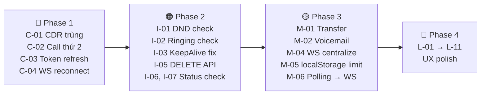

# 📋 BÁO CÁO KIỂM TRA CHUYÊN GIA — SMARTCALL WEB (Mock)

> **Dự án:** `Smart_Call_Web_Mock` (`D:\Project\Smart_Call_Web_Mock`)
> **Phạm vi:** Toàn bộ mã nguồn — services, views, components, router, config
> **Vai trò đánh giá:** Chuyên gia ứng dụng tổng đài VoIP / WebRTC
> **Ngày:** 2026-11-13

---

## MỤC LỤC

1. [🔴 Lỗi nghiêm trọng (Critical)](#1--lỗi-nghiêm-trọng-critical)
2. [🟠 Lỗi quan trọng (Important)](#2--lỗi-quan-trọng-important)
3. [🟡 Thiếu logic / Edge Case (Medium)](#3--thiếu-logic--edge-case-medium)
4. [🔵 Cải thiện UX & Bảo trì (Minor)](#4--cải-thiện-ux--bảo-trì-minor)
5. [Tổng kết & Khuyến nghị ưu tiên](#5-tổng-kết--khuyến-nghị-ưu-tiên)

---

## 1. 🔴 Lỗi nghiêm trọng (Critical)

### C-01. Ghi CDR trùng lặp khi ngắt cuộc gọi đến đã nhận

| Mục | Chi tiết |
|---|---|
| **File** | [App.vue](file:///D:/Project/Smart_Call_Web_Mock/src/App.vue#L279-L298) + [CallsView.vue](file:///D:/Project/Smart_Call_Web_Mock/src/views/CallsView.vue#L420-L465) |
| **Mô tả** | `App.vue → onHangup()` ghi CDR với `duration: 15` (hardcoded). `CallsView.vue → hangupCall()` cũng ghi CDR với `callSeconds.value`. Khi người dùng nhận cuộc gọi đến (được chuyển đến `/calls?active=true`) rồi cúp máy, **cả hai hàm đều có thể kích hoạt**, tạo ra 2 bản ghi CDR cho cùng 1 cuộc gọi. |
| **Hành vi mong đợi** | Chỉ ghi **đúng 1 bản CDR** với thời lượng thực tế. |
| **Đề xuất** | Loại bỏ logic ghi CDR ở `App.vue → onHangup()` hoặc đánh dấu cờ `cdrRecorded` để tránh ghi đôi. Xem xét `onHangup` có phải dead code không (xem C-05). |

### C-02. Không bảo vệ cuộc gọi thứ 2 đến khi đang đàm thoại

| Mục | Chi tiết |
|---|---|
| **File** | [App.vue](file:///D:/Project/Smart_Call_Web_Mock/src/App.vue#L147-L180) |
| **Mô tả** | `handleIncomingCall()` **luôn** ghi đè `currentCall.value` và hiện modal cuộc gọi đến mới. Nếu người A đang đàm thoại với B, khi C gọi đến: (1) `currentCall` bị ghi đè thành session C → mất tham chiếu đến B, (2) modal cuộc gọi đến popup lên che giao diện đàm thoại. |
| **Hành vi mong đợi** | Nếu đang trong cuộc gọi, cuộc gọi đến thứ 2 phải được xếp hàng chờ (call waiting) hoặc tự động từ chối kèm thông báo bận. Tuyệt đối không ghi đè `currentCall` khi đang active. |
| **Đề xuất** | Thêm guard: `if (callState.value === 'active' || callState.value === 'ringing') { /* reject hoặc call waiting */ return }` trước khi hiện modal. |

### C-03. Token Wazo không tự động làm mới → Mất kết nối sau ~1h

| Mục | Chi tiết |
|---|---|
| **File** | [wazo.js](file:///D:/Project/Smart_Call_Web_Mock/src/services/wazo.js#L85-L95) |
| **Mô tả** | `wazoService` lưu `refreshToken` nhưng **không triển khai** cơ chế tự động gia hạn token. Theo tài liệu kỹ thuật tổng đài (dev_guide.md mục 2.2), token có thời hạn sống (thường ~1 giờ). Khi hết hạn: tất cả API trả 401, WebSocket ngắt, Presence dừng cập nhật. |
| **Hành vi mong đợi** | Tự động dùng `refreshToken` gọi `POST /api/auth/0.1/token` để lấy token mới trước khi hết hạn, hoặc ít nhất hiển thị thông báo phiên đã hết hạn và yêu cầu đăng nhập lại. |
| **Đề xuất** | Triển khai `setInterval` hoặc `setTimeout` gọi refresh token trước khi hết hạn (~50 phút). Khi refresh thất bại, điều hướng về `/login` với thông báo. |

### C-04. WebSocket Presence (`eventWs`) không tự động kết nối lại

| Mục | Chi tiết |
|---|---|
| **File** | [wazo.js](file:///D:/Project/Smart_Call_Web_Mock/src/services/wazo.js#L290-L320) |
| **Mô tả** | `openWebSocketEvents()` → `ws.onclose` chỉ set `this.eventWs = null`, **không reconnect**. Kết quả: bất kỳ sự cố mạng nào cũng làm trạng thái Presence (online/offline/busy) **đóng băng vĩnh viễn** cho đến khi tải lại trang. |
| **So sánh** | `websocketService.js` (dùng cho Chat) **có** tự kết nối lại sau 5 giây — logic nhất quán cần áp dụng cho cả Presence WS. |
| **Đề xuất** | Thêm `_scheduleReconnect()` tương tự `websocketService.js` vào hàm `onclose` của `eventWs`. |

---

## 2. 🟠 Lỗi quan trọng (Important)

### I-01. Không chặn gọi trạng thái DND từ bàn phím số (CallsView)

| Mục | Chi tiết |
|---|---|
| **File** | [CallsView.vue](file:///D:/Project/Smart_Call_Web_Mock/src/views/CallsView.vue#L300-L360) |
| **Mô tả** | `handleDial()` chỉ kiểm tra `busy` và `offline` nhưng **không kiểm tra `dnd`** (Không làm phiền). Người dùng có thể nhập trực tiếp số máy lẻ đang DND vào bàn phím và gọi thành công. |
| **So sánh** | `ContactsView.vue` (dòng 344-353) **đã kiểm tra** DND và hiển thị cảnh báo phù hợp → logic thiếu nhất quán. |
| **Đề xuất** | Thêm check DND trong `handleDial()`: `if (targetStatus === 'dnd') { toast('Người này đang bật chế độ Không làm phiền') }`. |

### I-02. Không chặn gọi trạng thái `ringing` từ bàn phím số

| Mục | Chi tiết |
|---|---|
| **File** | [CallsView.vue](file:///D:/Project/Smart_Call_Web_Mock/src/views/CallsView.vue#L300-L360) |
| **Mô tả** | `statusOf()` trong `contactService` trả `ringing` khi đối phương đang đổ chuông từ cuộc gọi khác. Nhưng `handleDial()` không kiểm tra trạng thái này → người dùng có thể gọi vào máy đang đổ chuông, gây nhầm lẫn hoặc tranh chấp cuộc gọi trên hệ thống tổng đài. |
| **Đề xuất** | Thêm logic cảnh báo: "Máy lẻ này đang nhận cuộc gọi khác, bạn có muốn tiếp tục gọi?" |

### I-03. `KeepAlive` + `CallsView` gây rò rỉ trạng thái

| Mục | Chi tiết |
|---|---|
| **File** | [App.vue](file:///D:/Project/Smart_Call_Web_Mock/src/App.vue#L35-L45) + [CallsView.vue](file:///D:/Project/Smart_Call_Web_Mock/src/views/CallsView.vue) |
| **Mô tả** | `<KeepAlive>` bọc `<router-view>` → `CallsView` giữ state khi chuyển tab. Nếu cuộc gọi kết thúc (sự kiện `wazo-ended` trên `window`) trong khi user đang ở tab khác (Messages, History…): `hangupCall()` chạy ngầm → CDR được ghi → nhưng UI CallsView vẫn đang hiện "Đang đàm thoại" cũ khi user quay lại. |
| **Đề xuất** | Dùng `onActivated()` hook để kiểm tra và đồng bộ lại `callState` khi user quay lại tab Calls. Hoặc sử dụng global state (Pinia/provide-inject) cho trạng thái cuộc gọi. |

### I-04. `mockAnswerTimer` có thể xung đột với sự kiện Wazo thật

| Mục | Chi tiết |
|---|---|
| **File** | [CallsView.vue](file:///D:/Project/Smart_Call_Web_Mock/src/views/CallsView.vue#L373-L391) |
| **Mô tả** | Mock timer được khởi động khi `isFeatureEnabled('mockData') && (!isRealWazoCall \|\| offline_mode)`. Trường hợp edge: cờ `mockData = true` (vì đang dùng `Smart_Call_Web_Mock`) nhưng user đăng nhập thật thành công (không bật Offline) → `isRealWazoCall = true` nhưng timer có thể vẫn chạy nếu logic `offline_mode` sai → `startCallTimer()` bị gọi 2 lần. |
| **Đề xuất** | Đảm bảo `clearTimeout(mockAnswerTimer)` khi nhận sự kiện `wazo-answered` thật. Chuẩn hóa điều kiện mock rõ ràng hơn. |

### I-05. `clearAllHistory()` gọi `DELETE` trên CDR API — API không hỗ trợ

| Mục | Chi tiết |
|---|---|
| **File** | [historyService.js](file:///D:/Project/Smart_Call_Web_Mock/src/services/historyService.js#L306-L326) |
| **Mô tả** | `clearAllHistory()` gọi `DELETE /api/call-logd/1.0/users/me/cdr`. Theo đặc tả Wazo API (wazo_api_reference.md), endpoint này **không hỗ trợ phương thức DELETE**. CDR là log hệ thống chỉ đọc (read-only). Request sẽ luôn trả `405 Method Not Allowed`. |
| **Đề xuất** | Chỉ xóa dữ liệu localStorage local. Bỏ lệnh `fetch DELETE` hoặc thêm comment rõ ràng rằng đây chỉ là xóa cache client. |

### I-06. Gọi lại từ Lịch sử không kiểm tra trạng thái online/offline

| Mục | Chi tiết |
|---|---|
| **File** | [HistoryView.vue](file:///D:/Project/Smart_Call_Web_Mock/src/views/HistoryView.vue#L277-L290) |
| **Mô tả** | `handleCallback(call)` điều hướng thẳng sang `/calls?number=X&autocall=true` mà **không kiểm tra** trạng thái đối phương (offline/busy/DND). Cuộc gọi sẽ được thực hiện bất kể đối phương có khả dụng hay không. |
| **So sánh** | `ContactsView.vue` kiểm tra kỹ trạng thái trước khi cho phép gọi. `AppHeader.vue → quickCall()` kiểm tra offline trước khi điều hướng. |
| **Đề xuất** | Trước khi điều hướng, tra cứu `contactService.findContactByExtension(call.extension)` và kiểm tra trạng thái. |

### I-07. Dashboard — Gọi nhanh (Quick Dial / Speed Dial) không kiểm tra trạng thái

| Mục | Chi tiết |
|---|---|
| **File** | [DashboardView.vue](file:///D:/Project/Smart_Call_Web_Mock/src/views/DashboardView.vue#L366-L380) |
| **Mô tả** | `callQuickContact(ext)` và `handleQuickDial()` điều hướng trực tiếp đến `/calls?autocall=true` mà **không kiểm tra** trạng thái offline/busy/DND. Tương tự I-06. |
| **Đề xuất** | Áp dụng cùng logic kiểm tra như `ContactsView.vue`. |

---

## 3. 🟡 Thiếu logic / Edge Case (Medium)

### M-01. Không có cơ chế Call Transfer (Chuyển cuộc gọi)

| Mục | Chi tiết |
|---|---|
| **Mô tả** | Tài liệu kỹ thuật tổng đài (dev_guide.md mục 4.2) mô tả API transfer (`PUT /api/calld/1.0/users/me/transfers`). Wazo SDK có sẵn `Wazo.Phone.transfer()`. Nhưng **không có** tính năng chuyển cuộc gọi (blind/attended transfer) trong UI hoặc service layer. |
| **Tầm quan trọng** | Transfer là tính năng **bắt buộc** (must-have) của mọi ứng dụng tổng đài doanh nghiệp — người dùng cần chuyển cuộc gọi đến phòng ban hoặc đồng nghiệp khác. |

### M-02. Không có truy cập Voicemail (Hộp thư thoại)

| Mục | Chi tiết |
|---|---|
| **Mô tả** | Tài liệu kỹ thuật tổng đài mô tả API voicemail (`GET /api/calld/1.0/users/me/voicemails`). Không có UI voicemail, không có service method, không hiển thị số tin nhắn thoại chưa nghe. |
| **Tầm quan trọng** | Voicemail là tính năng cơ bản khi người dùng không thể nhận cuộc gọi. |

### M-03. Không có xử lý cuộc gọi Conference/3-way thực sự

| Mục | Chi tiết |
|---|---|
| **File** | [MessagesView.vue](file:///D:/Project/Smart_Call_Web_Mock/src/views/MessagesView.vue#L492-L531) |
| **Mô tả** | `startVoiceCall()` cho phòng nhóm gọi hardcode `confRoomNumber = '8001'` và gửi tin nhắn thông báo. Nhưng **không có** cơ chế thực sự để mời các thành viên vào cuộc gọi hội nghị — chỉ gọi số phòng họp cho chính user. Các thành viên khác phải tự gọi vào cùng số. |
| **Đề xuất** | Ghi rõ hạn chế này trong UI, hoặc triển khai tính năng "Mời tất cả" thông qua API `POST /api/calld/1.0/conferences/{conf_id}/participants`. |

### M-04. MessagesView gọi `websocketService.connect()` thừa mỗi lần mount

| Mục | Chi tiết |
|---|---|
| **File** | [MessagesView.vue](file:///D:/Project/Smart_Call_Web_Mock/src/views/MessagesView.vue#L406-L411) |
| **Mô tả** | `onMounted` gọi `websocketService.connect()` mỗi lần view được mount. Nhưng kết nối WebSocket nên được quản lý tập trung ở `App.vue` (sau khi login thành công), không phải ở mỗi view. Gọi `connect()` nhiều lần có thể tạo nhiều kết nối song song hoặc ghi đè `ws` đang hoạt động. |
| **Đề xuất** | Di chuyển `websocketService.connect()` vào `App.vue → onMounted` hoặc sau khi login thành công. MessagesView chỉ nên `on()/off()` listener. |

### M-05. localStorage có thể vượt quota — không xử lý ngoại lệ

| Mục | Chi tiết |
|---|---|
| **File** | [historyService.js](file:///D:/Project/Smart_Call_Web_Mock/src/services/historyService.js#L133-L138), [chatService.js](file:///D:/Project/Smart_Call_Web_Mock/src/services/chatService.js#L160-L167) |
| **Mô tả** | Cả CDR history lẫn chat rooms đều lưu toàn bộ vào `localStorage` không giới hạn kích thước. Sau thời gian dài sử dụng, tích lũy hàng nghìn bản ghi tin nhắn + CDR có thể vượt quota ~5-10MB của localStorage → `QuotaExceededError`. Catch block hiện tại chỉ `console.warn` → **dữ liệu mới sẽ mất mà user không biết**. |
| **Đề xuất** | Giới hạn số lượng bản ghi (VD: max 500 CDR, max 200 tin nhắn/phòng). Khi gần đầy, tự động xóa bản ghi cũ nhất (FIFO). Hiển thị cảnh báo khi lưu thất bại. |

### M-06. Dữ liệu Presence bị stale (cũ) khi gọi — polling 10s

| Mục | Chi tiết |
|---|---|
| **File** | [contactService.js](file:///D:/Project/Smart_Call_Web_Mock/src/services/contactService.js) |
| **Mô tả** | `startPresencePolling()` poll mỗi 10 giây. Khi user kiểm tra trạng thái trước khi gọi, dữ liệu có thể đã cũ đến 9.9 giây. Đối phương có thể đã offline mà hệ thống vẫn hiển thị online → gọi thất bại. |
| **Đề xuất** | Dùng WebSocket `chatd_presence_updated` (đã đăng ký trong `websocketService`) làm nguồn dữ liệu chính. Chỉ poll 1 lần khi khởi tạo app. Fallback poll mỗi 30-60 giây nếu cần. |

### M-07. `onHangup`, `onAccept`, `onReject`, `onToggleMute`, `onToggleHold` trong App.vue có thể là dead code

| Mục | Chi tiết |
|---|---|
| **File** | [App.vue](file:///D:/Project/Smart_Call_Web_Mock/src/App.vue#L247-L310) |
| **Mô tả** | Các hàm này được khai báo nhưng **không thấy** được gọi từ template hay event listener nào trong `App.vue`. Flow chính: cuộc gọi được xử lý bởi `CallsView.vue` (hangupCall, toggleMute, toggleHold). Cuộc gọi đến được xử lý bởi `IncomingCallModal` → emit lên App → acceptCall/rejectCall. Các hàm `onHangup/onAccept/onReject` dường như là phiên bản cũ chưa dọn. |
| **Rủi ro** | Nếu `onHangup` thực sự được gọi trong edge case nào đó, nó ghi CDR với `duration: 15` hardcoded → sai dữ liệu. |
| **Đề xuất** | Kiểm tra lại toàn bộ event binding. Nếu xác nhận là dead code, loại bỏ hoàn toàn để tránh nhầm lẫn. |

### M-08. AppHeader `quickCall()` kiểm tra offline nhưng vẫn điều hướng đến `/calls?autocall=true`

| Mục | Chi tiết |
|---|---|
| **File** | [AppHeader.vue](file:///D:/Project/Smart_Call_Web_Mock/src/views/../components/layout/AppHeader.vue#L282-L295) |
| **Mô tả** | Khi liên hệ offline, hiện confirm "Chuyển vào hộp thư thoại?". Nếu user bấm Cancel → `return`. Nhưng nếu user bấm OK → vẫn điều hướng đến `/calls` để gọi, **không thực sự chuyển đến voicemail** (vì tính năng voicemail chưa tồn tại). Dẫn đến hành vi mâu thuẫn — hứa voicemail nhưng thực hiện gọi thường. |
| **Đề xuất** | Sửa text confirm hoặc triển khai redirect đến voicemail thật (quay số `*98 + ext` theo tài liệu kỹ thuật). |

### M-09. `wazo-registered` event listener leak trong DashboardView

| Mục | Chi tiết |
|---|---|
| **File** | [DashboardView.vue](file:///D:/Project/Smart_Call_Web_Mock/src/views/DashboardView.vue#L397-L411) |
| **Mô tả** | `onMounted` thêm anonymous listener cho `wazo-registered` nhưng `onUnmounted` **không gỡ bỏ** nó (chỉ gỡ 3 listener CDR/rooms/contacts). Kết quả: mỗi lần mount Dashboard, thêm 1 listener trùng lặp. Với `<KeepAlive>`, vấn đề nhẹ hơn nhưng vẫn tồn tại logic leak. |
| **Đề xuất** | Lưu reference đến arrow function rồi gỡ bỏ trong `onUnmounted`. |

---

## 4. 🔵 Cải thiện UX & Bảo trì (Minor)

### L-01. Extension mặc định `'1002'` hiển thị sẵn trên bàn phím số

| Mục | Chi tiết |
|---|---|
| **File** | [CallsView.vue](file:///D:/Project/Smart_Call_Web_Mock/src/views/CallsView.vue) |
| **Mô tả** | `extension` ref khởi tạo `'1002'` → bàn phím số luôn hiện sẵn "1002" khi user mở tab Calls. Có thể gây nhầm lẫn (user nhấn Call mà không biết đang gọi ai). |
| **Đề xuất** | Khởi tạo rỗng `''`. |

### L-02. Không validate input số máy lẻ

| Mục | Chi tiết |
|---|---|
| **File** | [CallsView.vue](file:///D:/Project/Smart_Call_Web_Mock/src/views/CallsView.vue), [DashboardView.vue](file:///D:/Project/Smart_Call_Web_Mock/src/views/DashboardView.vue) |
| **Mô tả** | Ô nhập số máy lẻ chỉ có `type="tel"` và `maxlength="6"` — user vẫn nhập được chữ cái, ký tự đặc biệt. |
| **Đề xuất** | Thêm `@input` handler chỉ cho phép ký tự `0-9*#`. |

### L-03. Toast notification chỉ hiển thị 1 cái → Mất thông báo liên tiếp

| Mục | Chi tiết |
|---|---|
| **File** | [App.vue](file:///D:/Project/Smart_Call_Web_Mock/src/App.vue) |
| **Mô tả** | Toast chỉ dùng 1 biến `toastMessage`, mỗi toast mới ghi đè toast cũ. Các sự kiện liên tiếp nhanh (VD: login thành công + WebRTC registered) → user chỉ thấy thông báo cuối. |
| **Đề xuất** | Chuyển sang mảng queue với auto-dismiss từng toast riêng lẻ. |

### L-04. Cuộc gọi đến từ số ngoài danh bạ hiển thị tối thiểu

| Mục | Chi tiết |
|---|---|
| **File** | [IncomingCallModal.vue](file:///D:/Project/Smart_Call_Web_Mock/src/components/call/IncomingCallModal.vue) |
| **Mô tả** | Nếu số gọi đến không nằm trong danh bạ, chỉ hiện "Máy lẻ XXXX" mà không có bất kỳ thông tin bổ sung nào. Không có cơ chế tra ngược (reverse lookup). |
| **Đề xuất** | Gọi `contactService.findContactByExtension()` để tra tên từ danh bạ Wazo. |

### L-05. Biểu tượng khóa SRTP hiển thị nhưng không xác thực thực tế

| Mục | Chi tiết |
|---|---|
| **File** | [IncomingCallModal.vue](file:///D:/Project/Smart_Call_Web_Mock/src/components/call/IncomingCallModal.vue) |
| **Mô tả** | Modal cuộc gọi đến hiện 🔒 ngụ ý mã hóa SRTP, nhưng không có logic xác minh SRTP thực sự đang hoạt động. Có thể đánh lừa người dùng tin rằng cuộc gọi luôn được mã hóa. |
| **Đề xuất** | Chỉ hiện icon khi xác minh qua `RTCPeerConnection.getStats()` rằng SRTP đang active, hoặc loại bỏ icon. |

### L-06. `openSettings` unused trong DashboardView

| Mục | Chi tiết |
|---|---|
| **File** | [DashboardView.vue](file:///D:/Project/Smart_Call_Web_Mock/src/views/DashboardView.vue#L362-L364) |
| **Mô tả** | Hàm `openSettings` được khai báo nhưng không được gọi từ template. Dead code. |
| **Đề xuất** | Xóa bỏ hoặc gắn vào button phù hợp. |

### L-07. `chatService.getRooms()` khi server trả phòng thật sẽ mất dữ liệu local

| Mục | Chi tiết |
|---|---|
| **File** | [chatService.js](file:///D:/Project/Smart_Call_Web_Mock/src/services/chatService.js#L173-L211) |
| **Mô tả** | Khi API trả về danh sách phòng từ Wazo server (`data.items.length > 0`), hàm `return` ngay → **bỏ qua toàn bộ phòng chat local** (bao gồm phòng 1-1 tạo offline, phòng có lịch sử tin nhắn local). Dữ liệu local bị mất hoàn toàn. |
| **Đề xuất** | Merge dữ liệu server và local tương tự cách `historyService.getHistory()` đang làm. |

### L-08. `counts.missed` đếm sai — bao gồm cả cuộc gọi đi bị từ chối

| Mục | Chi tiết |
|---|---|
| **File** | [HistoryView.vue](file:///D:/Project/Smart_Call_Web_Mock/src/views/HistoryView.vue#L224-L230) |
| **Mô tả** | `missed = calls.filter(c => c.status === 'missed' \|\| !c.answered).length`. Điều kiện `!c.answered` bao gồm cả cuộc gọi **đi** mà đối phương không nhấc (`status: 'declined'`). Về nghiệp vụ tổng đài, "Missed" thường chỉ dành cho cuộc gọi **đến** mà user không nhấc. |
| **Đề xuất** | `missed = calls.filter(c => c.direction === 'inbound' && !c.answered).length`. |

### L-09. Không có cơ chế Auto-logout / Session timeout

| Mục | Chi tiết |
|---|---|
| **Mô tả** | Sau khi đăng nhập, phiên làm việc tồn tại vĩnh viễn (chỉ mất khi user nhấn Đăng xuất hoặc xóa localStorage). Không có inactivity timeout. Nếu user quên đăng xuất → trạng thái online/sẵn sàng nhận cuộc gọi vô thời hạn → gây phiền toái cho đồng nghiệp gọi đến nhưng không ai nhấc. |
| **Đề xuất** | Triển khai timeout 30 phút không tương tác → tự động chuyển trạng thái `away`, hoặc timeout 2 giờ → logout. |

### L-10. Chưa xử lý sự kiện `call_created`, `call_answered`, `call_ended` từ WebSocket

| Mục | Chi tiết |
|---|---|
| **File** | [websocketService.js](file:///D:/Project/Smart_Call_Web_Mock/src/services/websocketService.js#L63-L68) |
| **Mô tả** | `websocketService` đăng ký subscribe cho `call_created`, `call_answered`, `call_ended` nhưng **không có listener nào** xử lý các sự kiện này. Chúng chỉ emit nhưng không ai listen → bỏ phí dữ liệu real-time. |
| **Đề xuất** | Sử dụng các sự kiện này để cập nhật Presence (ai đang gọi), lịch sử CDR real-time, và đồng bộ trạng thái cuộc gọi. |

### L-11. Không xử lý `chatd_presence_updated` từ `websocketService`

| Mục | Chi tiết |
|---|---|
| **File** | [websocketService.js](file:///D:/Project/Smart_Call_Web_Mock/src/services/websocketService.js) + [contactService.js](file:///D:/Project/Smart_Call_Web_Mock/src/services/contactService.js) |
| **Mô tả** | `websocketService` subscribe `chatd_presence_updated` nhưng `contactService` **không lắng nghe** sự kiện này để cập nhật trạng thái liên hệ real-time. Thay vào đó, `contactService` dùng polling mỗi 10 giây riêng qua `wazo.js → eventWs` → 2 hệ thống WebSocket chạy song song cho cùng mục đích, gây lãng phí tài nguyên. |
| **Đề xuất** | Hợp nhất thành 1 kênh WebSocket duy nhất. `contactService` nên lắng nghe từ `websocketService` thay vì mở WS riêng qua `wazo.js`. |

---

## 5. Tổng kết & Khuyến nghị ưu tiên

### Bảng tổng hợp

| Mức độ | Số lượng | Ảnh hưởng |
|--------|----------|-----------|
| 🔴 Critical | 4 | Mất dữ liệu, crash luồng cuộc gọi, mất kết nối |
| 🟠 Important | 7 | Logic sai, thiếu kiểm tra trạng thái, API không hợp lệ |
| 🟡 Medium | 9 | Thiếu tính năng chuẩn PBX, rò rỉ tài nguyên |
| 🔵 Minor | 11 | UX, dead code, cảnh báo sai lệch |
| **Tổng** | **31** | |

### Thứ tự ưu tiên khắc phục đề xuất

> [!IMPORTANT]
> Đây là báo cáo **chỉ phân tích và đề xuất** (Review-First). Tuân thủ quy tắc GEMINI.md — **KHÔNG có file nào bị chỉnh sửa**. Vui lòng xem xét và xác nhận trước khi tiến hành khắc phục.
