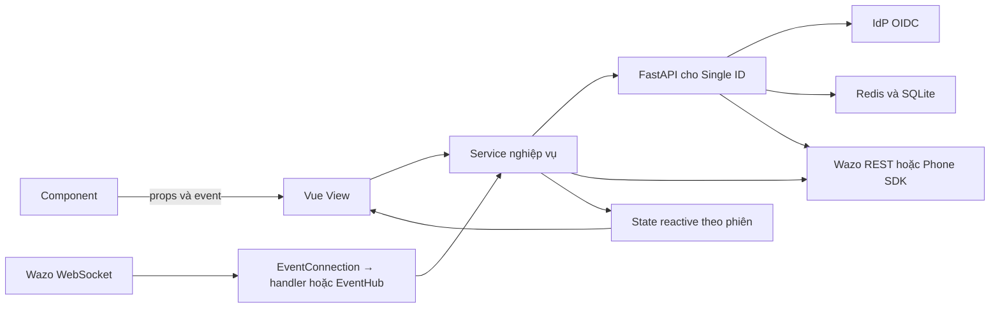
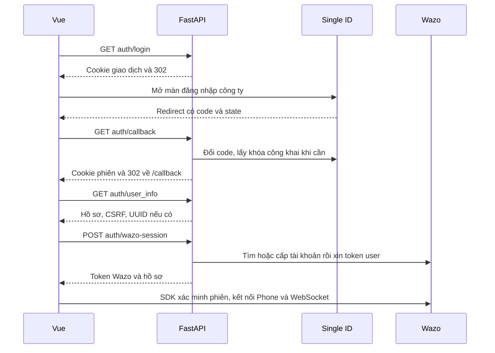
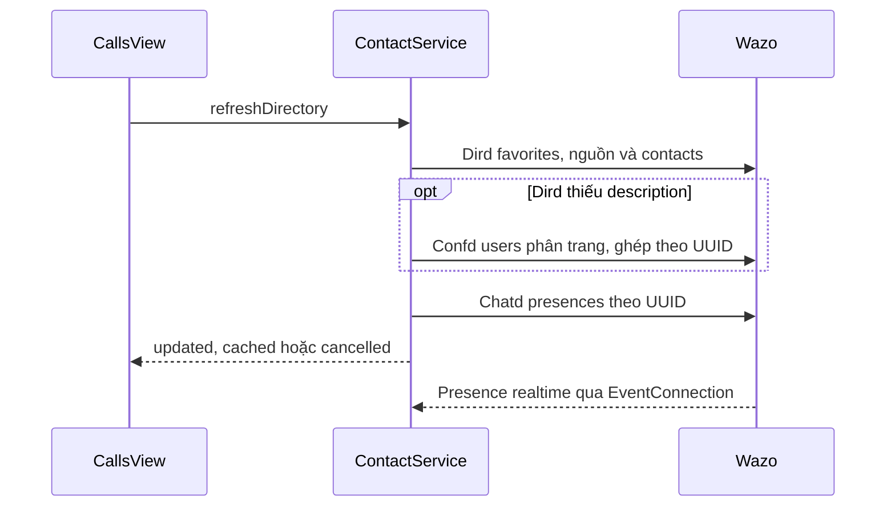
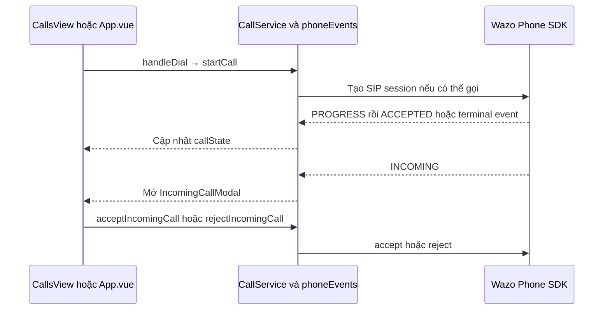
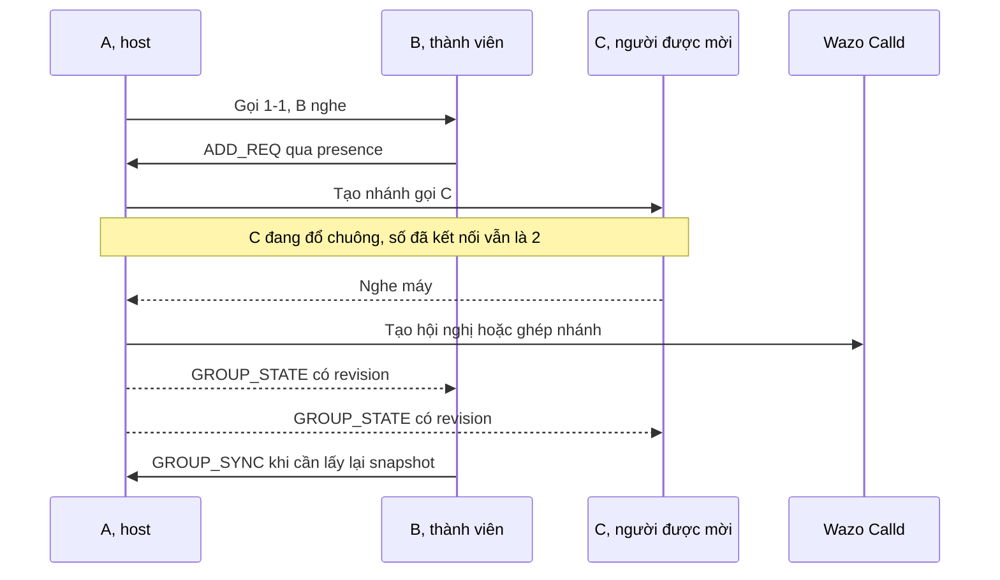
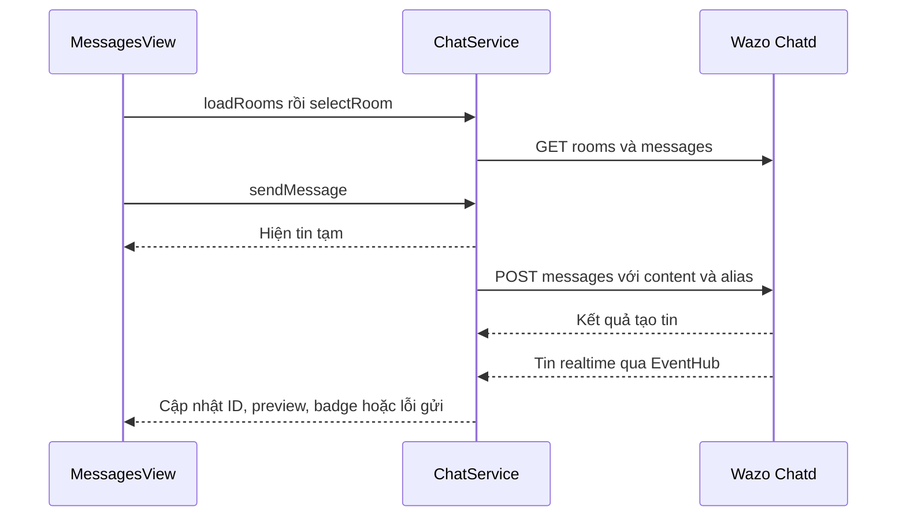
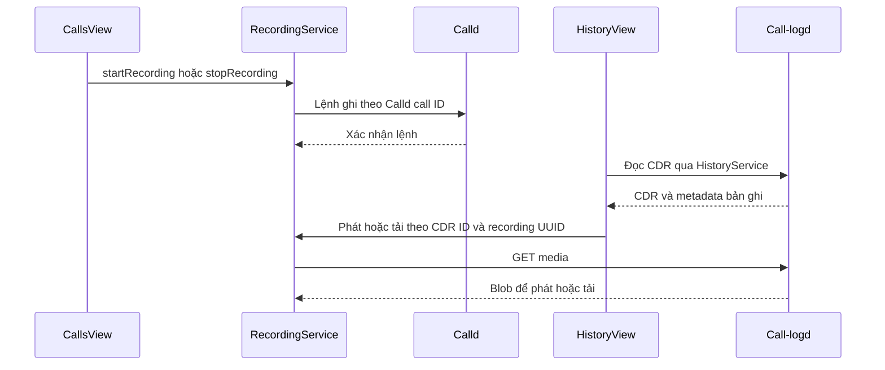
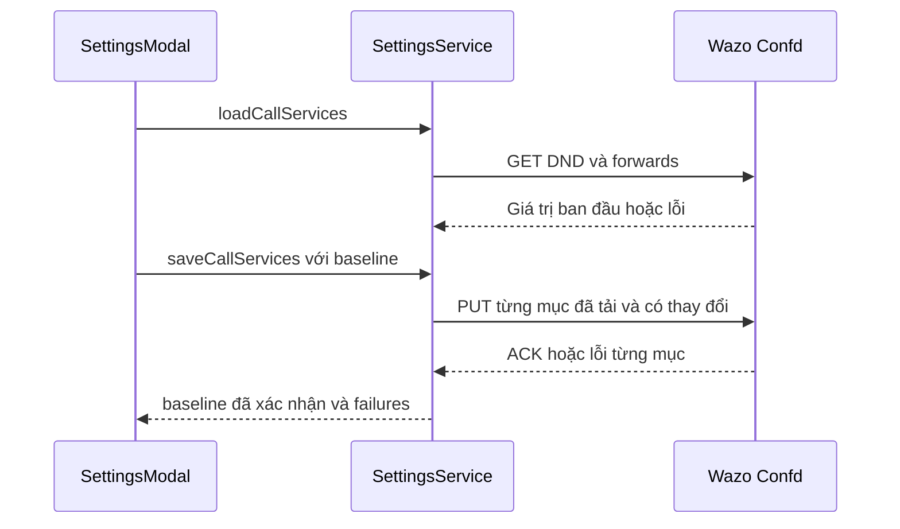

# SmartCall Web từ thao tác đến mã nguồn

Đối chiếu mã ở mốc `cd9666d` trên `codex/refactor-architecture`. Dùng trang này để lần nhanh một thao tác. Đọc [hướng dẫn toàn bộ luồng](HUONG_DAN_TOAN_BO_LUONG_SMARTCALL.md) khi cần xem diễn giải và trích đoạn code.

Để tìm nhanh theo tên hàm hoặc file, mở [bản đồ Graphify](BAN_DO_MA_NGUON_SMARTCALL.html) bằng trình duyệt từ bản clone. Bản đồ tải thư viện hiển thị từ CDN. Graphify lập chỉ mục tĩnh 59 file JS, Vue và Python của ứng dụng. Dùng sơ đồ tuần tự và mã nguồn bên dưới để xác minh lệnh qua SDK, event và kết quả trả về trong từng tình huống.

| Bạn muốn biết | Mở mục |
| --- | --- |
| Đăng nhập xong mà SIP vẫn offline | [Đăng nhập và phiên](#1-đăng-nhập-và-phiên), [gọi-1-1](#3-gọi-1-1-và-âm-thanh) |
| Danh bạ thiếu người hoặc phòng ban | [Danh bạ](#2-danh-bạ-và-presence) |
| Ai gọi C khi B mời, khi nào đếm C | [Gọi nhóm](#4-gọi-nhóm) |
| Tin về từ đâu, badge tăng lúc nào | [Tin nhắn](#5-tin-nhắn-và-badge) |
| Từ cuộc gọi đi đến file ghi âm thế nào | [Lịch sử và ghi âm](#6-lịch-sử-và-ghi-âm) |
| Lưu cài đặt theo API nào, lỗi một phần ra sao | [Cài đặt](#7-cài-đặt) |
| Tìm endpoint, event hoặc ID đã thấy trong log | [Bảng tra](#8-bảng-tra-api-và-sự-kiện) |

## Cách lần code

[Router](../frontend/src/router/index.js) chọn màn hình và chặn route riêng tư khi chưa có phiên. [App.vue](../frontend/src/App.vue) giữ khung giao diện, điều phối popup cuộc gọi đến, chuyển trang và dọn giao diện khi mất phiên. [createServices.js](../frontend/src/services/createServices.js) là nơi thấy các dependency được nối. Khi gặp chuỗi `/api/auth/`, kiểm tra host trước. Đường dẫn Single ID của SmartCall đi qua cùng origin với frontend. Các đường dẫn Wazo Auth có đoạn phiên bản `/api/auth/0.1/` và đi tới Wazo.

## 1. Đăng nhập và phiên

| Điểm vào | Hàm và tác động |
| --- | --- |
| Form tài khoản Wazo | `LoginView.handleLogin` → `AuthService.login` → cổng `SdkAuthenticationGate` → `completeAuthenticatedSession`. Khi Auth thành công, View điều hướng sang Calls. [LoginView](../frontend/src/views/LoginView.vue) · [AuthService](../frontend/src/services/auth/authService.js) |
| Single ID | `beginSingleIdLogin` mở backend. `OidcClient.begin` dựng URL và thông tin giao dịch. Callback so state với cookie và lấy giao dịch Redis một lần. `OidcClient.finish` đổi code, xác minh JWT và dựng hồ sơ. [Routes](../backend/main.py) · [OIDC](../backend/oidc.py) · [Store](../backend/store.py) |
| Lấy phiên Wazo | `CallbackView.connectWazo` → `completeSingleIdLogin` → `WazoClient.provision`. Backend khóa theo tenant, ưu tiên mapping SQLite rồi mới tra email khi thích hợp. UUID đã lưu trả 404 thì tìm lại. Lỗi quyền và lỗi mạng dừng cấp phát. Backend xác minh UUID trong token trước khi trả. [CallbackView](../frontend/src/views/CallbackView.vue) · [Provisioning](../backend/wazo.py) |
| F5, đổi phiên, logout | `restoreSession` khôi phục và xác minh phiên Wazo. `invalidateSession` tăng thế hệ và hủy request thuộc phiên cũ. Logout IdP có bước cấp vé dùng một lần để browser chuyển hướng. [AuthService](../frontend/src/services/auth/authService.js) · [Session scope](../frontend/src/services/auth/sessionScope.js) |

Hai mốc cần kiểm tra riêng là **xác thực Wazo thành công** và **Phone báo SIP registered**. Có hồ sơ mà chưa vào Calls thì kiểm tra `wazo-session` và kết quả SDK. Đã vào Calls nhưng chưa quay số được thì kiểm tra đăng ký SIP và audio. Khi backend cấp phát chậm mà người dùng đã logout, backend kiểm tra lại phiên trước khi giao token.

## 2. Danh bạ và presence

Mapper chuẩn hóa bảng hoặc danh sách từ Dird. `description` là nguồn phòng ban ưu tiên. Nếu Confd không cấp quyền, danh bạ Dird vẫn dùng được. `statusOf` diễn giải presence và trạng thái line. `useContactFilters` lọc trên dữ liệu đã tải. Khi đánh dấu yêu thích, state chỉ đổi sau phản hồi thành công. `cached` báo UI đang dùng dữ liệu cũ, còn danh bạ rỗng có thể là `updated` hợp lệ. [ContactService](../frontend/src/services/data/contactService.js) · [Mapper](../frontend/src/utils/contactMapper.js) · [Bộ lọc](../frontend/src/composables/useContactFilters.js)

## 3. Gọi 1-1 và âm thanh

`startCall` kiểm tra số, khả năng gọi, phiên và SIP trước khi gửi lệnh. SDK tạo session là lúc bắt đầu gọi. Event accepted của đúng session mới xác nhận đã nghe. `hangupCurrentCall` kết thúc cuộc gọi hiện tại. Mute tác động media, DTMF gửi tới nhánh đang đàm thoại. `PhoneAdapter` quản lý thiết bị và phát luồng âm thanh. Timer, chuông, session và callback cũ được xử lý theo vòng đời cuộc gọi. [CallsView](../frontend/src/views/CallsView.vue) · [CallService](../frontend/src/services/calls/callService.js) · [Sự kiện Phone](../frontend/src/services/calls/phoneEvents.js) · [PhoneAdapter](../frontend/src/services/audio/wazoPhone.js)

## 4. Gọi nhóm

View gọi `startGroupCall` khi khởi tạo nhóm hoặc `addParticipantsToGroupCall` khi mời thêm. Nếu B đang là người nhận, lệnh mời gửi `ADD_REQ` tới A. Host kiểm tra người gửi và cuộc gọi hiện tại trước khi thực hiện. SIP session, Calld call ID và conference ID được đối chiếu riêng. `call_ended` khi chuyển kênh vào ConfBridge có thể là kết thúc nhánh cũ. Số trên panel lấy từ danh sách **đã kết nối**, tách khỏi danh sách đang mời. Cúp hoặc thu hồi phiên host kích hoạt cleanup hội nghị và các nhánh thuộc host. [GroupCallService](../frontend/src/services/calls/groupCallService.js) · [Calld API](../frontend/src/services/calls/callApi.js) · [Handler realtime](../frontend/src/services/realtime/wazoEventHandler.js) · [Panel](../frontend/src/components/call/ActiveCallPanel.vue)

## 5. Tin nhắn và badge

| Thao tác | Điểm lần và điều kiện |
| --- | --- |
| Tìm/mở chat riêng | `getOrCreateDirectRoom` phân giải UUID, tra phòng rồi tạo khi cần. ID tạm phía Web chưa phải UUID phòng để gửi tin. |
| Gửi và nhận | `sendMessage` cập nhật ID/thời gian khi nhận phản hồi. Nếu lỗi trong cùng phiên, tin tạm có `sendFailed`. `handleIncomingMessage` xử lý tin realtime và loại trùng. |
| Badge | Chỉ tính tin đến đủ điều kiện khi phòng chưa thực sự mở. Sidebar đọc tổng, danh sách đọc theo phòng. LocalStorage giữ metadata theo host/UUID. |
| Đổi tên, đóng phòng | `renameGroup` và `deleteRoom` dùng tin điều khiển được kiểm tra quyền. Đóng phòng dùng quy ước SmartCall. API thêm/gỡ thành viên phòng hiện có chưa được luồng này cung cấp. |
| Gọi từ chat | `startVoiceCall` gửi lệnh điều hướng sang Calls cho chat riêng. Với phòng nhóm, View phân giải máy lẻ đủ điều kiện và gọi `startGroupCall`. |

[MessagesView](../frontend/src/views/MessagesView.vue) · [ChatService](../frontend/src/services/data/chatService.js) · [Sidebar](../frontend/src/components/layout/AppSidebar.vue)

## 6. Lịch sử và ghi âm

`fetchHistory` gọi `HistoryService.getHistory` rồi lọc trên dữ liệu đã tải. Lượt force refresh cũ hoặc phản hồi từ phiên cũ không thay danh sách mới. `callHistoryMapper` chuẩn hóa hướng gọi và metadata. Gọi lại và mở chat đi qua view tương ứng. Player quản lý ObjectURL và vòng đời audio. CDR của cuộc gọi vừa kết thúc có thể tới muộn. [HistoryView](../frontend/src/views/HistoryView.vue) · [HistoryService](../frontend/src/services/data/historyService.js) · [RecordingService](../frontend/src/services/audio/recordingService.js) · [Player](../frontend/src/composables/useRecordingPlayer.js)

## 7. Cài đặt

DND và chuyển tiếp lưu trên Wazo. Trường chưa tải thành công có baseline `null`. Chọn microphone, loa, cấu hình ghi âm tự động và cờ giao diện có đường lưu cục bộ tương ứng. Đo mic/thử loa dùng API trình duyệt, và việc đổi mật khẩu Wazo đi qua AuthService. Mật khẩu tài khoản Single ID do IdP quản lý. [SettingsModal](../frontend/src/components/common/SettingsModal.vue) · [SettingsService](../frontend/src/services/data/settingsService.js) · [Mic meter](../frontend/src/composables/useMicrophoneMeter.js)

## 8. Bảng tra API và sự kiện

### API SmartCall và IdP

| Method và đường dẫn | Dữ liệu chính | Mã nguồn |
| --- | --- | --- |
| `GET /api/health` | Trạng thái tiến trình FastAPI | [main.py](../backend/main.py) |
| `GET /api/auth/login`, `GET /api/auth/callback` | Cookie giao dịch, state, code, redirect, cookie phiên | [main.py](../backend/main.py) |
| `GET /api/auth/user_info` | Cookie phiên → profile, CSRF, hạn phiên và UUID nếu đã liên kết | [main.py](../backend/main.py) |
| `POST /api/auth/wazo-session` | Cookie, Origin, CSRF và `client_id` → token Wazo user, UUID và hồ sơ | [main.py](../backend/main.py) · [wazo.py](../backend/wazo.py) |
| `POST /api/auth/logout`, `POST /api/auth/idp-logout`, `GET /api/auth/idp-logout/continue` | Hủy phiên ứng dụng hoặc cấp/dùng vé chuyển hướng logout IdP | [main.py](../backend/main.py) |
| OIDC discovery, authorization, token, JWKS | Backend đọc metadata qua discovery, browser mở authorization endpoint, backend đổi code ở token endpoint và kiểm tra chữ ký bằng JWKS | [oidc.py](../backend/oidc.py) |

### REST Wazo theo nơi gọi

Tiền tố ở cột đầu ghép với đường dẫn ở cột thứ hai. Các nhánh trực tiếp từ trình duyệt dùng phiên Wazo của user, còn việc tìm/cấp tài khoản Single ID chạy trong backend với quyền cấp phát.

| Tiền tố | Method và tài nguyên | Dữ liệu hoặc kết quả cần nhận diện |
| --- | --- | --- |
| `/api/auth/0.1` | `POST /token`. `GET/DELETE /users/{uuid}/sessions[/{session}]`. `GET/DELETE /users/{uuid}/tokens[/{client}]`. `DELETE /token/{token}` | Token, refresh token, danh sách phiên và lệnh thu hồi. [AuthService](../frontend/src/services/auth/authService.js) · [WazoClient](../backend/wazo.py) |
| `/api/auth/0.1` | `GET /users/{uuid}`. `PUT /users/{uuid}/password`. `GET /users/password/reset` | Tra username auth ở backend, đổi hoặc yêu cầu đặt lại mật khẩu từ frontend. [WazoClient](../backend/wazo.py) · [AuthService](../frontend/src/services/auth/authService.js) |
| `/api/confd/1.1` | `GET /users`, `GET /users/me`, `GET/PUT /users/{uuid}`, `POST /users` | Hồ sơ, phòng ban, tài khoản và cấp phát. Payload cấp mới gộp user, auth, line, extension và SIP endpoint. [AuthService](../frontend/src/services/auth/authService.js) · [ContactService](../frontend/src/services/data/contactService.js) · [WazoClient](../backend/wazo.py) |
| `/api/confd/1.1` | `GET /contexts`, `GET /endpoints/sip/templates`, `GET /extensions`, `GET /users/{uuid}/lines/main/associated/endpoints/sip`, `PUT /endpoints/sip/{uuid}` | Kiểm tra context, template, máy lẻ và sửa tên SIP endpoint khi tài khoản managed cần cập nhật. [WazoClient](../backend/wazo.py) |
| `/api/dird/0.1` | `GET /directories/default/sources`, `GET /backends/wazo/sources/{id}/contacts`, `GET /directories/lookup/default`, `GET /directories/favorites/default`, `PUT/DELETE /directories/favorites/{source}/{id}` | Nguồn và dữ liệu danh bạ, tìm theo term, tải hoặc cập nhật yêu thích. [ContactService](../frontend/src/services/data/contactService.js) |
| `/api/chatd/1.0` | `GET /users/presences`, `PUT /users/{uuid}/presences` | Presence theo UUID, trạng thái hiển thị và tín hiệu nhóm do SmartCall mã hóa trong status. [ContactService](../frontend/src/services/data/contactService.js) · [AuthService](../frontend/src/services/auth/authService.js) |
| `/api/chatd/1.0` | `GET/POST /users/me/rooms`, `GET/POST /users/me/rooms/{roomId}/messages` | Phòng, thành viên, lịch sử, UUID tin và tin điều khiển. GET phòng hỗ trợ tra theo `user_uuid` trong luồng chat riêng. [ChatService](../frontend/src/services/data/chatService.js) |
| `/api/calld/1.0` | `GET /users/me/calls`, `DELETE /users/me/calls/{callId}`, `POST /users/me/conferences/adhoc`, `DELETE /users/me/conferences/adhoc/{conferenceId}`, `PUT /users/me/conferences/adhoc/{conferenceId}/participants/{callId}` | Call ID server, conference ID, kết quả ghép hoặc cleanup. [CallControlApi](../frontend/src/services/calls/callApi.js) |
| `/api/calld/1.0` | `PUT /users/me/calls/{callId}/record/{action}`, fallback `PUT /calls/{callId}/record/{action}` | `action` là `start` hoặc `stop`. ACK xác nhận thao tác ghi âm trên máy chủ. [RecordingService](../frontend/src/services/audio/recordingService.js) |
| `/api/call-logd/1.0` | `GET /users/me/cdr`, `GET /users/me/cdr/{cdrId}/recordings/{uuid}/media` | Danh sách CDR và Blob bản ghi. [HistoryService](../frontend/src/services/data/historyService.js) · [RecordingService](../frontend/src/services/audio/recordingService.js) |
| `/api/confd/1.1` | `GET/PUT /users/me/services/dnd`, `GET /users/me/forwards`, `PUT /users/me/forwards/{type}` | DND và chuyển tiếp theo bận, không trả lời, hoặc toàn bộ. [SettingsService](../frontend/src/services/data/settingsService.js) |

### Kênh sự kiện và ID

| Tín hiệu hoặc ID | Dùng để tra |
| --- | --- |
| Phone SDK `ON_CALL_INCOMING`, `ON_CALL_ACCEPTED` và các sự kiện kết thúc | Nhận máy, đàm thoại, mất nhánh thoại. Đối chiếu SIP session trước khi sửa state. [phoneEvents.js](../frontend/src/services/calls/phoneEvents.js) |
| Wazo `/api/websocketd/` v2 | Các event `call_*`, hội nghị, presence và Chatd; event được phân tuyến qua handler đăng ký. [EventConnection](../frontend/src/services/realtime/wazoEvents.js) · [Handler](../frontend/src/services/realtime/wazoEventHandler.js) |
| `ADD_REQ`, `GROUP_STATE`, `GROUP_SYNC` | Tín hiệu qua presence. Kiểm tra host, người gửi, phạm vi nhóm và revision. [Handler nhóm](../frontend/src/services/realtime/wazoEventHandler.js) |
| SIP session ID, Calld call ID, conference ID, CDR ID, recording UUID | SIP cho nhánh WebRTC, Calld cho điều khiển hoặc ghi âm, conference cho hội nghị, CDR cùng recording UUID cho media. [State thoại](../frontend/src/state/callState.js) · [API thoại](../frontend/src/services/calls/callApi.js) · [API bản ghi](../frontend/src/services/audio/recordingService.js) |

Các endpoint trên được lần từ mã SmartCall. Với phần SDK thực hiện nội bộ hoặc quyền phụ thuộc cấu hình Wazo, tra thêm [tham chiếu Wazo](WAZO_API_REFERENCE.md) và xác nhận trên môi trường tích hợp.
