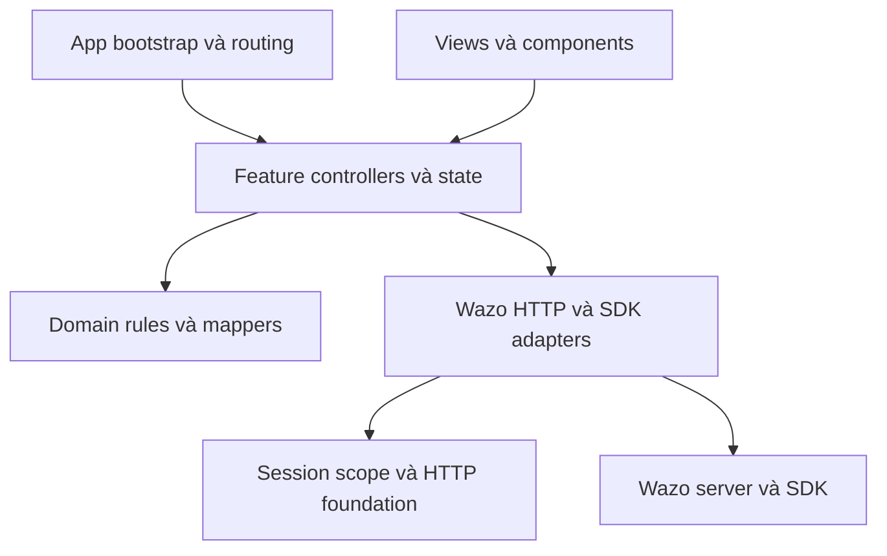

# Phương án refactor toàn dự án SmartCall Web

[Đánh giá chất lượng](12-code-quality-review-2026-11-19.md) · [Snapshot và giới hạn](14-incremental-review-snapshot-2026-11-19.md)

## Có làm được không, và có nên làm bây giờ không?

**Làm được. Quy mô 23 file trong `src` chưa lớn, nhưng luồng gọi WebRTC/hội nghị có độ phức tạp cao. Nên refactor theo từng miền ngay khi baseline nghiệp vụ được xác định; không nên thay toàn bộ kiến trúc trong một lần rồi chỉ kiểm tra bằng build.**

Phân biệt ba phạm vi:

- **Chuyển thư mục/đổi tên:** tương đối dễ, nhưng gần như không xử lý root cause của coupling/state/error.
- **Refactor kiến trúc có giữ hành vi:** đúng nhu cầu hiện tại; giữ Vue/Vite/Wazo và giao diện, tách ownership và contract.
- **Viết lại sản phẩm từ đầu:** rủi ro cao hơn, dễ làm mất edge cases, workaround SDK và hành vi Web–Android đã biết; chưa có lý do kỹ thuật đủ mạnh để chọn.

Thời điểm hiện tại có lợi vì backend/IdP mới chưa được tích hợp. Có thể chuẩn bị auth/session/adapter boundary để nhận dự án mẫu về sau. Chưa thể chốt giao thức SSO hoặc giả định frontend refactor thay thế backend RBAC/membership.

## Mục tiêu đo bằng kết quả

1. Sửa một nghiệp vụ không cần hiểu toàn bộ service Wazo trước.
2. View không tự xây URL/header Confd/Chatd/Calld hoặc tự normalize DTO.
3. Một state nghiệp vụ có một owner, command và selectors công khai.
4. Auth token, SIP registration, event socket và call status được phân biệt rõ.
5. Command server thất bại không trở thành thành công ở UI; partial result được biểu diễn.
6. Adapter SDK/HTTP có test riêng; domain logic có thể test qua import bình thường.
7. Mỗi bước có thể quay lui, không làm thay đổi API/header/protocol đang dùng khi chưa có lý do được xác nhận.

Không lấy số thư mục mới, số file được tách hoặc số class làm tiêu chí thành công.

## Cấu trúc đích đề xuất

Đây là cấu trúc theo feature với hạ tầng dùng chung nhỏ. Chỉ tạo thư mục/file khi thực sự có code; không tạo trước toàn bộ cây rỗng.

```text
src/
  app/
    App.vue
    main.js
    bootstrap.js
    router/
      index.js
    layout/
      AppHeader.vue
      AppSidebar.vue
    components/
      DebugLogDrawer.vue

  core/
    http/
      sessionHttpClient.js
      apiErrors.js
    session/
      sessionScope.js
      sessionStorage.js
    wazo/
      authApi.js
      directoryApi.js
      chatApi.js
      callLogApi.js
      callControlApi.js
      userServicesApi.js
      phoneAdapter.js
      eventSocket.js
    observability/
      logger.js

  features/
    auth/
      views/LoginView.vue
      state/authState.js
      services/authService.js
      mappers/userProfile.js
    calls/
      views/CallsView.vue
      components/
        Dialpad.vue
        ActiveCallPanel.vue
        IncomingCallModal.vue
        AddParticipantsModal.vue
      composables/useDialpad.js
      services/
        callController.js
        groupCallController.js
        recordingController.js
      state/callState.js
      domain/callStateMachine.js
    contacts/
      components/
        ContactsPanel.vue
        ContactListItem.vue
      composables/useContactFilters.js
      services/contactService.js
      state/contactState.js
      mappers/contact.js
      domain/presence.js
    messages/
      views/MessagesView.vue
      components/
        RoomList.vue
        MessageList.vue
        MessageComposer.vue
        GroupMembersModal.vue
      services/chatService.js
      state/chatState.js
      mappers/room.js
      mappers/message.js
    history/
      views/HistoryView.vue
      components/RecordingPlayer.vue
      services/historyService.js
      mappers/cdr.js
    settings/
      components/SettingsModal.vue
      components/AudioSettings.vue
      components/CallServiceSettings.vue
      composables/useMicrophoneMeter.js
      services/settingsService.js

  shared/
    components/
    utils/
      avatar.js
      duration.js
    styles/

  config/
    features.js

tests/
  unit/
  components/
  integration/
  e2e/
  fixtures/
```

Số file cuối cùng có thể tăng và vẫn là cải thiện nếu mỗi file có một trách nhiệm có ý nghĩa. Không cần chia mọi helper 5 dòng thành một file riêng. `shared` chỉ nhận code đã có nhu cầu dùng chung rõ; tránh biến nó thành nơi chứa toàn bộ nghiệp vụ không biết xếp ở đâu.

`recordingController` điều khiển ghi âm cuộc gọi; `RecordingPlayer` chịu trách nhiệm phát bản ghi. Hai vòng đời này cần phân biệt, dù có thể cùng dùng adapter call-log/media.

Không có feature pin/read trong cấu trúc mới. Các thao tác group membership đang bị chặn vẫn phải được phản ánh đúng trạng thái hỗ trợ; đổi folder không làm API đó xuất hiện.

## Chiều phụ thuộc



- Adapter không import Vue view hoặc service nghiệp vụ phía trên.
- `sessionScope` không import Wazo service hay feature controller.
- `eventSocket` chỉ quản lý transport, đăng ký và phân phối envelope. Xử lý room/message/presence/call nằm ở handler của feature.
- Các feature có thể dùng facade công khai của feature khác theo một chiều đã định. Ví dụ messages dùng command gọi điện và đọc selector danh bạ; contacts không import ngược messages/calls.
- Logout do app/session lifecycle phối hợp reset các feature. Không để auth service import mọi feature, rồi mọi feature lại import auth singleton.
- Header đọc selector auth/connection đã normalize; không dùng sự tồn tại token để kết luận SIP đã đăng ký.

Không cần DI container. Một hàm cấu hình hoặc factory nhận `getToken`, `getHost`, SDK adapter và callback cần thiết là đủ ở các boundary có lợi cho kiểm thử. Không biến mọi object thành interface trừu tượng khi chỉ có một implementation đơn giản.

## Phân công trách nhiệm mới

| Hiện tại | Đích refactor | Điểm cần giữ |
|---|---|---|
| `wazo.js`: auth/profile/token | authService + authState + authApi | Session ownership, refresh single-flight, lỗi thu hồi phiên. |
| `wazo.js`: SDK/SIP/audio stream | phoneAdapter + callController | Named listeners, cleanup, semantics accept/ended, thiết bị đã chọn. |
| `wazo.js`: group call | groupCallController + domain state | Call epoch, primary/secondary legs, timeout, merge ACK, hủy kết quả muộn. |
| `wazo.js`: websocket/presence commands | eventSocket + feature handlers | Event names và payload tương thích; phân biệt transport với policy. |
| `chatService.js` | chatApi + room/message mappers + chatState/controller | Envelope identity, session guard, selection và send failure; không phục hồi ghim/read. |
| `contactService.js` | directoryApi + mapper + presence domain + contactState | UUID/extension/source IDs, status priority, server confirmation favorites. |
| `historyService.js` | callLogApi + cdr mapper + history state | Inbound/outbound/missed, server CDR và record tạm không bị nhập nhằng. |
| `recordService.js` | recording control + media retrieval/cache | Stop HTTP ACK, start cancellation, cache owner/revoke; giới hạn memory được thiết kế riêng. |
| `CallsView.vue` | page composition + panel/modal + UI composables | Service vẫn là nơi quyết định được gọi; UI giữ input/filter/selection. |
| `MessagesView.vue` | room/message/composer/group UI | Giữ lựa chọn phòng sau tác vụ muộn; lỗi nhóm từng phần được biểu diễn. |
| `SettingsModal.vue` | modal composition + audio meter + settingsService | Loaded/dirty guard và partial save, cleanup mic. |
| `LoginView.vue` | form UI gọi auth command | Profile mapping/storage commit không rải giữa view và SDK service. |
| `App.vue` | shell và lifecycle coordinator | KeepAlive theo user, routing, global notifications và reset boundary. |

## Contract nên thống nhất trước khi di chuyển

- `UserProfile`: UUID người dùng, extension, displayName, department, trạng thái xác thực.
- `ConnectionState`: auth/session, SIP registration và websocket connection riêng biệt.
- `Contact`: UUID, directory contact ID, source, extension, displayName, department và presence đã normalize.
- `Call`: local operation ID, SIP session ID và server call ID riêng; state và hướng gọi rõ.
- `Room`/`Message`: ID, type, metadata quản trị có nguồn tin cậy, envelope sender, content và timestamp; không có read/pin fields.
- `CommandResult`: chọn quy ước thống nhất cho thành công, lỗi, hủy và kết quả từng phần. Tránh boolean vừa mang nghĩa trạng thái đích vừa mang nghĩa server thành công.

Có thể bắt đầu bằng JSDoc + JavaScript và runtime normalizers. Chuyển TypeScript từng module thuần nếu có nhu cầu; không buộc đổi toàn bộ ngôn ngữ trong cùng đợt. Pinia cũng không phải điều kiện bắt buộc: Vue reactive + composables có API rõ có thể đáp ứng quy mô hiện tại.

## Lộ trình thực hiện có thể kiểm tra

| Bước | Việc làm | Rủi ro tương đối | Điều kiện hoàn tất |
|---|---|---|---|
| 0. Đóng băng baseline | Chốt hành vi, xử lý CQ-BUG-01/02/03, ghi API/model hiện dùng | Vừa | Những trường hợp lỗi có regression test; biết rõ giới hạn membership/IdP. |
| 1. Tạo cổng kiểm tra | Test qua import thực, component smoke, lint/check-format, scripts CI | Thấp–vừa | Build và tests chạy lặp được; không dựa duy nhất vào regex nạp source. |
| 2. Tách module thuần | Normalizers, duration/avatar có quy ước, presence policy | Thấp | Kết quả mapping/policy giữ nguyên hoặc thay đổi được giải thích và kiểm thử. |
| 3. Tách hạ tầng | HTTP/auth provider, session storage, SDK adapter, event transport | Vừa–cao | Adapter không import feature; test header/timeout/abort/response và cleanup. |
| 4. Contacts/history/settings/auth | API → mapper → state/controller → view | Vừa | Các miền đã tách không tạo cycle mới; lỗi API không báo thành công giả. |
| 5. Tách UI | Panel/modal/composer/player; page chỉ phối hợp | Vừa | Props/emits rõ, không tạo state nghiệp vụ trùng; KeepAlive vẫn đúng. |
| 6. Chat | Room/message controller, state và paging strategy | Vừa–cao | Send/receive/direct room/closed room và đổi phiên đạt; không mở lại pin/read. |
| 7. Calls và group | Đưa lifecycle thành state machine/controller; gom SDK workaround | Cao | Test SIP/media thật: answer/reject/hangup, phụ nghe trước, timeout, merge thất bại và cancel. |
| 8. Gỡ tương thích cũ | Xóa facade/alias/dead code sau khi hết caller; profiling | Vừa | Không còn import cũ, cycle cũ hoặc event giữ state trùng; measured regressions không vượt ngưỡng đã chốt. |

Các bước là dependency roadmap, không phải cam kết lịch. Quy mô code cho phép làm, nhưng thời gian phụ thuộc staging, số hành vi cần giữ, SDK/Android và mức kiểm thử được bổ sung. Không đủ căn cứ hứa hoàn tất trong một số giờ cố định.

## Cách giữ hoạt động trong khi chuyển đổi

1. Mỗi thay đổi tập trung một responsibility. Tách code đang chạy trước, sửa policy riêng khi cần, tránh vừa move vừa viết lại mọi logic.
2. Giữ import path/facade cũ tạm thời để caller chưa chuyển vẫn hoạt động. Facade chỉ forward; module mới không import ngược facade cũ, nếu không sẽ giữ nguyên cycle.
3. Việc đổi API wrapper phải bảo toàn header, endpoint, signal và error semantics trước khi chuẩn hóa hành vi đã được quyết định rõ.
4. SDK workaround như chặn auto-hold và truy cập `currentSipSession` phải được cô lập, ghi lý do và kiểm tra với phiên bản SDK đang lock. Không xóa chỉ vì là code nội bộ; cũng không coi nó là API ổn định lâu dài.
5. Không chạy song song hai call controller/socket owner thật trong sản phẩm để “so sánh”, vì có thể tạo lệnh gọi và subscription trùng.
6. Sau mỗi phần: kiểm tra import direction, tests liên quan, build và smoke tương ứng. Thay đổi media/call phải có staging phù hợp.
7. Chỉ commit phần hoàn chỉnh có thể quay lui. Chưa thực hiện branch/commit/push trong lượt phân tích này.

## Các kịch bản bắt buộc trước khi kết thúc toàn bộ refactor

- Auth: login/restore/refresh, lỗi token, logout và đổi tài khoản khi request còn pending.
- Contacts: schema object/table, favorites thành công/lỗi, presence websocket và polling, lọc/search.
- Chat: gửi/nhận realtime, HTTP lỗi, đổi phòng khi đang gửi, direct-room resolution, thiếu metadata quản trị và nhóm đã đóng.
- Calls: outgoing/incoming, không mic/quyền bị từ chối, busy/offline/DND/self, kết thúc trong lúc SDK còn pending.
- Group call: nhánh phụ nghe trước, chính rời, secondary timeout, conference trả muộn, merge bị từ chối và cleanup server.
- Recording: start/stop/mất phản hồi, hủy start, file thực trên CDR, phát audio trả ngược thứ tự và chuyển route.
- Settings: thay audio không ghi dịch vụ chưa tải, partial save và cleanup meter.
- Routing/KeepAlive: không lặp listeners/timers/controller khi chuyển màn hình hoặc đổi user.

“Build thành công” là một cổng cần thiết; không phải điều kiện đủ để kết luận refactor thoại/media thành công.

## Việc chưa nên làm cùng đợt

- Đổi framework, cập nhật major SDK, thay toàn bộ UI và đổi JS sang TS đồng thời.
- Tự xây backend/SSO khi chưa có contract dự án mẫu.
- Tạo microfrontend, event bus cho mọi mutation hoặc repository/interface cho mọi hàm đơn giản.
- Dùng việc chuyển file để tuyên bố backend RBAC/membership hoặc trạng thái server đã được giải quyết.
- Đưa lại ghim, receipt hoặc tính năng đã được người dùng loại khỏi sản phẩm.

Khuyến nghị lựa chọn: **refactor toàn dự án theo đích rõ ràng, triển khai tăng dần và kiểm chứng từng miền**. Cách này đáp ứng mục tiêu làm lại cấu trúc mà vẫn bảo toàn phần nghiệp vụ đã tích lũy.
