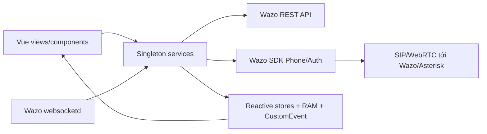

# Hiểu dự án và đối chiếu tài liệu

> **Tài liệu lịch sử.** Nội dung phản ánh thời điểm ghi nhận. Đường dẫn code, số liệu và đề xuất có thể đã thay đổi.

Ngày 19/11/2026. [Tổng kết](08-executive-summary.md) · [Findings](03-bugs-and-logic-findings.md) · [Coverage](09-audit-coverage.md).

## Sản phẩm và người dùng

SmartCall Web là client truyền thông nội bộ doanh nghiệp: đăng nhập Wazo, danh bạ/presence, gọi thoại và hội nghị ad-hoc, nhắn tin 1-1/nhóm, CDR, ghi âm/phát lại, cài đặt thiết bị và dịch vụ cuộc gọi. Người dùng mục tiêu là nhân viên/công nhân công ty. Dữ liệu hiện được lấy từ các tài khoản Wazo; tính thật của hồ sơ nhân sự không thể xác nhận từ frontend.

Người dùng đã xác nhận hướng mới Python + SQLite + SingleIdAuth và API chat cho Android dùng sau. Chưa có dự án mẫu IdP, chưa giao rõ người cấu hình Wazo–IdP. Đây là phần **planned/blocked bởi hợp đồng tích hợp**, không đánh giá như feature hiện hành đã hứa hoàn tất. Logout Web–App từng nêu được tạm gác vì người dùng hiện không tái hiện; không quy kết sự cố đó vẫn xảy ra.

## Tech stack được xác minh

| Thành phần | Actual |
|---|---|
| Framework | Vue 3, Composition API với script setup |
| Ngôn ngữ | JavaScript, Vue SFC, CSS; không TypeScript trong application |
| Build | Vite; alias @ tới src; plugin Vue và Vue DevTools |
| Routing | Vue Router, history mode, lazy Calls/Messages/History, login import trực tiếp |
| State | callStore/recordStore reactive; singleton classes, local refs và window CustomEvent; không Pinia/Vuex |
| API | fetch trực tiếp và Wazo SDK; REST token header; WebSocket events và SIP over WSS |
| Dependencies khai báo | vue ^3.5.42, router ^5.3.1, SDK ^0.49.11, vite ^8.2.2 |
| Lockfile | Vue 3.5.45, Router 5.5.0, SDK 0.49.11, Vite 8.3.8 |
| UI/validation | HTML/CSS/SVG tự xây, kiểm tra thủ công; không library UI/schema validation trong direct dependencies |
| Backend/database trong runtime source | Không có Python backend hay SQLite implementation |
| Checks | dev/build/preview/format; không script test/lint/typecheck |

## Module inventory

| File/nhóm | Trách nhiệm và entry |
|---|---|
| index.html → src/main.js | Mount app, global Vue error handler và unhandledrejection logger |
| src/App.vue | Auth/layout state, KeepAlive theo user+route, accept/reject incoming, toast/settings/log drawer |
| src/router/index.js | /login, /calls, /messages, /history, redirects và auth/feature UI guard |
| src/config/features.js | Feature config localStorage, default mockData=false, migration cấu hình cũ |
| src/services/wazo.js | SDK Auth, restore/refresh/heartbeat, WebSocket, SIP listeners, callStore, group bridge/mapping/timers |
| contactService.js | Dird mapping/favorites, presence REST/polling/event, statusOf, availability |
| chatService.js | Rooms/messages, optimistic send, tag parser, metadata, thay thành viên/tombstone, pin |
| historyService.js | CDR fetch/map/filter, merge bản ghi RAM, single-flight và refresh/reset |
| recordService.js | Calld start/stop/pause/resume, recordStore, tải blob media, URL cache |
| audioService.js | Oscillator ringtone/ringback/DTMF và dừng tone |
| websocketService.js | Pub/sub wrapper dùng socket của WazoService |
| loggerService.js | Reactive ring buffer 250 entries, console, export text |
| LoginView.vue | Login/reset-password UI, timeout, profile mapping và fallback |
| CallsView.vue | Dialpad, contacts/filter/favorites, group selection, call controls, recording, route autocall |
| MessagesView.vue | Room selection, chat, group/member modals, read info, direct route, voice-call dispatch |
| HistoryView.vue | CDR filters/counts, callback/chat, audio playback/download |
| IncomingCallModal.vue | Incoming UI, ringtone và timeout30s, emits cho App |
| SettingsModal.vue | Device enumeration/meter, feature config, DND/forwards, password, preferences |
| AppHeader.vue/AppSidebar.vue | Profile/presence/status, navigation, unread badges |
| DebugLogDrawer.vue | Hiển thị/copy/xóa logger dùng chung |
| src/assets/main.css | Base style; style phần lớn ở SFC |

Không có thư mục composables/stores/types riêng; không mặc định đó là thiếu sót tự nó. public là icon/static assets. FileQuest là mã/tài liệu tham chiếu, không được import vào application runtime.

## Kiến trúc và luồng dữ liệu

### Business-critical flows đã truy vết

| Flow | Expected | Các module/cổng kiểm tra |
|---|---|---|
| Login/refresh/restore | Xác thực, map UUID/máy lẻ, tái lập phone; không lẫn user | LoginView → wazo Auth → App/router → services reset |
| Dial trực tiếp/callback/chat | Chặn self/busy/ringing/DND/offline, mic; signal thật | Calls/History/Messages → route → validateAndMakeCall → SDK |
| Incoming | Reject khi bận; answer/fail/end theo session; duration đúng | SDK handlers → callStore → App/Incoming modal |
| Group | Host mời, timeout từng leg, merge talking_to, cleanup | Calls/Messages → group API → SDK/events → Calld bridge |
| Directory | UUID/ext/name chuẩn, availability, favorites theo server | ContactService → Dird/presence → Calls và chat lookup |
| Messaging | Room đúng người, ack đúng kết quả, reset/route không stale | Messages ↔ ChatService ↔ Chatd REST/WS |
| Membership | Admin đúng quyền, lịch sử theo policy, không partial migration | Member modal → create/remove/add/close tags |
| CDR/recording | Server facts, duration/direction đúng, stop thật, playback đúng bản | Wazo finalize → history/record → HistoryView |
| Settings | Lưu đúng nhóm đã sửa, không đổi dịch vụ ngoài ý muốn | Settings → media/Confd/Auth |
| Đổi user | State/cache/request cũ không vượt session boundary | logout/reset → singleton callbacks + KeepAlive |

## Documentation inventory và mức áp dụng

| Tài liệu | Purpose / trạng thái / yêu cầu quan trọng |
|---|---|
| GEMINI.md | Quy tắc hiện có: read/review-first, main dữ liệu Wazo thật, zero persistent business data, SSOT/lifecycle; hướng backend mới là thay đổi scope người dùng xác nhận |
| doc/README.md | Template Vue/Vite, cũ so với nhu cầu vận hành UC |
| doc/HUONG_DAN_TRIEN_KHAI_TUNG_BUOC.md | Nhật ký lịch sử đến bước76; ưu tiên bước75–76 cho code hiện tại, phần đầu mô tả mock/dashboard đã cũ |
| doc/KIEN_TRUC_VA_LUONG_HOAT_DONG_CHI_TIET.md | Kiến trúc/flow/FAQ; có giả định localStorage và bảo đảm “không thể xảy ra” chưa còn đúng |
| doc/GIAI_THICH_CHI_TIET_SERVICES.md | Giải thích service cũ; số phương thức, trạng thái và API timeout không khớp hoàn toàn |
| doc/GIAI_THICH_CHI_TIET_VIEWS.md | UI/route/lifecycle hướng dẫn cũ; query/timer/device handling có sai lệch |
| doc/BAO_CAO_RA_SOAT_CODEBASE_ONBOARDING.md | Snapshot onboarding, lazy-load và global errors; kết quả build là lịch sử |
| doc/SMARTCALL_EXPERT_AUDIT_REPORT.md | Audit bản Mock, không áp findings trực tiếp lên main |
| doc/SMART_CALL_WEB_ANALYSIS_AND_ROADMAP.md | Roadmap từ mock tới Wazo/HR, planned/historical |
| doc/TONG_HOP_TOAN_BO_API_DA_CALL.md | Danh mục API cũ, cần bổ sung Calld/ghi âm/group mới |
| doc/WAZO_API_REFERENCE.md và FileQuest/wazo_api_reference.md | Catalog endpoint Wazo, tra phần Auth/SAML/Chatd/Dird/Confd/Calld/Call-logd; không phải schema/live ACL đã kiểm nghiệm |
| FileQuest/dev_guide.md | Hướng dẫn tích hợp; có ghi rõ endpoint cần kiểm tra spec |
| specs/architecture/plan.md | Kế hoạch ghi chờ phê duyệt, stack phiên bản cũ; không coi “đạt100%” là verification |
| doc/walkthrough.md | Tooling Antigravity, không business spec |
| doc/PHAN_TICH_IDP_BACKEND_CHAT_WEB_ANDROID_2026-11-19.md | Tổng hợp yêu cầu mới trước đợt audit; giữ nguyên file, không dùng findings snapshot trước làm kết luận mới |

## Documentation vs implementation

1. CDR localStorage trong tài liệu cũ đã được loại khỏi source ở bước75. Không lặp lại như lỗi hiện hành.
2. Bước75 ghi sendMessage lỗi đã xử lý: đúng ở service; command delete/rename vẫn không kiểm tra sendFailed (BUG-007).
3. Bước76 giữ primary khi secondary accepted: có guard mới; secondary nghe trước vẫn không tạo clock và ON_PROGRESS vẫn thay aggregate status (BUG-005).
4. Quy tắc không có mock vẫn còn enterOfflineMode, fake token và fallback1001/1007 trong main; default mockData=false nên không kết luận mặc định người dùng thấy mock. Fallback máy lẻ gây lỗi thật ở BUG-008.
5. Tài liệu mô tả chọn output/setSinkId nhưng source chỉ lưu ID/test meter, BUG-009.
6. Hướng API server-first không tương ứng pin chỉ RAM, read receipt suy đoán và tag text; LOGIC-001/002.
7. “Chuyển toàn bộ lịch sử” mâu thuẫn slice(-25), LOGIC-002; dữ liệu cũ chưa chắc bị xóa vật lý.
8. Kế hoạch Router4/Vite5 khác lockfile Router5/Vite8. Không đánh giá phiên bản mới tự nó là bug.
9. SingleIdAuth/backend Python chưa có contract mẫu; đánh dấu planned, không invent REST-to-token exchange hay đọc cookie cổng khác.

Giới hạn đọc tài liệu lịch sử và code tham chiếu được liệt kê tại [09](09-audit-coverage.md).
