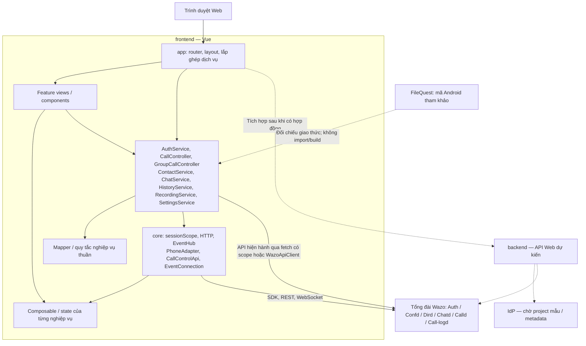
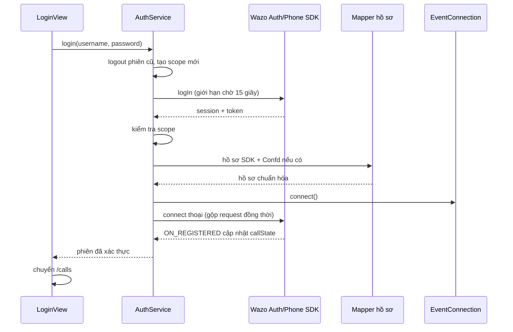

# Kiến trúc SmartCall Web sau refactor

Ngày: 19/11/2026. Phạm vi: bản clone `Smart_Call_Web_Refactor`, nhánh `codex/refactor-architecture`.

## 1. Mô hình tổng thể



Mũi tên trong sơ đồ tổng thể mô tả luồng tương tác, không phải toàn bộ import. Hiện Web vẫn kết nối Wazo như bản cũ. Backend và IdP trong nét đứt **chưa được triển khai**.

## 2. Nguyên tắc tổ chức

- **Theo tính năng:** vào `features/messages` để tìm luồng chat, thay vì tìm lẫn trong một thư mục services chung.
- **Theo trách nhiệm trong từng tính năng:** view/component hiển thị; composable quản lý vòng đời UI; service/controller điều phối; mapper chuyển dữ liệu; state giữ trạng thái.
- **Một nơi lắp ghép:** `app/createServices.js` tạo các đối tượng và truyền dependency. `app/services.js` nạp SDK thật và cung cấp instance cho giao diện.
- **Hạ tầng dùng chung:** core không import app hoặc feature. Callback nghiệp vụ được truyền vào EventConnection; transport không tự hiểu phòng chat/hội nghị.
- **Giữ vừa đủ tầng:** chưa thêm repository/interface rỗng hoặc Pinia chỉ để tạo thêm cấu trúc. Đây là SPA có một người dùng hoạt động trong mỗi tab; state module không được thiết kế cho SSR hay nhiều phiên trong cùng runtime.

## 3. Cây thư mục hiện hành

```text
Smart_Call_Web_Refactor/
├── frontend/
│   ├── public/
│   ├── src/
│   │   ├── app/
│   │   │   ├── App.vue
│   │   │   ├── main.js
│   │   │   ├── createServices.js
│   │   │   ├── services.js
│   │   │   ├── router/index.js
│   │   │   ├── layout/{AppHeader,AppSidebar}.vue
│   │   │   └── components/DebugLogDrawer.vue
│   │   ├── core/
│   │   │   ├── session/{sessionScope,userSessionState}.js
│   │   │   ├── http/{WazoApiClient,ApiError}.js
│   │   │   ├── events/EventHub.js
│   │   │   ├── wazo/{PhoneAdapter,CallControlApi,EventConnection}.js
│   │   │   ├── audio/CallToneService.js
│   │   │   └── logging/LoggerService.js
│   │   ├── features/
│   │   │   ├── auth/
│   │   │   │   ├── views/LoginView.vue
│   │   │   │   ├── services/AuthService.js
│   │   │   │   └── mappers/userProfile.js
│   │   │   ├── calls/
│   │   │   │   ├── views/CallsView.vue
│   │   │   │   ├── components/{DialerPanel,IncomingCallModal}.vue
│   │   │   │   ├── services/{CallController,GroupCallController,RecordingService}.js
│   │   │   │   ├── services/{phoneEventHandlers,handleWazoEvent}.js
│   │   │   │   ├── state/{callState,groupCallState,recordingState}.js
│   │   │   │   └── domain/callPolicy.js
│   │   │   ├── contacts/
│   │   │   │   ├── services/ContactService.js
│   │   │   │   ├── mappers/contactMapper.js
│   │   │   │   └── composables/useContactFilters.js
│   │   │   ├── messages/
│   │   │   │   ├── views/MessagesView.vue
│   │   │   │   ├── components/{MessageList,MessageComposer}.vue
│   │   │   │   ├── services/ChatService.js
│   │   │   │   └── utils/formatMessageDateTime.js
│   │   │   ├── history/
│   │   │   │   ├── views/HistoryView.vue
│   │   │   │   ├── services/HistoryService.js
│   │   │   │   ├── mappers/callHistoryMapper.js
│   │   │   │   └── composables/useRecordingPlayer.js
│   │   │   └── settings/
│   │   │       ├── components/SettingsModal.vue
│   │   │       ├── services/SettingsService.js
│   │   │       └── composables/useMicrophoneMeter.js
│   │   ├── shared/
│   │   │   ├── styles/main.css
│   │   │   └── utils/avatar.js
│   │   └── config/features.js
│   ├── tests/{unit,components,helpers}/
│   ├── scripts/check-architecture.mjs
│   ├── package.json
│   ├── package-lock.json
│   ├── vite.config.js
│   ├── vitest.config.js
│   ├── eslint.config.js
│   ├── jsconfig.json
│   ├── .prettierrc.json
│   ├── .env.example
│   └── index.html
├── backend/README.md
├── doc/refactor/
│   ├── ARCHITECTURE.md
│   ├── DEVELOPMENT_GUIDE.md
│   ├── IMPLEMENTATION_PROMPT.md
│   ├── PROGRESS.md
│   └── VERIFICATION.md
├── FileQuest/
├── AGENTS.md
├── README.md
└── package.json                  # Lệnh chuyển tiếp vào frontend
```

Dấu ngoặc nhọn chỉ rút gọn danh sách tên file, không phải tên thư mục thật. `.env`, `node_modules`, `dist`, cache đối chiếu được ignore. Các tài liệu/spec lịch sử còn được giữ tại gốc.

## 4. Chủ sở hữu và hợp đồng chính

| Thành phần | Sở hữu / trách nhiệm |
| --- | --- |
| AuthService | Token, hồ sơ, refresh, kiểm tra/thu hồi phiên; điều phối cleanup khi logout |
| userSessionState | UUID, máy lẻ, tên, phòng ban của người dùng Web |
| CallController / callState | Cuộc gọi hiện tại, gọi đến, dialing, đăng ký SIP, đồng hồ, lệnh SDK |
| GroupCallController / groupCallState | Chủ nhóm, thành viên, Map nhánh gọi, hội nghị, timer lời mời |
| RecordingService / recordingState | Start/stop ghi âm phía server và cache URL media trong phiên |
| ContactService.state | Danh bạ reactive, presence, danh sách yêu thích |
| ChatService.state | Phòng/tin nhắn reactive; lệnh quản trị và kết quả API |
| HistoryService | CDR tải từ server và bản ghi vừa kết thúc trong RAM |
| SettingsService | Đọc/ghi Confd và xác nhận từng phần; không sở hữu input của modal |
| Composable UI | Microphone meter, audio player, bộ lọc; có cleanup theo vòng đời |
| EventConnection | Một socket, trạng thái kết nối và timer reconnect |
| EventHub | Phân phối sự kiện nội bộ; không phải nơi giữ dữ liệu nghiệp vụ |

Giao diện danh bạ/phòng chat đọc state qua computed, không giữ bản sao mảng rồi chờ window event để đồng bộ. Hội nghị giữ SIP session trong shallowReactive Map để không bọc sâu đối tượng SDK.

## 5. Luồng dễ theo dõi

### Đăng nhập và khôi phục



AuthService chờ SDK logout cũ hoàn tất trước login mới; CallController cũng đợi disconnect cũ trước connect. SDK 0.49.11 thay đổi state nội bộ sau await nên chỉ xóa state Web là chưa đủ.\n\nThành công xác thực và sẵn sàng thoại là hai trạng thái khác nhau. Lỗi kết nối thoại không giả lập ON_REGISTERED. Token khôi phục bị từ chối được xóa nếu vẫn thuộc thế hệ phiên đang khôi phục.

### Gọi điện

`CallsView → CallController.startCall → callPolicy → ContactService/SDK → phoneEventHandlers → callState`.

Controller kiểm tra số rỗng, gọi chính mình, contact/status, thiết bị và khóa quay số; giữ khóa trong cả thời gian lookup. `answering` chờ SDK xác nhận rồi mới chuyển `connected`. GroupCallController xử lý nhánh/hội nghị riêng; CallControlApi chứa lệnh REST Calld. Kết thúc gọi đi qua một đường cleanup chung.

### Chat và thay đổi dữ liệu

`MessagesView → ChatService → API → ACK → rooms reactive → MessageList`.

MessageComposer chỉ phát ý định gửi, xử lý Enter/IME và kích thước input. Không có ghim hoặc receipt/read. Đóng nhiều nhóm trả `{ deletedIds, failures }`; nhóm lỗi vẫn còn được chọn. Hoàn tất gửi ở phòng A không đổi lựa chọn đang ở phòng B. Tên `publishRoomsChanged` thể hiện cập nhật RAM/sự kiện, không giả vờ lưu dữ liệu vào localStorage.

### Sự kiện thời gian thực

`Wazo WebSocket → EventConnection → callback handleWazoEvent → controller/EventHub → service/state → Vue`.

Protocol subscribe/start và metadata cuộc gọi nhóm đang dùng được giữ. Android chỉ giúp đối chiếu protocol, không quyết định cấu trúc phần mềm Web.

## 6. sessionScope và các thế hệ

`sessionScope.js` là hàng rào cho tác vụ bất đồng bộ:

- `captureSessionContext()`: chụp epoch và UUID đang hoạt động.
- `isSessionContextCurrent()`: kiểm tra tác vụ còn thuộc đúng phiên.
- `assertSessionContext()`: ném StaleSessionError nếu phiên đã đổi.
- `invalidateSession()`: tăng epoch, abort fetch đang được quản lý.
- `createSessionFetch()`: kiểm tra trước/sau request và sau khi đọc JSON/blob/text.

Ví dụ: A đang tải phòng, logout rồi B đăng nhập; response của A đến sau không được ghi vào rooms của B. Việc refresh token cùng phiên không tự tăng epoch. Thế hệ cuộc gọi, request lịch sử, player và microphone giải quyết tranh chấp trong cùng phiên. Callback SDK còn được ràng buộc với thế hệ listener để không chạy sau disconnect.

Đây là cơ chế giữ tính nhất quán phía Web; server vẫn phải kiểm tra quyền và credential cho từng API. Abort của fetch không có nghĩa SDK cũng hỗ trợ hủy request nội bộ.

## 7. Mở rộng và giới hạn thực tế

Cấu trúc này phù hợp quy mô hiện tại và cho phép thêm feature qua cùng luồng. Các controller hội nghị/chat và trang Calls/Messages vẫn có nhiều nghiệp vụ/CSS; chúng chưa trở thành những file nhỏ hoàn toàn. Tách thêm nên theo luồng thực tế và kiểm chứng với tổng đài, tránh chia cơ học theo số dòng.

Chưa có phân trang đầy đủ cho mọi danh sách, chưa đo tải lớn, chưa tối ưu bundle SDK và chưa kiểm chứng media thật. WazoApiClient hiện dùng cho SettingsService; các dịch vụ cũ còn dùng createSessionFetch để giữ nguyên hợp đồng API. Có thể chuyển dần sang client chung khi chỉnh từng luồng, không cần thay toàn bộ transport trong một lượt.

SSO/IdP, API backend và membership/RBAC cần hợp đồng server. Xem [backend](../../backend/README.md) và [kiểm chứng](VERIFICATION.md).
