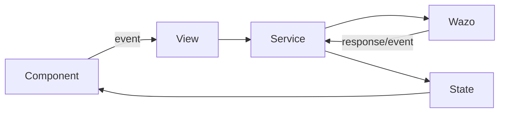

# Kiến trúc Web và cấu trúc dễ đọc

Cập nhật 25/11/2026. ContactService dùng FastAPI để tìm kiếm toàn nguồn và giữ một trang 30 kết quả. CallGroupsView dùng nhóm cá nhân lưu SQLite. Các đoạn ChatService/ContactsPanel cũ trong tài liệu phản ánh phiên bản trước khi đổi luồng. [Danh bạ và nhóm gọi hiện hành](KE_HOACH_DANH_BA_VA_NHOM_GOI.md).

Cập nhật: 20/11/2026. Tài liệu hiện hành sau lượt đơn giản hóa. Bản gốc đã được push riêng lên main tại 5d5fe3e; những thay đổi mô tả ở đây chỉ thuộc clone.

## Mô hình chính

View nhận thao tác/điều hướng, component trình bày và phát sự kiện, service xử lý nghiệp vụ và SDK/API, state reactive làm Vue vẽ lại. Không dùng một folder riêng cho từng lớp khái niệm.



## Cây source hiện hành

```text
frontend/src/
├── assets/
│   └── main.css
├── components/
│   ├── call/
│   │   ├── ActiveCallPanel.vue
│   │   ├── AddParticipantModal.vue
│   │   ├── DialerPanel.vue
│   │   └── IncomingCallModal.vue
│   ├── common/
│   │   ├── DebugLogDrawer.vue
│   │   └── SettingsModal.vue
│   ├── contacts/
│   │   ├── ContactCard.vue
│   │   └── ContactsPanel.vue
│   ├── layout/
│   │   ├── AppHeader.vue
│   │   └── AppSidebar.vue
│   └── messages/
│       ├── MessageComposer.vue
│       └── MessageList.vue
├── composables/
│   ├── useContactFilters.js
│   ├── useMicrophoneMeter.js
│   └── useRecordingPlayer.js
├── config/
│   └── features.js
├── router/
│   └── index.js
├── services/
│   ├── audio/
│   │   ├── audioService.js
│   │   ├── recordingService.js
│   │   └── wazoPhone.js
│   ├── auth/
│   │   ├── authService.js
│   │   ├── sdkAuthenticationGate.js
│   │   └── sessionScope.js
│   ├── calls/
│   │   ├── callApi.js
│   │   ├── callService.js
│   │   ├── groupCallService.js
│   │   └── phoneEvents.js
│   ├── common/
│   │   ├── apiClient.js
│   │   └── loggerService.js
│   ├── data/
│   │   ├── chatService.js
│   │   ├── contactService.js
│   │   ├── historyService.js
│   │   └── settingsService.js
│   ├── realtime/
│   │   ├── eventBus.js
│   │   ├── wazoEventHandler.js
│   │   └── wazoEvents.js
│   ├── createServices.js
│   └── index.js
├── state/
│   ├── callState.js
│   └── sessionState.js
├── utils/
│   ├── avatar.js
│   ├── callHistoryMapper.js
│   ├── callPolicy.js
│   ├── contactMapper.js
│   ├── formatMessageDateTime.js
│   └── userProfile.js
├── views/
│   ├── CallsView.vue
│   ├── HistoryView.vue
│   ├── LoginView.vue
│   └── MessagesView.vue
├── App.vue
└── main.js
```

## Chủ sở hữu

| Phần | Chủ sở hữu | Giao diện đọc/gửi lệnh |
| --- | --- | --- |
| Phiên và hồ sơ | AuthService + userSessionState | LoginView, App, Header |
| Thoại một nhánh và kết nối SIP | CallService + callState | CallsView |
| Hội nghị và nhánh phụ | GroupCallService.state | CallsView/AddParticipantModal |
| Ghi âm | RecordingService + recordingState | CallsView/ActiveCallPanel |
| Danh bạ | ContactService.state | ContactsPanel qua props |
| Tin nhắn | ChatService.state | MessagesView/MessageList |
| CDR | HistoryService | HistoryView |
| Mic preview/player | Composable của component | Settings/History |

## Điểm nối và ranh giới

- services/index.js dùng SDK thật; createServices.js lắp dependency cho app hoặc test. Không phải container/framework mới.
- Service nghiệp vụ không import index/createServices hoặc giao diện. State/helper thuần không import ngược service. Architecture checker kiểm tra các ranh giới này, import thiếu, cycle, HTTP trong Vue và identifier của tính năng đã bỏ.
- Không có vòng import tĩnh không đồng nghĩa không còn phụ thuộc lúc chạy. CallService/GroupCallService vẫn phối hợp; điểm nối và cleanup cần rõ ràng.
- Tác vụ HTTP giữ context qua response/body. SDK Auth có gate riêng vì timeout không hủy side effect nội bộ SDK.
- phoneEvents nhận event SDK; wazoEvents sở hữu socket; wazoEventHandler phân loại và xác thực event server. EventBus chỉ phân phối nội bộ.
- callState.js chứa state gọi/ghi âm và factory state nhóm. Map chứa SIP session dùng shallowReactive.

## Các luồng để lần theo

1. Gọi: DialerPanel → CallsView → CallService.startCall → requestSdkCall → SDK → phoneEvents → callState → ActiveCallPanel.
2. Mời người: AddParticipantModal → CallsView → GroupCallService → CallControlApi hoặc ADD_REQ cho host.
3. Danh bạ: CallsView → ContactService → Dird/presence → mapper → reactive state → ContactsPanel/ContactCard.
4. Chat: MessageComposer → MessagesView → ChatService → Chatd → proxy tin nhắn → MessageList.
5. Logout: AuthService → invalidate scope/SDK gate/cleanup → xóa token/cache → App bỏ private view.

## Quyết định và giới hạn

53 file, 20 thư mục dưới src, tối đa hai tầng thư mục. Không cố giảm số file bằng cách đưa tất cả vào wazo.js; thay vào đó giảm tầng và tách UI thành các khối người dùng nhận ra. CallsView không sở hữu bộ lọc danh bạ, markup một liên hệ hoặc lựa chọn modal.

Các selector CSS gọi điện được đặt trong namespace .calls-view và giữ đủ rule khi tách; không làm CSS rò sang trang khác. CallsView/MessagesView/Settings vẫn còn một số phần có thể làm gọn theo nhu cầu thật. Không coi đợt này là tối ưu hiệu năng hoặc hoàn tất mọi thiết kế.

Backend đã triển khai OIDC Single ID và cấp tài khoản Wazo qua FastAPI; cần cấu hình .env và kiểm chứng IdP/Wazo thật. Xem [hướng dẫn vận hành backend](../../backend/doc/README.md). Đóng nhóm là giao thức Web, không thay API membership/ACL server. Cần thử Wazo/Android thật trước khi dùng thay bản chính.

Xem [hướng dẫn đầy đủ](../HUONG_DAN_FRONTEND_CHO_NGUOI_MOI.md), [kiểm chứng](VERIFICATION.md) và [nhật ký](PROGRESS.md).

## Nhóm service hiện hành

services/auth (phiên), calls (thoại/hội nghị), audio (âm thanh/thiết bị/ghi âm), realtime (socket/event), data (danh bạ/chat/CDR/cấu hình Wazo), common (HTTP/log). Chỉ có một cấp nhóm. index.js/createServices.js tiếp tục là điểm lắp ghép chung.

## Comment phục vụ người mới

Hàm/method/getter/computed có phần giải thích công việc trước khai báo. Kiểm tra quan trọng có comment ngắn trong thân hàm: context/thế hệ, ID cuộc gọi/hội nghị, quyền, ACK HTTP và cleanup. Không thay đổi hành vi khi thêm comment; đối chiếu AST và template/style riêng với snapshot.

## Đồng bộ hành vi mới — 20/11/2026

GroupCallService giữ host là người gọi ban đầu; người nhận gửi ADD_REQ. CallService xử lý SDK/lifecycle nhánh, wazoEventHandler phân biệt chuyển kênh với rời hội nghị. Hàng đợi sự kiện lúc ghép thuộc GroupCallService và được dọn theo thế hệ cuộc gọi.

ChatService sở hữu bộ đếm reactive và cache metadata tạm theo host/UUID; Sidebar/MessagesView chỉ đọc state và báo phòng đang xem. Đây là ngoại lệ localStorage do người dùng yêu cầu, không phải read receipt hoặc lưu nội dung chat. Tiếng phím HTMLAudio được giữ trong CallToneService, không tạo AudioContext trong handler nhập.

Xem [bản sửa và giới hạn](LATEST_FIXES_2026-11-20.md). Cây thư mục và ranh giới import giữ nguyên.


## Backend xác thực — cập nhật 20/11/2026

LoginView → backend /api/auth/login → IdP → backend callback → CallbackView → backend wazo-session → AuthService.validateSdkSession → completeAuthenticatedSession dùng chung bootstrap mật khẩu. Backend gồm config, store (Redis/SQLite), oidc, wazo, main; không đưa mã Android vào runtime. JWT/Origin/CSRF/session expiry được xác minh trước cấp phát. Identity issuer/sub/tenant liên kết Wazo UUID, không lưu password/token trong SQLite. Nguồn nhân sự là IdP, nguồn UUID/line/máy lẻ là Wazo.
